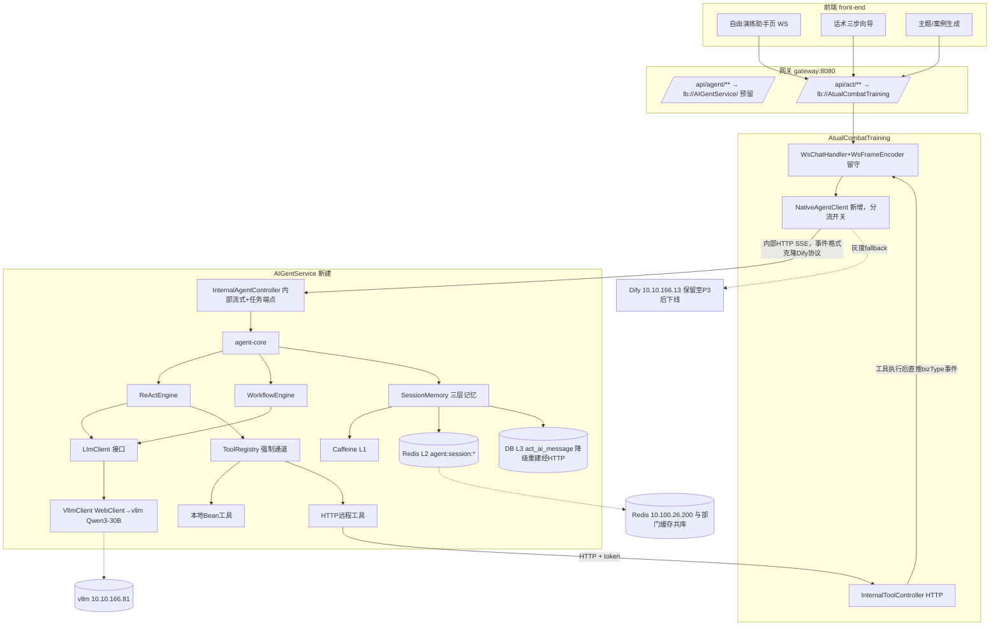

# Dify 智能体迁移 AIGentService 技术实现方案

> **实施状态（2026-10-23）：P2 与 P3 六个 workflow 已实施**——WorkflowEngine、
> 主题/案例生成、场景/大纲/话术、两个评分任务和 ModelScope 文生图均有 native 入口；
> Dify 保留 fallback。运行加固已实现内部 token、Prometheus 指标和 L1/L2/L3 记忆；
> 最终取舍见 `07-P2-P3实施记录与偏差.md`、`08-运行加固实施记录与偏差.md`。

> 版本：v1.0 ｜ 日期：2026-10-10 ｜ 配套：01-需求文档.md、03-接口文档.md
> 工程基线：after-end 微服务族（Spring Boot 4.x / gateway:8080 / final_dream@10.100.26.200）；
> AIGentService 本身不依赖 Nacos discovery/MySQL/Dubbo。

---

## 1. 整体架构



要点：
- **前端零改动的落地方式（事实修正）**：前端会话协议实证为 **WS 帧协议**（WsChatHandler `/api/act/ws/chat` + WsFrameEncoder 事件帧，工具 bizType 事件以 data part 交织在助手消息 part 序列内）——WS 端点、帧编码、消息落库（act_ai_messages）、工具事件推送**全部留守 AtualCombatTraining**；AIGentService 只对上游暴露**内部流式 HTTP 接口**（服务间直连，不经网关），SSE 事件格式克隆 Dify 协议，消费端 NativeAgentClient 平移 DifyAgentClient 结构。原"前端直连 AIGentService"方案撤回（需跨服务回传 bizType 事件 + 复制整套 WS 栈，得不偿失）。
- 网关路由 `/api/agent/**` 仍声明在 `/api/**` 兜底之前，仅作预留（未来前端直连/调试端点）。
- Redis 复用现成实例（StaffManagement 部门缓存在用），key 一律 `agent:` 前缀。
- Dify 全程保留为灰度 fallback，P3 切完下线。

## 2. 技术选型

| 层 | 选型 | 理由 |
|----|------|------|
| 应用 | Spring Boot 4.x（无 Nacos discovery/DB/Dubbo） | 纯 agent runtime，消费端经内网 HTTP 直连 |
| LLM 调用 | **手写 VllmClient（WebClient+Jackson）** | OpenAI 兼容接口；SRT 管线手写先例；不引入框架 |
| 编排引擎 | **手写 agent-core（600~900 行）** | 需求高度定制（SSE 帧协议对齐/HTTP 工具/三层记忆），框架抽象税大于便利；黑盒调试与 Dify 痛点同构 |
| 记忆 L1 | Caffeine | 进程内高性能缓存，标准件 |
| 记忆 L2 | spring-boot-starter-data-redis（复用 10.100.26.200） | 现成基础设施 |
| 素材解析 | Apache Tika | 复用媒体处理模块同款选型 |

**架构原则（本轮讨论收敛，写死）**：手写 agent-core 为基座；**LlmClient 与 ToolRegistry 是所有 agent 的强制通道**；框架（Spring AI / LangChain4j 等）按 **agent 粒度**按需引入（触发条件：RAG/向量检索、供应商切换、复杂编排），依赖限定在具体 agent 模块，不反向渗透平台层。触发条件出现时只加实现类（如 SpringAiClient implements LlmClient），agent 循环与工具层不动。

## 3. agent-core 详细设计

### 3.1 LlmClient（强制通道）

```java
public interface LlmClient {
    /** 结构化输出调用：schema 由调用方提供（JSON Schema），返回已校验的 JsonNode */
    LlmResult complete(LlmRequest req);
    /** 流式调用：逐 token 回调（ReAct 引擎/SSE 用） */
    void completeStream(LlmRequest req, StreamListener listener);
}
public record LlmRequest(String model, List<Message> messages,
        JsonNode outputSchema /* nullable */, double temperature, int maxTokens) {}
```

- VllmClient：OpenAI 兼容 `/v1/chat/completions`；structured output 走 `response_format=json_schema`（vllm 支持），**schema 校验失败重试 2 次后抛业务异常**（对齐 SRT 管线纪律）。
- 超时：非流式 120s（长生成）；流式首 token 30s、总 300s。

### 3.2 ReActEngine

```
execute(session, userMsg):
  1. 装载上下文：SessionMemory.load(sessionId) → messages + inputs 快照
     （首轮：拼 instruction 为 system；is_first_turn 标志注入）
  2. loop（iter = 1..80）:
     a. llmClient.completeStream(messages, listener=引擎SSE桥)
     b. 响应含 tool_calls？ → 逐个：
        ToolRegistry.invoke(name, args)   // HTTP 远程工具或本地 Bean
        → tool 结果以 tool role 消息回填 → continue
     c. 无 tool_calls → 最终回答 → break
  3. 持久化：SessionMemory.append(userMsg, assistantMsg, toolTrace)
  4. 返回 AgentTurnResult（含每轮迭代 trace：迭代号/工具/耗时/ token 数）
```

- **工具调用协议**：vllm 的 OpenAI 兼容 function calling（tools 参数）；Qwen3-30B 支持。工具 schema 从 ToolRegistry 取（name/description/parameters）。
- **SSE 桥**：LlmClient 流式 token → 引擎转 `agent_message` 事件（answer 增量，克隆 Dify 协议）→ NativeAgentClient.onChunk → RoundWriter.writeText（WS part-content）。工具调用发生在引擎内部（HTTP 调 AtualCombatTraining），**工具的 bizType 事件由工具执行侧直推 WS**（与现 InternalToolController 行为一致），不经 SSE 回传；`message_end` 收尾（task_id/message_id）、`error` 错误——**事件集与 DifyAgentClient 消费的三种事件完全同构，前端零改动**。
- 失败纪律：工具连续失败 2 次停止该工具重试（对齐 instruction 规则）；LLM 输出 schema 校验 3 连败 → 会话级错误事件。

### 3.3 WorkflowEngine

```
execute(taskName, inputs):
  for step in task.steps:   // 步骤定义=代码内 TaskDefinition
    llm → (optional) postProcess(Java函数) → next
  return final
```

- 每个迁移的 workflow 一个 `AgentTaskDefinition`（Bean）：步骤声明 + prompt 模板 + 后处理函数（DSL 的 code 节点平移）。
- 全部同步调用（现状也是请求-响应），无会话态。

### 3.4 ToolRegistry（强制通道）

```java
@Component public class ToolRegistry {
    Map<String, AgentTool> tools;   // 启动时扫描 @AgentToolDefinition 注解注册
}
public interface AgentTool {
    String name(); String description(); JsonNode parametersSchema();
    ToolResult invoke(JsonNode args, ToolContext ctx);  // ctx: sessionId/traceId
}
```

- 自由演练助手 4 工具：`AssistantHttpToolClient` 调 AtualCombatTraining
  `/api/act/internal/tools/**`，请求携带 `X-Internal-Token`；Dify fallback 继续使用同一入口。
- 工具描述（何时调用/禁止调用，DSL 里的 extra.description）原样平移为 `description()`。

## 4. 三层记忆实现

### 4.1 数据结构

**Redis（L2）**，key 设计（全部 `agent:` 前缀）：

| Key | 类型 | 值 | TTL |
|-----|------|-----|-----|
| `agent:session:{sessionId}` | String(JSON) | `{messages:[{role,content,toolCalls}...], scenePlanDelivered}` | 7 天（每次写入续期） |

- 序列化：Jackson 显式（对齐工程"实体 String+Service 层 Jackson"决策，不用 ORM TypeHandler）。
- L1：`ConcurrentHashMap<String, SessionState>`，每会话最近 24 条；超过 5000 个会话时整体清理。

### 4.2 读写路径

```
读：L1 命中 → 用；未命中 → L2 反序列化 → 回填 L1；L2 也无 → L3
（`act_ai_message` 最近 1000 条 text 块）→ 回填 L1/L2
写：L1 更新 + 同步覆盖 L2；消息落库仍由 AtualCombatTraining 维持
inputs：当前不缓存，AtualCombatTraining 每轮重新计算并随请求传入
```

### 4.3 伪 query 根治

- 删除 `SESSION_START_QUERY_NEW/RESUMED`。
- 首轮开场：instruction 已含"新会话：开场问候后询问三件事"规则；引擎检测 `messages` 为空 → 注入 `is_first_turn=true` 的 system 提示（结构化标志，非用户消息）。
- 恢复会话：`messages` 非空（L2/L3 装载）→ 注入 system 消息"用户重新进入会话，请以 artifact_summary 为准，简要说明当前进展并询问本次想做什么"——**system 角色，不再伪装用户发言**。

### 4.4 实施校正（2026-10-23，以代码为准）

- 本节 4.1/4.2 的 Caffeine 30 分钟逐出、Redis 异步 version 锁、`agent:lock:*`、inputs 缓存均为
  规划稿，当前未实现；
- 当前 L1 为进程内 `ConcurrentHashMap`，最近 24 条；L2 每轮同步写
  `agent:session:{sessionId}` 并续期 7 天；Redis 未命中经 Atual 只读 HTTP 端点回源 L3；
- L3 读取 `act_ai_message` 最近 1000 条并仅拼接 text 块；回源命中后回填 Redis；
- 具体配置、接口与偏差见 `08-运行加固实施记录与偏差.md`。

## 5. 后端工程结构

```
com.jack.aigentservice/
├── controller/
│   ├── InternalAgentController.java   # /internal/agent/chat：内部流式会话端点（SSE，事件克隆Dify协议）
│   └── InternalTaskController.java    # /internal/agent/task/**：workflow 型调用（阻塞JSON+流式）
├── core/
│   ├── LlmClient.java / VllmClient.java / LlmResult.java
│   ├── ReActEngine.java / WorkflowEngine.java
│   ├── ToolRegistry.java / AgentTool.java / @AgentToolDefinition
│   └── SseEventBridge.java           # LLM流→SSE帧映射（事件格式克隆Dify协议）
├── memory/
│   ├── SessionMemory.java            # 三层编排
│   ├── SessionState.java / InputsCache.java
│   └── DbSessionStore.java            # L3 降级重建（读 act_ai_message 经 HTTP）
├── tasks/                            # P2/P3 每个 workflow 一个 Definition
│   ├── SceneGenTask.java / OutlineGenTask.java / ScriptGenTask.java（含v1.2提示词）
│   ├── ThemeGenTask.java / CaseGenTask.java
│   └── AvatarGenTask.java / ReportScoreTask.java / SpeechScoreTask.java
├── agents/
│   └── FreePracticeAgent.java        # P1：instruction常量 + 工具集装配 + ReAct配置
└── config/ (Redis/HttpClient/Nacos动态开关预留)
```

- **提示词资产**：9 个 DSL 的 instruction/prompt 平移为 `resources/prompts/*.md`（**随 git 版本化**，E:\File\final_dream_dify 原件一并入库 `docs/dify-archive/`），代码 `@Value("classpath:prompts/xxx.md")` 加载。
- **provider 开关**：`agent.<name>.provider` 当前由环境变量/启动参数注入，消费端 Router
  分流 dify/native；Nacos 动态刷新仍未实现，切换后重启生效。

## 6. 现有应用改动（AtualCombatTraining / SpeechTraining）

| 应用 | 改动 |
|------|------|
| AtualCombatTraining | ① InternalToolController 四端点继续供 Dify/native 共用，并新增受 token 保护的 memory 查询端点；② 新增 NativeAgentClient（改调 AIGentService 内部流式接口，SSE 事件同构），AssistantChatService 按 provider 开关分流；③ Theme/CaseGeneration 的 workflowClient 按开关分流到 AIGentService 任务接口。**WS 端点、WsFrameEncoder 帧协议、消息落库、bizType 事件推送全部不动** |
| SpeechTraining | 话术三步向导、评分、报告评分、文生图的 DifyWorkflowSupport 调用按开关分流到 AIGentService 任务接口；TTS/ASR 不动 |
| OnlineClassroom / StaffManagement | 零改动 |

## 7. 关键实现难点与对策

| 难点 | 对策 |
|------|------|
| SSE 断线重连续传 | 服务端 SessionState 不随连接销毁（L1 持有）；重连同 sessionId 恢复推送；正在进行的 LLM 流重连后从头重推当前轮（简单可靠，token 重推代价可接受） |
| 前后端协议零改动验证 | AtualCombatTraining WS 栈不动，唯一变更是"取流来源"（Dify→AIGentService，SSE 事件同构）；NativeAgentClient 与 DifyAgentClient 抽公共 SSE 事件 parser 复用；切换前双抓包逐事件对比 |
| Redis 双写一致性 | 当前每轮同步覆盖最近 24 条；无 lock/version；Redis 故障自动降级，L3 是事实源 |
| vllm function calling 兼容性 | Qwen3-30B 在 vllm 的 tools 支持需 P1 首日验证；不可用则降级为"JSON 指令协议"（提示词约束输出 `{"tool":"name","args":{}}`，引擎解析——Dify ReAct 本质也是文本协议，保底方案） |
| HTTP 工具超时 | 工具适配器设 120s 超时；失败以可读 observation 回填引擎，不阻塞无限循环 |
| 灰度期双维护 | 工具逻辑单一实现（Service），dify/native 两入口共用；提示词改动双写（DSL 与 prompts/*.md 同步改，P1~P3 期间提示词冻结不动） |

## 8. 实施计划与工作量

| 阶段 | 内容 | 工作量 |
|------|------|--------|
| P0 | 应用骨架 + agent-core + LlmClient 打通 vllm | 2 天 |
| P1 | 自由演练助手（ReAct + 4 HTTP 工具 + 三层记忆 + SSE） + 回归 | 2~3 天 |
| P2 | 主题/案例生成 + 素材 Tika 本地化 | 1~2 天 |
| P3 | 六个 workflow 平移 + 全量切流 + Dify 下线 | 2 天 |
| 合计 | | **约 7~9 个工作日** |

## 9. 风险清单

| 风险 | 影响 | 应对 |
|------|------|------|
| vllm function calling 不可用 | ReAct 方案变体 | 文本协议降级（§7）；Dify 也是文本 ReAct，能力不降级 |
| Redis 与部门缓存互相影响 | 共实例风险 | key 前缀隔离 + 内存监控；极端时 Redis 独立实例（部署成本可控） |
| NativeAgentClient 与 Dify 行为分叉 | 联调 | SSE 事件格式克隆 Dify 协议（agent_message/message_end/error，逐字段对齐 DifyAgentClient 消费代码）；抽公共 parser；切换前双抓包对比 |
| 灰度期提示词双写遗漏 | 两侧行为分叉 | P1~P3 期间提示词冻结（有需求先攒着）；切流完成后 DSL 归档只读 |
| Caffeine 容量预估不足 | 活跃会话逐出频繁 | 上线观察命中率，调 maximumSize；逐出仅降性能不丢数据 |
