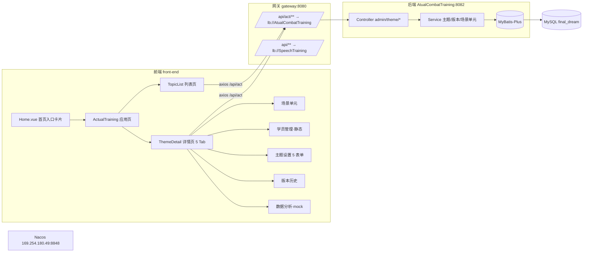
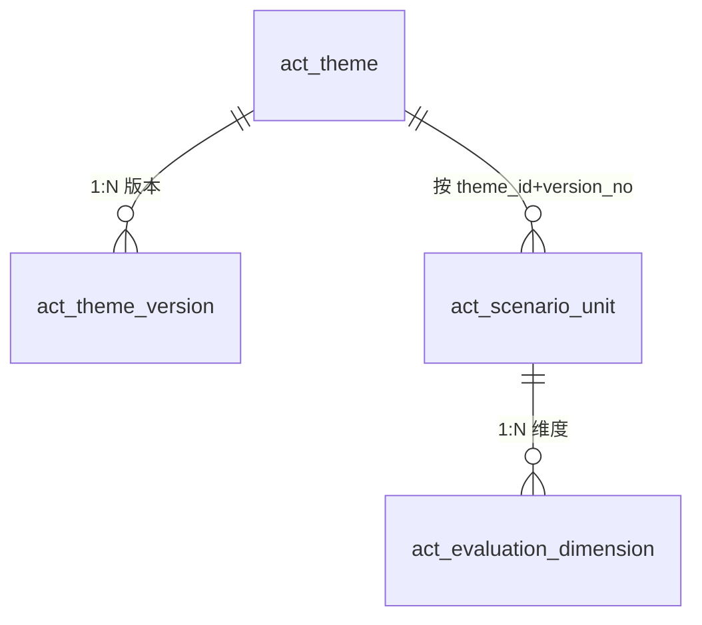

# AI实战训练场（管理端）复刻技术实现方案

> 版本：v1.0 ｜ 日期：2026-09-16 ｜ 配套：01-需求文档.md、03-接口文档.md、05-建表与种子数据.sql

---

## 1. 整体架构



要点：
- 网关新增 `/api/act/**` 路由且**必须排在 `/api/**` 之前**（Spring Cloud Gateway 按声明顺序匹配，通配路由后移）。
- 前端不新增 baseURL，沿用 `request.ts` 的 `http://localhost:8080/api`，本模块接口路径以 `/act/` 开头。
- 数据分析纯前端 mock，不经过后端。

## 2. 技术栈

| 层 | 选型 | 版本 | 说明 |
|----|------|------|------|
| 前端框架 | Vue + TS + Vite | 3.5.13 / 6.x / 8.x | 现有工程 front-end |
| 状态/路由 | Pinia / vue-router(hash) | 4.x / 4.6 | 沿用；本模块页面级状态用组件内状态即可，可不加 store |
| 样式 | 手写 SCSS | — | Element Plus 不注册（全工程约定） |
| 图表 | ECharts（已装）或纯 div 条形 | 6.1.0 | 数据分析 mock 图形简单，纯 CSS 条形即可，避免引 ECharts 包体 |
| 后端框架 | Spring Boot | 4.0.8（Java 21） | 现有空应用 AtualCombatTraining |
| ORM | MyBatis-Plus | 3.5.17 + jsqlparser | 对齐 SpeechTraining |
| 注册中心 | Nacos | 169.254.180.49:8848 | 网关 lb 负载发现 |
| 数据库 | MySQL final_dream | 10.100.26.200 | 新建 4 张 act_ 前缀表 |

## 3. 模块划分与 FP 对应

| 模块 | 覆盖 FP | 依赖 |
|------|---------|------|
| 前端-入口与框架 | FP-01、FP-02 | router |
| 前端-列表 | FP-03~05 | api/actTheme.ts |
| 前端-详情头部 | FP-07~09 | api/actTheme.ts |
| 前端-五 Tab | FP-10~20 | api/actTheme.ts + mock |
| 后端-主题查询 | FP-06、FP-07 | act_theme |
| 后端-状态操作 | FP-09 | act_theme |
| 后端-场景单元查询 | FP-11、FP-17 | act_scenario_unit / act_evaluation_dimension |
| 后端-设置读写与版本 | FP-13~18 | act_theme_version（+复制场景单元） |
| 后端-版本列表与回滚 | FP-19 | act_theme / act_theme_version |
| 基础设施 | FP-21 | 网关/建表/种子 |

## 4. 数据模型设计

### 4.1 ER 图



### 4.2 表结构

> 完整 DDL（含注释、索引、种子数据）见 `05-建表与种子数据.sql`。此处列字段清单与设计意图。

**act_theme（主题表）**——列表查询与头部展示的主表，冗余当前版本的可筛选/可展示字段：

| 字段 | 类型 | 说明 |
|------|------|------|
| id | varchar(32) PK | 雪花 ID（前端用 string） |
| theme_name | varchar(50) | 冗余自当前版本（列表/详情标题） |
| theme_desc | varchar(100) | 冗余自当前版本 |
| status | tinyint | 0草稿 1发布中 2发布失败 3已发布 4已暂停 5已结束 |
| theme_mode | tinyint | 1日常训练 2通关考核 3训考一体（由版本演练模式推导冗余） |
| assign_mode | tinyint | 1指定分配 2全体学员（由版本加入方式推导冗余） |
| difficulty | tinyint | 1简单 2正常 3困难（冗余自当前版本） |
| jurisdiction_type | tinyint | **占位**：1我管辖的 2我负责的（前端暂不传） |
| source_type | tinyint | **占位**：1单独安排 2项目安排（前端暂不传） |
| current_version_no | int | 当前版本指针，回滚=改此字段 |
| pass_rate / pass_user_count / participant_count / avg_score / total_training_count | decimal/int | **占位统计字段**（FP-08 只展示） |
| customer_profile_count | int | **占位**：客户画像数量（FP-17 展示） |
| created_at / updated_at | datetime | |

**act_theme_version（主题版本表）**——每个版本一条记录，五个表单的全部可编辑字段都在这里；主题设置读=读 current_version_no 对应行，写=插入新行：

| 分组 | 字段 | 说明 |
|------|------|------|
| 基本信息 | theme_name、theme_desc、owner_user_id（**占位**，写死管理员）、plan_start_time、plan_end_time | |
| 访问控制 | total_drill_count、per_scene_limit（NULL=不限）、join_mode（1仅指派 2指派+完全公开）、guest_access_enabled（**占位**） | |
| 训练策略 | ai_response_mode（1专家 2快速）、training_mode_enabled、assessment_mode_enabled、coach_review_enabled（训练模式开启时强制 1）、suggestion_enabled、practice_methods（varchar，CSV：case,custom,random）、difficulty、allow_custom_difficulty | |
| 防作弊（占位） | face_check_enabled、face_check_stage、screen_switch_mode、screen_switch_limit | 只展示不逻辑 |
| 通过标准 | scene_pass_type（1累计 2连续）、scene_pass_count | 主题通过标准固定=全部场景，不落库 |
| 版本元数据 | id、theme_id、version_no（uk: theme_id+version_no）、creator（写死'管理员'）、used_user_count / completed_count / in_progress_count（**占位**）、created_at、updated_at | |

**act_scenario_unit（场景单元表）**——按 `theme_id + version_no` 归属版本（保存设置产生新版本时整表复制；未来 AI 修改在新版本上变更，回滚即回到旧版本单元）：

| 字段 | 类型 | 说明 |
|------|------|------|
| id | varchar(32) PK | |
| theme_id + version_no | varchar(32)+int，idx | |
| sort_order | int | 序号 1~N |
| unit_name | varchar(100) | "A：B"格式名称 |
| audience | varchar(50) | 适用人群标签 |
| time_limit_minutes | int | 时间限制（分钟） |
| business_goal | text | 业务目标 |
| iceberg_elements | json | 关联冰山模型要素（字符串数组） |
| business_impact / failure_cost / core_conflict | text | |
| common_failure_modes / difficulties / forbidden_behaviors | json | 字符串数组 |
| pass_score | int | 评估标准通过分（如 70） |

**act_evaluation_dimension（评估维度表）**——挂在场景单元下（**非主题级**，各单元维度可不同）：

| 字段 | 类型 | 说明 |
|------|------|------|
| id | varchar(32) PK | |
| scenario_unit_id | varchar(32)，idx | |
| dimension_name | varchar(50) | 如"系统认知完整性" |
| weight | decimal(5,2) | 权重百分比（25.00） |
| dimension_desc | varchar(500) | 维度解释 |
| excellent_standard / good_standard / improve_standard | varchar(1000) | 三档评分标准文案（含"优秀（90-100分）：…"） |
| sort_order | int | |

### 4.3 关键设计决策

1. **版本模型**：配置快照存 act_theme_version，场景单元/维度按 version_no 隔离。保存设置 = 插入新版本行 + 复制场景单元（含维度，内容不变）+ 切 current_version_no。回滚 = 仅切指针，不新增行、不改既有行，列表排序（按 version_no 倒序）天然不变。
2. **主题表冗余**：theme_name/theme_mode/assign_mode/difficulty 等冗余到 act_theme，避免列表页 join 版本表；每次保存设置时同步。
3. **主题模式推导**：`training_mode_enabled=1 && assessment_mode_enabled=0 → 1；0&&1 → 2；1&&1 → 3`，保存时计算落库（theme_mode + version 各存）。
4. **分配模式推导**：join_mode=1 → 指定分配；join_mode=2 → 全体学员，落库 assign_mode。
5. **冰山要素/维度概览计数**：内容设计页的"冰山模型要素 N 项"= 当前版本所有单元 iceberg_elements 合并去重 count；"评估维度 N 个"= 所有单元维度名合并去重 count（后端在 settings 响应里直接算好返回，前端不算）。
6. **JSON 字段读写**（2026-09-16 实施修订，已与用户确认）：场景单元表 JSON 列（iceberg_elements / common_failure_modes / difficulties / forbidden_behaviors）实体字段用 `List<String>` + `@TableField(typeHandler = JacksonTypeHandler.class)`，且 `@TableName(autoResultMap = true)` 保证 SELECT 时 TypeHandler 生效。注：最初设想的"String 字段 + JacksonTypeHandler"不可行——MP 的 JacksonTypeHandler 对 String 字段会二次序列化（读 JSON 数组报错、写带引号），故改为 List 映射。

## 5. 前端工程

### 5.1 目录与路由

```
src/
├─ api/actTheme.ts                    # 本模块全部接口封装
└─ views/admin/AICombat/ActualTraining/
   ├─ index.vue                       # 应用布局（左菜单 + router-view）
   ├─ TopicList.vue                   # 列表页（FP-03~05）
   ├─ ThemeDetail.vue                 # 详情页容器（头部 FP-07~09 + Tab FP-10）
   ├─ components/
   │  ├─ DetailHeader.vue             # 头部信息+统计+按钮
   │  ├─ ScenarioUnitList.vue         # 场景单元（展开/收起，FP-11）
   │  ├─ StudentPanel.vue             # 学员管理静态壳（FP-12）
   │  ├─ ThemeSettings.vue            # 主题设置（FP-13~18，内含五分区表单）
   │  ├─ VersionHistory.vue           # 版本历史（FP-19）
   │  ├─ DataAnalysis.vue             # 数据分析（FP-20）
   │  └─ dataAnalysisMock.ts          # mock 数据（三口径×5 单元）
```

路由（加入现有 `/sparring` AdminLayout children，与平台 URL 对齐，统一小写 freesimulate）：

```ts
{ path: 'freesimulate/topic',  name: 'ActualTopicList',  component: ActualTraining/index.vue 内嵌 TopicList, meta:{title:'训练主题', activeMenu:'actual-training'} },
{ path: 'freesimulate/theme/:id', name: 'ActualThemeDetail', component: ThemeDetail, meta:{title:'主题详情'} }
```

Home.vue：常用应用区新增「AI实战训练场」卡片（target 风格图标 + 副标题"围绕真实业务场景展开动态实战训练"），点击 `router.push('/sparring/freesimulate/topic')`。

### 5.2 关键实现点

- **ID 全部 string**：接口返回的 id/versionNo 均按字符串处理，避免精度丢失。
- **场景单元展开态**：13 项内容块按截图 05 的彩色面板布局（浅蓝紫/绿/红/粉/紫色语义分块）；维度列表权重条为纯 CSS 宽度百分比。
- **主题设置**：左侧快速导航滚动定位 + 五分区表单组件共享一个 form 状态对象；「保存设置」整体提交（PUT settings），成功后刷新详情（版本+1 同步头部与版本历史徽标）。「取消」重新拉取 settings 覆盖本地状态。
- **表单校验**：名称必填≤50、描述≤100、总演练次数正整数、达标次数≥1、演练模式至少一种、练习方式至少一种（前端拦截 + 后端兜底校验）。
- **数据分析 mock**：dataAnalysisMock.ts 按场景单元 id 组织 `{overview, totalDistribution:{first,last,all}, dimensionMastery:{...}, dimensionChange:[...]}`；口径切换只切数据集与单位标签（人/百分比）；维度名列表从场景单元接口动态取，mock 数据按维度名索引。
- **占位交互**：统一 `comingSoon(msg)` 轻提示，用于创建新主题/AI 按钮/分享/导出/学员管理操作/左侧三菜单。

## 6. 后端工程

### 6.1 目录结构（对齐 SpeechTraining）

```
jack/digityhuman/atualcombattraining/
├─ AtualCombatTrainingApplication.java
├─ common/      ApiResponse、BizException、GlobalExceptionHandler、MybatisPlusConfig(分页)、JacksonConfig
├─ controller/  AdminThemeController（/api/act/admin/theme/**）
├─ service/     ThemeService、ThemeVersionService、ScenarioUnitService（接口+impl）
├─ mapper/      4 个 BaseMapper
├─ entity/      ActTheme、ActThemeVersion、ActScenarioUnit、ActEvaluationDimension
└─ dto/
   ├─ req/  ThemeListReq、ThemeSettingsSaveReq（五表单分组嵌套）
   └─ resp/ ThemeListResp、ThemeDetailResp、ScenarioUnitResp（含 dimensions）、
            ThemeSettingsResp（含 contentOverview）、VersionResp
```

### 6.2 配置（application.properties，纯 ASCII）

```properties
spring.application.name=AtualCombatTraining
server.port=8082
# Nacos discovery
spring.cloud.nacos.config.import-check.enabled=false
spring.cloud.nacos.discovery.server-addr=169.254.180.49:8848
spring.cloud.nacos.discovery.namespace=public
# MySQL final_dream
spring.datasource.url=jdbc:mysql://10.100.26.200:3306/final_dream?useUnicode=true&characterEncoding=utf8&serverTimezone=Asia/Shanghai&useSSL=false&allowPublicKeyRetrieval=true
spring.datasource.username=...
spring.datasource.password=...
spring.datasource.driver-class-name=com.mysql.cj.jdbc.Driver
# MyBatis-Plus
mybatis-plus.configuration.map-underscore-to-camel-case=true
```

> 中文注释一律不写进 properties；数据库账号密码由用户填入（交付时占位）。

### 6.3 关键流程

**保存设置（PUT settings）事务内：**
1. 校验（名称非空、演练模式≥1、练习方式≥1、状态非已结束才允许保存）
2. `max(version_no)+1` 插入 act_theme_version 新行（creator='管理员'）
3. 复制当前版本 act_scenario_unit + act_evaluation_dimension 到新版本号（批量 insert，保持 sort_order）
4. 更新 act_theme：current_version_no、theme_name/theme_desc、theme_mode/assign_mode/difficulty（推导）、updated_at
5. 返回新版本号，前端刷新

**回滚（POST rollback）：**
1. 校验目标版本存在、主题状态非已结束
2. `UPDATE act_theme SET current_version_no=?, updated_at=NOW() WHERE id=?`
3. 同步冗余字段（theme_name 等取目标版本值）

**暂停/恢复（POST pause）：** status=3→4（暂停），status=4→3（恢复）；其余状态拒绝并提示。
**结束（POST finish）：** status∈(3,4)→5；5 幂等拒绝。

### 6.4 网关路由变更（gateway/application.properties）

```properties
# route[0] = actual-combat-training（新增，必须在前）
spring.cloud.gateway.server.webmvc.routes[0].id=actual-combat-training
spring.cloud.gateway.server.webmvc.routes[0].uri=lb://AtualCombatTraining
spring.cloud.gateway.server.webmvc.routes[0].predicates[0]=Path=/api/act/**
# 原 speech-training 由 routes[0] 改为 routes[1]，内容不变
spring.cloud.gateway.server.webmvc.routes[1].id=speech-training
spring.cloud.gateway.server.webmvc.routes[1].uri=lb://SpeechTraining
spring.cloud.gateway.server.webmvc.routes[1].predicates[0]=Path=/api/**
```

## 7. 关键实现难点与对策

| 难点 | 对策 |
|------|------|
| 版本复制一致性（单元+维度跨 2 表批量复制） | 单事务内先查后插；插入时按 sort_order 保持顺序；单测覆盖"保存后新版本单元数=维度数=旧版本" |
| JSON 字段（iceberg_elements 等）映射 | MyBatis-Plus JacksonTypeHandler + 实体 `@TableField(typeHandler=...)`，实体上声明 String 类型手动序列化亦可（择一，勿混用） |
| 回滚后冗余字段不同步 | 回滚与保存共用"同步主题冗余字段"私有方法 |
| 网关路由顺序 | /api/act/** 必须声明在 /api/** 之前；联调用 curl 先探网关再探前端 |
| 前端 ID 精度 | 所有 id/versionNo 后端序列化为字符串（Long→String 或直接 varchar） |
| 数据分析三口径单位切换 | mock 结构预置三口径数据集，单位（人/%）作为配置切换，避免图表组件重复 |

## 8. 风险清单

| 风险 | 影响 | 应对 |
|------|------|------|
| 误动线上平台（AI 计费） | 产生费用 | 文档与提示词中明确禁止 agent 访问线上创建/AI 页面；走查仅只读 |
| 实体字段与 DDL 不齐 | MyBatis-Plus Unknown column（历史教训） | 新增实体后逐一比对 DDL 列；单测 contextLoads |
| 网关改错影响话术训练模块 | 现有功能不可用 | 只增 route[0] 并把原路由改为 route[1]，改完 curl 回归 /api/admin/... |
| properties 中文乱码/绑定失败（历史教训） | 启动失败 | 纯 ASCII，中文不落 properties |
| 本机无 mysql CLI | 无法执行 DDL | 用 ~/.m2 mysql-connector-j + 临时 Java 类执行（已验证方案），或用户在 IDE 执行 05 SQL |

## 9. 联调与验收顺序

1. 执行 05-建表与种子数据.sql（final_dream）
2. 启动 AtualCombatTraining(8082) → Nacos 注册可见
3. 修改并重启 gateway(8080) → `curl http://localhost:8080/api/act/admin/theme/list` 返回种子数据
4. 前端 `npm run dev` → 首页入口 → 列表 → 详情五 Tab 走查
5. 核心回归：暂停/恢复/结束、保存设置版本+1、回滚指针切换、/api/** 话术模块不受影响
