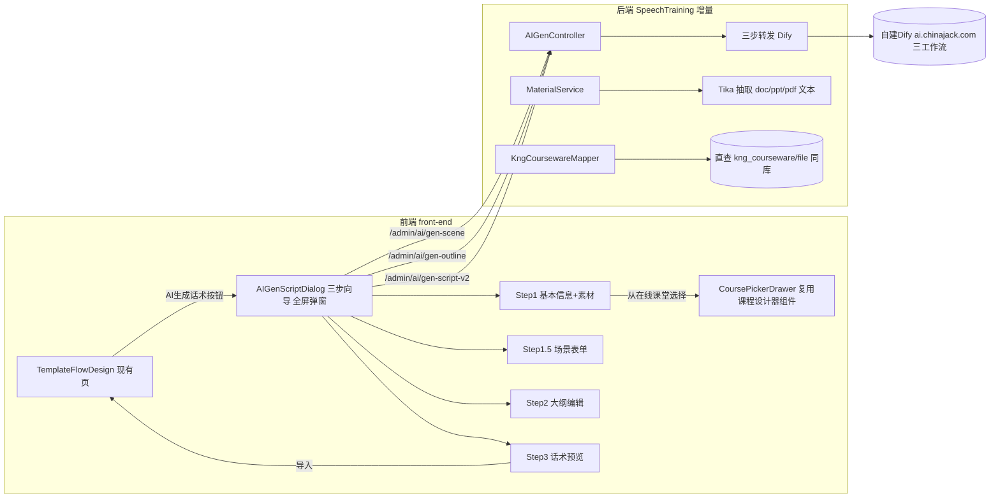

# AI生成话术闭环升级技术实现方案

> 版本：v2.0（升级）｜ 日期：2026-10-08 ｜ 配套：01-需求文档（升级）.md、03-接口文档（升级）.md、04-Dify工作流改造说明.md
> 基线：话术训练模块 v1.0（front-end /kng→/sparring 族 + SpeechTraining 后端 + 自建 Dify）；课件管理模块（kng_courseware/file 表，同库 final_dream）。

---

## 1. 整体架构（增量）



要点：
- 后端仍落 SpeechTraining 应用（现有 Dify 调用模式：application.properties 配 agent key + RestTemplate 转发）。
- **在线课堂课件数据直查同库**（kng_courseware/kng_courseware_file，final_dream 同库——组织架构模块先例：跨应用只读同库表），不跨服务调用。
- 旧接口 `POST /admin/ai/generate-script` 与 `/generate-script/upload` **下线**（前端唯一入口已改为三步向导；接口保留一个版本兼容期后删除，决策记录见 01 附录B）。

## 2. 技术栈（增量）

| 项 | 选型 | 说明 |
|----|------|------|
| 文档文本抽取 | Apache Tika（tika-core+tika-parsers） | 一个依赖覆盖 doc/docx/ppt/pptx/pps/pdf；SpeechTraining 引入 |
| Dify 调用 | 沿用现有 RestTemplate + DSL app key 模式 | 三工作流三个 key 配置项 |
| 进度模拟 | 前端 setInterval 线性递增 | 无真实流式进度 |

## 3. 模块划分与 SG 对应

| 模块 | 覆盖 SG | 要点 |
|------|---------|------|
| 前端-向导框架 | SG-01/06 | AIGenScriptDialog.vue 全屏弹窗+步骤条+生成遮罩 |
| 前端-Step1 | SG-02/03 | 表单+素材区（本地上传/在线课堂/占位） |
| 前端-课程选择抽屉 | SG-03 | CoursePickerDrawer 从课程设计器抽取为共用组件（列名适配：分享人→上传者） |
| 前端-场景/大纲/预览 | SG-04/05/07 | 三个步骤子组件 |
| 前端-导入 | SG-08 | 调后端编排接口（**前端不做节点拼装**，与旧实现差异） |
| 后端-三步转发 | SG-09 | AIGenController + DifyClient 三个方法 |
| 后端-素材服务 | SG-03 | 上传暂存+Tika抽取+30k截断 |
| 后端-课件查询 | SG-03 | 已发布+文档类过滤+file 取第一个文档 |
| 后端-编排导入 | SG-08 | 复用新 DSL parse_json 语义（resolve_round_node）在 Java 侧实现 |

## 4. 数据模型（增量）

**sparring_ai_gen_record（生成会话表，新）**——支持"返回上一步重新生成"与服务端留痕：

| 字段 | 说明 |
|------|------|
| id varchar(32) PK | |
| session_id varchar(64) | 前端生成 uuid，三步共用 |
| step tinyint | 1场景 2大纲 3话术 |
| request_json text | 该步入参快照 |
| result_json mediumtext | 该步出参（场景五字段/环节数组/话术数组） |
| created_by / created_at | |

- 场景/大纲/话术的中间产物**每步落一条**；重新生成覆盖（同 session+step 删旧插新）。
- 素材文件不上传服务端长期存储：本地上传的素材经 `POST /admin/ai/material/extract`（multipart）即时抽取文本返回，前端只持有 `materialText` + 文件名列表——**服务端不存素材文件本体**（生成完即弃，减少存储与安全面）。

## 5. 前端工程（增量）

```
views/sparring/…/components/aiGen/        （或现有 AI 弹窗目录重构）
├── AIGenScriptDialog.vue      # SG-01 全屏弹窗+步骤条+遮罩（替代旧 AIDialog）
├── Step1BasicInfo.vue         # SG-02/03：描述/素材/开启者
├── MaterialList.vue           # 素材条目（文件名+预览+删除）
├── CoursePickerDrawer.vue     # 从课程设计器 CoursewarePickerDrawer 抽取共用
│                              #   差异：数据源 /admin/ai/material/kng-list（仅文档类可选）
├── SceneForm.vue              # SG-04 五字段
├── Step2Outline.vue           # SG-05 环节卡片增删移改
├── Step3Preview.vue           # SG-07 气泡流（学员右/陪练者左）+checkbox+要点解析
└── GeneratingMask.vue         # SG-06 进度遮罩
api/aiGen.ts                   # genScene/genOutline/genScript/importScript/materialExtract/kngList
```

关键实现：
- **进度模拟**：预估时长=轮数×8s；`setInterval` 每秒 +100/(预估×1.1)，封顶 90%；接口 resolve 后 100% 再切步骤。
- **气泡布局**：纯 CSS——学员卡 `margin-left:auto`（右侧）、陪练者气泡 `align-self:flex-start`（左侧）；头像+名字+气泡三件套，对照截图6 镜像。
- **CoursePickerDrawer 共用抽取**：课程设计器的选课件抽屉组件迁移到 `src/components/shared/`（或引用处 props 化：数据源接口、可选过滤回调）；sparring 侧传"仅文档类源文件"过滤。
- **旧入口替换**：TemplateFlowDesign 的 openAIDialog 改指向 AIGenScriptDialog；旧单步表单组件删除。

## 6. 后端工程（增量，SpeechTraining）

```
controller/AIGenController.java   # /admin/ai/gen-scene|gen-outline|gen-script-v2|
                                  #   import-script|material/extract|material/kng-list
service/
├── AIGenService.java             # 三步 Dify 转发 + 会话表读写 + 超时/重试
├── MaterialExtractService.java   # Tika 抽取 + 30k 截断
├── KngMaterialService.java       # 直查 kng_courseware(+file) 文档类课件 + 取文件流文本
└── ScriptImportService.java      # 话术数组→流程节点编排（Java 版 resolve_round_node）
util/DifyWorkflowClient.java      # 通用 workflow 调用（key 可配三个 app）
```

- **Tika 抽取**：`AutoDetectParser`，限制：单文件 100M（上传校验）→ 抽取文本 30k 截断（超出返回 `truncated:true` 提示）。
- **在线课堂课件列表**：`SELECT id,title,type FROM kng_courseware WHERE status=2 AND on_sale=1 AND deleted`（按课件管理表结构）+ EXISTS file 文档类——仅返回有文档源文件的课件；勾选确定后前端再调 `material/kng-extract?coursewareId=` 取该文件抽取文本。
- **导入编排（SG-08）**：入参=话轮数组+firstSpeaker；逻辑照新 DSL：firstSpeaker=student→大节点 type=学员问陪练者答，否则=陪练者问学员答；节点/边结构对齐现有流程设计器存储（沿用现有流程 JSON 结构，**不是**把 Dify 的 nodes/edges 原样透传——旧接口旧 DSL 的问题正在于此，新编排由 Java 保证与前端画布结构一致）。
- **配置**：`ai.gen.scene-key / ai.gen.outline-key / ai.gen.script-key` 三个 Dify app key（properties 纯 ASCII 约定）。

## 7. 关键实现难点与对策

| 难点 | 对策 |
|------|------|
| 三步中间态一致性（改了场景忘改大纲） | 每步出参落 sparring_ai_gen_record；步骤推进必传上一步 result 的 hash，不匹配则 code=1"基础信息已变更，请重新生成" |
| 素材文本超 prompt 上限 | 30k 截断 + 提示词中声明"素材可能不完整" |
| 英语话术质量 | 工作流③提示词区分 zh/en 分支（英文输出对话、要点解析仍中文） |
| CoursePickerDrawer 跨模块复用 | 抽 shared 组件+props 数据源；课程设计器同步改引用（一次重构两处用） |
| 生成耗时超 RestTemplate 默认 | 专用 RestTemplate 120s（沿用语气评分先例） |
| 旧接口下线 | generate-script 保留 30 天返回 code=1"请使用新版AI生成话术" |

## 8. 风险清单

| 风险 | 影响 | 应对 |
|------|------|------|
| vllm Qwen3-30B 长上下文（场景+大纲+素材30k）生成慢/超时 | 第三步 60s+ | 提示词精简素材引用；实测后调超时与进度速率；极端时素材降 15k |
| Tika 抽取 .pps 老格式失败 | 个别素材不可用 | 失败返回该条素材错误，不阻塞其余素材 |
| 直查 kng_* 表的跨模块耦合 | 表结构变更影响 | 只读+字段白名单（id/title/type/file），课件模块 DDL 变更需同步本模块（风险表双向登记） |
| 进度模拟与真实耗时不匹配 | 用户体验 | 常见 5 轮实测校准速率 |
