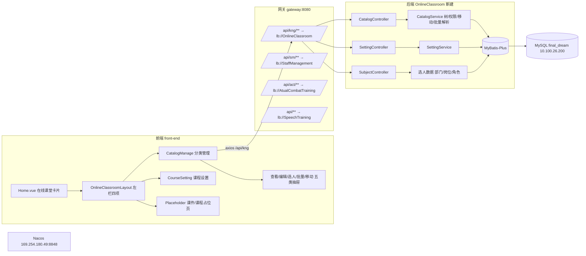
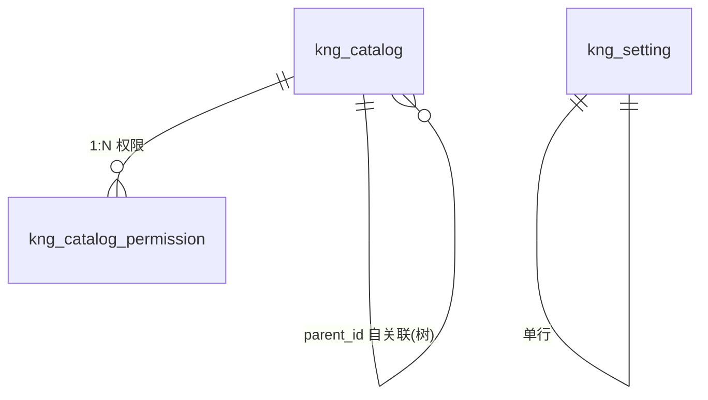

# 在线课堂（管理端）复刻技术实现方案 —— 分类管理 + 课程设置

> 版本：v1.0 ｜ 日期：2026-09-29 ｜ 配套：01-需求文档.md、03-接口文档.md、04-建表与种子数据.sql

---

## 1. 整体架构



要点：
- **网关新增 `/api/kng/**` 路由且必须排在 `/api/**` 兜底路由之前**（同 act 模块做法）。
- 前端不新增 baseURL，沿用 `request.ts` 的 `http://localhost:8080/api`，本模块接口路径以 `/kng/` 开头。
- 用户自建 OnlineClassroom 空应用（Spring Boot 4.0.8 + Java 21 + MyBatis-Plus 3.5.17，对齐 AtualCombatTraining 工程结构）。
- 选人抽屉的部门/岗位/角色数据**直查同库** `sys_department` / `sys_user(position distinct)` / `sys_role`（组织架构模块已建），不做跨服务调用。

## 2. 技术栈

| 层 | 选型 | 版本 | 说明 |
|----|------|------|------|
| 前端框架 | Vue + TS + Vite | 3.5.13 / 现有 | 现有 front-end 工程 |
| 样式 | 手写 SCSS | — | Element Plus 不注册（全工程约定） |
| 后端框架 | Spring Boot | 4.0.8（Java 21） | 新建空应用 OnlineClassroom（用户自建，端口 8084） |
| ORM | MyBatis-Plus | 3.5.17 + jsqlparser | 对齐既有应用 |
| 注册中心 | Nacos | 169.254.180.49:8848 | 网关 lb 负载发现 |
| 数据库 | MySQL final_dream | 10.100.26.200 | 新建 3 张 `kng_` 前缀表 + sys_permission 增 4 条权限点 |
| 鉴权 | 沿用全站登录态 | — | 菜单/路由按 sys_permission 权限码守卫（前端守卫） |

## 3. 原平台逆向结论（来源：逆向勘察记录-2026-09-29.md）

| 项 | 结论 |
|----|------|
| 原平台 | 云学堂绚星 SaaS（api-phx-ali.yunxuetang.cn），Vue2 + 自研 yxt-* 组件 |
| 列表接口 | `POST /kng/classificate/list` 一次返回整树（根=主课堂），节点含 kngCount/courseCount/allKngCount/allCourseCount 双口径、routingPath、orderIndex、updateTime |
| 详情接口 | `POST /kng/kngCatalog/info` → 基本信息 + catalogPermissions[]（userGroupId/groupType/permissionTypes CSV）+ confBeans[]（权限点配置）+ createFullname/createUserName |
| 移动树 | `POST /kng/kngCatalog/tree`（轻量树，无统计） |
| 选人 | 部门 `GET /udp/depts/tree`（全量树）、岗位 `GET /udp/positions`（分页）、角色 `GET /core/nav/roles/search`（分页） |
| 前端本地行为 | 展开收起/搜索/口径切换均不发请求（实测确认） |
| 写接口 | 生产环境未触发，未抓包；本模块写接口为**自行设计**，字段语义对齐 info 响应 |
| 主键/命名 | UUID 主键、camelCase；本系统改用**雪花 ID 字符串**（全站约定），权限点码 0/1/2/4/6 重编为连续 1~5（映射：0→1 浏览、1→2 允许下载课件、2→3 分发、4→4 维护、6→5 App缓存课件） |

## 4. 开源方案采用情况

| 模块 | 结论 | 理由 |
|------|------|------|
| 全模块 | 从零自研 | 候选开源（Element Plus 系树形表格/封装库）均与"无组件库+手写 SCSS"工程约定冲突；模块为中等 CRUD，自研成本可控 |

## 5. 模块划分与 FP 对应

| 模块 | 覆盖 FP | 依赖 |
|------|---------|------|
| 前端-入口与布局 | FP-01 | router、sys_permission 守卫 |
| 前端-课程设置 | FP-02 | api/kng.ts |
| 前端-分类列表 | FP-03/04/05/06 | api/kng.ts（整树一次拉取） |
| 前端-查看/编辑/权限抽屉 | FP-07/08/09/11 | api/kng.ts |
| 前端-选人抽屉 | FP-10 | api/kng.ts（部门树/岗位/角色） |
| 前端-删/移/批 | FP-12/13/14/15 | api/kng.ts |
| 后端-分类树与统计 | FP-03/04 | kng_catalog（递归聚合双口径） |
| 后端-详情/保存 | FP-07/08/09 | kng_catalog + kng_catalog_permission |
| 后端-继承与合并 | FP-11 | 快照复制/递归下推/并集合并 |
| 后端-选人 | FP-10 | sys_department / sys_user / sys_role |
| 后端-删除/移动/批量 | FP-12/13/14/15 | 事务 + 防环 + 缩进解析 |
| 后端-课程设置 | FP-02 | kng_setting 单行表 |
| 基础设施 | FP-01 | 网关路由、建表、权限点种子 |

## 6. 数据模型设计

### 6.1 ER 图



### 6.2 表结构（完整 DDL 见 04-建表与种子数据.sql）

**kng_catalog（分类表）**

| 字段 | 类型 | 说明 |
|------|------|------|
| id | varchar(32) PK | 雪花 ID（字符串） |
| parent_id | varchar(32) NULL | 父分类；**NULL=一级分类**（挂在虚拟"主课堂"根下，根不落库） |
| name | varchar(50) NOT NULL | 分类名称 |
| level | int NOT NULL | 层级，一级=1，≤10 |
| order_index | int NOT NULL default 0 | 同级排序；新增=当前同级 max+1 |
| order_type | tinyint default 1 | 默认课程顺序：1发布时间 2更新时间 3名称 4学习人数 |
| prefix_enabled | tinyint default 0 | 标题自动加前缀开关 |
| prefix_content | varchar(50) NULL | 前缀内容 |
| date_suffix_enabled | tinyint default 0 | 标题自动加日期开关 |
| date_suffix_format | varchar(20) NULL | 日期格式：yyyy-MM-dd / yyyy/MM/dd / yyyyMMdd |
| inherit_parent | tinyint default 0 | 继承父分类权限标志（FP-11 快照锁定） |
| kng_count | int default 0 | 本级课件数（**预留恒 0**，未来课件模块维护） |
| course_count | int default 0 | 本级课程数（**预留恒 0**） |
| created_by | varchar(32) | 创建人 sys_user.id |
| created_at / updated_at | datetime | updated_at 即列表"更新日期" |

- 同级同名唯一性：**应用层校验**（MySQL 唯一索引对 NULL parent_id 不生效），新增/改名/批量创建/移动时校验目标同级下重名。
- "含子级"口径（allKngCount/allCourseCount）：**查询时递归聚合**（树全量加载后内存求和），不落冗余列，避免双写不同步。

**kng_catalog_permission（分类权限表）**

| 字段 | 类型 | 说明 |
|------|------|------|
| id | varchar(32) PK | |
| catalog_id | varchar(32) NOT NULL idx | 所属分类 |
| subject_type | tinyint NOT NULL | 1超级管理员&分类创建者(内置) 2课堂管理员(内置) 3课堂成员(内置) 4部门 5岗位 6角色 |
| subject_id | varchar(64) NULL | 内置行=NULL；部门=sys_department.id；**岗位=岗位名称字符串**（sys_user 无岗位表，岗位以 distinct position 为准）；角色=sys_role.id |
| subject_name | varchar(100) NOT NULL | 展示名冗余（部门名/岗位名/角色名/内置行名），列表与查看抽屉直接读此列 |
| permissions | varchar(32) NOT NULL | 权限码 CSV，"1,2,3,4,5"（1浏览 2允许下载课件 3分发 4维护 5App缓存课件） |
| created_at | datetime | |

- 去重：应用层按 (catalog_id, subject_type, subject_id) 去重（NULL 索引问题同上）。
- 新建分类时**固定插入三行内置记录**（默认勾选见 FP-09），保证权限矩阵/查看抽屉有数据。

**kng_setting（课程设置，单行表）**

| 字段 | 类型 | 说明 |
|------|------|------|
| id | tinyint PK default 1 | 恒一行 |
| credit_mode | tinyint default 1 | 1=学完课程时发放所有课件的学分（预留扩展） |
| anti_idle_enabled | tinyint default 0 | 防挂机开关 |
| anti_idle_mode | tinyint default 1 | 1模式一 2模式二 |
| check_interval_minutes | int default 3 | 确认在线间隔（分钟） |
| confirm_seconds | int default 120 | 模式二确认时限（秒） |
| prompt_text | varchar(250) | 提示语 |
| updated_at / updated_by | datetime / varchar(32) | |

**sys_permission 增量**（组织架构模块 DataInitializer 机制）：

| code | name | route_path |
|------|------|-----------|
| kng:courseware | 课件管理 | /kng/courseware |
| kng:course | 课程管理 | /kng/course |
| kng:catalog | 分类管理 | /kng/catalog |
| kng:setting | 课程设置 | /kng/setting |

落地时 DataInitializer 额外补一个不可路由的分组节点 `kng`（在线课堂），四个权限点挂其下；
兼容 SQL 因现有 `sys_permission` 结构没有 `created_at`，改为按 `parent_id=0`、`sort=41~44` 插入四行。

## 7. 前端工程

```
src/
├── api/kng.ts                        # 本模块全部接口（命名与 03 接口文档一一对应）
├── router/index.ts                   # /kng 族路由 + meta.permission
├── views/onlineclassroom/
│   ├── OnlineClassroomLayout.vue     # 左栏（四项菜单）+ 内容区
│   ├── PlaceholderPage.vue           # 课件/课程管理占位页（props 传菜单名）
│   ├── CourseSetting.vue             # FP-02
│   └── catalog/
│       ├── CatalogManage.vue         # FP-03/04/05/06/15：树形表格+行选中+搜索
│       ├── CatalogViewDrawer.vue     # FP-07 查看抽屉
│       ├── CatalogEditDrawer.vue     # FP-08/06/创建子分类：编辑表单+权限矩阵(FP-09)+继承区(FP-11)
│       ├── SubjectPickerDrawer.vue   # FP-10 部门/岗位/角色三 tab
│       ├── CatalogBatchDrawer.vue    # FP-13/15 批量创建
│       └── CatalogMoveDrawer.vue     # FP-14 移动（含课程/仅课程共用，mode prop 区分）
```

- **路由**：`/kng/catalog`（默认）、`/kng/setting`、`/kng/courseware`、`/kng/course`；`meta.permission` 对应权限码；首页卡片跳 `/kng/catalog`。
- **布局**：参照 EnterpriseLayout 模式（左栏宽约 200px、菜单项图标+文字、选中蓝底）；内容区内部滚动（沿用 fullBleed 链式撑满约定：height 锁死 + 整链 flex:1 + min-height:0）。
- **树形表格**：手写递归行渲染（组件内 children 递归或行组件递归），缩进 = (level-1)×24px；展开态存组件内 Set<id>。
- **搜索整链展开**：先深度遍历求"命中节点集合"，再回溯收集祖先集合，渲染 = 祖先∪命中，且祖先节点强制展开。
- **行选中**：组件内 selectedId（单选），行背景淡蓝 `#E8F4FF`（对齐原平台）。
- **抽屉栈**：查看→编辑→选人 三层叠加，逐层 z-index 递增（原平台行为）。

## 8. 后端工程（OnlineClassroom，用户自建空壳后按下述填充）

```
jack.digityhuman.onlineclassroom/
├── controller/
│   ├── CatalogController.java        # /api/kng/admin/catalog/**（树/详情/增删改/批量/移动/合并）
│   ├── SubjectController.java        # /api/kng/admin/subjects/**（部门树/岗位/角色）
│   └── SettingController.java        # /api/kng/admin/setting
├── service/CatalogService.java       # 核心：树构建+聚合、权限快照、防环、批量解析
├── service/SettingService.java
├── mapper/ (KngCatalogMapper / KngCatalogPermissionMapper / KngSettingMapper
│            / SysDepartmentMapper / SysUserMapper / SysRoleMapper)   # 直查 sys_* 同库
├── entity/ + dto/ (CatalogTreeNode / CatalogDetail / PermissionRow / SubjectDTO ...)
└── config/ (MyBatis-Plus 配置，对齐 AtualCombatTraining)
```

- **统一响应**：`{code:0, message, data}`；code=1 业务失败（中文 message），无细分错误码。
- **事务**：保存（含权限矩阵替换）、批量创建、移动、合并到父 均 `@Transactional`。
- **雪花 ID**：全站字符串序列化。

## 9. 关键实现难点与对策

| 难点 | 对策 |
|------|------|
| 整树一次拉取 + 双口径聚合 | 单条 SQL 全表 `order by parent_id, order_index` → 内存建树（Map<parentId, List>）；聚合用后序遍历：all = 本级 + Σ(children.all)。当前统计恒 0，逻辑先就位 |
| 批量文本解析（FP-13/15） | 逐行解析：`leading spaces` 计算深度（深度=⌈空格数⌉ 且必须=栈顶深度+1，否则行号报错）；用"父栈"维护当前链路；10 级校验=父分类 level + 最大相对深度 ≤10；同级同名用 Set 校验；整体 @Transactional 回滚 |
| 移动防环 | 后端递归收集待移动分类的全部子孙 id 集合，targetParentId ∈ 集合或 = 自身 → 拒绝（前端树已隐藏，后端兜底）；移动后递归更新子孙 level（Δ=新父level+1-旧level） |
| 权限快照继承（FP-11） | ①继承父：保存时若 inherit_parent=1 → delete 本分类权限 + insert 父分类权限副本（保留三行内置 subject_type 归位）；②子分类继承：递归收集子孙，对每个子孙执行同样"覆盖"；③合并到父：父权限按 (subject_type, subject_id) 匹配 → 已存在则 permissions 取并集，不存在则插入副本 |
| 权限矩阵保存 | 保存=整表替换（delete by catalog_id + batch insert 前端提交的完整行集），避免 diff 逻辑；内置三行必须存在（后端校验补齐） |
| 树形表格渲染层级深 | 名称列 width 40% + 横向不换行 ellipsis + title 提示全名；缩进 24px/级 |
| 岗位无独立表 | sys_user distinct position 作为岗位数据源（组织架构模块既有做法）；权限表 subject_id 存岗位名字符串，部门/角色改名后名称冗余列不同步——接受（展示名快照），部门/角色仍以 id 关联为准 |

## 10. 风险清单

| 风险 | 影响 | 应对 |
|------|------|------|
| 日期格式选项为推断 | 与原平台实际选项不一致 | 上线前用户在原平台展开下拉核对（需求文档附录C） |
| 未来课件/课程模块的统计与移动课程契约 | 本模块预留字段/接口可能与未来实现偏差 | 接口文档已注明"预留"；kng_count/course_count 由未来模块维护，本模块只读 |
| 部门/角色改名后权限展示名过期 | 查看抽屉显示旧名 | subject_name 为快照；可在列表接口返回时 join sys_* 实时覆写名称（实现时选一，文档按"保存时快照"为准） |
| sys_* 表为组织架构模块所有 | OnlineClassroom 直查产生跨模块耦合 | 只读访问（SELECT），不写 sys_*；表结构变更由组织架构模块版本管理 |
| 移动子树 level 批量更新 | 深层级更新行数多 | 当前规模（数百节点）单事务无压力；未来量大时改物化路径 |
