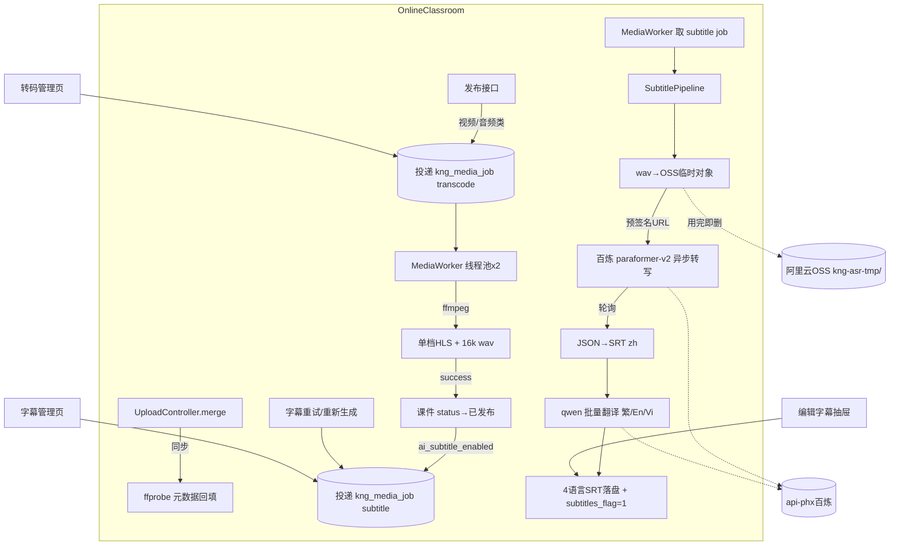

# 在线课堂 AI字幕与转码专项技术实现方案

> 版本：v1.0 ｜ 日期：2026-10-04 ｜ 配套：01-需求文档.md、03-接口文档.md
> 基线：OnlineClassroom 应用 + kng_ 表族 + 课件管理 v1.0 的上传/状态机/管理页骨架。

---

## 1. 整体架构



要点：
- **MediaWorker 为 OnlineClassroom 进程内组件**（`@Async` 线程池 2 并发 + DB 轮询取 job 或直接内存投递；单机部署无需引入 MQ——job 落库保证重启后 pending 可恢复）。
- **PublishSimulateJob（模拟定时任务）退役**：发布状态由真实 transcode job 驱动；非媒体类课件发布后直接已发布。
- ASR 引擎与翻译引擎均走接口抽象（§5）。

## 2. 技术栈（增量）

| 项 | 选型 | 说明 |
|----|------|------|
| 转码/抽音频 | ffmpeg + ffprobe（LGPL 构建） | 部署机安装；ProcessBuilder 调用；**禁 --enable-gpl 构建**（PoC-1 核查） |
| ASR | 百炼 paraformer-v2（DashScope SDK 异步转写） | 备选 fun-asr（配置切换）；句级毫秒时间戳 |
| 翻译 | qwen（DashScope，OpenAI 兼容接口） | flash 级即可 |
| OSS | 阿里云 OSS Java SDK | kng-asr-tmp/ 临时桶/前缀；预签名 URL 15 分钟；**生命周期规则 1 天兜底删除** |
| 播放 | hls.js（前端） | 编辑字幕抽屉/详情预览；静态资源映射 /kng-files/** |
| 定时 | DB 轮询 @Scheduled(10s) | 恢复重启丢落的 pending/running（超时回收） |

## 3. 数据模型（DDL 见 03 §4）

> 模块-功能点对应：§1 merge 链路=MT-01；发布→transcode=MT-02；subtitle 管线=MT-03；两管理页=MT-04/05；play=MT-06。

**kng_media_job（新表）**

| 字段 | 类型 | 说明 |
|------|------|------|
| id | varchar(32) PK | |
| job_type | tinyint | 1 transcode 2 subtitle |
| courseware_id | varchar(32) idx | |
| status | tinyint | 0 pending 1 running 2 success 3 failed |
| stage | varchar(20) NULL | subtitle 管线细分：asr/srt/translate（transcode 为 NULL） |
| progress_lang | varchar(20) NULL | 翻译阶段已完成的语言（CSV），断点续翻 |
| error_msg | varchar(2000) NULL | 失败原因（stderr 尾部/异常消息） |
| retry_count | int default 0 | 上限 3 |
| started_at / finished_at | datetime | 已转换时间=now-started_at（转码中tab） |
| created_by | varchar(32) | 操作人（字幕管理页"操作人"列） |
| created_at | datetime | 字幕管理页"开始时间"列 |

- 幂等：投递前查 `courseware_id+job_type+status IN(0,1)` 存在则拒绝。
- kng_courseware 增列：media_width/media_height int NULL、media_codec varchar(20)、**subtitles_flag tinyint default 0**（课件列表已有 subtitlesFlag 字段语义，转正）、hls_path varchar(500) NULL。
- kng_setting 增列 media_conf JSON（asr.model、translate.model、worker.concurrency 等运行参数——沿用 JSON 存储决策）。

## 4. 后端工程（增量）

```
service/
├── MediaJobService.java        # 投递/查询/重试/幂等/超时回收（MT-02/03）
├── MediaWorker.java            # @Scheduled 取 pending → 按类型分发；线程池执行
├── TranscodeTask.java          # ffmpeg 单档HLS + 抽wav + status回写（MT-02）
├── SubtitlePipeline.java       # stage 状态机：asr→srt→translate（MT-03）
├── AsrEngine.java（接口）      # File transcribe(Path wav) → AsrResult{sentences[{beginMs,endMs,text}]}
│   ├── BailianAsrEngine.java   # paraformer-v2/fun-asr，配置切换；OSS临时上传+轮询+结果下载
│   └── (预留 LocalFunasrEngine)
├── TranslateEngine.java（接口）# translate(List<SrtEntry>, lang) → List<SrtEntry>
│   └── QwenTranslateEngine.java
├── SrtService.java             # SRT 读写/解析/重写（标准格式）；百炼JSON→SRT转换（MT-05）
└── OssTempService.java         # 临时对象上传/预签名/删除
```

关键实现：
- **ffmpeg 调用**：ProcessBuilder，`-timeout` 全局 60 分钟看门狗；输出目录约定 `/kng-files/transcode/{id}/`；先写 `.tmp` 目录成功后原子改名。
- **百炼异步转写**：`Transcription.async_call(model, file_urls=[预签名URL])` → `wait`/自轮询（5s 间隔，30 分钟超时）；结果 JSON sentences 直接映射中间格式。
- **qwen 批量翻**：50 条/批，prompt 固定："只输出译文 JSON 数组，保持输入序号顺序，不解释"；输出解析失败重试 2 次；**时间戳/序号由本地按输入回填**（不信任模型复制，结构零风险）。
- **stage 断点**：subtitle job 每完成一个 stage 落库（stage+progress_lang），重试从断点续跑。
- **发布状态机**：发布→status=发布中+投 transcode；TranscodeTask 成功→status=已发布（复用原 PublishSimulateJob 的更新点，删除定时类）。

## 5. 前端工程（增量）

```
views/onlineclassroom/courseware/
├── TranscodeMgmt.vue      # 数据源切 POST /api/kng/admin/media/jobs {type:transcode}
│                          # 已转换时间列：进入页后 30s 定时刷新或前端按 started_at 自算
├── SubtitleMgmt.vue       # 数据源切 {type:subtitle}；失败原因列+重试
└── components/
    └── SubtitleDrawer.vue # 占位→转正：
        # <video> + hls.js 播 playUrl；四语言 tab；SRT 行渲染(mm:ss+文本+铅笔)
        # 行内编辑=行内 input；保存按当前语言整份重写（PUT subtitles）
api/media.ts               # jobs 查询/重试/play/subtitles 读写/重新生成
```

- 课程模块的任务列表"状态"列：原取课件 status；**升级**为课件 status+subtitles_flag 组合展示（转码成功文案仍不做，仅已发布等四态）——课程模块无需改动。

## 6. 关键实现难点与对策

| 难点 | 对策 |
|------|------|
| worker 与发布事务一致性 | 投递在发布事务**提交后**（TransactionSynchronization afterCommit）再 insert job，避免事务回滚留脏 job |
| 进程重启丢 job | job 落库；启动时 running 超过 60 分钟视为僵死重置 pending（retry_count+1） |
| 百炼结果 24h 有效期 | 下载即转 SRT 落盘，不保存远端 URL |
| OSS 临时对象泄漏 | 双保险：管线内 finally 删除 + 桶生命周期 1 天 |
| 大视频转码占满磁盘 | 转码前检查磁盘余量（<源文件×3 拒绝并 failed）；HLS 产物与源文件同盘（本机磁盘方案既定） |
| qwen 输出不稳定 | 只要求译文数组，时间戳/序号本地回填；解析失败整批重试，仍失败 stage=translate failed |
| 编辑字幕与重新生成并发 | 抽屉保存接口校验 job 活跃时拒绝（"字幕生成中，稍后保存"） |

## 7. 风险清单

| 风险 | 影响 | 应对 |
|------|------|------|
| paraformer-v2 培训专有名词准确率低 | 字幕质量差 | PoC-2 量化；不行切 fun-asr 或开启热词（百炼支持 context 增强，配置预留） |
| ffmpeg LGPL 构建不可得（发行版默认带 GPL x264） | 许可合规 | PoC-1 核查；内部部署不对外分发风险可控，但记录决策 |
| 部署机 CPU 转码慢 | 大视频发布久 | 已知权衡（单档+并发2）；未来云 GPU/云转码时 TranscodeTask 接口化 |
| 百炼计费口径变化 | 成本 | 每次调用记用量日志；media_conf 可随时切模型 |
| 单机部署 OSS 依赖新增 | 需开通 OSS | 仅字幕功能需要；若不开通则字幕功能不可用（转码不受影响），配置开关降级 |
