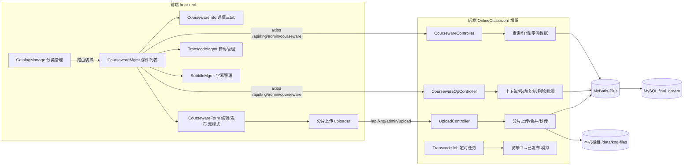
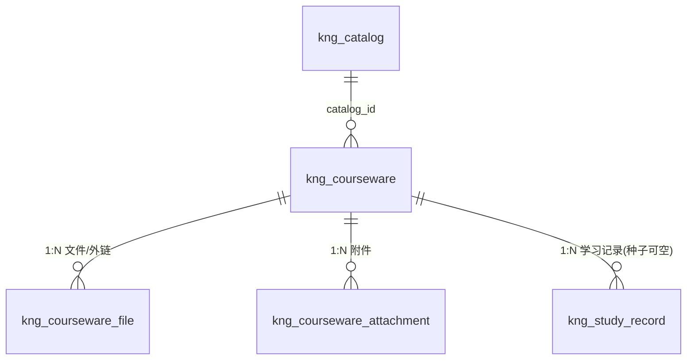

# 在线课堂（管理端）课件管理复刻技术实现方案

> 版本：v1.0 ｜ 日期：2026-09-30 ｜ 配套：01-需求文档.md、03-接口文档.md、04-建表与种子数据.sql
> 工程基线沿用分类管理 v1.0（OnlineClassroom 应用 / 网关 /api/kng/** / front-end 工程 / sys 权限体系），本文只写课件管理增量。

---

## 1. 整体架构（增量）



要点：
- 复用：`GET /api/kng/admin/catalog/tree`（分类树）、DeptTree 组件（学习详情部门筛选）、`kng:courseware` 权限点（v1.0 已建）。
- 文件存储：本机磁盘目录（配置 `kng.upload.dir`，默认 `/data/kng-files/{yyyyMM}/{uuid}.{ext}`），DB 存相对路径；预留 StorageService 接口便于未来换对象存储。
- 网关无新增路由（同 /api/kng/**）。

## 2. 技术栈（增量）

| 项 | 选型 | 说明 |
|----|------|------|
| 分片上传 | 前端 File.slice(5MB) + 后端分片暂存/合并 | 不引第三方库；断点续传=前端查询已传分片号续传 |
| 定时任务 | Spring @Scheduled（30s） | 模拟发布中→已发布 |
| 图表 | 纯 CSS 条形/双柱（优先） | 对齐工程"避免引 ECharts 包体"的既有决策；学习数据图简单 |
| 媒体处理 | **不做**（待办） | 时长手动填；转码/字幕骨架页 |

## 3. 原平台逆向结论（要点，全量见勘察记录）

| 原接口 | 我们的对应 |
|--------|-----------|
| POST /kng/knowledge/courseWarelist?limit&offset&orderBy&orderType（body 全筛选位） | POST /api/kng/admin/courseware/list?page&pageSize&orderBy&orderType（body 筛选）——分页改 page 从 1 起（工程约定），limit/offset→page/pageSize |
| GET /kng/knowledge/detail/info/{kngId} | GET /api/kng/admin/courseware/{id}/detail |
| GET /kng/knowledge/getcatalogallpath | 详情接口内联返回 catalogPath（省一次请求） |
| POST /kng/knowledge/study/info?limit&offset（body：deptId/finishMethod/name/id/studyStatus/hasChild） | POST /api/kng/admin/courseware/{id}/study-records?page&pageSize |
| 学习数据四接口 | GET .../study-overview、.../finish-time-overview、.../dept-first-level、POST .../dept-finish-overview |
| POST /kng/study/kngPlay（播放+字幕文件清单） | 待办#1（AI 字幕专项）设计；本次编辑字幕抽屉为占位 |
| type/status 码 | type 1~8 / status 0~3（见需求文档 §2；原平台 status=4 已发布，我们改 2=已发布，映射记录于接口文档） |

## 4. 模块划分与 CW 对应

| 模块 | 覆盖 CW | 依赖 |
|------|---------|------|
| 前端-列表页 | CW-01~06 | api/courseware.ts、catalog/tree |
| 前端-详情页 | CW-07 | api/courseware.ts |
| 前端-编辑/发布页 | CW-08/10/11 | CoursewareForm（双模式）、Uploader |
| 前端-更多菜单与批量 | CW-09/13 | 复用移动抽屉样式 |
| 前端-转码/字幕页 | CW-14/15 | api/courseware.ts |
| 后端-查询 | CW-02~07 | kng_courseware + kng_study_record |
| 后端-操作 | CW-09/13 | 事务 |
| 后端-上传与发布 | CW-10/11 | kng_upload_chunk + 文件磁盘 |
| 后端-定时任务 | CW-10/14 | kng_courseware.status |

## 5. 数据模型设计（完整 DDL 见 04）

### 5.1 ER



### 5.2 表

**kng_courseware（课件主表）**

| 字段 | 类型 | 说明 |
|------|------|------|
| id | varchar(32) PK | 雪花 |
| title | varchar(200) NOT NULL | 名称 |
| type | tinyint NOT NULL | 1文档 2视频 3音频 4压缩 5微课 6SCORM 7HTML 8外链 |
| catalog_id | varchar(32) NOT NULL idx | 所属分类 |
| status | tinyint NOT NULL default 0 | 0未发布 1发布中 2已发布 3已下架 |
| on_sale | tinyint default 1 | 上架（下架操作置 0 且 status=3？——**不**：on_sale 独立位，上架/下架批量操作用；status=3 由"更多-下架"设置。二者语义对齐原平台 onSale 字段，详见接口文档） |
| standard_minutes / standard_seconds | int | 标准时长 |
| standard_duration_follow | tinyint default 0 | 0单独设置 1跟随学分策略（文档/压缩/HTML/外链类；跟随态页数换算待办#2，本次仅存储） |
| study_score | decimal(5,2) NULL | 单独学分；NULL=跟随学分策略（**数值不落库，展示时按 kng_setting.score_conf 实时换算**，见 §8） |
| finish_standard_percent | int default 100 | 完课标准 10~100 |
| description | text | 简介（富文本 HTML） |
| cover_url | varchar(500) | 封面相对路径 |
| code / version_str | varchar(100) | 编码/版本（version 是 MySQL 保留字附近词，列名用 version_str 避险） |
| platform_no | varchar(32) | 平台课程编号 ZXKTyyyyMMddNNNN，发布时生成 |
| view_permission | tinyint default 1 | 1跟随分类 2单独允许 |
| download_enabled | tinyint default 1 + download_permission tinyint default 1 | 允许下载 + 跟随/单独 |
| app_save_enabled | tinyint default 1 + app_save_permission tinyint default 1 | 允许保存 + 跟随/单独 |
| speed_enabled / speed_hours_calc / ai_subtitle_enabled | tinyint default 1/1/0 | 功能设置三开关 |
| copy_of | varchar(32) NULL | 源课件 id（复制产生） |
| contributor_id | varchar(32) | 贡献者 sys_user.id（默认创建人） |
| language | varchar(20) NULL | 语种（zh/ha/en/vi，文件级语种在 file 表） |
| created_by / created_at / updated_at | | 上传者=列表"分享者" |

- study_count（学习人数）不落库：`count(kng_study_record)` 实时聚合（学员端未做时恒 0，逻辑就位）。

**kng_courseware_file（课件文件/外链）**

| 字段 | 说明 |
|------|------|
| id / courseware_id idx | |
| file_name | 原始文件名 |
| storage_path | 磁盘相对路径（外链为 NULL） |
| file_size | 字节 |
| language | 语种（设置语种弹窗产物；NULL=未设置） |
| sort_order | 文件顺序（上传文件区拖拽排序的落点，本次不做拖拽但字段预留） |

**kng_courseware_attachment（附件）**：id / courseware_id / file_name / storage_path / file_size（上限 50 应用层校验）。

**kng_upload_chunk（分片暂存）**：upload_id（前端生成 uuid）/ chunk_index / total_chunks / file_name / file_size / rel_dir / created_at——合并成功后删除记录；断点续传=GET 已传分片号列表。

**kng_study_record（学习记录，种子空表）**：id / courseware_id idx / user_id / dept_id / post / study_status(1完课2学习中) / start_study_time / end_study_time / study_len_hours decimal / finish_cost_days / finish_method(1培训2自学)——详情页学习详情/学习数据 tab 数据源；学员端未做，恒空，列表/图表正常空态。

## 6. 前端工程（增量）

```
src/
├── api/courseware.ts                  # 全部接口（与 03 一一对应）
├── router                             # /kng/courseware 族：
│   # /courseware（列表）/courseware/info/:id /courseware/edit/:id
│   # /courseware/publish/:variant(file|scorm|html|link) 
│   # /courseware/transcode /courseware/subtitles
├── utils/chunkUploader.ts             # 分片上传（slice 5MB/并发2/进度回调/续传）
└── views/onlineclassroom/courseware/
    ├── CoursewareMgmt.vue             # CW-01~06：树面板+筛选+表格+批量
    ├── components/
    │   ├── CatalogTreePanel.vue       # 树面板（搜索/收起/口径radio/共N）
    │   ├── FilterDrawer.vue           # 更多筛选弹窗（CW-06）
    │   ├── FilterTags.vue             # 面包屑标签
    │   ├── MoreMenu.vue               # 更多 hover 菜单（CW-09）
    │   ├── CopyDrawer.vue             # 复制抽屉（截图25）
    │   ├── SubtitleDrawer.vue         # 编辑字幕占位抽屉（截图26）
    │   ├── TakeDownDialog.vue         # 下架倒计时弹窗（截图09）
    │   └── DeptPickerDialog.vue       # 部门选择弹窗（复用 DeptTree）
    ├── CoursewareInfo.vue             # 详情三 tab（CW-07）
    ├── CoursewareForm.vue             # 编辑/发布双模式（CW-08/10/11，variant prop）
    ├── TranscodeMgmt.vue              # CW-14
    └── SubtitleMgmt.vue               # CW-15
```

关键实现：
- **锚点导航滚动**：五区块 `ref` + `scrollIntoView({behavior:'smooth'})`；`IntersectionObserver` 反向高亮当前区块锚点。
- **面包屑标签**：筛选条件对象 `{onSale, quote, uploadStart, uploadEnd, updateStart, updateEnd}` → computed 渲染标签数组（label 详细文案），× 移除单项后重新查询。
- **下架倒计时**：弹窗打开 `setInterval` 2s 递减，按钮文案"下架(Ns)"，N=0 时 disabled=false。
- **列表 checkbox**：组件内 `Set<id>`；批量按钮 disabled 随之。
- **上传进度**：chunkUploader 每片成功回调，文件行进度条 = 已传分片/总分片。

## 7. 后端工程（增量）

```
controller/
├── CoursewareController.java     # /api/kng/admin/courseware：list/detail/study-records/
│                                 #   study-overview/finish-time-overview/dept-first-level/dept-finish-overview
├── CoursewareOpController.java   # 上架/下架/移动/复制/删除/下载/批量操作
└── UploadController.java         # /api/kng/admin/upload：init(秒传检查)/chunk/merge
service/
├── CoursewareService.java        # 查询组装（三字段 OR 模糊/口径树/统计聚合）
├── CoursewareOpService.java      # 操作事务
├── UploadService.java            # 分片落盘/合并/MD5 秒传
├── StorageService.java           # 磁盘读写门面（未来换对象存储只改这里）
└── PublishSimulateJob.java       # @Scheduled 30s：发布中且超30s → 已发布
mapper/ KngCoursewareMapper / KngCoursewareFileMapper / ... / KngStudyRecordMapper
```

- **下载**：`GET /api/kng/admin/courseware/{id}/download` → 流式读磁盘文件（`Content-Disposition` 原文件名）；外链课件无下载。
- **发布编号**：`ZXKT + yyyyMMdd + 4位序号`（当日序号，重试并发用 SELECT ... FOR UPDATE）。
- **复制的引用安全**：file 行复制（同 storage_path），删除源课件不删文件（按 storage_path 引用计数判断）。
- **定时任务分布式锁**：单实例部署可不用；预留 `@SchedulerLock` 注释位（如未来多实例）。

## 8. 关键实现难点与对策

| 难点 | 对策 |
|------|------|
| 分片上传（GB 级） | 5MB/片 + 2 并发；init 接口按 MD5 秒传（同文件直接复用）；合并=按序追加 FileOutputStream；上传中文件暂存 `{dir}/.tmp/{uploadId}/`，合并后移正式目录 |
| 树口径查询（includeChildCatalog） | 分类树全量取回内存求子孙集合（复用分类管理逻辑）→ `catalog_id IN (...)`；仅当前= `catalog_id = ?` |
| 三字段 OR 模糊 | `(title LIKE ? OR catalog_name LIKE ? OR uploader LIKE ?)`——catalog/uploader 冗余列（catalog_name/created_by_name）落库避免 join，写入时维护 |
| 完课标准发布后锁死 | edit 接口忽略 finish_standard_percent 入参（服务端不更新该列），前端禁用 |
| 状态机与批量上下架 | 更多-下架 → status=3；批量上架=3→2、批量下架=2→3；on_sale 字段与 status=3 同步维护（列表筛选"是否上架"查 on_sale） |
| 学习数据聚合 | 全部 count 聚合 kng_study_record；空表返回 0 值正常渲染 |
| **学分策略联动（实时计算）** | 跟随态课件（study_score IS NULL）在 detail 接口返回 `studyScoreCalc`（按 kng_setting.score_conf 实时换算）：视频/音频=时长(分)÷videoAudio.standardMinutes×score；文档/压缩/HTML=时长(分)÷document.standardMinutes×score（**页数口径简化为时长折算，推断**，媒体解析后切页数）；SCORM=同上按 scorm 块；外链=0。策略修改→全局跟随课件自动生效（无快照、无回填） |
| **倍速/学时两级联动** | 前端表单打开时读 GET /api/kng/admin/setting 的 playConf：speedEnabled=false→课件级强制关+禁用；speedScope=1→强制开+禁用；speedScope=2→可编辑；speedHoursCalc 控制学时计算 checkbox。课件表单只存课件级意愿值，展示层算最终生效值 |

## 9. 风险清单

| 风险 | 影响 | 应对 |
|------|------|------|
| 本机磁盘容量/备份 | 5GB 级视频堆积 | StorageService 门面+路径规范，未来迁 MinIO 只改实现 |
| 无媒体解析，时长手填 | 体验降级 | 待办#2（转码专项）；表字段就位 |
| 定时模拟与真实发布混淆 | 未来接真解析需改 | PublishSimulateJob 独立类+注释标明"模拟实现，替换点" |
| 学习记录空表 | 学习详情/学习数据恒空态 | 已确认为预期；组件按空态设计（保留列头） |
| 引用检查无数据源 | 删除不阻止 | 引用表 kng_ref 预留设计写入接口文档注释（未来课程/考试插入记录即可生效） |
