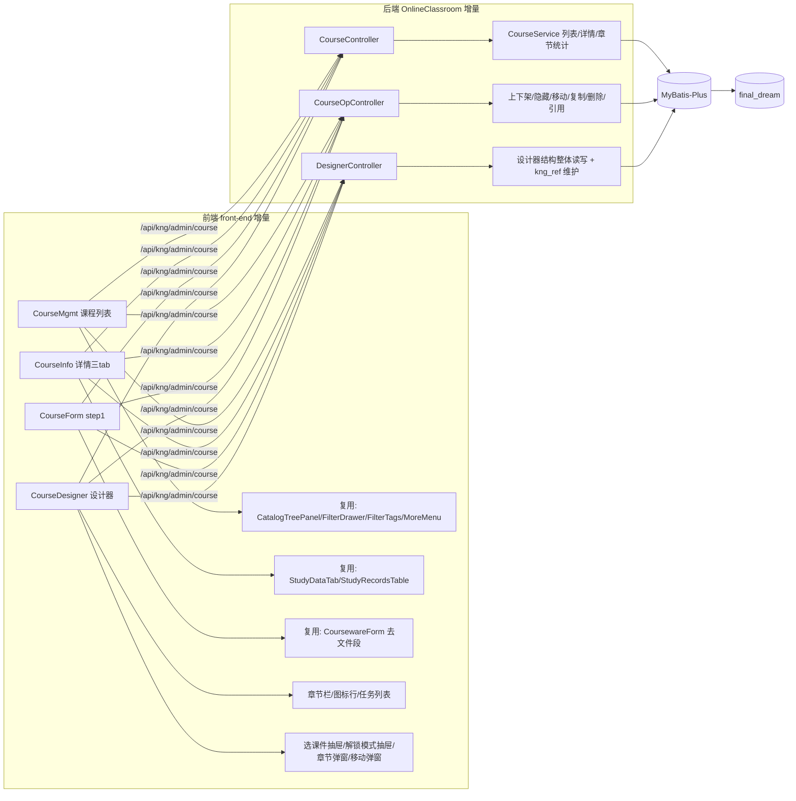
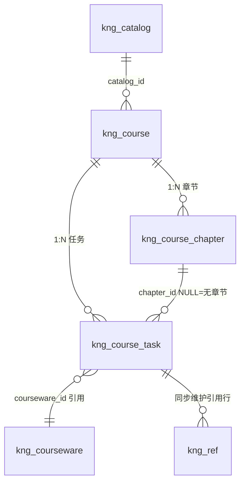

# 在线课堂（管理端）课程管理复刻技术实现方案

> 版本：v1.0 ｜ 日期：2026-10-03 ｜ 配套：01-需求文档.md、03-接口文档.md、04-建表与种子数据.sql、05-课件管理增补-隐藏与继承分类.md
> 工程基线沿用 OnlineClassroom / front-end / kng_ 表族；**最大化复用课件管理 v1.0 的组件与基础设施**（分片上传、DeptTree、移动抽屉、下架弹窗、FilterDrawer 等）。

---

## 1. 整体架构（增量）



要点：
- 课程列表/详情**大量复用课件模块接口形态**（courselist 与 courseWarelist 同构、detail/info 同构），Service 层抽公共 `KngQueryService`（type=课件/课程 两态查询同一张表）。
- 设计器为 front-end 内顶层全屏路由页（非独立 SPA，不套 `/kng` 侧栏布局），整体 JSON 提交。

## 2. 数据模型设计（完整 DDL 见 04）

### 2.1 设计原则：课件与课程**同表**

原平台课件与课程共用 knowledge 体系（detail/info 同接口）。我们沿用：`kng_courseware` 表加 `biz_type` 区分（1=课件 2=课程）？——**不**。经权衡：课件表字段（文件/上传相关）对课程多数为空，且课程有独立结构（章节/任务/解锁），**分表**更清晰，但列表/详情接口形态保持同构。拍板：**新表 kng_course + kng_course_chapter + kng_course_task**，不混用课件表。

**kng_course（课程主表）**

| 字段 | 类型 | 说明 |
|------|------|------|
| id | varchar(32) PK | 雪花 |
| title | varchar(200) NOT NULL | 名称（创建默认"未命名课程"） |
| catalog_id | varchar(32) NOT NULL idx | 分类 |
| status | tinyint default 0 | 0未发布 1发布中 2已发布 3已下架 |
| on_sale | tinyint default 1 | 上架位（同课件语义） |
| hidden | tinyint default 0 | 隐藏标记（独立于 status，学员不可见；列表置灰标记） |
| structure_type | tinyint default 0 | 0无章节 1有章节 |
| unlock_mode | tinyint default 1 | 1自由学习 2按顺序学习 |
| unlock_unit | tinyint default 1 | 1按内容 2按章节 |
| standard_duration_follow | tinyint default 0 | 标准时长跟随策略（表单存储；展示用任务聚合） |
| standard_minutes / standard_seconds | int | 单独设置时长（冗余存储；展示以任务聚合优先，无任务时用手填值） |
| study_score | decimal(5,2) NULL | 单独学分；NULL=跟随（展示=任务学分和） |
| finish_standard_percent | int default 100 | |
| description / cover_url / code / version_str | | 同课件 |
| view_permission / speed_enabled / speed_hours_calc | | 同课件（功能设置） |
| contributor_id / platform_no / catalog_name / created_by / created_by_name / created_at / updated_at | | 同课件 |

**kng_course_chapter（章节表）**

| 字段 | 说明 |
|------|------|
| id / course_id idx | |
| name varchar(200) | 章节名称 |
| description varchar(500) NULL | 章节说明 |
| order_index int | 排序（仅展示顺序） |

**kng_course_task（任务表 = 课件引用）**

| 字段 | 说明 |
|------|------|
| id / course_id idx / chapter_id NULL idx | 无章节课程 chapter_id=NULL |
| courseware_id NOT NULL idx | 引用的课件 |
| task_name varchar(200) | 任务名（默认=课件名，编辑抽屉可改） |
| hidden tinyint default 0 | 隐藏标记 |
| order_index int | 任务顺序 |

- kng_ref（课件管理已建）：任务写入时同步 insert（ref_type=1）；换选课件/删任务/删课程同步维护。

### 2.2 ER



## 3. 原平台逆向结论（要点）

| 原接口 | 对应 |
|--------|------|
| POST /kng/knowledge/courselist（与 courseWarelist 同构，type=0/fileType=course/ulcdCode/released；status 4已发布 5未发布） | POST /api/kng/admin/course/list |
| GET /kng/knowledge/detail/info/{id}（课程与课件同接口） | GET /api/kng/admin/course/{id}/detail |
| POST /kng/knowledges/study/info（章节+每课件近7天/总学习人数） | POST /api/kng/admin/course/{id}/chapter-study-stats |
| POST /kng/knowledge/study/info?limit&offset（body 多 courseId）| 复用课件 study-records + courseId 参数，响应加 studySchedule |
| 学习数据四接口 | 同构（路径换 course） |
| ULCD 设计器写接口 | 未抓包，自行设计整体读写 |

## 4. 前端工程（增量）

```
src/
├── api/course.ts                        # 课程族接口
├── router                               # /kng/course 族：
│   # /course /course/info/:id /course/courseware-study/:courseId/:coursewareId
│   # /course/edit/:id/step1 /course/edit/:id/designer
│   # /course/create/step1 /course/create/designer（或合并 edit/:id/designer，创建后即有 id）
└── views/onlineclassroom/course/
    ├── CourseMgmt.vue                   # 列表（复用课件组件，无类型列）
    ├── CourseInfo.vue                   # 详情三 tab（复用 StudyDataTab）
    ├── CoursewareStudyInCourse.vue      # CS-05 课件学习详情（复用表格组件+学习进度列）
    ├── CourseForm.vue                   # step1（包装 CoursewareForm 或抽取共用 BasicInfoForm）
    └── designer/
        ├── CourseDesigner.vue           # 设计器主页（顶栏/章节栏/图标行/任务列表）
        ├── components/
        │   ├── ChapterPanel.vue         # 章节栏（添加/编辑/删除/切换结构）
        │   ├── ChapterDialog.vue        # 章节弹窗（截图12）
        │   ├── TaskTypeBar.vue          # 13 图标行（做/占位/不显示三态）
        │   ├── TaskTable.vue            # 任务列表（批量/行内操作/隐藏标记）
        │   ├── CoursewarePickerDrawer.vue # 选课件抽屉（截图13）
        │   ├── UnlockModeDrawer.vue     # 解锁模式抽屉（截图10/11）
        │   ├── MoveTaskDialog.vue       # 移动任务弹窗（截图15）
        │   ├── EditTaskDrawer.vue       # 编辑任务抽屉（截图16）
        │   └── HideTaskDialog.vue       # 隐藏确认弹窗（截图18）
        └── StructureChooseDialog.vue    # 创建首入结构选择弹窗（截图20）
```

关键实现：
- **设计器状态模型**：`{ structureType, chapters:[{id,name,description,tasks:[{id,coursewareId,taskName,hidden,...课件冗余字段}]}], flatTasks:[](无章节), unlockMode, unlockUnit }` 组件内维护，【保存】整体 POST；【暂存关闭】同接口带 `publish:false`。
- **结构切换**：有→无：chapters 展平为 flatTasks（任务保留）；无→有：建"章节1"并将 flatTasks 归入。
- **复用课件编辑嵌套抽屉**：EditTaskDrawer 内"编辑课件"打开 CoursewareForm 精简模式（抽屉内抽屉，z-index 递增，对齐原平台截图17）。
- **任务行冗余字段**：加入任务时从选课件抽屉的行数据快照（学分/时长/状态），列表渲染不回表；课件状态变更后重新进设计器时以接口最新数据覆盖（detail 接口 join 实时值）。

## 5. 后端工程（增量）

```
controller/
├── CourseController.java        # /api/kng/admin/course：list/{id}/detail/
│                                #   {id}/chapter-study-stats/学习数据四接口
├── CourseOpController.java      # 上架/下架/隐藏/取消隐藏/移动/复制/删除/引用记录/下载(提示)
└── CourseDesignerController.java # GET/PUT /api/kng/admin/course/{id}/designer（结构整体读写）
service/
├── CourseService.java           # 列表/详情（聚合任务时长学分）/章节统计
├── CourseOpService.java         # 操作事务（复制含章节任务深拷贝+ref 重建；删除含 ref 清理）
├── DesignerService.java         # 结构保存（全删全插 or diff——**全删全插**简单可靠：事务内删 chapters+tasks 再插入，ref 同步重建）
└── CourseRefService.java        # kng_ref 维护门面（任务增删改调用；课件删除检查复用）
```

- **设计器保存=全删全插**（当前规模任务数≤99，无性能问题），ref 行在事务内同步重建（先 delete by ref_id=courseId 再批量 insert），天然一致。
- **课程删除**：删 course+chapters+tasks+ref(by ref_id)；课件删除检查（课件模块已有接口）读 kng_ref 自然生效。
- **复制**：深拷贝三表 + ref 重建；title 追加"-副本"。
- **隐藏**：course.hidden / task.hidden 两级独立列；课件模块增补的 hidden 列见 05 增补文档（DDL 合并到 04）。

## 6. 关键实现难点与对策

| 难点 | 对策 |
|------|------|
| 列表/详情与课件模块同构复用 | 后端抽 `KngListQueryTemplate`（共用筛选解析/分页/口径树逻辑，子类提供表名与类型差异）；前端组件直接复用 |
| 课程时长/学分聚合 | detail 接口 join tasks→sum(课件 standardMinutes/seconds、studyScoreCalc)；无任务且有手填学分时返回手填值，无任务且未手填时返回 null（不套用课件策略公式） |
| 设计器结构整体保存 | 全删全插 + 事务 + ref 重建（§5） |
| 换选课件（编辑任务抽屉） | task.courseware_id 更新 + ref 行 update（delete+insert） |
| studySchedule（学习进度） | kng_study_record 预留 study_schedule 列（04 SQL 增补该列）；学员端写入，当前恒空 |
| 课程学分"跟随"语义 | 课程跟随时=任务 studyScoreCalc 之和（非策略折算），接口文档明确 |

## 7. 风险清单

| 风险 | 影响 | 应对 |
|------|------|------|
| 全删全插设计器保存 | 高频保存产生写放大 | 当前规模可忽略；任务量大时改 diff |
| 本地上传后不自动刷新 | 体验缺口 | 设计器窗口 focus 时刷新一次（轻量实现，文档已注明） |
| 课程/课件状态码映射 | 原平台 4/5 与我们 2/0 | 接口文档映射表明确 |
| 嵌套抽屉层级多（设计器→编辑任务→编辑课件） | 样式/滚动复杂 | 统一 z-index 阶梯（+100/层），遮罩点击只关最上层 |
