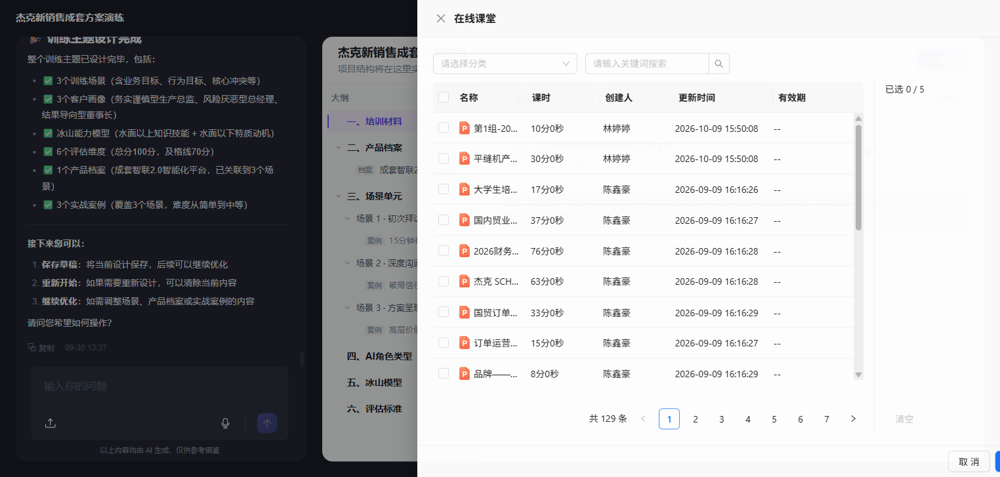
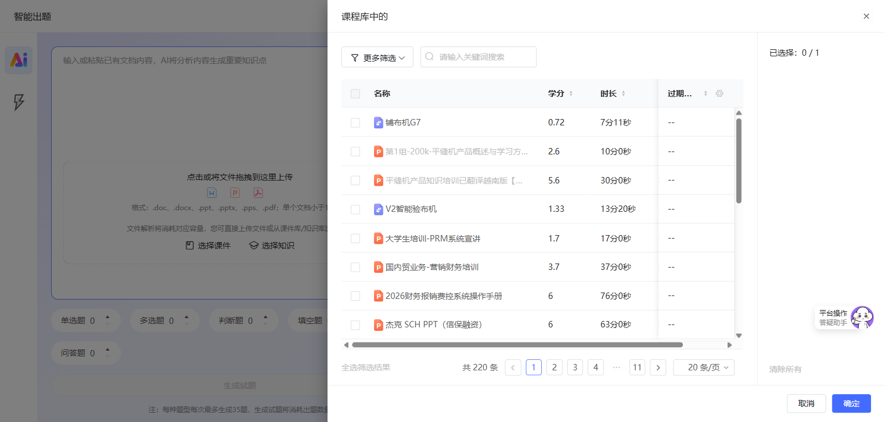

# 在线课堂资源选择接入 需求文档

> 日期：2026-10-28
> 来源：用户截图 📸 + 原平台实测 ✅ + HAR 抓包 + 当前代码核对
> 涉及模块：AI 设计助手、测练中心 AI 出题、在线课堂
> 实施状态：需求已确认，本轮只形成契约，不修改业务代码

## 1. 目标

把在线课堂中已发布、可用的学习资源接入 AI 内容生成入口，作为 AI 设计助手和 AI 出题的素材来源。用户不离开当前 AI 页面即可选择资源，并把资源中可读的文本送入现有材料/出题链路。

本文范围以两个最终确认目标为准：

1. AI 设计助手聊天页的“上传资料”菜单。
2. 测练中心 AI 出题素材区。

AI 生成话术的在线课堂选择已经实现，不在本轮范围内。

## 2. 范围

### 2.1 本期包含

- AI 设计助手“上传资料”菜单增加“从在线课堂选择”。
- AI 出题增加“选择课件/从在线课堂选择”。
- 在线课堂资源列表、分类筛选、关键词搜索、分页和已选上限。
- 文档类课件的文本抽取。
- AI 设计助手选中资源后进入培训材料，并标记来源为在线课堂。
- AI 出题选中资源后把文本写入素材区。
- 题库详情与试卷固定编辑页共用同一 AI 出题组件。

### 2.2 本期不包含

- AI 生成话术接入改造。
- 知识空间模块及“从知识空间选择”。
- 微课内容模型、发布和文本提取。
- 视频/音频文本提取。
- 课件标签模型。
- 课件删除态筛选。
- 资源选择关系写入 `kng_ref`。

## 3. 内容类型范围

| 生成入口 | 原平台实际内容 | 本系统首期开放 | 说明 |
|---|---|---|---|
| AI 设计助手 | 文档 | 文档 | 抓包请求排除视频、音频、炫页、SCORM、HTML、压缩包、外链 |
| AI 出题 | 文档、视频、音频、微课 | 文档 | 视频/音频依赖字幕提取；微课当前仍为占位类型 |

本系统课件类型：

| type | 名称 | AI 设计助手首期 | AI 出题首期 | 后续条件 |
|---|---|---|---|---|
| 1 | 文档 | 可选 | 可选 | 已完成 |
| 2 | 视频 | 不可选 | 不可选 | 接入字幕/ASR 文本后开放 |
| 3 | 音频 | 不可选 | 不可选 | 接入字幕/ASR 文本后开放 |
| 4 | 压缩文件 | 不可选 | 不可选 | 原平台未开放 |
| 5 | 微课 | 不可选 | 不可选 | 微课模块闭环后开放 |
| 6 | SCORM | 不可选 | 不可选 | 原平台排除 |
| 7 | HTML | 不可选 | 不可选 | 原平台排除 |
| 8 | 外链课 | 不可选 | 不可选 | 原平台排除 |

## 4. 用户流程

### 4.1 AI 设计助手

1. 用户进入 AI 设计助手主题页面。
2. 点击聊天输入框左侧“上传资料”。
3. 菜单显示：
   - 从在线课堂选择
   - 从知识空间选择（置灰）
   - 本地上传
4. 点击“从在线课堂选择”，打开标题为“在线课堂”的抽屉。
5. 抽屉顶部提供分类下拉与关键词搜索。
6. 用户最多选择 5 个文档课件。
7. 右侧显示“已选 N / 5”和已选资源名称。
8. 点击“确定”，系统将所选课件抽取为培训材料并加入当前助手会话。
9. 材料出现在右侧“培训材料”页，带来源标识、预览、学员可见开关和删除操作。
10. 聊天消息流中出现一张“解析完成”卡片（逐条列出本次导入的课件名与解析结果），同时右侧“培训材料”tab 同步更新。

### 4.2 AI 出题

1. 用户进入题库详情或试卷固定编辑页的 AI 出题入口。
2. 在素材区点击“选择课件”。
3. 打开在线课堂资源抽屉。
4. 用户最多选择 1 个课件。
5. 点击“确定”，选中课件以资源条目显示。
6. 点击“提取知识点”，把课件文本写入素材区。
7. 用户设置题型数量并生成试题；现有 AI 生成接口不变。

## 5. 功能需求

### F1 统一在线课堂资源选择器

- 在线课堂查询、分页和文档抽取统一由在线课堂模块提供。
- 两个入口共用一个 Vue 抽屉组件，通过 `purpose`、`maxSelect` 和列模式参数化。
- 抽屉使用 Element Plus，主区为表格，右侧为已选区。
- 验收：
  - AI 设计助手显示 5 个上限。
  - AI 出题显示 1 个上限。
  - 两处资源数据来自同一接口。

### F2 AI 设计助手接入

- 入口位于聊天输入框“上传资料”按钮，不另加一个独立大按钮。
- 上传资料菜单保留本地上传；新增在线课堂；知识空间置灰。
- 抽屉字段：
  - 名称
  - 课时
  - 创建人
  - 更新时间
  - 有效期
- 首期只返回文档课件。
- 最多选择 5 个。
- 已选资源可单条移除，也可“清空”。
- 确定后资源进入当前助手会话材料：
  - 显示在“培训材料”tab。
  - 同时在聊天消息流插入一条“解析完成”卡片（`bizType=biz-common-parse-file`），逐条列出课件名与成功/失败原因。
  - `fileSource=3` 表示在线课堂来源。
  - 通过 `fileId=kng_<coursewareId>` 与 `fileSource=3` 保留来源，支持去重与审计。
  - 有主题时同步写入工作区 artifact；建主题前先挂 session，建主题后归集。
- 抽取失败单条返回错误，不阻塞其他资源。
- 本地上传流程保持不变。
- AI 设计助手页面参照：

### F3 AI 出题接入

- 素材区增加“选择课件”和置灰的“选择知识”。
- 最多选择 1 个课件，后选替换先选。
- 确定后只显示资源条目，不立即覆盖文本。
- 点击“提取知识点”后：
  - 当前素材文本为空时直接写入。
  - 当前素材文本非空时先确认是否覆盖。
- 题库详情与试卷固定编辑页共用 `AiQuesDrawer`，一次接入覆盖两个入口。
- 生成试题接口继续使用现有 `materialText + counts`。
- AI 出题页面参照：

### F4 筛选、排序与分页

#### AI 设计助手

- 分类：单选分类下拉，可配置是否包含子分类。
- 关键词：按课件名称模糊搜索。
- 不展示“更多筛选”，与原平台当前抽屉一致。
- 默认 20 条/页。
- 分页显示真实总数。

#### AI 出题

- 关键词。
- 更多筛选：
  - 课程创建时间
  - 课程分类
  - 隐藏课程
  - 课程类型（首期固定文档）
- 默认 20 条/页，真实总数。
- 学分/时长排序。

### F5 选择上限与已选区

- AI 设计助手：最多 5 个，已选上限不可突破。
- AI 出题：最多 1 个，单选替换。
- 跨页选择不丢失。
- 已选区支持单条移除和清空。
- 达到上限后未选行的复选框禁用。

### F6 文本抽取

- 只取课件第一个文档类源文件。
- 扩展名：`.doc/.docx/.ppt/.pptx/.pps/.pdf`。
- 文件路径必须位于在线课堂存储根目录内。
- AI 设计助手抽取上限 30,000 字，与现有材料摘要截断阈值一致。
- AI 出题抽取上限 20,000 字，与现有 AI 出题文本上限一致。
- 超限返回 `truncated=true`。

### F7 状态与异常

| 状态 | 表现 |
|---|---|
| 列表加载 | 表格 loading，已选区不丢失 |
| 空数据 | “暂无可用课件” |
| 加载失败 | 错误提示 + 重试 |
| 抽取中 | 确认按钮 loading，禁止重复提交 |
| 单条抽取失败 | 提示失败资源名与原因，其他成功项继续 |
| 达到上限 | 未选行禁用 |
| 来源失效 | 提示“课件不可用”，刷新列表 |

## 6. 界面规格

### 6.1 AI 设计助手抽屉

- 标题：“在线课堂”
- 宽度：约 960px
- 顶部：分类下拉、关键词搜索
- 列：名称、课时、创建人、更新时间、有效期
- 右侧：已选 `N/5`、已选列表、清空
- 底部：取消、确定
- 有效期数据在本系统不存在时固定显示 `--`。

### 6.2 AI 出题抽屉

- 标题：“课程库中的”
- 宽度：约 960px
- 关键词、更多筛选、表格、分页
- 列：名称、学分、时长、分享人
- 右侧：已选 `N/1`、清空
- 底部：取消、确定

### 6.3 关键文案

| 位置 | 文案 |
|---|---|
| 上传资料菜单 | 从在线课堂选择 / 从知识空间选择 / 本地上传 |
| 设计助手抽屉标题 | 在线课堂 |
| 出题抽屉标题 | 课程库中的 |
| 设计助手分页 | 共 N 条 |
| 已选区 | 已选 N / 上限 |
| 清空 | 清空 |
| 出题提取 | 提取知识点 |

## 7. 非功能需求

- 仅管理员登录态可调用。
- 列表只返回 `status=2`、`on_sale=1` 的可用课件。
- SQL 参数化，禁止路径穿越。
- 不向前端返回绝对磁盘路径。
- 在线课堂来源进入 AI 设计助手后，材料内容仍需落 `act_ai_material`，以支持预览、可见性和主题保存。
- 同一会话重复选择同一课件时按 `fileId=kng_<coursewareId>` 更新，不新增重复材料。
- 不把在线课堂源文件复制到 `act-files`，避免双份存储。

## 8. 验收清单

| 编号 | 验收项 |
|---|---|
| AC-01 | AI 设计助手“上传资料”菜单出现三项，知识空间置灰 |
| AC-02 | 设计助手抽屉显示分类、关键词、名称/课时/创建人/更新时间/有效期 |
| AC-03 | 设计助手显示真实总数和 20 条/页 |
| AC-04 | 设计助手最多选择 5 个，跨页保留选择 |
| AC-05 | 确认后材料进入会话，不复制源文件到 `act-files` |
| AC-06 | 材料进入培训材料 tab，可预览、切换学员可见、删除；聊天消息流同时出现“解析完成”卡片 |
| AC-07 | 同一课程重复选择不产生重复材料 |
| AC-08 | AI 出题可在题库详情和试卷编辑页打开同一抽屉 |
| AC-09 | AI 出题最多选择 1 个，提取后写入素材区 |
| AC-10 | 文档类抽取成功、超长截断、失败提示正确 |
| AC-11 | 视频、音频、微课本期不出现可选 |
| AC-12 | 知识空间入口保持置灰 |
| AC-13 | 在线课堂与前端接口都不返回磁盘绝对路径 |

## 9. 已确认决策

1. 首期只开放文档类；视频、音频、微课后续按独立阶段接入。
2. AI 设计助手“有效期”列无数据时固定显示 `--`。
3. AI 出题已有素材文本时，“提取知识点”必须先二次确认，确认后覆盖。
4. 设计助手导入材料后，聊天消息流显示“解析完成”卡片，且“培训材料”tab 同时更新（两者都做，不是二选一）。

