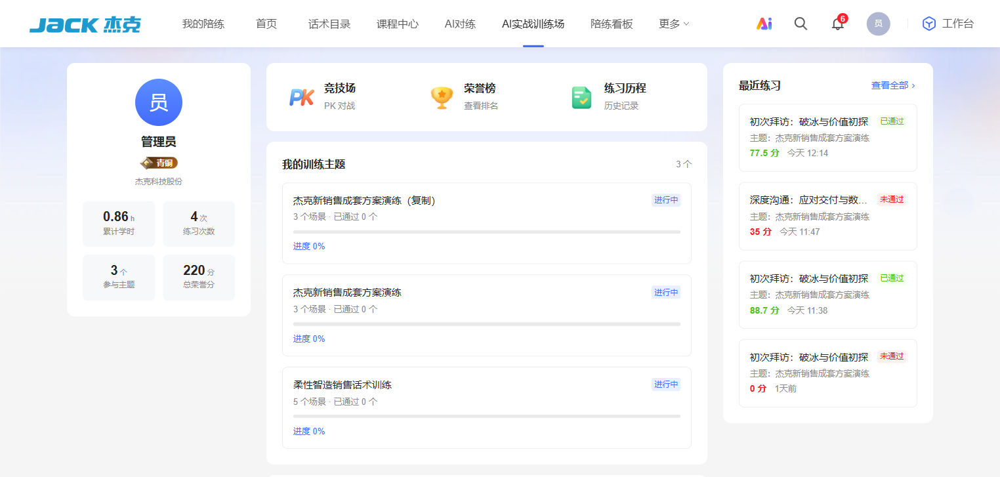
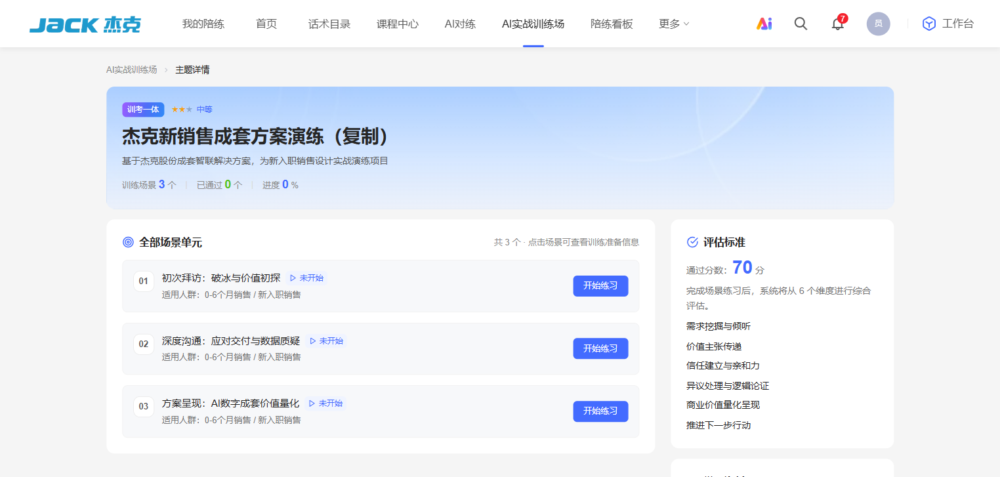
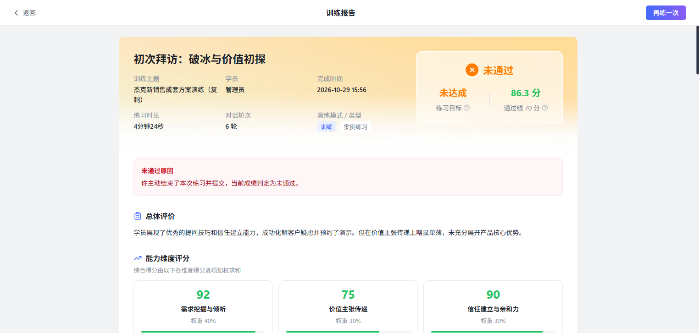
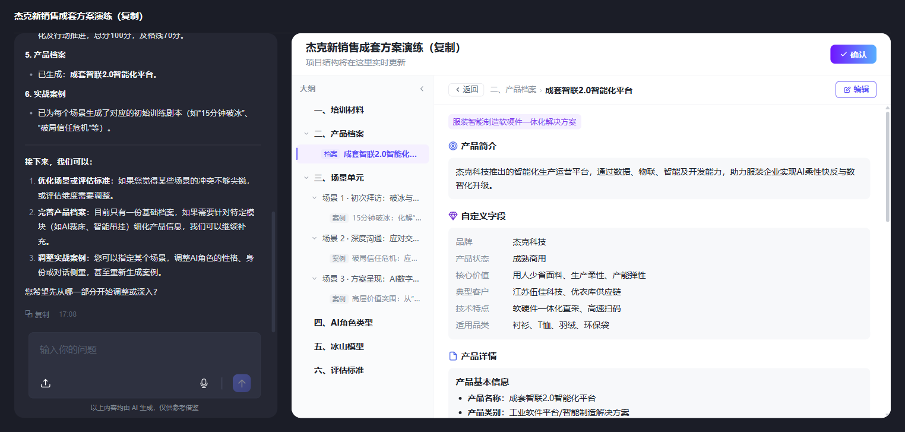
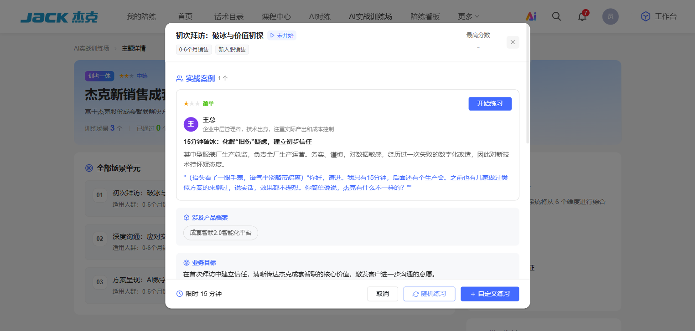
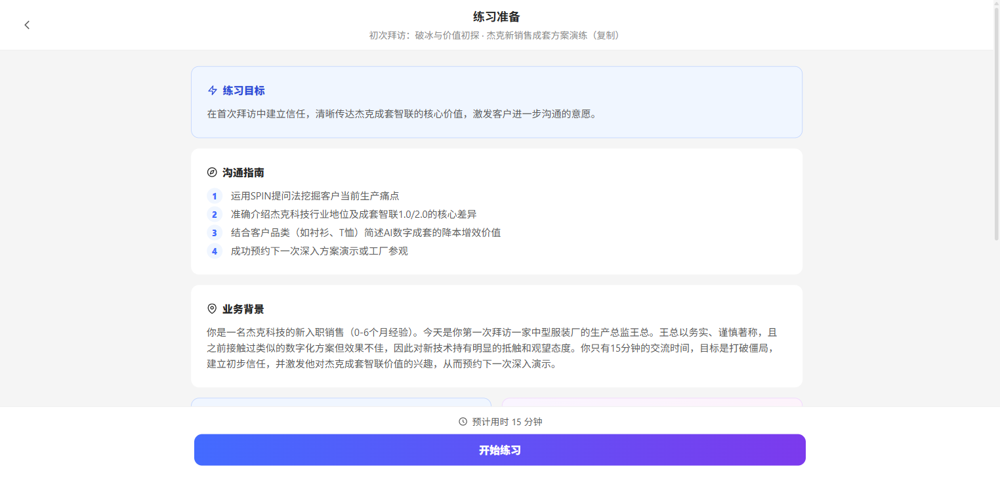
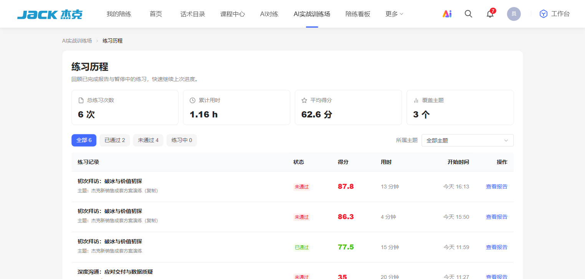
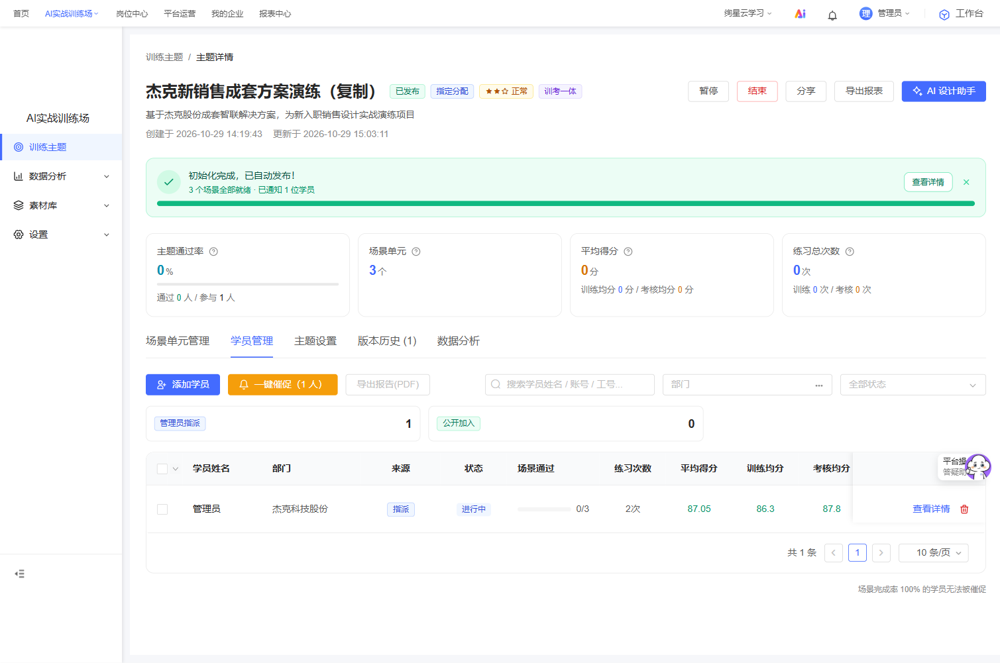
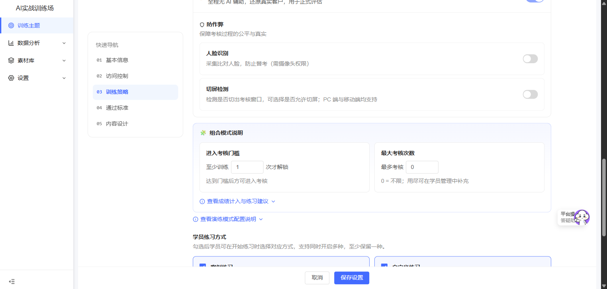

# AI实战训练场学员端与训考闭环需求文档

> 版本：v1.1 ｜ 日期：2026-10-30
> 参照：`https://train.chinajack.com/sparring/#/web/drillmate` 及管理端主题控制台
> 配套：`00-整合说明与决策记录.md`、前后端技术方案、接口和建表 SQL

## 1. 概述

### 1.1 目标

让学员从顶部导航进入 AI 实战训练场，完成“选主题 -> 选场景 -> 选择练习方式 -> 准备 -> 对练 -> 报告 -> 重练/查看历史”的闭环；让管理员能管理参与学员、查看训练与考核结果，并确保每次练习可追溯到明确的内容版本、全局设置和评分依据。

### 1.2 范围

本期包含：

- 学员端首页、主题详情、场景准备、三类练习、准备页、训练、考核、报告、练习历程和文件查看。
- 管理员主题设置补充、内容版本、发布快照、产品档案、学员管理和学员记录。
- 在线课堂文档素材进入 AI 设计助手与学员学习资料。

本期不包含：

- 知识空间。
- 学员主动申请并等待审批。
- 竞技场和荣誉榜的真实业务。
- 实时口型驱动和真人视频生成。
- 手机 App 专属能力。

### 1.3 关键页面







## 2. 角色与术语

| 角色/术语 | 说明 |
|---|---|
| 学员 | 进入学员端参与训练、考核、查看报告的人 |
| 管理员 | 创建主题、发布、管理学员和查看统计的人 |
| 主题 | 一组场景、评估标准、学习资料、产品档案和训练策略的集合 |
| 内容版本 | 只描述主题内容，首次发布才产生 `v1` |
| 全局设置 | 访问、时间、模式、AI 辅助、防作弊、通过标准等，不随内容版本递增 |
| 场景 | 一次业务对练情境 |
| 实战案例 | 场景中已生成并发布的固定案例脚本 |
| 随机练习 | 系统基于场景生成具体客户、事件和角色细节 |
| 自定义练习 | 学员补充场景、角色、产品档案和难度后生成脚本 |
| attempt | 一次正式训练或考核会话，是次数、消息、报告和快照的归属对象 |
| 训练模式 | 有 AI 教练点评和可选建议，成绩不参与主题最终通过 |
| 考核模式 | 无 AI 辅助，成绩参与通过判定 |
| 训考一体 | 同一主题同时启用训练与考核，先训练解锁考核 |

## 3. 用户流程

### 3.1 学员主流程

```text
学员端顶部 AI实战训练场
  -> 学员首页
  -> 我的训练主题
  -> 主题详情
  -> 场景准备
  -> 选择实战案例 / 随机练习 / 自定义练习
  -> 选择训练 / 考核（仅混合模式）
  -> 资格与次数检查
  -> AI 准备页
  -> 正式对练
  -> 报告
  -> 再练一次 / 返回主题 / 查看练习历程
```

### 3.2 管理端主流程

```text
AI 设计助手生成内容与产品档案
  -> 点击确认
  -> 首次发布 v1 / 已发布后确认即发布下一版本
  -> 添加学员
  -> 学员训练与考核
  -> 学员管理查看状态、次数、均分、场景分布和对练记录
```

### 3.3 混合模式流程

```text
训练未达门槛：考核按钮显示“完成 N 次训练后解锁考核”
  -> 学员完成训练 attempt
  -> 服务端按训练次数实时计算解锁状态
  -> 达到门槛后“开始考核”可用
  -> 考核 attempt
  -> 考核报告参与主题通过判定
```

## 4. 功能需求

### F01 学员端入口与导航

- 描述：学员端顶部“AI实战训练场”从禁用文字改为真实导航项。
- 点击后进入 `/sparring/web/drillmate`。
- 当前在首页、详情、历程、运行时“AI实战训练场”保持激活态。
- 原有“AI对练”、我的陪练、首页导航不回退。
- 验收：
  - 点击导航进入学员首页。
  - 直接刷新 `/sparring/web/drillmate` 不白屏。
  - 管理端会话不能误入学员路由，学员会话不能调用管理 API。

### F02 学员首页数据面板

- 展示头像、姓名、部门、岗位。
- 四项统计：累计学时、练习次数、参与主题、总荣誉分。
- 首期不展示等级/段位。
- 总荣誉分首期前端固定显示 `20`，接口可返回 null 并标注 mock。
- 数值超过 1 万使用“万/亿/万亿”缩写。
- 验收：
  - 无岗位或部门时显示 `--`。
  - 统计数据加载失败不阻塞首页其他区块。

### F03 快捷入口

- “竞技场 PK 对战”和“荣誉榜”显示占位卡，点击提示“功能建设中”。
- “练习历程 历史记录”进入练习历程页。
- 占位卡保留视觉位置，不创建伪造排名。

### F04 我的训练主题

- 数据来自当前学员的参与关系，不直接查全部已发布主题。
- 卡片展示主题名、状态、`N 个场景 · 已通过 M 个`、进度条和百分比。
- 默认最多展示 4 个，超过后“显示更多/收起”。
- 进度：`floor(passedScenarioCount / scenarioCount * 100)`。
- 状态：
  - 全部场景通过：已通过。
  - 主题已结束：已结束。
  - 有 attempt 或参与记录：进行中。
  - 其他：未开始。
- 点击进入主题详情。

### F05 更多学习机会

- 只展示已发布、当前在计划时间内、允许完全公开、当前学员尚未加入的主题。
- 首页最多请求 6 个。
- 点击“立即加入”创建参与关系并提示“已加入主题”。
- 首期不展示申请审批。
- 自己已加入或计划时间外的主题不得出现在列表。

### F06 最近练习

- 取当前学员练习记录最新 1 条。
- 展示场景名、状态、主题名、得分、相对时间。
- 点击整卡进入该次报告；点击“查看全部”进入练习历程。
- 状态使用本契约统一枚举，不复用原平台含混的 `passed=1/studyStatus=20` 组合。
- 无记录时显示空态，不隐藏整张卡。

### F07 主题详情

- 页头展示模式、难度、主题名、描述、场景数、已通过数和进度。
- 左侧展示全部场景：
  - 两位序号。
  - 场景名与状态。
  - 适用人群前两个标签。
  - 练习次数、最高分。
  - “开始练习 / 继续练习 / 再练一次”按钮；混合模式可显示训练与考核两个动作。
- 右侧依次展示：
  - 评估标准。
  - 学习资料。
  - 产品档案。
  - 我的训练记录。
- 计划时间外、主题暂停/结束或内容未发布时，页面可查看但不能开始新 attempt。

### F08 学习资料与产品档案

- 学习资料只展示发布快照中 `visibility=student` 的材料。
- 卡片展示名称、类型、大小、来源。
- 点击在线课堂材料进入在线课堂查看器；点击 ACT 本地材料进入受保护文件流页面。
- 产品档案展示名称、分类、简介；点击打开详情弹窗。
- 详情包含自定义字段和 Markdown“产品详情”。
- 无产品档案时展示空态，不创建占位假数据。



### F09 场景准备弹窗

- 打开时按当前学员和发布版本读取场景快照。
- 展示：
  - 场景名、状态、适用人群。
  - 练习次数、最高分、难度、限时。
  - 实战案例卡、角色与背景。
  - 涉及产品档案。
  - 业务目标、影响、失败代价、核心冲突。
  - 常见失败模式、困难挑战、禁止行为。
  - 场景评估维度和权重。
- 底部按设置只展示已开启的练习方式。
- 所有方式均不可用时说明原因。



### F10 实战案例练习

- 点击案例“开始练习”后先执行资格检查。
- 打开确认弹窗，展示限时、训练或考核说明、AI 辅助、成绩是否计入。
- 混合模式同时启用训练和考核时，先选择本次要进入的模式。
- 训练模式说明包含教练点评与建议；考核模式明确“无 AI 辅助”。
- 取消不创建 attempt、不扣次数。

### F11 随机练习

- 展示简单/中等/困难三档；主题不允许自定义难度时只显示主题难度说明。
- 每档展示荣誉分说明，首期荣誉分可以只展示不参与总分。
- 难度只影响 AI 角色抵触强度，不改变场景范围。
- 确认后进入模式选择和资格检查。

### F12 自定义练习

- 使用动态步骤，不写死五步：
  - 关联产品档案（主题允许多个档案时出现）。
  - 还原场景：发生时间、地点、现场情况、事情起因，必填。
  - 丰富角色：快捷角色类型、角色名必填、身份、性格多选、背景。
  - 选择难度（允许自定义难度时出现）。
  - 预览确认。
- 角色快捷类型只辅助填写，不替代自定义字段。
- 预览显示全部输入。
- 取消不创建 attempt。

### F13 Attempt 资格与次数

- 创建 attempt 前统一执行：
  - 学员已加入主题。
  - 主题已发布、未暂停/结束。
  - 当前时间在计划区间。
  - 内容版本和场景存在。
  - 练习方式已启用。
  - 该用户同主题无活动 attempt。
  - 场景次数未用尽。
  - 训练/考核模式可进入。
  - 混合模式已达到训练解锁门槛。
  - 考核次数未用尽。
- 服务端返回结构化拒绝码和可读文案。
- 创建 attempt 只做预占，不扣次数。
- 正式点击“开始对练”时在同一事务中再次校验并扣次数。

### F14 AI 准备流程

- 创建 attempt 后进入深色准备页：
  1. 分析场景信息。
  2. 构建对话剧本。
  3. 生成角色身份。
  4. 准备就绪。
- 进度通过服务端推送，可刷新恢复。
- 案例模式可复用发布快照中的案例脚本；随机/自定义模式生成新的 attempt 脚本。
- 准备生成失败：
  - attempt 标记 `preparation_failed`。
  - 不扣次数。
  - 提供重试和返回。

### F15 练习准备页

- 展示练习目标、沟通指南、业务背景、学员角色、AI 演员、评估标准、预计用时。
- 底部“开始练习”。
- 页面刷新后从 attempt 快照恢复，不重新生成。
- 点击开始前显示限时确认：
  - 到时自动结束并生成报告。
  - 通过要求为达到目标且综合分不低于场景通过分。
- 确认后 attempt 进入 `in_progress`，开始计时并扣次数。



### F16 训练运行

- 深色沉浸式页面，包含 AI 角色形象、场景旁白、对话区、输入区和背景介绍抽屉。
- 顶部显示剩余时间、目标达成度、对话方式、聊天记录和帮助。
- 对话方式来自主题全局设置 `dialog_modes`，只展示已启用的语音/文字模式；两种都启用时允许运行中切换。
- 支持文字和语音输入；语音经 ASR 后回填，学员确认后发送。
- AI 台词支持 TTS 播报、继续播报和字幕。
- 训练模式支持教练点评；`suggestion_enabled` 时可在学员应答前请求建议。
- 每轮返回目标进度、轮次和剩余时间。
- 断线重连恢复消息、计时和最后状态。
- 禁止同一 attempt 在两个窗口同时推进对话。


### F17 退出、暂停与到时

- 退出练习必须二次确认：
  - “退出后本次记录会保存并生成报告”。
  - 主动退出后 `passed=false`。
- 训练可暂停时，暂停期间服务端不计时；考核默认不可暂停。
- 剩余时间归零时服务端主动结束，不依赖浏览器计时器。
- 达到最大轮次时结束。
- 计划结束时间到达时强制结束进行中 attempt。
- 所有结束路径最终都必须产生且仅产生 1 份报告。

### F18 训练/考核报告

- 报告展示：
  - 场景、主题、学员、完成时间、时长、轮次、学习模式、练习类型。
  - 是否通过、是否达成目标、综合分、通过线。
  - 总体评价。
  - 维度得分、权重、加权公式和证据。
  - 优秀表现、改进建议、关键对话片段、推荐下一步。
  - 完整对话回放。
- `passed`、`target_reached`、`timed_out` 分开展示，不制造互相矛盾的状态。
- 主动结束、切屏违规、系统失败需展示具体原因。
- “再练一次”创建新 attempt，不打开旧会话。

### F19 混合模式与考核

- 训练模式开启时，教练点评必选；应对建议可选。
- 考核模式无教练点评和建议。
- 考核开始前执行防作弊预检。
- 考核中按设置采集人脸/切换屏幕事件。
- 达到切屏上限立即结束并提交；人脸校验失败由配置决定阻止开始或结束。
- 训练达到 `minTrainCountToUnlockExam` 后解锁考核。
- 最大考核次数用尽后禁止新考核；管理员可追加次数。
- 考核成绩计入主题通过。


### F20 练习历程

- 页面标题“练习历程”。
- 四项统计：总练习次数、累计用时、平均得分、覆盖主题。
- Tab：全部、已通过、未通过、练习中。
- 所属主题下拉只列有记录的主题。
- 表格列：练习记录、学习模式、状态、得分、用时、开始时间、操作。
- 进行中操作为“继续练习”，已结束为“查看报告”。
- 服务端分页，默认 20 条。
- 空态、加载态、错误态完整。



### F21 主题详情训练记录抽屉

- 点击最近记录或“查看全部”打开 900px 右侧抽屉。
- 最近记录默认展示最多 10 条；抽屉支持状态、场景、学习模式筛选。
- 数据由服务端按当前主题和学员过滤。
- 进行中可继续；已结束可查看报告。

### F22 管理端学员管理

- 工具栏：添加学员、搜索、来源、状态、学习模式。
- 汇总：指派人数、公开加入人数、训练总次数、考核总次数。
- 表格：姓名、部门、来源、状态、场景通过、训练次数、考核次数、平均分、训练均分、考核均分、最近活跃、操作。
- 添加学员复用组织选人能力：
  - 部门下拉树。
  - 姓名/账号/工号搜索。
  - 服务端分页。
  - 右侧已选区域。
  - 已在名单用户禁用。
- 操作：查看详情、调整考核次数、移出主题。
- 学员详情包含“综合分析 / 对练记录 / 场景分布”。
- 对练记录按全部/训练/考核筛选。
- “催促”和 PDF 导出后置。



### F23 主题设置、版本与发布

- 全局设置包含：
  - 计划时间、访问控制、模式、AI 响应、AI 辅助、语音/文字对话方式、防作弊、练习方式、难度、通过标准、混合模式门槛与最大考核次数。
- 设置保存不创建内容版本。
- 首次发布前不显示版本号或版本历史。
- 首次成功后产生 `v1`。
- 已发布后 AI 内容确认直接发布下一版本；版本历史即时增加。
- 训练/考核模式开关发布后锁定；复制主题后才能调整。
- AI 辅助、防作弊等设置可在发布后修改，但只影响新 attempt。
- 发布必须校验：
  - 已确认工作内容。
  - 至少 1 个场景。
  - 每个场景有可运行案例或生成配置。
  - 评估维度权重合计 100。
  - 启用模式所需设置完整。
  - 人脸识别启用时比对供应商可用。



### F24 产品档案

- AI 设计助手右侧增加“产品档案”模块。
- 产品档案字段：
  - 名称。
  - 分类/副标题。
  - 简介。
  - 自定义字段键值对。
  - Markdown 产品详情。
  - 来源 artifact 与版本。
- 管理员可新建、编辑、删除；AI 可从材料生成候选档案。
- 场景可关联 0~N 个产品档案。
- 自定义练习可选择一个或多个已关联档案。
- 发布时冻结产品档案内容和字段快照。
- 学员只读取发布快照。
- 产品档案使用稳定 `profileKey`；字段结构、生成接口和校验见 `09-产品档案artifact契约.md`。

### F25 在线课堂材料与 AI 设计助手

- “上传资料”菜单：
  - 从在线课堂选择。
  - 从知识空间选择（置灰）。
  - 本地上传。
- 在线课堂抽屉：
  - 分类、关键词、真实分页。
  - 名称、课时、创建人、更新时间、有效期。
  - 有效期无值显示 `--`。
  - 最多 5 个，跨页保留。
- 首次只开放文档课件。
- 确定后逐条解析：
  - “培训材料”Tab 更新。
  - 聊天消息流出现一张“解析完成”卡片。
- 同一课件按 `fileSource=onlineClassroom + coursewareId` 去重。
- AI 出题入口已有素材文本时，提取知识点必须二次确认覆盖。
- 发布后可见材料进入内容版本快照。

### F26 文件查看器

- 统一页面 `/sparring/web/drillmate/files/:materialId`。
- 在线课堂材料复用在线课堂课件查看/播放能力。
- ACT 本地 PDF/TXT/Markdown 直接查看；Office 文件优先使用异步生成的 PDF 预览。
- Office 转换器不可用或转换失败时，使用提取文本阅读并明确提示“版式可能不同”，同时允许下载原文件。
- 不向前端暴露磁盘路径。
- 详细状态、转换器、接口和验收见 `11-本地材料查看方案.md`。

## 5. 界面与交互规格

### 5.1 首页

- 内容最大宽度 1200px，三栏：学员概览 280px、主内容约 672px、最近练习 320px。
- 桌面栏间距 24px；白卡圆角 12px、内边距 24px。
- 主题卡和记录卡圆角 8px、边框 `#e9e9e9`。
- 主色 `#436bff`；成功绿、警告橙、失败红使用语义色，不只靠颜色表达状态。
- 最近练习 hover 只改变边框为主色，过渡 150ms。

### 5.2 主题详情

- 主体最大宽度 1200px，左栏约 836px，右栏约 340px。
- Banner 使用原有蓝紫渐变和模式/难度标签。
- 场景卡之间有稳定间距；状态标签和操作按钮不因标题长度位移。

### 5.3 弹窗与抽屉

- 场景准备 800px，随机/自定义 800px，限时确认 480px。
- 训练记录抽屉 900px，管理端添加学员 1040px。
- 内容区独立滚动，底部按钮常驻。
- 日期、下拉、抽屉的 z-index 层级必须一致；不得出现选择器落在遮罩和弹窗之间。
- 输入框宽度按内容自适应，避免横向前后滚动才能操作。

### 5.4 运行时

- 深色全屏，顶部状态栏固定。
- 右侧背景介绍抽屉 324px，可关闭。
- 输入区始终可见；长对话只滚消息区。
- 移动端至少可完成文字训练；语音按钮受浏览器权限能力降级。

## 6. 状态与文案

### 6.1 attempt 状态

| 状态 | 含义 | 记录是否展示 | 可操作 |
|---|---|---|---|
| preparing | 正在生成脚本/角色 | 否 | 查看准备页 |
| ready | 准备完成，未开始 | 否 | 开始、退出 |
| in_progress | 正式对练中 | 是 | 继续练习 |
| report_generating | 已结束，报告生成中 | 是 | 查看进度 |
| completed | 报告完成 | 是 | 查看报告、重练 |
| failed | 准备或系统失败 | 是，标失败原因 | 重试/返回 |

### 6.2 结果文案

| 场景 | 文案 |
|---|---|
| 到时 | 本次练习时间已结束 |
| 主动退出 | 你主动结束了本次练习并提交 |
| 目标达成 | 已达成练习目标 |
| 目标未达成 | 未达成练习目标 |
| 通过 | 已通过 |
| 未通过 | 未通过 |
| 报告生成中 | 正在生成训练报告 |

### 6.3 空态

- 无参与主题：“暂未加入训练主题”。
- 无可加入主题：“暂无可加入的主题”。
- 无练习记录：“暂无练习记录”。
- 无学习资料：“暂无学习资料”。
- 无产品档案：“暂无产品档案”。
- 所有空态保持区块结构，不用一条 toast 代替。

## 7. 权限与安全

- 学员只能读取自己的参与关系、attempt、报告和材料。
- 管理 API 需要 `act:training` 权限；学员 API 需要登录态。
- 学员端接口不得返回 draft、未发布版本、内部材料和磁盘路径。
- 材料预览和下载都必须鉴权。
- 语音文件、人脸抓拍和对话内容属于敏感数据，按最短保留和最小可见原则处理。
- 不将 TTS/ASR、人脸识别 key 下发浏览器。

## 8. 非功能需求

- 前端所有 ID 使用 string。
- 列表首次加载 2 秒内出现骨架或 loading；准备/报告等长任务显示真实阶段。
- WS 断线指数退避重连，页面刷新可恢复。
- 倒计时与结束由服务端时间裁决，浏览器时间只用于显示。
- attempt 开始、扣次、活动会话唯一性必须事务或原子更新保证。
- 报告生成、脚本生成和消息回复具备幂等键。
- 移动端 375px 起无横向页面级溢出；核心文字与按钮不重叠。
- 所有图标按钮有 `aria-label` 或 tooltip。

## 9. 验收清单

| 编号 | 验收项 |
|---|---|
| AC-01 | 顶部导航可进入学员首页并正确高亮 |
| AC-02 | 首页三栏、统计、主题、机会、最近练习均有真实状态 |
| AC-03 | 更多学习机会只出现公开且未加入且计划期内的主题 |
| AC-04 | 主题详情正确展示场景、评估、资料、档案和最近记录 |
| AC-05 | 场景准备按设置展示三类练习入口 |
| AC-06 | 随机练习难度、自定义练习动态步骤可完整操作 |
| AC-07 | 混合模式未达训练门槛时考核不可进入，达门槛后解锁 |
| AC-08 | 准备页刷新不重复生成，失败不扣次数 |
| AC-09 | 正式开始时才扣次数，重复点击不重复扣 |
| AC-10 | 训练文字、语音、TTS、教练点评、建议可用 |
| AC-11 | 考核无 AI 辅助，防作弊事件被记录并按规则结束 |
| AC-12 | 到时/退出/轮次/计划结束都只生成一份报告 |
| AC-13 | 报告区分通过、目标达成、到时和主动退出 |
| AC-14 | 再练一次创建新 attempt |
| AC-15 | 练习历程和主题记录按当前用户正确过滤、分页 |
| AC-16 | 管理端可添加、移除、调整考核次数并查看学员详情 |
| AC-17 | 设置保存不产生版本；发布与 AI 确认符合版本决策 |
| AC-18 | 产品档案 CRUD、场景关联和发布快照完整 |
| AC-19 | 在线课堂文档导入同时更新材料 Tab 和解析消息 |
| AC-20 | 文件查看按来源正确分流且不泄露路径 |
| AC-21 | 计划开始前/结束后不能新开 attempt |
| AC-22 | 所有敏感数据不出现在前端响应、日志和抓包证据中 |
| AC-23 | AIGentService 脚本/回合/报告全部通过对应 schemaVersion 校验 |
| AC-24 | 迁移后未发布主题只有隐藏 v0，已发布主题指针和场景/维度映射正确 |
| AC-25 | Office 转换器缺失时仍可文本阅读和下载，不影响材料解析与发布 |
