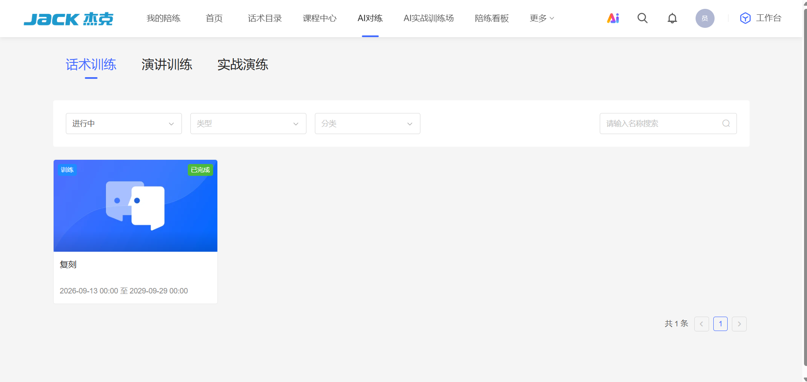
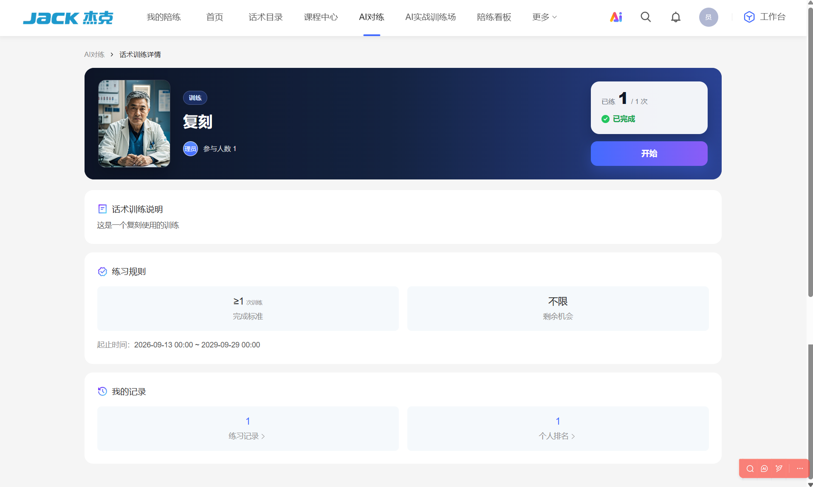
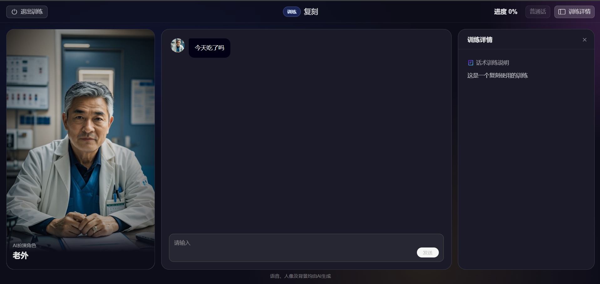
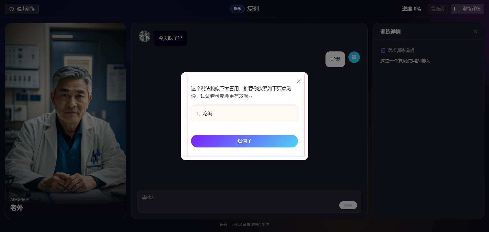
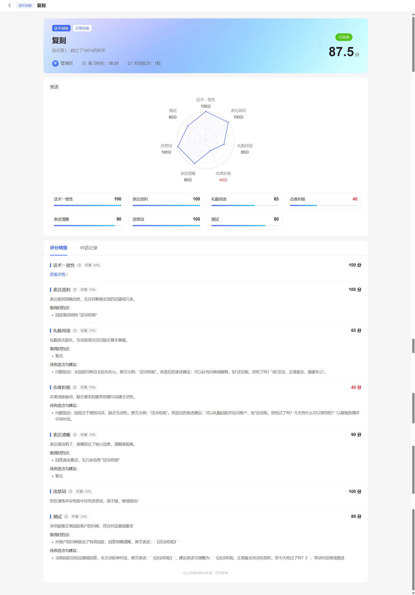

# 学员端 AI对练-话术训练 复刻需求文档

**项目名称**: 学员端 AI对练-话术训练模块
**版本**: v1.1（新增语音对话与陪练者形象，FP-24~28）
**日期**: 2026-09-15
**参照平台**: 杰克数字人陪练（云学堂）学员端 https://train.chinajack.com
**前端工程**: `D:\JACK\final_dream\front-end`（在现有工程内扩展）
**后端工程**: `D:\JACK\final_dream\after-end\SpeechTraining`（在现有工程内扩展）

---

## 1. 项目概述

### 1.1 复刻目标

复刻数字人平台**学员端**"AI对练"功能模块中的**话术训练**入口，覆盖完整学习闭环：

```
话术训练列表页 → 话术训练详情页 → 开始 → 训练对话页（按流程拓扑对话）
→ 流程完成 → AI 训练报告页（评分明细 + 对话记录） → 练习记录
```

### 1.2 范围边界

- **做**：话术训练入口的 4 个页面（列表/详情/训练/报告）+ 练习记录二级页 + 语音对话模式（TTS 播报 + 录音输入 ASR，FP-24~25）+ 虚拟陪练者 AI 形象生成与展示（FP-26~27）+ 后端学员端接口 + Dify 报告评分智能体 DSL。
- **不做**（详见附录A）：演讲训练、实战演练入口、悬浮工具栏、断线恢复、分类体系、code 一次性令牌、钉钉人员同步。数字人视频（口型驱动）已于 2026-09-24 立项为 v1.3（见 08 专项方案与 FP-29，实施待 GPU 前置条件确认）。

### 1.3 参照来源（证据）

| 素材 | 说明 |
|------|------|
| 平台走查 | 2026-09-14 实际登录 train.chinajack.com 走查全部 4 个页面并实测对话流转（含撤回/弹窗/跳转报告） |
| 截图 | `screenshots/01~07`（本文档各节引用；06/07 为 v1.1 增量参照） |
| 已有代码 | 管理端前后端代码（含流程节点/流转条件/评分维度/虚拟陪练者数据模型） |
| 已有文档 | `D:\JACK\plan\话术训练模块\`（管理端需求/技术方案/接口文档） |

---

## 2. 术语与角色

| 术语 | 说明 |
|------|------|
| 学员 | 使用学员端的受训人员。本版本使用 mock 固定学员（user_id=`mock_student_001`，姓名"学员"），钉钉人员同步后替换 |
| 训练项目 | 管理端创建并发布的 `training_project`（日常训练/通关考核） |
| 流程 | 项目的对话拓扑：开始节点 → 大节点（陪练者节点+学员节点）→ … → 结束节点，连线带权重 |
| 学员节点 | 大节点中需要学员回答的节点，含标准话术、要点（keyPoints）、流转条件（passCondition） |
| 流转条件 | 学员回复需命中要点才可流转：`命中任意N个` 或 `命中指定要点` |
| 练习（会话） | 学员从点"开始"到流程结束/退出的一次完整训练，落库为 `training_session` |
| 轮次 | 一个学员节点的问答记 1 轮（陪练者问 + 学员答） |
| 报告 | 流程结束后由 Dify 报告评分智能体生成的评分明细 + 对话记录 |
| 语音对话模式 | dialogueMode=0 的项目：陪练者消息自动 TTS 播报（FP-24）。v1.2 起学员录音输入不再属于该模式的专属能力 |
| ASR / TTS | 语音识别（v1.2 起为**豆包 / 火山引擎 SAUC v3**，原阿里云百炼 Paraformer 下线）/ 语音合成（阿里云百炼 CosyVoice） |
| 陪练者形象 | 管理端"虚拟陪练者设置"中 AI 生成或上传的形象图片，学员端训练页左栏展示（FP-26/27） |

---

## 3. 页面清单与路由

路由与原平台对齐（hash 模式），在现有 `front-end` 工程的 `/sparring` 路由组下扩展：

| 序号 | 页面 | 路由 | 截图 |
|------|------|------|------|
| 1 | 话术训练列表 | `/sparring/#/web/speech/list` | screenshots/01-列表页.png |
| 2 | 话术训练详情 | `/sparring/#/web/script/detail/:projectId` | screenshots/02-话术训练详情页.png |
| 3 | 训练对话页 | `/sparring/#/web/script/training/:projectId`（query: `sessionId`） | screenshots/03-训练进行页.png、screenshots/04-要点提示弹窗.png |
| 4 | 训练报告页 | `/sparring/#/standpracticereport`（query: `sessionId`） | screenshots/05-训练报告页.png |
| 5 | 练习记录列表 | `/sparring/#/web/script/records/:projectId` | 无原平台截图，按详情页"我的记录"卡信息自行设计 |

> 原平台训练页 URL 还带 `code`（一次性令牌）与 `flowId`，本版本不复制令牌机制，flowId 由后端从项目流程读取，URL 仅保留 `sessionId`。

---

## 4. 功能需求

### 4.1 列表页（`/web/speech/list`）



#### FP-01 三入口 Tab
- **功能描述**：页面顶部三个 Tab：话术训练（默认选中）、演讲训练、实战演练。
- **交互**：话术训练可点击切换内容；演讲训练/实战演练置灰不可点击（或点击显示空态"暂未开放"）。
- **证据**：截图 01；平台走查（AI对练页顶部三个 Tab，话术训练带蓝色下划线）。

#### FP-02 筛选栏
- **功能描述**：白色圆角筛选卡，从左至右：
  - **状态下拉**：未开始 / 进行中（默认选中）/ 已过期 / 已结束（口径见 FP-18）
  - **类型下拉**：训练 / 考核（placeholder"类型"）
  - **搜索框**：placeholder"请输入名称搜索"，按项目名称模糊搜索
  - （原平台还有"分类"下拉，**不做**，界面不出现该控件）
- **交互**：任一筛选条件变化即重新请求列表（带分页参数回到第 1 页）。
- **证据**：截图 01；走查实测下拉选项。

#### FP-03 项目卡片网格
- **功能描述**：卡片式网格（每行自动换行），单卡片结构：
  - 封面图区域（无自定义封面时显示蓝色渐变+双对话气泡默认图）
  - 左上角徽标：`训练`（蓝）或 `考`字样（考核类，橙色）
  - 右上角状态徽标：学员已达标时显示绿色`已完成`，否则不显示
  - 标题（项目名称）
  - 起止时间：`2026-09-13 00:00 至 2029-09-29 00:00`（灰色小字）
- **交互**：点击卡片任意区域进入详情页。
- **证据**：截图 01；"已完成"=学员达标为确认口径（决策记录 FP-03）。

#### FP-04 分页
- **功能描述**：右下角 `共 N 条` + 页码分页器，当前页蓝色边框高亮，首/末页箭头置灰。
- **交互**：切页请求对应页数据。

#### FP-03/04 验收标准
- Given 已发布项目 A（进行中，学员未达标） When 进入列表页 Then 状态筛选默认"进行中"，卡片显示蓝色"训练"徽标、无"已完成"徽标，分页显示"共 1 条"
- Given 学员在项目 A 已练次数≥完成标准 When 刷新列表 Then 卡片右上角显示绿色"已完成"徽标
- Given 选择状态"未开始" When 存在开始时间晚于当前时间的项目 Then 仅显示该项目

### 4.2 详情页（`/web/script/detail/:projectId`）



#### FP-05 面包屑
- **功能描述**：页面顶部 `AI对练 › 话术训练详情`，"AI对练"可点击返回列表页。

#### FP-06 头部信息卡（深蓝渐变横幅）
- **功能描述**：
  - 左侧：项目封面（方形圆角）
  - 中部：`训练`pill 徽标 + 项目名大标题 + 小头像与`参与人数 N`
  - 右侧：白色圆角面板显示 `已练 N / M 次`（N=学员已练次数，M=完成标准）+ 学员已达标时绿色 ✓`已完成`；面板下方**开始**按钮（蓝紫渐变、宽按钮）
- **交互**：点击"开始"→ 调后端创建练习会话 → 新窗口打开训练对话页。
- **证据**：截图 02。

#### FP-07 话术训练说明卡
- **功能描述**：白色卡片，标题"话术训练说明"（带文档图标），正文为项目 `description`。

#### FP-08 练习规则卡
- **功能描述**：白色卡片，两个浅灰内嵌面板：
  - 左：`≥N 次训练` / 小字`完成标准`（N=completion_standard；考核类显示`达标分数 ≥ X 分`）
  - 右：`不限` / 小字`剩余机会`（本版本不做次数上限，恒为"不限"）
  - 底部灰字：`起止时间：{start} ~ {end}`

#### FP-09 我的记录卡 + 练习记录二级页
- **功能描述**：白色卡片，两个浅灰内嵌面板：
  - 左：蓝色数字（练习记录条数）+ 可点击文字`练习记录 ›`
  - 右：蓝色数字（个人排名）+ 文字`个人排名 ›`（本版本排名数字展示，点击不跳转）
- **练习记录二级页**（`/web/script/records/:projectId`）：返回按钮 + 项目名标题；列表展示该学员在此项目的历次练习：练习时间、状态（已完成/未完成）、得分、对话轮次、操作（已完成记录可"查看报告"跳报告页）。
- **数据口径**：所有记录按 mock 学员 user_id 落库与查询（决策记录 FP-09）。
- **验收标准**：
  - Given 学员完成一次练习 When 进入详情页 Then "我的记录"显示练习记录 1，点"练习记录›"进入二级页可见该记录且可查看报告
  - Given 学员中途退出一次练习 When 进入练习记录页 Then 显示一条"未完成"记录，无"查看报告"入口

### 4.3 训练对话页（`/web/script/training/:projectId?sessionId=xxx`）





#### FP-10 三栏布局
- **功能描述**：深色（深蓝紫渐变背景）三栏布局：
  - **左栏**：虚拟陪练者形象卡片（**FP-26/27**：展示项目保存的陪练者形象图片，未设置时显示内置默认陪练者形象图），卡片为 **1:1 正方形**（生图模型固定输出 1024×1024 方图），小字`AI扮演角色`+ 陪练者名称（取 `virtual_trainer.trainer_name`）显示在图片**下方**。口型视频本期未实施；FP-29 已立项，待 S3 前置条件满足后接入。
  - **中栏**：对话区（见 FP-12），底部输入框（placeholder`请输入`）+ 白色胶囊`发送`按钮（输入为空时置灰）；底部页面级灰字：`语音、人像及背景均由AI生成`
  - **右栏**：`训练详情`面板（默认展开）：标题 + ×关闭按钮；`话术训练说明`小标题 + 项目说明正文
- **交互**：右栏可通过顶部"训练详情"按钮开/关；关闭后中栏占满。
- **证据**：截图 03。

#### FP-11 顶部栏
- **功能描述**：深色顶栏：
  - 左：`退出训练`按钮（电源图标）
  - 中：`训练`pill 徽标（蓝）+ 项目名
  - 右：`进度 N%`（口径：**已完成对话轮次 / 流程总轮次**，学员消息通过流转判定即计 1 轮完成）+ `普通话`**静态徽标** + `训练详情`开关按钮
- **`普通话` 徽标口径**（2026-09-23 由按钮改为静态标记）：识别与评分**一律按普通话处理**，没有可切换的语种能力
  （粤语等由豆包 `enable_lid` 自判后落 `training_round_acoustic.lid_lang` 供核验，见 FP-25 与 02 §4.5），
  故渲染为 `cursor:default` + `title="语音识别与评分一律按普通话处理，不提供语种切换"` 的标记而非按钮。
  原平台把它做成点了无任何反应的按钮，语义上会被读成"这里能换语种"，因此按缺陷处理（有意偏离原平台外观）。
- **验收标准**：
  - Given 流程共 2 个学员节点，学员已通过 1 轮 When 处于训练页 Then 顶部显示"进度 50%"

#### FP-12 对话流程引擎（核心）
- **功能描述**：对话严格按项目流程拓扑进行：
  1. 进入页面后，从流程的**开始节点**沿连线走到第一个大节点的**陪练者节点**，在对话区左侧显示陪练者气泡（陪练者问文本 + 陪练者头像）
  2. 学员发送消息（文字模式：输入框文字；语音模式：录音经 ASR 转文字，见 FP-24；两者进入同一判定流程）→ 消息先以右侧灰色气泡显示
  3. 后端调 **Dify 话术评分器智能体**（复用已有）判定要点命中，按当前学员节点的**流转条件**（命中任意N个 / 命中指定要点）判定：
     - **通过** → 消息保留；按出边**权重随机**路由到下游节点：
       - 下游是陪练者节点 → 返回其"陪练者问"文本，左侧新增气泡
       - 下游是结束节点 → 调结束逻辑，返回 `finished=true`
     - **未通过** → 本次消息**撤回**（右侧气泡从对话区移除），弹出**要点提示弹窗**
  4. 撤回的消息在会话消息表中标记 `withdrawn=1` 留存（供报告对话记录/分析使用）
- **要点提示弹窗**（照抄原平台，截图 04）：白色圆角弹窗居中于对话区：
  - 正文：`这个说法貌似不太管用，推荐你按照如下要点沟通，试试看可能会更有效哦～`
  - 浅粉色圆角框内按序号列出当前学员节点的要点（如 `1、吃饭`）
  - 底部通栏蓝紫渐变按钮`知道了`，点击关闭弹窗，可继续作答
- **验收标准**：
  - Given 当前学员节点要点为["吃饭"]且流转条件=命中任意1个 When 学员发送"好饿" Then 右侧气泡先显示，随后被撤回，弹出要点提示弹窗显示"1、吃饭"，点击"知道了"后弹窗关闭且对话区无该消息
  - Given 同上节点 When 学员发送"还没吃饭呢，正准备去吃饭" Then 消息保留，陪练者按权重路由出下一句（或流程结束），进度+1 轮
  - Given 节点 A 有两条出边（权重 1 和 3） When 学员多次通过节点 A Then 下游命中比例约 1:3（权重随机路由）
- **证据**：截图 03/04；走查实测（发送"好饿"→撤回+弹窗；发送含"吃饭"→流转完成跳报告）。

#### FP-13 流程结束跳转报告
- **功能描述**：流程走到结束节点后：
  1. 后端将练习会话置为"已完成"并**异步**触发 Dify 报告评分智能体生成报告（详见 FP-21）
  2. 前端当前窗口跳转报告页（`/standpracticereport?sessionId=xxx`）
  3. 报告未生成完毕前，报告页显示等待态：渐变文档图标 + `报告生成中，请耐心等待` + `报告生成可能需要一些时间，请稍候...`，并轮询报告接口，完成后自动展示报告
- **交互**：`退出训练`（FP-19）→ 保存未完成记录后关闭窗口返回详情页。

#### FP-10/13 补充：页面级异常态与提示口径（2026-09-23 新增，不另立编号）
- **加载失败态**：训练页进入时若项目详情/会话数据拉取失败，**不渲染三栏骨架**，改为整块错误卡：
  一句失败文案 + 两个按钮`重新加载`（原地重试，先 `store.reset()` 再重拉）与`返回项目详情`（`router.replace` 回详情页）。
  原实现失败只 `console`，页面停在空白对话区，学员不知道该刷新还是该退出。
- **提示一律非阻塞 toast**：全站废弃 `alert()`，改用 `src/utils/toast.ts`（同屏最多 4 条、3s 自动消失、`role="status" aria-live="polite"`、层级压过弹窗）。
  两条硬理由：① `alert` 同步冻结主线程，会把录音/播报链路的后续状态更新卡住；
  ② 报告页轮询刻意"连续失败 3 次才提示"，而 `alert` 让每次网络抖动都弹窗，重试逻辑形同虚设。
  配套：axios 支持 `silent` 选项——后台自动行为（报告轮询、消息到达后自动补合成 TTS）失败不弹，用户主动点击触发的请求才弹。
- **麦克风不可用**：权限被拒或录音启动失败 → `toast.error('无法访问麦克风，已切换到键盘输入…')`（或"录音启动失败…"）并自动切到键盘形态，不阻断作答。
- **验收标准**：
  - Given 项目详情接口 500 When 进入训练页 Then 显示错误卡与两个出口按钮，不出现半空对话区
  - Given 报告接口连续失败 2 次 When 轮询 Then 页面不弹任何提示；第 3 次失败才出一条 toast
  - Given 首次自动播报 TTS 失败 When 消息到达 Then 不弹窗（静默），学员点气泡上的 🔊 重播时才提示

### 4.4 训练报告页（`/standpracticereport?sessionId=xxx`）



#### FP-14 成绩概览卡
- **功能描述**：浅灰页面上：顶部返回栏（`‹` + 蓝字`话术训练` + 项目名）；紫蓝→青渐变概览卡：
  - 左上 pill：`话术训练`（实心蓝）+ `日常训练`/`通关考核`（白底蓝字）
  - 大标题：项目名
  - 灰字：`排名第{N}，超过了{P}%的同学`（按项目内学员报告总分实时排名计算）
  - 元信息行：头像+学员名 ｜ 时钟图标+`练习时长：mm:ss`（会话开始到结束） ｜ 对话气泡图标+`对话轮次：N轮`
  - 右上：绿色 pill`已完成`；下方大号总分 `{score}分`；再下白底绿字 pill `较上次上升 N 分`（对比该学员本项目上一份已完成报告，首次练习或下降时不显示）
- **证据**：截图 05；走查实测（"排名第1，超过了100%的同学 / 91分 / 较上次上升 4 分"）。

#### FP-15 雷达图 + 维度得分卡
- **功能描述**：白色卡片（标题为`维度得分`——原平台截图此处是`发送`，语义与卡片内容无关，判为原文案缺陷，已按有意偏离处理）：
  - ECharts 雷达图，N 维（=**本次实际参与评分**的维度），轴标签`{维度名} {分数}分`，低分（<60）标红
  - 图例：实线蓝紫`本次` + 虚线青`上次`（无上次报告时仅画本次）
  - **未参与评分的维度不进坐标轴**（否则会出现 0 分尖刺，把"没评"表达成"考了 0 分"）；卡下方一行说明文案：`{维度名}未参与本次评分——{原因}`
  - **上次报告缺少本次某维度得分时，整条"上次"虚线不画**并在图下注明，不拿 0 补位（半截对比线会让人以为某几项退步到 0）
  - 全部维度均未参与评分时清空图表并显示"本次训练没有维度参与评分，暂无可展示的得分"，不显示空白图表
  - 下方维度得分小卡网格：每卡 = 维度名 + 右侧分数（低分红字；未参与显示灰字`未参与`）+ 蓝青渐变进度条（未参与不画条）
- **证据**：截图 05；`发送`文案与卡片内容无对应关系，故按缺陷处理（2026-09-23 决策）。

#### FP-16 评分明细 Tab
- **功能描述**：白色卡片，Tab：`评分明细`（默认）/`对话记录`。评分明细为维度块纵向列表，每块：
  - 左侧蓝色竖条 + 维度名 + `?`图标 + 灰色 pill `权重 {w}%` + 右对齐`{score} 分`（低分红字）
  - 总评描述一句话（如"表达极其流畅自然，无任何影响交流的迟疑或冗余。"）
  - `做得好的点:` 无序列表（引用学员原文，如 `回应简洁明快 "还没吃呢"`；无则`暂无`）
  - `待改进点与建议:` 无序列表（`问题指出：… 原文示例："…"。改进后的表述建议：…`；无则`暂无`）
  - **未参与评分的维度**（`score` 为 null）只显示维度名 + `未参与` + 原因文案，不显示"做得好的点/待改进点"两块——没有分数就没有可评的内容
  - **违禁词**块：未踩中时显示"您在演练中没有踩中任何违禁词，很不错，继续保持！"
- **要点命中详情入口**：放在 Tab 行右侧的链接`查看逐轮要点命中详情 ›`（有 `reportId` 即显示），点击弹层显示每轮要点命中情况（每轮：陪练者问、学员答、要点列表及命中/未命中标记）。
  早期实现把它挂在名为"话术一致性"的维度块里（`v-if="dim.dimensionName === '话术一致性'"`），而接口数据本身是**逐轮/报告级**的、不隶属于任何维度，维度一旦改名或自定义入口就消失，故上移为报告级入口（2026-09-23 决策，记为对原平台布局的有意偏离）。
- **数据来源**：全部维度评语/做得好/待改进由 Dify 报告评分智能体输出（FP-23）；配了 `metric_config` 的维度由后端规则定分（FP-21/FP-25）；总分=Σ(维度分×权重)/Σ**参与评分**维度的权重。
- **证据**：截图 05（含全部 7 个维度的实际文案样例）。

#### FP-17 对话记录 Tab
- **功能描述**：对话气泡列表：
  - 陪练者消息：左侧圆形头像 + 浅紫气泡。**头像与训练页左栏必须同一张脸**：取报告接口新增的 `trainerAvatar`
    （后端按 `report.projectId` 查 `virtual_trainer.avatar_image` 带出），经统一的 `trainerFace()` 解析，为空回落内置默认形象图。
    改造前三处各写各的（训练页读 Pinia、报告页气泡自拼 URL、另一处直接 import 默认图），同一会话在两页出现两张脸（2026-09-23 修正）
  - 学员消息：右侧灰色气泡 + 右侧学员头像；气泡下方操作行：✨图标 + 蓝字`改进建议`（点击展开该轮的改进建议文本，来自报告智能体的逐轮建议）+ 👍图标 + 点赞数（点击点赞，计数+1 落库，重复点击不叠加）
  - "第 N 轮"的 N 由**该条消息在学员消息序列中的序号**得出，且必须是响应式派生（`computed`）：报告页消息是异步补拉的，
    setup 期一次性快照会把所有轮次号算没，导致"改进建议"永久空白（2026-09-23 修出的真实缺陷）
  - 被撤回的消息**不展示**
- **证据**：走查实测（对话记录 Tab："今天吃了吗"/"还没吃饭呢，正准备去吃饭" + 改进建议链接 + 点赞"0"）。

### 4.5 后端功能需求

#### FP-18 学员端列表/详情接口
- **功能描述**：
  - 列表：分页查询已发布且在有效期内的项目（按 mock 学员视角），返回卡片所需字段 + 学员已完成标记 + 练习次数
  - 项目状态计算：`未开始`(now<start) / `进行中`(start≤now≤end) / `已过期`(now>end 且学员未达标) / `已结束`(学员已达标) —— "已结束"口径为推断，见附录C
  - 详情：项目基本信息 + 评分维度 + 练习规则 + 该学员已练次数/达标状态/练习记录数/排名
- **验收标准**：
  - Given 项目 start=明天 When 查列表 Then status=未开始，出现在"未开始"筛选下

#### FP-19 训练会话管理
- **功能描述**：
  - `开始`：创建 `training_session`（状态=进行中），加载项目已发布流程（节点+连线），返回 sessionId + 首个陪练者问题 + 总轮次
  - 会话消息逐条落库（role/内容/所属节点/命中要点/是否通过/是否撤回/序号）
  - `退出训练`：会话置为"未完成"结束，保留消息，不生成报告
  - 训练页刷新（sessionId 仍在）：重新拉取会话详情（历史消息+当前节点陪练者问题+进度），可继续作答（简化的恢复，不做原平台 recoverFromBreak 完整机制）
- **验收标准**：
  - Given 学员退出一次未完成练习 When 查练习记录 Then 存在一条"未完成"记录且包含已发生的对话消息

#### FP-20 消息流转判定接口
- **功能描述**：接收学员消息 → 调 Dify 话术评分器（标准话术/要点/流转条件/学员输入）→ 后端按流转条件判定 → 通过则按出边权重随机路由返回下一陪练者问题或 finished；未通过返回 `withdrawn=true` + 当前节点要点列表。
- **验收标准**：
  - Given 流转条件=命中指定要点["要点A","要点B"] When Dify 返回 hit_points 含 A、B Then 判定通过

#### FP-21 流程结束 + 报告生成
- **功能描述**：流程到达结束节点：
  1. 会话置"已完成"，计算练习时长、对话轮次
  2. **异步**（@Async）生成报告：
     - 后端量化规则定分（按维度 `metric_config` 路由，不看维度名）：违禁词按 `virtual_trainer.forbidden_words` 逗号分隔词表对学员消息做包含匹配，每命中一次扣 20 分，扣完为止，未踩中=100；语速按各轮 字数/时长 折算字/分钟套区间公式
     - 组装 Dify 输入：逐轮对话（陪练者问/学员答/该轮要点）+ **本次参与评分的**评分维度（名称/权重/评分规则；已被后端定分的维度，其规则文本里追加"后端已判定…得分为 N 分，必须采用"）+ 违禁词事实。**未参与的维度不下发**，模型不会为评不了的维度编造评语
     - 调 Dify 报告评分智能体（FP-23）解析输出
     - 计算总分=Σ(维度分×权重)、排名、超过百分比、与上次报告的分差，落库 `training_report` + `training_report_dimension`
  3. 生成失败：报告状态置"失败"，报告页显示失败提示 + 重新生成按钮
- **验收标准**：
  - Given 流程结束 When 立即查询报告接口 Then status=生成中；轮询至生成完毕后返回完整报告数据

#### FP-22 报告查询接口
- **功能描述**：
  - 按 sessionId 查询报告（含生成状态轮询）
  - 报告数据：概览（总分/排名/超过百分比/时长/轮次/较上次变化）、本次+上次雷达数据、维度明细（权重/得分/总评/做得好/待改进）、逐轮改进建议
  - 话术一致性详情：逐轮要点命中明细
  - 消息点赞：POST 更新消息 like_count
- **验收标准**：
  - Given 该学员本项目已有上一份报告（87.5 分）When 本次报告 91 分 Then 返回 scoreChange=+3.5，前端显示"较上次上升 4 分"（四舍五入取整）

#### FP-23 Dify 报告评分智能体
- **功能描述**：新建 Dify workflow 智能体（DSL 文件随文档交付：`dify报告评分智能体.yaml`，适配 Dify 1.1.0.1）：
  - 输入：`rounds`（逐轮对话 JSON：陪练者问/学员答/要点说明）、`dimensions`（**本次参与评分**的评分维度及权重/规则，后端已定分者的规则文本内嵌"必须采用该分数"标注）、`forbidden_words_result`（后端已判定的违禁词事实）
  - 提示词按"是否有后端定分标注"决定采用谁的分数，**不按维度名匹配**（DSL 见 `04-Dify报告评分智能体.yaml`）
  - 输出（结构化 JSON）：每维度 `{score, comment, good_points[], improvements[], advice}` + 逐轮 `round_suggestions[]`
  - 单智能体一次调用输出全部维度（决策记录 FP-23）
- **同时交付**：`dify话术评分器-微调版.yaml`（在已有话术评分器基础上微调 prompt：要求 hit_points 输出内容与输入要点逐字一致，保证"命中指定要点"判定可靠）。

### 4.6 语音对话与陪练者形象（v1.1 增量）

#### FP-24 语音对话训练模式
- **前置条件**：陪练者自动播报限项目 `dialogueMode=0`（语音对话）；学员录音输入 v1.2 起所有项目可用（文字对话项目默认仍是输入框，点麦克风按钮可切过去）。
- **功能描述**：
  1. **陪练者消息 TTS 播报**：陪练者消息文字进入聊天框的同时，按创建项目时"虚拟陪练者设置"的配置（朗读语言/声音角色/语速）调用 TTS 合成并自动播放；陪练者气泡带 🔊 图标可点击重播
  2. **学员语音输入**（v1.2：**所有项目可用，不再限 dialogueMode**）：点麦克风按钮开始录音（显示录音中波形动画），再点停止；录音上传后端经 ASR 转文字，识别文本以学员气泡展示（气泡带 🔊 可回放自己的录音）并进入 FP-12 同一流转判定流程
  3. **文字输入**（v1.2：不再是"语音模式的回退路径"，而是与录音对等的一种输入方式）：输入框 + 发送按钮，走 FP-12 原流程；`inputMode=1` 的消息不带音频，语音类评分特征自然缺省。两种输入方式在输入区互斥展示、可随时切换，默认按 `dialogueMode` 选初始形态（语音对话→录音，文字对话→输入框），用户切过之后保持其选择
  4. 顶部`普通话`按钮只展示陪练者**朗读**语言。v1.2 的豆包 `bigmodel` 是单模型多语种，识别语种由模型自行判定（`enable_lid` 回传 `lid_lang`），不再按朗读语言切换识别模型；`lid_lang` 除落日志外还随每轮声学特征入库（`training_round_acoustic.lid_lang`），否则"粤语到底识别出来没有"事后无从查起
  5. 被撤回的语音消息与文字消息同规则：气泡撤回+要点弹窗，录音与识别文本仍留存（withdrawn=1）
  6. **"没听到"与"没答到点上"分开提示**（v1.2 修正）：识别不到任何内容（trim 后为空，含纯静音）时响应带 `noSpeech=true` 且不带要点，输入区上方提示"刚才没有听到你的声音，请再说一遍"，**不弹要点弹窗**；识别出内容但未命中要点才是撤回+要点弹窗。单字等极短回答不再被长度门槛提前判死，照常送 Dify 判定
- **交互流程**：录音停止 → 上传（按钮 loading）→ 返回识别文本+音频 URL → 学员气泡展示 → 走流转判定
- **验收标准**：
  - Given dialogueMode=0 的项目 When 进入训练页 Then 输入区默认显示录音按钮，陪练者首句消息自动按配置声音播报
  - Given 学员点击录音并说"还没吃饭呢" When 停止录音 Then 聊天框出现学员气泡显示识别文本，且可点击回放自己的录音
  - Given 语音识别结果不满足流转条件 When 判定返回 Then 气泡撤回+要点弹窗，与文字模式表现一致
  - Given 学员录音全是静音（识别文本为空）When 判定返回 Then 气泡撤回、显示"刚才没有听到你的声音，请再说一遍"，且**不**弹要点弹窗
  - Given dialogueMode=1 的项目 When 进入训练页 Then 输入区默认纯文字输入框、陪练者消息不播报，但**麦克风切换按钮可用**，切过去即可录音作答（v1.2 变更，v1.1 该项为"无录音按钮"）
- **证据**：截图 07（训练页语音模式：顶部"普通话"按钮、默认形象占位）；用户描述（2026-09-15）。

#### FP-25 语音维度评分
- **功能描述**：含录音消息的会话结束后（v1.2 起与 `dialogueMode` 无关，只看消息 `input_mode`），报告生成输入在逐轮对话文字基础上**附加每轮语音特征**：
  - 每轮特征：音频时长（**毫秒**，取 ASR 返回的 utterance 时间跨度，无 utterance 时回落 WAV 头时长）、识别文本字数（去标点空白）、语速（字/分钟，=字数÷时长×60）
    - **v1.3 口径变更（2026-09-24 决策，见 08 §3）**：语速的时长基数由"含停顿的音频总时长"切换为**净发声时长 `speech_ms`**（取 `training_round_acoustic`，缺失/异常回落旧口径 audio_duration_ms 并 WARN）。语义：**"语速适中"不再惩罚长停顿**，停顿数据（次数/总时长/最长间隔）独立保留给"表达流利"类混合维度（FP-25 声学注入）使用，两个维度各管各的
  - **语速适中**等公式型维度：由后端按公式直接计算（满分区间参数化 `bestMin/bestMax`，管理端可配，默认 150-250 字/分钟；每超出/低于区间 10 字/分钟扣 5 分，扣完为止），作为"后端已判定事实"传给 Dify（同违禁词模式），Dify 必须采用
  - 表达流利/礼貌用语/态度积极等维度：Dify 综合对话文字 + 每轮语音特征（语速/时长）评定
    - **声学摘要注入（2026-09-24 决策，见 08 §4，随 S1 实施）**：`evidence_type=3`（文字+语音）的维度，其评分规则文本由后端追加"（语音表现参考——…：第N轮 语速X字/分、停顿M次共S.S秒；…）"标注，Dify 提示词（04 第 6 条）据此综合文字与语音数据评分——文字仍是主要依据，语音数据用于佐证与调节分档；纯文字会话不注入，无标注时按文字正常评、不得虚构语音表现。此项关闭下述 ⚠️ 标注的"提示词未要求使用语速/时长字段"欠账
    - ⚠️ **实现现状（2026-09-23 核对，2026-09-24 已出方案待实施）**：语速/时长三个数字确实随 `rounds` JSON 上传，但报告评分智能体的提示词此前**没有任何一句要求模型使用它们**，这些维度实际只按转写文本评。数据留存已于 09-23 解决：ASR 分句时间戳汇总为发声时长、停顿次数/总时长/最长间隔、分句数、检出语种、末句是否终结、逐字时间戳原文，随每条语音消息落 `training_round_acoustic`（见 02 §4.5）。情感/韵律标签豆包 SAUC 不返回，**语气维度走 Qwen2-Audio 两阶段方案**（PoC 先行，见 FP-30 与 08 §2）
  - 文字对话项目：无语音特征，**语音依据的维度本次不参与评分**（不按满分也不按 0 分计），总分权重只按参与维度归一，
    报告页明示"××维度未参与本次评分"（2026-09-23 变更；此前语音维度在纯文字轮次照评，等于白送满分、抬高无语音练习者的排名）
- **评分依据可配置**（2026-09-23 新增）：管理端每个评分维度多一个必选项**"依据：文字 / 语音 / 混合"**（落 `scoring_dimension.evidence_type`），
  并可选"该维度由哪段后端规则定分"（落 `metric_config`，当前提供 `speech_speed` 语速、`forbidden_words` 违禁词，及"不指定=交给 AI 评"；**语气维度 PoC 通过后新增 `tone`**，见 FP-30）。
  意义：代码定分不再认维度名字，管理员改名的维度、新建的自定义维度只要选对指标就享受同样口径；语速满分区间也从写死的 150-250 变成可配参数（**v1.3 起管理端提供参数输入框**，见 08 §5 S0-4）。
- **验收标准**：
  - Given 语音会话某轮音频总长 10 秒（净发声 8 秒）、识别 20 字 When 生成报告 Then 语速按净发声口径 150 字/分钟进入评分输入（v1.3 起，v1.2 前为 120），"语速适中"维度按公式定分（150 在满分区间内 → 100 分）；Given 同轮若净发声 5 秒（语速 240）Then 落在区间上沿同为满分；Given 净发声 4 秒（语速 300，超区间 50 字/分钟）Then 扣 25 分得 75 分
  - Given 某维度改名或为自定义维度，但管理端为其选了 `speech_speed` 指标 When 生成报告 Then 仍由后端公式定分（**不再依赖维度名匹配**）
  - Given 文字对话会话（无任何 `input_mode=2` 消息）When 生成报告 Then 语音依据维度不出现在雷达图与总分权重中，`score` 为 null 并在明细显示未参与原因；其余维度按纯文本评，行为与 v1.0 一致
  - **Given 未参与维度不计入总分（2026-10-21 E-06 修正）**：Given 7 维度权重 40/10/10/10/10/10/10、学员全程文字作答、其余 6 维度均 100 分 When 生成报告 Then 总分 = **100.0**；未参与维度 `score=null`，分子和分母都不计入，明细只说明未参与原因。2026-09-24 曾短暂采用"权重照占、按 0 分计"（总分 90.0），后因未作答不应等同答错而恢复按参与维度归一
  - Given `metric_config` 被写成未知指标或坏 JSON When 生成报告 Then 该维度回落为"交给 AI 评分"且日志留 WARN，**报告仍能正常生成**（配置错误不该让整份报告失败）
- **证据**：管理端评分维度默认规则（语速适中 150-250 字/分钟公式）；用户描述（结合语音按相关维度打分）。

#### FP-26 管理端：AI 生成陪练者形象
- **位置**：管理端"创建训练项目"三步表单的第三步"虚拟陪练者设置"（同一 front-end 工程内），参照截图 06。
- **功能描述**：在现有表单（陪练者名称/朗读语言及声音/学员录入语言/语速/违禁词）基础上，新增**陪练者形象**字段：
  - 提示词输入框（placeholder 示例：`中年男性医生，白大褂，专业亲切`）+ `AI生成`按钮
  - 点击生成 → 调后端生图接口（Dify 生图插件，**固定输出 1024×1024 方图**，其他尺寸效果明显变差）→ 表单内展示生成的形象预览图（**160×160 方形圆角卡片**，与出图同比例，不裁剪）
  - 预览图下方提供`重新生成`（再次按提示词生成）与`上传本地图片`（手动替换）两种操作
  - 项目保存时形象图片 URL 随 `virtualTrainer.avatarImage` 字段落库；不生成不上传时该字段为空
- **验收标准**：
  - Given 管理员输入提示词并点击 AI生成 When 生成成功 Then 表单展示形象预览，可重新生成或本地替换
  - Given 表单含形象预览 When 保存项目 Then virtual_trainer.avatar_image 落库为该图片 URL
- **证据**：截图 06（现有表单结构，形象字段为新增）；用户描述（2026-09-15）。

#### FP-27 学员端：陪练者形象展示
- **功能描述**：训练页左栏展示项目保存的陪练者形象（FP-26 的 avatar_image）。因生图模型固定输出 1024×1024 方图，形象卡按 **1:1 正方形**展示，图片完整可见、不做裁剪：
  - 有形象：形象图铺满 280×280 方形卡片（`object-fit: cover`，容器与图片同比例，故不产生裁切）
  - 无形象：显示**内置默认陪练者形象图**（`front-end/src/assets/default-trainer.jpg`，同为 1024×1024）；早期"灰色人形剪影 SVG 占位"已废弃
  - 小字`AI扮演角色` + 大字陪练者名称显示在图片**下方**（原为叠加在图片底部的深色渐变上，卡片改方后移出，渐变层一并删除）
  - **形象取值的唯一入口**：三处展示（训练页左栏、对话气泡头像、报告页）统一调 `trainerFace(avatar)`
    = `resolveAssetUrl(avatar) || 内置默认图`；报告页的 `avatar` 来自报告接口新增的 `trainerAvatar` 字段，
    不再自行按 projectId 猜或读 Pinia（2026-09-23 统一，见 FP-17）
- **验收标准**：
  - Given 项目配置了陪练者形象 When 进入训练页 Then 左栏以 1:1 完整显示该形象图（左右上下均不被裁掉），图片下方显示"AI扮演角色 / {陪练者名称}"
  - Given 项目未配置形象 When 进入训练页 Then 左栏显示内置默认陪练者形象图与陪练者名称
  - Given 同一会话 When 从训练页跳到（或直接打开）报告页 Then 对话记录里的陪练者头像与训练页左栏是**同一张脸**；未配置形象时两处都是默认形象图
- **证据**：截图 03（原平台真实形象+名称叠加）、截图 07（早期默认占位形态，现已被默认形象图替代）；1024×1024 出图约束与"前端做适配"决策来自用户描述（2026-09-23）。

#### FP-28 后端：语音与生图服务（支撑 FP-24~27）
- **功能描述**：
  - **TTS 合成**：按 virtual_trainer 配置（language/voice_id/speed）调用阿里云百炼 CosyVoice 合成陪练者消息音频；合成结果存文件返回 URL；相同"文本+声音+语速"缓存复用
  - **ASR 识别**：接收学员录音（WAV 16bit 单声道，≤60s；采样率以文件头为准，不假定 16k），调用**豆包 SAUC v3**（`bigmodel_async` + `enable_nonstream`）转文字，同时返回音频时长；录音文件与识别文本随消息落库。响应里的分句时间戳另汇总为每轮声学特征（发声时长/停顿/检出语种/逐字时间戳原文）落 `training_round_acoustic`（v1.2 留存，不参与判定与评分，见 02 §4.5）
  - **生图**：调 Dify 生图工作流（Dify 生图插件），输入提示词输出图片 URL，**输出尺寸固定 1024×1024 方图**；图片转存本地文件服务（不依赖外部图床长期有效）。后端在用户提示词后追加"人物半身居中、头顶与左右留边"的构图约束；Dify 工作流侧另配有一个提示词优化 LLM 节点（把中文描述改写为写实风格英文提示词，并强制人脸完整可见、居于画面中心），构图由该节点兜底
  - **语音特征计算**：每轮按"音频时长+识别字数"计算语速，报告生成时按 FP-25 注入
- **验收标准**：
  - Given 陪练者消息文本 T When 请求 TTS When 返回可播放音频 URL；再次相同请求 Then 直接返回缓存 URL（不重复合成）

#### FP-29 陪练者口型驱动视频（v1.3，2026-09-24 立项）
- **功能描述**：语音对话项目播放陪练者语音时，左栏陪练者形象卡同步播放**带口型的说话视频**（对齐原平台"嘴跟着动"的表现）。完整技术设计见 `08-口型驱动与语音维度专项方案.md` §1，要点：
  - **路线**：模块化组合（保留百炼 TTS 音频）+ **发布时离线预生成**（陪练者台词 100% 静态，发布时按"文案+音色+语速+形象图+模型"md5 缓存键逐条生成口型视频，训练时前端只播视频，运行时零 GPU）；否决全流程整合路线（会替换百炼音色与 Dify 判定链路，且实时能力对静态台词无意义）
  - **唇形模型**：Wav2Lip 打底跑通，效果不满意切 SadTalker（服务同构，配置切换）；独立 Python 服务（FastAPI），Java 后端 HTTP 调用
  - **重发布钩子**：改文案/音色/语速/形象图后重新发布，变化的台词自动重新生成（缓存键变化即触发），未变化的零成本命中缓存
  - **降级原则**：视频是体验增强项——生成失败、服务不可用、未生成完，一律降级为现状（音频+静态形象图），训练功能永不因视频失败；`speech.lipsync.enabled` 总开关（默认关）
  - **前置条件（实施闸门）**：GPU 资源与部署确认 + PoC 效果用户验收，不满足则整体推迟
- **验收标准**：
  - Given 已发布项目且视频资产生成完成 When 语音项目学员训练中陪练者说话 Then 形象卡播放口型视频，嘴部与语音开合同步，播完停在最后一帧
  - Given 管理员修改某节点台词后重新发布 When 生成完成 Then 仅该节点台词的视频重新生成，其余命中缓存
  - Given 唇形服务停机 When 学员训练 Then 陪练者照常播报（音频+静态图），无任何报错
- **证据**：原平台实测（播放语音时形象嘴部动作）；用户 2026-09-24 确认模块化+预生成路线。

#### FP-30 语气维度评分（Phase 2，PoC 通过后实施）
- **功能描述**："语气热情/亲和/自信"类维度需要韵律特征（音调、能量、节奏风格），豆包 SAUC 不返回情感标签，纯代码不可得。方案为 **Qwen2-Audio 两阶段**（完整设计见 08 §2）：
  - **Phase 1 PoC（先做，不改生产代码）**：vllm 起 Qwen2-Audio-7B-Instruct，对已落盘的原始录音（`/audio/asr/{messageId}.wav`）按"热情/亲和/自信"单角度 0-100 评分，人肉验收三指标：区分度（极差≥25）、稳定性（重评差≤10）、方向正确性；**no-go 则语气维度继续不评，不硬上**
  - **Phase 2（go 后）**：metric 白名单新增 `tone`（params.aspect 为"评什么角度"参数，同一指标服务任意自定义语气维度）；后端 ToneScoringService 对进入评分的语音轮调音频模型、字数加权平均定分，走既有"后端已判定"管道（标注注入+measured 覆盖），Dify 只写评语；**任何失败 → 该维度不参与评分（score=null+原因），绝不编造分数**
  - 管理端：定分方式下拉新增"音频模型评语气"+ 评什么角度输入框（默认"热情"）
- **验收标准**：
  - Given PoC 三指标全过 When Phase 2 上线 Then 含语气维度的项目报告该维度有后端定分，评语由模型撰写且 rule 带已判定标注
  - Given 音频模型服务不可用 When 生成报告 Then 语气维度 score=null、明细写明原因，其余维度正常，报告不失败
  - Given PoC 未通过 When 决策复核 Then 语气维度保持"不评"状态，管理端不出现 tone 选项
- **证据**：用户 2026-09-24 确认 Qwen2-Audio PoC 路线；数据基础=原始录音按 messageId 落盘 + training_round_acoustic（09 #28）。

#### FP-31 管理端：默认评分维度呈现升级（2026-09-24）
- **功能描述**：默认评分维度的规则文案由一行短句升级为**分档锚点式**（100/80/60/40/0 五档描述 + 权重），对齐原平台呈现形式。维度集合与权重维持我方 7 维度不变（不采用原平台 4 维度/70-5-5-20 权重——我方含语速、违禁词等 v1.3 能力维度）；共有四维度（话术一致性/表达流利/态度积极/表述清晰）逐字采用原平台文案，我方特有三维度（语速适中/礼貌用语/违禁词）按同风格补写。完整文案终稿与 UI 规格见 `12-默认评分维度呈现升级.md`。纯前端 + 文案改动，评分架构（evidence/metric/定分/注入机制）零变化；`scoring_rule` 已是 TEXT 列，无 DDL。
- **验收标准**：
  - Given 新建项目 When 查看评分维度区块 Then 7 个默认维度按分档锚点式逐行呈现，档位词突出
  - Given 编辑维度规则 When 输入多行文本（≤1000 字）Then 保存与回显无损
  - Given 升级后项目生成报告 Then Dify 评语风格与分档锚点一致（锚点文案即提示词素材），评分行为与升级前基线一致
- **证据**：用户截图（原平台默认维度表：维度名称/评分规则五档/权重三列）；用户 2026-09-24 反馈"呈现形式要同步"。

---

## 5. 非功能需求

| 项目 | 要求 |
|------|------|
| 对话响应 | 消息流转判定（含 Dify 调用）P95 ≤ 15s；判定期间输入框置 loading |
| 语音响应 | TTS 合成 P95 ≤ 3s（命中缓存 < 200ms）；ASR 识别 P95 ≤ 3s（v1.2 豆包实测：7s 音频 ~2.6s、58s 音频 ~4.5s，达标）；录音上传中显示 loading，判定完成前禁用再次录音 |
| 报告生成 | 异步生成，通常 ≤ 60s；前端轮询间隔 3s，超时 5 分钟提示失败可重试 |
| 视觉还原 | 4 个主页面按截图 1:1 还原布局/配色/圆角/徽标样式；训练页为深色主题，其余浅色主题 |
| 兼容性 | Chrome/Edge 最新版（对齐现有工程） |
| 数据留存 | 被撤回消息保留（withdrawn=1），报告与对话记录可追溯 |

---

## 附录A. 不做的功能点及原因

| 功能 | 原因 |
|------|------|
| 演讲训练 / 实战演练入口 | 本次范围仅话术训练（用户确认） |
| 数字人视频（口型驱动/形象动画） | **2026-09-24 已立项为 v1.3（FP-29）**：模块化组合（保留百炼 TTS）+ 发布时预生成，方案见 08 §1。此前（2026-09-23）的"本轮推迟"已完成其两个前置缺陷修复——TTS 音频时长逐帧解析（`Mp3Duration`）、形象三处取值同源（`trainerFace()`）。**实时唇形驱动（流式）不做**：台词 100% 静态，预生成已覆盖全部需求；陪练者全身动作/表情库、视频抠像不做（超出"嘴跟着动"的复刻范围） |
| 学员端语音数据可视化（语速曲线、停顿时长图表等） | 不做（2026-09-23 决策）。声学特征本轮**只留存**（`training_round_acoustic`，供评分口径决策与线上核验），不给学员看：一是复刻范围里没有这块，二是把"你这段停了 3 次、语速 118 字/分钟"摊在学员面前是"被测量"感，与"像跟真人对话"的演练体验相冲 |
| 训练页悬浮工具栏（放大镜/AI/铅笔/...） | 不在本次范围（用户确认） |
| 断线恢复 recoverFromBreak 完整机制 | 简化为按 sessionId 拉会话详情恢复（用户确认） |
| 心跳上报 reportUserAttendTime | 练习时长由会话开始/结束时间计算，无需心跳 |
| code 一次性令牌机制 | 直接使用 projectId + sessionId（用户确认） |
| 分类筛选（含下拉占位） | 不做，界面不出现分类控件（用户补充确认）；管理端未做分类体系 |
| 个人排名二级页 | 仅展示排名数字 |
| 钉钉人员同步 / 真实登录 | mock 固定学员（user_id=mock_student_001），后续替换 |
| 多学员并发排名 | 排名按项目内已生成报告的学员计算，当前 mock 单学员即"第1/100%" |

## 附录B. 决策记录表

| 编号 | 功能点 | 决策 | 方案要点 | 用户备注 |
|------|--------|------|----------|----------|
| FP-01/04/05/06/07/08 | 列表/详情基础结构 | 完整复刻 | 按截图 1:1 还原 | — |
| FP-02 | 筛选栏 | 去掉分类 | 状态+类型+名称搜索；分类下拉不出现（2026-09-14 用户补充：分类条件不做） | — |
| FP-03 | 已完成徽标 | 真实计算 | 学员达标（次数≥完成标准/考核达标） | — |
| FP-09 | 我的记录 | 做二级页 | 练习记录列表页；user_id 落 mock 固定值 | 人员信息后续从钉钉拉，先用固定值模拟 |
| FP-10/11 | 训练页布局/进度 | 完整复刻+轮次进度 | 进度=已完成轮次/总轮次 | — |
| FP-12 | 流转判定 | 复用已有话术评分器 | 输出 hit_points 足够；微调 prompt | "能满足就复用，不行再新建"——评估结论：满足 |
| FP-12子 | 要点弹窗 | 照抄原平台 | 白弹窗+原文案+要点+知道了 | — |
| FP-13/19 | 退出训练 | 保存未完成记录 | 不生成报告 | — |
| FP-14 | 成绩概览 | 全部真实计算 | 排名/超过%/时长/轮次/较上次变化 | — |
| FP-15 | 雷达图 | 保留本次/上次对比 | 实线+虚线；**只画参与评分的维度**，上次数据不齐则整条虚线不画并说明；卡标题由原平台无意义的`发送`改为`维度得分`（有意偏离） | 2026-09-23：不用 null 顶点补 0，避免把"没评"表达成"0 分" |
| FP-16 | 评分明细 | 完整复刻 | 含要点命中查看详情；**入口上移到报告页 Tab 行**（数据是逐轮/报告级，不挂维度名） | 2026-09-23：维度可改名/自定义，按名称字符串判断会让入口消失 |
| FP-17 | 对话记录 | 气泡+改进建议+点赞 | 点赞落库 | — |
| FP-18 | 学员身份 | mock 固定学员 | 不复制 code 令牌 | — |
| FP-21 | 报告生成 | 异步+轮询 | 还原"报告生成中"体验 | — |
| FP-21子 | 违禁词 | 后端规则判定 | 字符串匹配扣分 | — |
| FP-23 | 报告智能体 | 单智能体一次输出全部维度 | 新建 DSL | 用户原始构想：给每轮对话+要点+维度打分 |
| FP-24 | 语音对话模式 | 双输入（v1.2）：文字与录音两种输入对所有项目开放，输入区可切换；自动播报仍限语音项目 | TTS 阿里云百炼 CosyVoice；ASR v1.2 换豆包 SAUC v3。学员录音 ASR 转文字后走同一流转判定 | 用户描述 2026-09-15；双输入 + 换豆包 2026-09-21 |
| FP-25 | 语音维度评分 | 公式型维度后端算 + Dify 写评语；**维度带"依据(文字/语音/混合)"与"量化指标"两个配置** | **已实现**：`ReportGenerationService` 按 `metric_config.metric` 路由定分（`speech_speed`/`forbidden_words`），不再按维度名硬编码；语音依据维度在本次无语音数据时**不参与评分**、权重按参与维度归一、明细说明原因。**已推进（2026-09-23）**：逐字时间戳、停顿、检出语种等客观特征由 ASR 分句时间戳汇总并逐轮落 `training_round_acoustic`（只留存，评分链路未读）。**仍未实现**：① 提示词引用这些字段并给分档口径；② 情感/韵律——豆包不返回，需另接声学分析服务，本轮不引入 | 数据侧已就绪，是否改评分口径待产品确认；改名/自定义维度不再丢定分 |
| FP-26 | AI 生成陪练者形象 | Dify 生图插件 | 提示词→Dify 生图工作流→预览/重生成/本地上传；avatar_image 随项目保存 | — |
| FP-27 | 学员端形象展示 | 有图显示/无图用内置默认形象图 | 左栏 1:1 方图卡展示 avatar_image（不裁剪），"AI扮演角色/名称"在图片下方；**三处展示统一走 `trainerFace()`**，报告页头像改由报告接口 `trainerAvatar` 下发 | 生图固定 1024×1024，改为展示侧适配而非裁图；同源问题 2026-09-23 修正 |
| 全站提示 | 非阻塞 toast | 废弃 `alert()`，`utils/toast.ts` + axios `silent` 选项（自动型请求不弹） | 2026-09-23 决策：`alert` 冻结主线程且使轮询重试逻辑失效 |
| 训练页异常态 | 加载失败显示错误卡 | 文案 + `重新加载` + `返回项目详情`，不再停在半空骨架 | 2026-09-23 |
| 口型同步 | ~~本轮不做~~ **2026-09-24 已立项（FP-29/08 §1）**：模块化组合 + 发布时预生成，Wav2Lip 打底、SadTalker 为质量目标，实施待 GPU 前置条件（P1/P2/P3） | 2026-09-23 曾决策推迟并修掉两个前置缺陷；2026-09-24 复审后立项 |
| D3 语速口径 | **切换净发声时长 speech_ms**（v1.3，08 §3） | 停顿不再计入语速、独立留给"表达流利"类维度；缺 acoustic 行回落旧口径，历史报告不重算。2026-09-24 用户确认 |
| D4 混合维度 | **声学摘要注入提示词**（v1.3，08 §4） | evidence_type=3 维度的 rule 追加"语音表现参考"标注，04 提示词第 6 条；纯文字会话不注入。2026-09-24 用户确认 |
| D2 语气维度 | **Qwen2-Audio 两阶段**（FP-30/08 §2）：PoC 先行（区分度/稳定性/方向正确性三指标），go 才做 tone 指标 | 否决"Dify 按转写文本近似评语气"——无声学信号就是猜，与已修掉的"纯文字轮语速幻觉"同错。2026-09-24 用户确认；**同日路线微调：PoC 改调百炼 qwen-audio API（dashscope key 现成），自建 vllm 降为备选**（用户无服务器 GPU 权限） |
| FP-31 默认维度呈现 | 分档锚点式同步**呈现形式与文案**；维度集合/权重**不同步**（维持我方 7 维度） | 原平台 4 维度无语音/违禁词能力维度，跟随即倒退；权重管理端可改。2026-09-24 用户反馈驱动 |

## 附录C. 待验证项

| 项 | 当前处理 | 待验证 |
|----|----------|--------|
| 状态筛选"已过期"与"已结束"的精确口径 | 已结束=学员已达标；已过期=超期未达标 | 如与原平台口径不符，仅需调整后端 status 计算函数 |
| 报告页雷达卡标题"发送" | **已定案（2026-09-23）**：改为`维度得分`，记为对原平台的有意偏离 | 原截图此处确为`发送`，与该卡内容（雷达图+维度分卡）无任何语义对应，判为原文案缺陷而非待还原项 |
| "较上次上升 N 分"取整规则 | 四舍五入取整（走查实测 87.5→91 显示"上升4分"反推） | — |
| 豆包 `words[]` 逐字时间戳的真实字段名 | 现按服务端返回**原样**存入 `training_round_acoustic.words_json`，不做字段重命名，因此存进去的一定是真实报文 | 采集一段真实录音核对字段名与时间单位，再决定是否解析成结构化列（当前单测样例为手写，非实测报文） |
| 粤语识别是否真出结果 | `lid_lang` 已随每轮声学特征入库，事后可查 | 仍无真实粤语样本；有样本后直接查表统计检出语种，不必再翻日志 |
