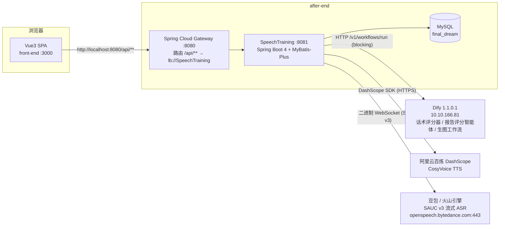
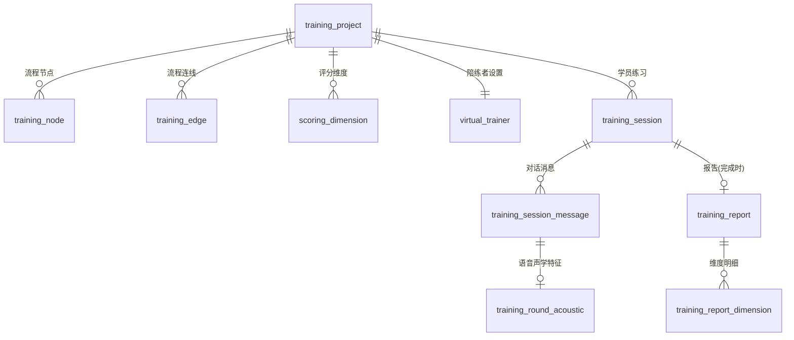

# 学员端 AI对练-话术训练 复刻技术实现方案

**项目名称**: 学员端 AI对练-话术训练模块
**版本**: v1.2（学员端双输入 + ASR 换豆包）
**日期**: 2026-09-21（v1.1 为 2026-09-15 新增语音对话与陪练者形象，FP-24~28）

---

## 1. 整体架构

在现有管理端工程内扩展学员端能力，不新建工程：



- 前端请求统一走 `front-end/src/api/request.ts`（baseURL `http://localhost:8080/api`），与现有管理端一致。
- 学员端接口全部挂在 SpeechTraining 服务，新增 `StudentXxxController`，路径前缀 `/api/student/**`，经网关转发。
- 学员身份：`UserContext` 增加 `getStudentId()/getStudentName()`（mock：`mock_student_001` / `学员`），后续钉钉同步后替换实现，接口签名不变。
- **v1.1 增量**：语音能力（TTS/ASR）外接阿里云百炼；陪练者形象生成走 Dify 生图插件（与其他智能体统一经 `DifyWorkflowSupport` 调用）。音频/图片文件复用现有 `FileStorageService` 落盘。
- **v1.2 增量**：① ASR 由阿里云百炼 Paraformer 换成**豆包（火山引擎 SAUC v3 二进制 WebSocket）**，TTS 仍留百炼 CosyVoice；② 学员端**双输入**——文字与录音两种输入对所有项目开放，`dialogueMode` 只决定是否自动 TTS 播报。

## 2. 技术栈（沿用现有工程，Phase 2 已确认）

| 层 | 选型 | 版本 | 说明 |
|----|------|------|------|
| 前端框架 | Vue 3 + TypeScript + Vite | 3.5.13 / Vite 8 | 现有工程 |
| UI 组件 | Element Plus | 2.14.5 | 现有工程 |
| 状态管理 | Pinia | 4.x | 现有工程 |
| 路由 | Vue Router（hash 模式） | 4.6.4 | 现有工程 |
| 图表 | ECharts | 6.1.0 | 报告页雷达图 |
| 录音 | Web Audio API（getUserMedia + ScriptProcessor 采 PCM 编 WAV） | 浏览器原生 | FP-24 学员录音，16bit 单声道 WAV；请求 16kHz 但**以实际 `AudioContext.sampleRate` 为准**（实测 44.1k/48k），后端按文件头声明采样率送识别 |
| 后端框架 | Spring Boot + Spring Cloud Alibaba | 4.0.8 / 2025.1.0.0 | 现有工程 |
| ORM | MyBatis-Plus | 3.5.17 | 现有工程 |
| 数据库 | MySQL | 8.x | final_dream 库 |
| 注册中心 | Nacos | 3.2.4 | 现有工程 |
| AI 编排 | Dify（自建） | 1.1.0.1 | 10.10.166.81，vllm 插件 + Qwen3-30B；生图插件承载形象生成 |
| 语音合成 | 阿里云百炼（DashScope SDK） | CosyVoice v2 | TTS 播报（v1.1 新增） |
| 语音识别 | 豆包 / 火山引擎（JDK `java.net.http.WebSocket`，无新增依赖） | SAUC v3 `bigmodel_async` + `bigmodel` | 录音转文字（v1.2 替换百炼 Paraformer） |

## 3. 模块划分

### 3.1 前端模块（FP → 模块）

| 模块 | 页面/组件 | 覆盖 FP |
|------|-----------|---------|
| 学员布局 | `StudentLayout.vue`、`StudentTopNav.vue`（已存在，需完善导航高亮） | — |
| 列表页 | `views/student/AICombat/SpeechList.vue`（重写现有 79 行骨架） | FP-01~04 |
| 详情页 | `views/student/AICombat/ScriptDetail.vue` | FP-05~09 |
| 练习记录页 | `views/student/AICombat/PracticeRecords.vue` | FP-09 |
| 训练页 | `views/student/AICombat/ScriptTraining.vue` + `TrainChat.vue` + `TipModal.vue`（要点提示弹窗） | FP-10~13 |
| 训练页语音 | `composables/useRecorder.ts`（录音/波形/WAV 编码）+ `composables/useAudioPlayer.ts`（播放）+ `TrainChat.vue` 内录音按钮/键盘切换/🔊 回放（v1.1） | FP-24 |
| 管理端形象生成 | `components/business/AvatarGenField.vue`（提示词+生成+预览+上传，嵌入 EditProject.vue 第三步）（v1.1） | FP-26 |
| 报告页 | `views/student/AICombat/PracticeReport.vue` + `RadarChart.vue` + `ScoreDetail.vue` + `ChatRecord.vue` + `ConsistencyDetail.vue` | FP-14~17 |
| API 层 | `api/student.ts`（新增） | — |
| 状态 | `stores/training.ts`（会话与消息状态） | — |

### 3.2 后端模块

| 模块 | 类 | 覆盖 FP |
|------|-----|---------|
| 学员项目 | `StudentProjectController` / `StudentProjectService` | FP-18 |
| 会话管理 | `StudentSessionController` / `TrainingSessionService` | FP-19 |
| 流程引擎 | `FlowEngineService`（拓扑流转/权重路由/流转条件判定） | FP-12/20 |
| Dify 流转判定 | 复用 `DifyScoringService`（prompt 微调后的话术评分器） | FP-12/20 |
| 报告生成 | `StudentReportController` / `ReportGenerationService`（@Async） / `ForbiddenWordChecker` | FP-21/22 |
| Dify 报告评分 | `DifyReportScoringService`（新增 agent 配置 `report-scoring`） | FP-23 |
| 语音服务 | `SpeechService`（TTS 合成+缓存 / ASR 识别）+ `TtsCacheService`（文本+声音+语速 哈希缓存）（v1.1）+ `doubao/DoubaoSaucClient`、`DoubaoAsrProperties`（SAUC 协议与配置，v1.2） | FP-24/28 |
| 语速特征 | `SpeechSpeedCalculator`（150-250 字/分钟公式，随报告生成调用）（v1.1） | FP-25 |
| 形象生成 | `AvatarGenService`（调 Dify 生图工作流 + 图片转存 `FileStorageService`）（v1.1） | FP-26/28 |

模块依赖：`StudentSessionController → FlowEngineService → DifyScoringService`；`ReportGenerationService → DifyReportScoringService + ForbiddenWordChecker + SpeechSpeedCalculator + 数据落库`；`SpeechService` 独立被 `StudentSessionController`（ASR/TTS 接口）与前端播放调用。

## 4. 数据模型设计

### 4.1 复用已有表（管理端）

`training_project`（项目）、`training_node`（流程节点，含 trainer_question/standard_script/key_points/pass_condition_*）、`training_edge`（连线权重）、`scoring_dimension`（评分维度）、`virtual_trainer`（陪练者/违禁词）。字段以管理端文档为准，不再赘述。

### 4.2 新增表

> 实施说明（2026-09-14）：实际管理端代码中，一个大节点（type 2/3）为**一行** training_node 记录，
> 同时含 trainer_question 与 standard_script/key_points/流转条件，连线直接连接大节点；
> 因此流程引擎按"单行大节点"结构实现，无需拆分子节点。

```sql
-- 练习会话表（一次"开始"到结束的完整训练）
CREATE TABLE training_session (
  id BIGINT PRIMARY KEY AUTO_INCREMENT,
  project_id BIGINT NOT NULL COMMENT '项目ID',
  user_id VARCHAR(100) NOT NULL COMMENT '学员ID(mock: mock_student_001)',
  user_name VARCHAR(100) COMMENT '学员姓名',
  status TINYINT NOT NULL DEFAULT 0 COMMENT '0=进行中, 1=已完成(待生成报告→已生成), 2=未完成退出',
  report_status TINYINT DEFAULT 0 COMMENT '报告状态: 0=未开始, 1=生成中, 2=已生成, 3=失败',
  current_node_id BIGINT COMMENT '当前学员节点ID',
  finished_rounds INT DEFAULT 0 COMMENT '已完成轮次',
  total_rounds INT DEFAULT 0 COMMENT '总轮次(学员节点数)',
  start_time DATETIME NOT NULL,
  end_time DATETIME,
  duration_seconds INT COMMENT '练习时长(秒)',
  created_at DATETIME DEFAULT CURRENT_TIMESTAMP,
  updated_at DATETIME DEFAULT CURRENT_TIMESTAMP ON UPDATE CURRENT_TIMESTAMP,
  INDEX idx_project_user (project_id, user_id),
  INDEX idx_user (user_id)
) ENGINE=InnoDB DEFAULT CHARSET=utf8mb4 COMMENT='练习会话表';

-- 会话消息表（含撤回消息）
CREATE TABLE training_session_message (
  id BIGINT PRIMARY KEY AUTO_INCREMENT,
  session_id BIGINT NOT NULL,
  node_id BIGINT COMMENT '学员节点ID(陪练者消息为其所属大节点ID)',
  role TINYINT NOT NULL COMMENT '1=陪练者, 2=学员',
  content TEXT NOT NULL,
  hit_points JSON COMMENT '命中要点内容列表(学员消息)',
  passed TINYINT COMMENT '是否通过流转条件(学员消息): 0/1',
  withdrawn TINYINT DEFAULT 0 COMMENT '是否被撤回: 0/1',
  like_count INT DEFAULT 0 COMMENT '点赞数',
  seq INT NOT NULL COMMENT '会话内序号',
  created_at DATETIME DEFAULT CURRENT_TIMESTAMP,
  INDEX idx_session (session_id)
) ENGINE=InnoDB DEFAULT CHARSET=utf8mb4 COMMENT='会话消息表';

-- 训练报告表
CREATE TABLE training_report (
  id BIGINT PRIMARY KEY AUTO_INCREMENT,
  session_id BIGINT NOT NULL,
  project_id BIGINT NOT NULL,
  user_id VARCHAR(100) NOT NULL,
  total_score DECIMAL(5,1) COMMENT '总分=Σ(维度分×权重)',
  rank_no INT COMMENT '项目内排名',
  exceed_percent INT COMMENT '超过同学百分比',
  score_change DECIMAL(5,1) COMMENT '较上次变化(正=上升)',
  duration_seconds INT,
  round_count INT,
  round_suggestions JSON COMMENT '逐轮改进建议(JSON数组, 对话记录Tab用)',
  status TINYINT DEFAULT 1 COMMENT '1=生成中, 2=已生成, 3=失败',
  created_at DATETIME DEFAULT CURRENT_TIMESTAMP,
  updated_at DATETIME DEFAULT CURRENT_TIMESTAMP ON UPDATE CURRENT_TIMESTAMP,
  UNIQUE INDEX uk_session (session_id),
  INDEX idx_project_user (project_id, user_id)
) ENGINE=InnoDB DEFAULT CHARSET=utf8mb4 COMMENT='训练报告表';

-- 报告维度明细表
CREATE TABLE training_report_dimension (
  id BIGINT PRIMARY KEY AUTO_INCREMENT,
  report_id BIGINT NOT NULL,
  dimension_name VARCHAR(50) NOT NULL,
  weight INT COMMENT '权重(%)',
  score DECIMAL(5,1),
  comment TEXT COMMENT '总评描述',
  good_points JSON COMMENT '做得好的点(数组)',
  improvements JSON COMMENT '待改进点与建议(数组)',
  sort_order INT DEFAULT 0,
  INDEX idx_report (report_id)
) ENGINE=InnoDB DEFAULT CHARSET=utf8mb4 COMMENT='报告维度明细表';

-- 消息点赞记录表（实施时新增：支撑接口 4.4 "同一学员对同一消息点赞幂等" 的后端实现）
CREATE TABLE training_message_like (
  id BIGINT PRIMARY KEY AUTO_INCREMENT,
  message_id BIGINT NOT NULL COMMENT '消息ID',
  user_id VARCHAR(100) NOT NULL COMMENT '学员ID',
  created_at DATETIME DEFAULT CURRENT_TIMESTAMP,
  UNIQUE INDEX uk_message_user (message_id, user_id)
) ENGINE=InnoDB DEFAULT CHARSET=utf8mb4 COMMENT='消息点赞记录表';
```

### 4.3 v1.1 表结构扩展（FP-24~28）

```sql
-- 虚拟陪练者表：新增形象字段
ALTER TABLE virtual_trainer ADD COLUMN avatar_image VARCHAR(500) NULL
  COMMENT '陪练者形象图片URL(AI生成或上传, 空则学员端显示默认占位图)' AFTER trainer_name;

-- 会话消息表：新增语音字段（文字消息为 NULL）
ALTER TABLE training_session_message ADD COLUMN (
  audio_url VARCHAR(500) NULL COMMENT '音频URL(学员录音)',
  audio_duration_ms INT NULL COMMENT '音频时长(毫秒)',
  input_mode TINYINT DEFAULT 1 COMMENT '输入方式: 1=文字, 2=语音'
);
```

- `input_mode` 区分该轮是否有语音特征：报告生成时仅对 `input_mode=2` 的轮次计算语速（字数=识别文本去标点后长度，语速=字数÷时长×60）。
- 陪练者消息的 TTS 音频不落消息表（按需合成+文件缓存即可，见 6.5）。

### 4.4 ER 关系



### 4.5 v1.2 新增表：每轮语音声学特征（training_round_acoustic）

> 定位：**只留存、不参与评分**。此前"语气/流利度"等语音维度在实现上只按转写文本打分，
> 豆包返回的分句与逐字时间戳、停顿、检出语种在 `SpeechService` 解析时就被丢弃了，
> 于是"语音类维度到底能不能客观评"这件事没有数据可判断。本表先把事实攒下来，
> 评分口径是否据此改造留待产品确认（见 09-问题清单）。

```sql
CREATE TABLE training_round_acoustic (
  id BIGINT PRIMARY KEY AUTO_INCREMENT,
  session_id BIGINT NOT NULL COMMENT '会话ID',
  message_id BIGINT NOT NULL COMMENT '学员语音消息ID(撤回的消息同样留存)',
  round_no INT COMMENT '轮次号(1起)',
  audio_ms INT COMMENT '录音时长(毫秒,本端WAV头,含静音)',
  speech_ms INT COMMENT '净发声时长(毫秒,各分句首尾跨度之和)',
  utterance_count INT COMMENT '分句数',
  pause_count INT COMMENT '停顿次数(相邻分句间隔≥300ms才计)',
  pause_total_ms INT COMMENT '停顿总时长(毫秒,与pause_count同口径)',
  max_pause_ms INT COMMENT '最长一次分句间隔(毫秒,不设阈值)',
  text_length INT COMMENT '识别文本长度(含标点)',
  lid_lang VARCHAR(32) COMMENT '豆包检出语种(粤语=speech_dia_cant,未检出为空)',
  definite TINYINT COMMENT '末分句是否终结结果: 0/1, NULL=无分句',
  words_json JSON COMMENT '豆包逐字时间戳原文(跨分句拼接的JSON数组)',
  server_audio_ms INT COMMENT '豆包回传音频时长(毫秒),与audio_ms不符即WAV封装头有问题',
  created_at DATETIME DEFAULT CURRENT_TIMESTAMP,
  UNIQUE INDEX uk_message (message_id),
  INDEX idx_session_round (session_id, round_no)
) ENGINE=InnoDB DEFAULT CHARSET=utf8mb4 COMMENT='每轮语音声学特征表(留存,暂不参与评分)';
```

口径说明：

| 字段 | 取值来源 | 为什么这么取 |
| --- | --- | --- |
| `audio_ms` | 本端 WAV 头（`WavHeader#durationMs`） | 学员实际按住录音的总长，含句首句尾静音 |
| `speech_ms` | Σ(每个 utterance 的 `end_time-start_time`) | 净发声时长；语速若按 `audio_ms` 算会把停顿算进说话速度，明显偏低 |
| `pause_count` / `pause_total_ms` | 相邻 utterance 间隔 ≥300ms | 小于 300ms 的间隔多为词间正常停顿与时间戳抖动，计入会把"流利"判成"卡顿" |
| `max_pause_ms` | 相邻 utterance 间隔最大值（不设阈值） | 一次长冷场与多次短停顿含义不同，需分开看 |
| `definite` | 末个 utterance 的 `definite` | 为 0 说明送判文本可能还没说完，这轮识别质量存疑 |
| `words_json` | 各 utterance 的 `words[]` 拼接 | **按服务端原样存、不重命名字段**：逐字字段的真实字段名尚未采集验证，猜映射会把留存数据写坏 **[待验证]** |
| `server_audio_ms` | `audio_info.duration` | 与本端 `audio_ms` 各存一份，不一致即说明我们封装的 WAV 头有问题 |

- 写入时机：与学员消息同一个短事务、同一把会话行锁内（`FlowEngineService#persistVoice`），消息与特征行要么都在、要么都不在。
- 撤回的回答**同样写**：撤回只是不计入流转，学员那段话确实说过，正是要攒的样本。
- `uk_message` 保证一条消息只有一行特征（重复提交/重试不产生副本）。
- 表未建立时语音消息接口会整笔失败回滚，**必须先执行 DDL 再部署本版本后端**。

### 4.6 v1.2 表结构扩展：评分维度的证据类型与量化指标（scoring_dimension）

> 改造前"哪个维度的分数由代码算"是**按维度名硬编码**判断的——`ReportGenerationService` 里挂着
> `"语速适中"`、`"违禁词"` 两个字符串分支。管理员一改名、或新建一个同样该用公式的自定义维度，
> 就静默退回"让 AI 猜一个语速分"。同时语音类维度在纯文字轮次也照评，等于拿转写文本给"语速"打分。
> 改为两个显式列，把"依据什么评"和"由谁定分"都变成配置。

```sql
ALTER TABLE scoring_dimension
  ADD COLUMN evidence_type TINYINT DEFAULT 1
    COMMENT '评分依据: 1=文字, 2=语音, 3=文字+语音' AFTER scoring_rule,
  ADD COLUMN metric_config VARCHAR(500)
    COMMENT '量化指标配置(JSON): {"metric":"speech_speed","params":{...}}。空=该维度由AI评分'
    AFTER evidence_type;
```

完整执行脚本（含执行前检查、`rule_type=5/6` 的回填 UPDATE、执行后校验）见 `07-DDL变更清单.md` ①。

| 列 | 语义 | 代码落点 |
| --- | --- | --- |
| `evidence_type` | 该维度**凭什么评**。2=语音：本次训练没有任何语音轮次时**不参与评分** | `ReportGenerationService#planDimensions` |
| `metric_config` | 该维度的**分数由哪段后端规则算**，非空即"代码定分、AI 只写评语" | `DimensionMetricConfig#parse` → `ReportGenerationService#measure` |

- 指标路由取代名字匹配：`measure()` 按 `metric` 做 `switch`（当前白名单 `speech_speed` / `forbidden_words`），
  管理端选到同一指标的自定义维度享受同样的代码定分。白名单外的 key 在 `toJson` 阶段就不落库，
  脏配置在 `parse` 阶段回落为"交给 AI 评分" + `log.warn`——**配置写错不能让整份报告生成失败**。
- 满分区间参数化：`metric_config` 支持 `{"metric":"speech_speed","params":{"bestMin":150,"bestMax":250}}`，
  读取侧由 `DimensionMetricConfig#intParam` 取值、缺失即回落代码默认的 150-250，**不再把区间写死在计算里**。
  **v1.3（2026-09-24）**：管理端界面在选"语速规则算分/违禁词规则算分"时展示参数输入框（bestMin/bestMax、deductPerHit），
  随 `metricParams` 一并提交——**"参数只能改库"的欠账消除**（见 08 §5 S0-4、03 §5.4b）。
  **白名单扩展预告（S2 Phase 2）**：语气维度 PoC 通过后新增 `tone` 指标（`params.aspect` 为角度参数，见 08 §2）。
- **混合维度的声学摘要注入（v1.3，见 08 §4）**：`evidence_type=3` 且本次存在语音轮的维度，`toDimensionsJson`
  在其 rule 追加"（语音表现参考——…：第N轮 语速X字/分、停顿M次共S.S秒；…）"；纯文字会话不注入、
  定分维度（metric 非空）不注入——它们已有确定分数。Dify 侧提示词第 6 条据此综合评分（04 已同步修订）。
- 未参与评分的维度 `score=null` 且**权重照常计入总分分母（等价按 0 分计）**——**2026-09-24 口径变更**
  （11 任务书 #3，用户实测确认）：总分 = Σ(有分维度分×权重) / Σ**全部启用**维度权重。变更前
  （2026-09-23 轮）为"既不给分也不占总分归一的权重、只在参与维度间归一"，当时的理由是防纯文字练习者
  被语音维度白送满分抬高排名；v1.2 双输入后该保护反成漏洞——**语音对话项目的学员可全程打字躲掉语音考核
  且零代价**。变更后示例：7 维度权重 40/10/10/10/10/10/10、其余 6 维均 100、语速未参与 → 总分 90.0。
  明细 comment 在 `NO_ACOUSTIC_REASON` 基础上注明"权重已计入总分"。
- 权重全部未配置（`weightSum=0`）时退化为已评分维度的简单平均；`scoringPlans`（送 Dify 的维度入参）
  只含参与评分的维度，避免模型为一个评不了的维度编造评语。
- 管理端对应改动：评分维度区块新增两个下拉——"依据：看文字/看语音/文字+语音"与"AI 评分/语速规则算分/违禁词规则算分"，
  请求字段为 `ProjectSaveReq.ScoringDimensionReq.evidenceType`（1/2/3）与 `metricKey`（`speech_speed`/`forbidden_words`/空），
  服务端 `TrainingProjectServiceImpl` 用 `DimensionMetricConfig.toJson(metricKey, metricParams)` 生成 `metric_config` 入库；
  详情回显走同一 DTO（响应数组名为 `scoringDimensions`），`getMetricKey()` / `getMetricParams()` 从 `metric_config` JSON 反解供下拉与参数框选中，
  因此**请求里的 `metricConfig` 一律被忽略**，避免前端拼出半成品 JSON。

## 5. 前端工程

### 5.1 路由（在 `router/index.ts` 的 `/sparring` 组下扩展）

```typescript
// 学员端 AI对练（StudentLayout）
{ path: 'web/speech/list',   name: 'StudentSpeechList',   component: SpeechList,        meta: { title: 'AI对练' } },
{ path: 'web/script/detail/:projectId',  name: 'ScriptDetail',  component: ScriptDetail },
{ path: 'web/script/records/:projectId', name: 'PracticeRecords', component: PracticeRecords },
{ path: 'web/script/training/:projectId',name: 'ScriptTraining', component: ScriptTraining },
// 报告页（独立路由，仍在 StudentLayout 下）
{ path: 'standpracticereport', name: 'PracticeReport', component: PracticeReport }
```

### 5.2 关键页面实现要点

> 页面视觉参照截图（位于 `screenshots/`，已内嵌于 01-需求文档对应章节）：01-列表页 / 02-话术训练详情页 / 03-训练进行页 / 04-要点提示弹窗 / 05-训练报告页 / 06-管理端虚拟陪练者设置表单 / 07-训练页默认形象占位。前端按截图 1:1 还原布局与配色。

**列表页 SpeechList.vue**：Tab 栏 + 筛选卡（状态下拉、类型下拉共 2 个 el-select + 名称搜索 el-input，不做分类筛选）+ 卡片 grid（flex wrap，卡片宽约 280px）+ el-pagination；卡片封面无 coverImage 时用内置渐变 SVG 默认图；徽标绝对定位在封面左上/右上。

**详情页 ScriptDetail.vue**：深蓝渐变 hero（封面/徽标/名称/参与人数/已练面板/开始按钮）+ 三张信息卡。开始按钮 → `POST /student/sessions` → `window.open('#/web/script/training/{projectId}?sessionId=xxx')`。

**训练页 ScriptTraining.vue**（深色主题，独立于 Element Plus 默认浅色，样式 scoped 手写还原截图 03）：
- 布局：`display:flex`，左栏固定 280px、右栏 320px（可 v-if 收起）、中栏自适应
- 左栏：展示 `virtual_trainer.avatar_image`（无则用内置默认陪练者形象图 `@/assets/default-trainer.jpg`），形象卡 `aspect-ratio: 1 / 1`（280×280，与生图输出的 1024×1024 同比例，`object-fit: cover` 不产生裁切），"AI扮演角色/{trainerName}"显示在图片**下方**的 `.trainer-info`（FP-27）。**v1.3（FP-29）**：形象卡升级为 `<video :poster="trainerFace(avatar)">` 为主、`` 兜底——`/tts` 返回 `videoUrl` 非空则播口型视频（播完停在最后一帧），空则回落音频+静态图（现状行为）；单槽纪律不变（播报前停上一个，学员回放自己的录音仍会打断播报），气泡 🔊 重播维持音频（详见 08 §1.6）
- 会话状态集中在 Pinia `trainingStore`：`session 信息 / messages[] / totalRounds / finishedRounds / loading`
- 发送流程：乐观渲染学员气泡 → `POST /student/sessions/{id}/messages` → 返回 `{withdrawn:true, keyPoints[]}` 则移除气泡+弹 TipModal；返回 `{passed, nextTrainerMessage}` 则追加陪练者气泡；返回 `{finished:true}` 则跳转 `#/standpracticereport?sessionId=xxx`
- 进度 = `finishedRounds/totalRounds`（取自接口返回，不前端自行计算）
- 轮询/心跳：无；刷新恢复：mounted 时 `GET /student/sessions/{id}` 重放消息列表

**训练页语音模式（FP-24，v1.1 新增；v1.2 改为双输入）**：
> v1.1 是 `dialogueMode=0` 才启用整块语音能力；v1.2 起**录音输入与对话方式解耦**，两种项目都可用文字或录音作答，`dialogueMode` 只决定陪练者消息要不要自动播报。
- `composables/useRecorder.ts`：`getUserMedia({audio})` 申请麦克风 → `AudioContext`（sampleRate 16000）+ ScriptProcessor 采集 PCM → 手写 WAV 编码（44 字节头+PCM）产出 Blob；`start()/stop()` 返回 `{blob, durationMs}`；录音中渲染 CSS 波形动画（数根竖条随机高度的 animation）
- `composables/useAudioPlayer.ts`：`new Audio(url).play()` 封装，含预加载与 stop（切换消息播放时停掉上一个）
- 输入区（v1.2 双输入）：仍是 `inputMode: 'voice' | 'text'` **两种展示形态互斥切换**，但**两种形态在任何对话方式下都可达**——这才是 v1.2 的变更点（v1.1 时 `dialogueMode=1` 根本不渲染录音入口）。`voice` 形态 = 提示文案 + 键盘切换图标 + 麦克风圆钮（录音中变波形动画 + 停止发送钮）；`text` 形态 = 输入框 + 发送钮 + 麦克风切换图标。默认 `dialogueMode=0 → 'voice'`、`=1 → 'text'`，用户手动切过（`inputModeTouched`）之后保持用户选择，会话恢复同理。文字走 `POST /messages`，录音走 `POST /voice-messages`，进入同一套流转判定
- 上传流程：`stop()` → 气泡先以"语音识别中…"占位 → `POST /student/sessions/{id}/voice-messages`（multipart，超时 30s）→ 返回识别文本替换占位并走同一流转判定（撤回/通过分支同 FP-12）；学员气泡带 🔊 回放 `audioUrl`
- 陪练者播报：每收到陪练者消息（含首句与会话恢复后的历史消息）→ `POST /student/sessions/{sessionId}/tts` 获取 `audioUrl` → useAudioPlayer 自动播放；气泡带 🔊 重播；会话恢复（mounted）时不自动播报历史，仅首条当前待答消息播报
- 麦克风权限被拒 / 录音启动失败：`toast.error('无法访问麦克风，已切换到键盘输入…')`（**非阻塞提示**，见 5.4）并自动切到键盘模式；不用 `alert`——它会冻结主线程，录音按钮的后续状态更新会被卡住
- 项目详情/会话加载失败：整块 `main-body` 不渲染（`v-if="!loadingError"`），改为显示错误卡（文案 + `重新加载` + `返回项目详情` 两个按钮）。此前失败后页面停在半空的骨架上，学员不知道该刷新还是该退出
- 顶部"普通话"标记：识别与评分**一律按普通话处理**（粤语等由豆包 `enable_lid` 自判后落 `lid_lang` 核验），没有可切换的语种能力，因此渲染为静态徽标（`cursor:default` + `title` 说明）而非按钮。原先是个点了什么都没发生的按钮，且语义上会被读成"这里能换语种"
- `dialogueMode=1`（文字）项目：输入区默认 `text` 形态，但麦克风切换按钮**照常可用**，切过去即可录音（v1.2 变更）；仅不请求 `/tts`、不自动播报

**管理端形象生成 AvatarGenField.vue（FP-26，v1.1 新增）**：嵌入 `EditProject.vue` 第三步"虚拟陪练者设置"表单（参照截图 06），字段：提示词 el-input + `AI生成`按钮（loading 10~30s）→ `POST /admin/ai/generate-avatar` → 预览卡（**160×160 方形圆角**，与 1024×1024 出图同比例）；`重新生成` / el-upload 本地替换；v-model 绑定 `form.virtualTrainer.avatarImage`（空=不生成不上传）。

**报告页 PracticeReport.vue**：
- mounted：`GET /student/reports/session/{sessionId}`，`status=生成中` 时渲染等待页（渐变文档图标 + 两行文案，CSS 动画），`setInterval` 3s 轮询直至 `status=已生成`；`status=失败` 显示重试按钮（`POST /student/reports/{reportId}/regenerate`）
- 轮询容错：连续失败 3 次才提示，单次失败静默重试（故 `getReport` 默认 `silent:true`，见 5.3）
- 雷达图：ECharts radar，两 series（本次实线 #4A7CFF、上次虚线 #22D3EE），axis label 拼接 `{name} {score}分`，score<60 用富文本标红。**只画有分的维度**（`scoredDimensions`）——未参与评分的维度不进坐标轴，否则会出现 0 分尖刺；**上次数据不齐则整条虚线不画**并在图下注明（`lastScoresFor` 返回 `incomplete`），不补 0。全部维度都无分时 `chart.clear()` + 覆盖层文案"本次训练没有维度参与评分，暂无可展示的得分"（不留空白图表）
- 评分明细：维度块列表组件 ScoreDetail.vue，按 `sortOrder` 排序，`score=null` 的维度渲染"未参与评分 + 原因"而非 0 分
- 话术一致性详情：`GET /student/reports/{reportId}/consistency` 是**逐轮/报告级**数据，不隶属于任何一个维度，
  入口因此放在 Tab 行右侧（"查看逐轮要点命中详情 ›"，`reportId` 存在即显示）。
  早期实现挂在名为"话术一致性"的维度块上、靠 `v-if="dim.dimensionName === '话术一致性'"` 判断，
  维度一改自定义名称入口就消失——这是把数据层级放错位置，已废弃（见 §10 变更记录）
- 对话记录：ChatRecord.vue 渲染消息（过滤 withdrawn），学员消息下方"改进建议"展开区域读 report.round_suggestions[seq]；点赞调 `POST /student/messages/{messageId}/like`
- 逐轮序号映射：`studentRoundSeqs` 必须是 `computed` 而非 setup 期一次性求值——报告页的消息是异步补拉的，
  setup 时 `props.messages` 还是空数组，快照会把所有学员消息的轮次号算没，改进建议区域永久空白
- 陪练者头像：与训练页左栏**同源**，取报告接口的 `trainerAvatar`（后端从 `virtual_trainer.avatar_image` 带出），
  统一经 `trainerFace()` 解析（见 5.4）

### 5.3 API 层（`api/student.ts` / `api/admin.ts` 扩展）

与接口文档一一对应，学员端函数：`getStudentProjects / getProjectDetail / startSession / getSession / sendMessage / sendVoiceMessage / getTts / exitSession / getReport / getConsistency / likeMessage / getPracticeRecords`；管理端扩展：`generateAvatar`（FP-26）。语音上传用 axios `FormData`（`Content-Type: multipart/form-data`），不经过统一的 JSON 拦截器需单独处理响应。

请求层新增 `silent` 选项（`declare module 'axios'` 增强 `AxiosRequestConfig`，拦截器按 `response.config.silent` 决定是否弹提示）：
后台自动行为（报告轮询、消息到达后的自动 TTS 补合成）失败时不该弹窗，页面自己有更准的降级表现；
用户主动点击触发的请求才保持默认弹。`getReport` 因轮询性质**默认 `silent: true`**，
`getTts(sessionId, messageId, { silent: auto })` 按是否自动播报决定，`getStudentProjectDetail` 由训练页传 `silent` 后自己渲染错误卡。

### 5.4 全局提示与形象兜底（学员端公共件）

- `src/utils/toast.ts`：原生 DOM 实现的非阻塞轻提示（`toast.error/warn/info`），容器 `role="status" aria-live="polite"`、
  `z-index:4000`（压过 z-3000 的弹窗）、同屏最多 4 条、3s 自动消失，样式随模块首次调用注入一次。
  **替换全站 `alert()`**：`alert` 同步冻结 JS 主线程，报告页"连续失败 3 次才提示"的轮询容错在它面前形同虚设
  （每次网络抖动都弹一次，学员被卡住），训练页录音链路同理。选原生实现而非引 Element Plus，
  是因为拦截器在纯 TS 模块里调用组件库需要额外挂载上下文，深色主题也覆盖不到。
- `src/views/student/AICombat/trainerFace.ts`：陪练者形象的**唯一**解析入口
  `trainerFace(avatar) => resolveAssetUrl(avatar) || defaultTrainerImg`。改造前三处各写各的
  （训练页读 Pinia、报告页气泡自己拼 URL、还有一处直接 import 默认图），同一会话两个页面两张脸。
  数据源随之统一：报告接口新增 `trainerAvatar` 字段（后端 `StudentReportService#getReportBySession` 按
  `report.projectId` 查 `virtual_trainer`），报告页不再"按 projectId 猜"，也就不会在直接打开报告 URL、
  store 为空时错拿默认图。

## 6. 后端工程

### 6.1 目录与分层（沿用现有包结构 `jack.digityhuman.speechtraining`）

```
controller/  StudentProjectController / StudentSessionController / StudentReportController
             AdminAiController（扩展 generate-avatar 端点）
service/     StudentProjectService / TrainingSessionService / FlowEngineService
             ReportGenerationService / DifyReportScoringService / ForbiddenWordChecker
             SpeechService / TtsCacheService / SpeechSpeedCalculator / AvatarGenService （v1.1）
entity/      TrainingSession / TrainingSessionMessage / TrainingReport / TrainingReportDimension
mapper/      对应 4 个 Mapper
dto/req/     StartSessionReq / SendMessageReq / TtsReq / GenerateAvatarReq ...
dto/resp/    ProjectCardResp / SessionResp / SendMessageResp / ReportResp / ConsistencyResp
             TtsResp / VoiceMessageResp / AvatarGenResp ...（v1.1 扩展）
```

统一响应沿用 `ApiResponse{code,message,data}`，异常走 `GlobalExceptionHandler`。

### 6.2 流程引擎 FlowEngineService（核心）

> 实施说明（2026-09-14）：实际存储结构为"单行大节点"——一个大节点（type 2/3）即一轮
> （trainerQuestion=陪练者问，standardScript/keyPoints/流转条件=学员答侧），连线直接连大节点。
> 因此 current_node_id 直接指向大节点行，流转 = 大节点 → 大节点按出边权重路由；
> type 3（学员问陪练者）与 type 2 同样处理（用户确认）。总轮次 = 项目流程中大节点数。

```java
@Service
public class FlowEngineService {
    // 会话启动：加载流程（节点+连线），从开始节点定位首个大节点，返回陪练者问 + totalRounds
    public SessionResp start(Long projectId);

    // 消息流转判定
    @Transactional
    public SendMessageResp sendMessage(Long sessionId, String content) {
        TrainingSession s = requireOngoing(sessionId);
        TrainingNode studentNode = requireStudentNode(s.getCurrentNodeId());
        // 1. 调 Dify 话术评分器（复用 DifyScoringService）
        AiScoringResp ai = difyScoringService.score(
            studentNode.getStandardScript(), studentNode.getKeyPoints(),
            buildPassConditionText(studentNode), content);
        // 2. 后端按流转条件复核（不信任 LLM 的 passed 字段，自算）
        boolean passed = judgePass(studentNode, ai.getHitPoints());
        if (!passed) {
            saveMessage(sessionId, studentNode, content, ai, passed=false, withdrawn=true);
            return SendMessageResp.withdrawn(studentNode.getKeyPoints()); // 前端撤回+弹窗
        }
        saveMessage(sessionId, studentNode, content, ai, passed=true, withdrawn=false);
        s.setFinishedRounds(s.getFinishedRounds() + 1);
        // 3. 权重随机路由
        TrainingNode next = routeByWeight(s.getCurrentNodeId());
        if (isEnd(next)) {
            sessionService.finish(s);            // 置完成、算时长
            reportGenerationService.generateAsync(s.getId()); // @Async 生成报告
            return SendMessageResp.finished();
        }
        advance(s, next);                        // current_node_id 指向下一个学员节点
        return SendMessageResp.trainerSay(next.getTrainerQuestion());
    }

    // 权重随机：edges.stream().filter(出边).权重加权随机取一
    private TrainingNode routeByWeight(Long fromNodeId) { ... }

    // 流转条件判定：type=1 命中任意N个 → |hits∩points|>=n；type=2 命中指定 → 指定要点全部 ∈ hits
    private boolean judgePass(TrainingNode node, List<String> hits) { ... }
}
```

**要点匹配细节**：`judgePass` 用命中内容与要点内容做去空格的字符串等值比较（Dify prompt 已约束逐字输出），因此"命中指定要点"可精确判定；若 Dify 返回内容与要点列表存在轻微出入，做包含式兜底匹配（`point.contains(hit) || hit.contains(point)`）。

**会话恢复**：`GET /student/sessions/{id}` 返回消息列表（过滤 withdrawn 的由前端决定展示策略——训练页不展示撤回消息）+ 当前节点陪练者问 + 进度。若会话已"未完成/已完成"返回对应状态由前端跳转。

### 6.3 报告生成 ReportGenerationService

> 实施说明（2026-09-14 立，2026-09-24 按 v1.2 机制更正）：
> - 流程结束时在 sendMessage 事务内**同步**插入 training_report（status=生成中），保证前端立即轮询可见；
>   异步生成通过事务提交后回调（afterCommit）触发，避免异步线程读不到未提交数据。
> - 重新生成拆为 `resetForRegenerate`（同步校验+重置）与 `generateAsync`（异步）两步由 Controller 依次调用，
>   规避 @Async 自调用不经过代理的问题。
> - **定分维度机制（v1.2 起现行口径）**：配了 `metric_config` 的维度由 `measure()` 按指标白名单定分，
>   分数经 rule 文本"（后端已判定：…必须采用该分数）"标注下发给 Dify 写评语；解析后 `measured != null` 的维度
>   以计算分覆盖模型输出（双保险）。违禁词即走此机制（`forbidden_words` 指标），**不存在按维度名覆盖的分支**。
> - `@Scheduled` 扫描器 `sweepStuckReports`（每 60s）把停在"生成中"超过 15 分钟的报告置为失败，
>   覆盖进程重启 / 任务被线程池拒绝丢弃这两类不会自己抛异常的场景；阈值远大于单次 Dify 读超时（120s），不误伤正常生成中的报告。
>   **超时判定必须取数据库时钟**（`updated_at < DATE_SUB(CURRENT_TIMESTAMP, INTERVAL ? MINUTE)`）：`updated_at` 由
>   `CURRENT_TIMESTAMP ON UPDATE` 写入，而开发库时区是 UTC、应用是 +08，用 `LocalDateTime.now()` 算阈值会把刚建好的
>   "生成中"报告立刻误判成卡死并直接置失败（2026-09-23 实测发现并修正，见 §10）。

```java
@Async
public void generateAsync(Long sessionId) {
    report.setStatus(生成中); // 前端轮询可见
    try {
        List<TrainingNode> studentNodes = ...;              // 按会话消息还原逐轮
        List<RoundInput> rounds = buildRounds(sessionId);   // 陪练者问/学员答/要点/标准话术
        Map<String,Object> forbiddenResult = forbiddenWordChecker.check(rounds, trainer.getForbiddenWords());
        Map<String,Object> difyOut = difyReportScoringService.score(
            toJson(rounds), toJson(enabledDimensions), forbiddenResult);
        // 解析各维度 score/comment/good_points/improvements/advice + round_suggestions
        // metric_config 白名单路由定分 + rule 标注注入 + 后端 measured 覆盖模型输出
        // （见 §4.6 与 09-问题清单 #6/#9）
        // 总分=Σ(score×weight)；排名/超过% 按同项目已生成报告的 user 去重总分排序
        // scoreChange = 本次总分 - 该学员本项目上一份报告总分
        save(report, dimensions);
        report.setStatus(已生成);
    } catch (Exception e) {
        log.error("报告生成失败", e); report.setStatus(失败);
    }
}
```

**ForbiddenWordChecker**：词表逗号分隔；对每条学员消息做 `contains` 匹配，只输出命中总数与各词次数等客观事实；全局传给 Dify 的 `forbidden_words_result` 不再包含扣分参数或最终分。配置了 `forbidden_words` 指标的维度在 `measure()` 中按该维度 `metric_config.params.deductPerHit` 计算得分（缺失或非正数回落 20），再走"后端已判定"标注与 `measured` 覆盖管道；AI 评分维度只把客观事实当上下文，不被后端覆盖。

**v1.1 语音特征注入（FP-25；v1.3 口径变更见末行）**：`buildRounds` 时对 `input_mode=2` 的学员消息附加 `{audio_duration_ms, char_count, speech_speed}`（**字段为 snake_case，与 Dify 提示词里的 JSON key 一致**；charCount=识别文本去标点长度，speechSpeed=charCount÷时长×60，四舍五入取整）；`SpeechSpeedCalculator` 按维度公式（默认 150-250 字/分钟满分，每偏离 10 字/分钟扣 5 分，扣完为止；区间可由 `metric_config.params.bestMin/bestMax` 覆盖）计算该维度分数，作为"后端已判定事实"传给 Dify 并覆盖其输出（同违禁词模式）；纯文字会话（全部 input_mode=1）时无语音特征字段、语音依据维度不参与评分（§4.6）。
**v1.3 变更（2026-09-24，见 08 §3）**：语速的时长基数由 `audio_duration_ms`（含停顿）切换为**净发声时长 `training_round_acoustic.speech_ms`**（按会话批量查表；null 或 ≤0 回落 audio_duration_ms 并 WARN 一次）。语义：语速不再惩罚长停顿，停顿数据保留给混合维度的声学摘要注入（§4.6 末条）使用。

### 6.5 语音与形象服务（v1.1 新增，FP-24/26/28；v1.2 ASR 换豆包 + 双输入）

拆成三个类（包 `jack.digityhuman.speechtraining`）：

| 类 | 职责 |
|----|------|
| `service/SpeechService` | 对外统一入口：`tts(text, voiceId, speed)` / `asr(wav, language)`；时长校验与结果解析 |
| `service/TtsCacheService` | 以"文本+声音+语速"哈希为文件名的 MP3 缓存读写（`/audio/tts/{hash}.mp3`） |
| `doubao/DoubaoSaucClient`（v1.2 新增） | 豆包（火山引擎）SAUC v3 二进制 WebSocket 协议编解码 + 识别调用 |

```java
@Service
public class SpeechService {
    // TTS：CosyVoice v2，同步合成（v1.1 起未变）
    public TtsResult tts(String text, String voiceId, Integer speed) {
        // 1. 查缓存：key = md5(text + voiceId + speed)，命中直接返回同一 URL
        // 2. 调 DashScope：model=cosyvoice-v2, voice=voiceId,
        //    speech_rate = 1.0 + (speed - 30) * 0.1
        //    （实施修正 2026-09-15：CosyVoice speech_rate 合法区间为 [0.5, 2.0] 浮点，
        //      原公式 (speed-30)*10 的 ±300 百分比刻度与其不兼容；按百分比解释映射 ±30%，
        //      speed=0→0.7 / 30→1.0 / 60→1.3，用户已确认）
        // 3. 音频落 FileStorageService（/audio/tts/），返回 URL
    }

    // ASR（v1.2）：豆包 SAUC，整段 WAV 上传 → 一次性取回全文
    public AsrResult asr(byte[] wav, String language) {
        // 1. 读 WAV 头算时长，非 WAV 或 > 60s 直接抛"录音文件无效或超长（≤60s）"
        // 2. doubaoSaucClient.recognize(wav) → 最后一个带文本的 payload（纯静音时为 null）
        // 3. 解析 result.text + utterances 时间跨度作为 durationMs；null 文本 → 空串（由上层短路）
        // 4. 同时把 utterances 汇总成 Acoustic（发声时长/停顿次数与时长/最长间隔/检出语种/
        //    末句是否终结/逐字时间戳原文/audio_info.duration），随学员消息落 training_round_acoustic
        // language（mandarin/cantonese）只落日志与留存的 lid_lang 比对：bigmodel 为单模型多语种，
        // 模型自行判定语种，识别语种不再影响评分口径
    }
}
```

**TTS 要点**

- 依赖 `dashscope-sdk-java`（保留，仅 TTS 使用；ASR 的 `Recognition` 相关 import 与 `speech.asr.model` / `speech.asr.cantonese-model` 配置在 v1.2 已删除）。
- **声音映射**：管理端"声音角色"下拉（温柔女声等）→ 百炼 voice 值，映射表配在 `application.properties`（`voice.温柔女声=longwan...`）；`virtual_trainer.voice_id` 存百炼 voice 值。
- **模型与音色必须同代**：`voice.map` 的音色带 `_v2` 后缀时 `speech.tts.model` 只能取 `cosyvoice-v2`；配 `cosyvoice-v3-flash` 会直接合成失败，且错误信息不含"版本"字样，容易被误判成鉴权问题。
- **TTS 缓存**：同"文本+声音+语速"只合成一次，文件名即哈希，天然幂等。
- **MP3 时长逐帧解析**（`common/Mp3Duration`）：缓存命中时手上只有落盘字节，时长原先按"请求的 256kbps"
  反推字节数算出。实测 CosyVoice 落盘是 **128kbps / 22050Hz（MPEG2 Layer III）**，常量折算会把时长算成真实值的一半。
  现改为跳过 ID3v2 后逐帧读帧头码率/采样率累加真实时长，解析不出有效帧返回 0（宁缺勿错）。
  这是口型对齐与各轮语速计算的基准，值错一倍会让后续任何按时长折算的口径都失真，故先于口型需求修掉。

**ASR 要点（豆包 SAUC v3）**

配置前缀 `speech.asr.doubao`：

| 键 | 默认值 | 说明 |
|----|--------|------|
| `url` | `wss://openspeech.bytedance.com/api/v3/sauc/bigmodel_async` | 端点 |
| `app-key` / `access-key` | — | 握手头 `X-Api-App-Key` / `X-Api-Access-Key` |
| `resource-id` | `volc.seedasr.sauc.duration` | 计费资源标识 |
| `model-name` | `bigmodel` | payload `request.model_name` |
| `enable-nonstream` | `true` | 二遍识别（先流式再整体复评），仅 `bigmodel_async` 支持 |
| `enable-lid` | `true` | 语种检测，响应 `utterances[0].additions.lid_lang` 回传检出语种 |
| `chunk-ms` | `200` | 单帧音频时长 |
| `chunk-interval-ms` | `0` | 发包间隔，0 为尽快灌完 |
| `timeout-seconds` | `10` | **末包等待**上限：音频按 `chunk-interval-ms=0` 整段快传，本值只覆盖"发完最后一个包到拿到终结结果"的等待（实测真人语音 <1s）。调小是为了让"录了但没声音"这种服务端不再回包的场景尽早失败（见下条错误口径） |

端点实测（7.29s 样本 @0ms 间隔；58s 长音频单列）：

| 端点 | 7s | 58s | 特点 |
|------|----|-----|------|
| `bigmodel_async`（选用） | ~2.6s | **~4.5s** | 唯一支持 `enable_nonstream` |
| `bigmodel_nostream` | ~2.2s | ~12.4s | 唯一响应 `audio.language`，长音频明显吃亏 |
| `bigmodel` | — | — | 旧版双向流式，未选用 |

- **交互形态不变**：前端仍是"整段录音上传 + 一次性取回全文"，不做流式字幕，所以接口契约（03 §5.2）与 v1.1 完全一致，只有识别引擎换了。
- **录音落盘**：识别成功后原文存 `/audio/asr/{messageId}.wav`（文件名=消息 ID），URL 与 `audio_duration_ms` 落 `training_session_message`，供气泡 🔊 回放。
- **协议**：帧 = 4 字节头 +（可选 4 字节 sequence）+ 4 字节 payloadSize + payload，整数一律**大端**；头三字节为 `version<<4|headerSize`、`messageType<<4|flags`、`serialization<<4|compression`。先发 `0b0001` full client request（JSON+GZIP），再按 `0b0010` 逐帧发裸 PCM，**最后一帧 sequence 取负**（`0b0011`）即结束信号，服务端回一个同样带负序号的"负包"。响应 `flags` 的 bit0=带 sequence、bit1=最后一包、bit2=带 event id，解帧按标志位定位偏移，不能写死。
- **两个坑**：① `WebSocket.Listener.onBinary` 给的 `ByteBuffer` 是池化的，`array()` 不含 `arrayOffset()`，直接 `array()` 会把 WebSocket 帧头当业务帧头，表现为**所有响应帧都解不出来**（`arraycopy` 越界、首字节 `0x82`）——必须相对读取 `new byte[data.remaining()]` + `data.get(...)`。② 见下条采样率。
- **采样率不写死**：请求 payload 的 `rate/channel/bits` 从 WAV 文件头读。浏览器 `new AudioContext({sampleRate:16000})` 并不总被遵守（实测出现 48k / 44.1k），前端不做重采样，只要声明真实采样率即可正确识别。
- **粤语等多语种**：`bigmodel` 单模型多语种，官方口径为 `language` 留空即覆盖中英文 + 上海话/闽南语/四川/陕西/粤语；且 `audio.language` 在 `bigmodel_async` 上**被忽略**（实测 `en-US` 只改变 `nostream` 输出）。所以不需要按陪练者语言切模型，靠 `enable_lid` 的 `lid_lang` 落日志核验。**[待验证]** 尚无真实粤语录音样本。
- **错误口径**：供应商错误码与 logId 只进 `log.error`，对外统一 `语音识别失败，请重试` / `语音识别超时，请重试`。
  **[实测口径]** 纯静音录音走的是**超时**这条而非 `noSpeech`：豆包对无内容音频**不回终结包**，客户端只能等满 `timeout-seconds` 后抛错，
  学员看到的是"语音识别超时，请重试"。`noSpeech=true`（"刚才没有听到你的声音"）只在服务端回了终结结果但 `text` 为空时触发
  （`SpeechServiceDoubaoAsrTest` 覆盖）。因此把 `timeout-seconds` 从 30 降到 10，纯静音的等待从实测 30.4s 降到 11.1s。
- **声学特征留存（v1.2，见 4.5）**：`show_utterances` 回来的分句时间戳此前只用来算一个首尾跨度，其余全部丢弃。现在 `parseAsrResult` 顺带汇总成 `SpeechService.Acoustic`（发声时长/停顿次数与总时长/最长间隔/分句数/检出语种/末句是否终结/逐字时间戳原文/`audio_info.duration`），由 `FlowEngineService#persistVoice` 与录音文件、消息行在同一事务内落 `training_round_acoustic`。**评分与流转链路一律不读它**，因此本轮改造对分数、对流转结果零影响。
- 单测：`DoubaoSaucFrameTest`（解帧/错误帧/畸形帧不抛异常）、`SpeechServiceDoubaoAsrTest`（文本+时长语义、停顿与逐字时间戳留存、静音空结果、超 60s 拒绝）、`FlowEngineVoiceShortCircuitTest#撤回的回答也留存声学特征`（特征行串联消息 ID）。

**双输入（v1.2）**：`POST /voice-messages` 不再校验 `dialogueMode`；`POST /tts` 仍限语音对话项目。口径详见 5.2 前端要点与 03 §5。

**AvatarGenService（Dify 生图，FP-26）**：走 `DifyWorkflowSupport.runWorkflow("avatar-gen", {prompt})`；Dify 侧为装了生图插件（如通义万相/其他 image-gen 插件）的 workflow：start 变量 `prompt` → 生图节点 → end 输出 `image_url`。后端拿到 URL 后**下载转存** `FileStorageService`（`/avatar/`），避免依赖生图服务的临时 URL 过期。超时 60s，失败抛业务异常"形象生成失败，请重试或上传本地图片"。

- **出图尺寸**：生图插件**固定输出 1024×1024 方图**，指定其他尺寸质量明显下降 → 尺寸不做后端处理，改由展示侧按 1:1 适配（见 5.2 与第 10 节变更记录）。
- **提示词构成**：后端在用户提示词后追加构图约束 `，人物半身居中构图，头顶与画面顶部保留适当留白，左右两侧留出背景余量`；Dify 工作流内另配了一个**提示词优化 LLM 节点**（把中文描述改写为 60~120 词的写实风格英文提示词，并强制 `full human face fully visible` / `face not cropped` / 人脸居于画面正中）。人脸完整性与居中由该节点保证，后端追加的约束只作补充，**不在仓库内可见，调整生图链路前先到 Dify 确认该节点**。

### 6.6 Dify 集成

`DifyProperties` 增加 agent 配置（application.properties）：

```properties
dify.agents.report-scoring.base-url=http://10.10.166.81/v1
dify.agents.report-scoring.api-key=app-xxxxxxxx   # 导入 DSL 后在 Dify 生成的 key
dify.agents.avatar-gen.base-url=http://10.10.166.81/v1
dify.agents.avatar-gen.api-key=app-yyyyyyyy       # 生图工作流的 key（v1.1）
# 阿里云百炼（v1.1，v1.2 起仅 TTS 使用）
dashscope.api-key=sk-xxxxxxxx
# 豆包 ASR（v1.2，SAUC v3）
speech.asr.doubao.url=wss://openspeech.bytedance.com/api/v3/sauc/bigmodel_async
speech.asr.doubao.app-key=...
speech.asr.doubao.access-key=...
speech.asr.doubao.resource-id=volc.seedasr.sauc.duration
speech.asr.doubao.model-name=bigmodel
speech.asr.doubao.enable-nonstream=true
speech.asr.doubao.enable-lid=true
speech.asr.doubao.chunk-ms=200
speech.asr.doubao.chunk-interval-ms=0
speech.asr.doubao.timeout-seconds=10
```

- 流转判定：复用 `dify.agents.scoring`（prompt 微调版 DSL，见交付文件）。
- 报告评分：`DifyReportScoringService` 调 `dify.agents.report-scoring`，blocking 模式，输入 `rounds / dimensions / forbidden_words_result` 三个 paragraph 变量，解析 end 节点输出的 JSON 字符串（code 节点已做 markdown 围栏剥离，后端再做一次容错解析）。
  `dimensions` 只含**本次参与评分**的维度；某维度若由后端定分，其 `rule` 文本尾部追加"（后端已判定：… 该维度得分为 N 分，必须采用该分数，你只需据此写评语）"——
  传递的是**规则文本里的标注**而非额外字段，所以 DSL 提示词也不认维度名（见 04）。
  Dify 返回后仍以后端算出的分为准覆盖（`buildDimensionRow` 对 `measured != null` 的维度直接取 `measured.score()`），模型不听话也不会影响总分。
- 形象生成：`avatar-gen` 工作流契约——输入 `prompt`，输出 `image_url`（v1.1；DSL 不随本次文档交付，在 Dify 界面配置生图插件即可）。
- 超时：RestTemplate 读超时 120s（报告智能体/生图输出较慢）。

### 6.7 唇形同步与视频资产（v1.3 新增，FP-29；完整设计见 08 §1）

| 组件 | 职责 |
|----|------|
| Python `LipSyncService`（外部，FastAPI） | `POST /generate {model, image_path, audio_path}` → `{video_path, duration_ms}`；模型 wav2lip/sadtalker 可切换；错误分类含 `no_face_detected` |
| `service/LipSyncClient` | Spring 侧 HTTP 调用，单条超时 120s，错误分类上抛 |
| `service/LipSyncGenerationService` | 发布 afterCommit 异步批生成（专用 `lipsyncExecutor`）：遍历节点台词 → 算缓存键 `md5(text\|voice\|speed\|avatar\|model)` → 查 `trainer_video_asset`，命中 status=2 跳过，否则"保 TTS 音频存在 → 调唇形服务 → 落盘 `/video/lip/{key}.mp4` → status=2"；**逐条独立成败，失败置 status=3 不抛出** |
| `entity/TrainerVideoAsset` | 视频资产表（07 §⑤-4，DDL v1.3），`asset_key` 唯一 |

- **重发布钩子**：无显式 diff 事件——发布时按当前配置重算 key，变化自然未命中缓存而重生成；文案/音色/语速/形象图/模型升级五种变更全覆盖。
- **运行时下发**：`POST /tts` 响应加 `videoUrl`（可空；`status=2` 且文件存在才返回，`speech.lipsync.enabled=false` 恒 null），前端 videoUrl 非空播视频、空则现状降级（03 §5.1）。
- **降级原则**：视频是增强项，任何失败只影响该条台词的"播视频"，训练永不因视频失败。
- 配置（ASCII）：`speech.lipsync.enabled/base-url/model/timeout-seconds`。

### 6.8 语气评分服务（S2 Phase 2 新增，FP-30；完整设计见 08 §2）

- **前置闸门**：Qwen2-Audio PoC 三指标（区分度极差≥25 / 重评差≤10 / 方向正确）人肉验收通过才实施；no-go 则语气维度保持"不评"。
- `service/ToneScoringService`：报告生成时对进入评分的语音轮（通过且未撤回，与 roundSpeeds 同口径）按 `params.aspect`（热情/亲和/自信…）调音频模型（vllm OpenAI 兼容接口，输入=原始录音文件+转写文本），字数加权平均得维度分 → 走"后端已判定"管道（标注注入 + measured 覆盖）。
- **失败纪律**：模型超时/失败 → 该维度不参与评分（`score=null` + 原因文案，同 `NO_ACOUSTIC_REASON` 口径），绝不编造分数。
- 配置：`speech.tone.base-url/model/timeout-seconds(默认30)/concurrency(默认4)`。

## 7. 关键实现难点与对策

| 难点 | 对策 |
|------|------|
| Dify 输出不稳定（JSON 解析失败/字段缺失） | DSL 内 code 节点剥离 markdown 围栏并校验；后端 Jackson 容错解析 + 默认值兜底；解析失败报告置"失败"可重试 |
| "命中指定要点"需精确匹配 | prompt 约束 hit_points 逐字取自输入要点；后端 judgePass 独立复核，不信任 LLM 自评 passed |
| 权重随机路由可测试性 | routeByWeight 注入可替换 Random，单测覆盖 1:3 分布与单一出边场景 |
| 报告异步生成的可见性 | report_status 状态机（0未开始/1生成中/2已生成/3失败），前端轮询；失败可 `regenerate` 重试（删除旧维度记录重新生成） |
| 撤回消息与报告展示口径不一致 | 训练页/对话记录 Tab 过滤 withdrawn=1；评分输入保留撤回消息吗？——**不保留**，评分只基于通过的消息（与原平台"撤回即未发生"语义一致） |
| 上次雷达数据 | 查询同 project+user 的上一份 status=已生成 报告的维度分；无则前端只画本次 |
| mock 学员 | UserContext.getStudentId() 固定值；所有学员端查询强制带 user_id 条件，后续替换实现不影响表结构与接口 |
| 浏览器录音格式兼容（v1.1） | 不用 MediaRecorder（webm/opus 百炼支持不稳），AudioContext 直采 PCM 手写 WAV 编码，16kHz 单声道，Safari/Chrome 均可靠 |
| TTS 播报与学员抢答（v1.1） | 不强制听完：播报同时输入区即可操作；仅要求后端 TTS 请求与消息渲染解耦（音频到达前后端已返回消息文本） |
| ASR 识别文本为空/极短（v1.1） | 后端校验识别文本长度 < 2 时直接按"未通过"处理并返回要点提示，不浪费 Dify 判定调用 |
| 生图服务临时 URL 过期（v1.1） | 后端下载转存 FileStorageService，库里永远存本地 URL |
| 语速公式维度与 Dify 冲突（v1.1） | 语速适中分数由后端 SpeechSpeedCalculator 计算后强制覆盖 Dify 输出（同违禁词模式），Dify 仅拿特征写评语 |

## 8. 风险清单

| 风险 | 影响 | 应对 |
|------|------|------|
| Dify 报告智能体单次输出长 JSON 被截断 | 报告生成失败 | max_tokens 4096+；维度数量多时 prompt 约束紧凑 JSON；失败可重试 |
| 大模型评分波动（同答案不同分） | 评分不可复现 | temperature 0.2；prompt 给出分级锚点（0/40/60/80/100 描述） |
| 流程拓扑异常（无开始节点下游/环） | 会话启动失败 | 复用管理端保存时的环检测；start 时校验拓扑连通性并抛业务异常提示 |
| 学员在生成报告期间重复开始新练习 | 数据竞争 | session 与 report 通过 uk_session 一对一；允许并发多个进行中会话（对齐原平台多次练习） |
| 钉钉人员同步后续接入 | user_id 变更 | 所有表 user_id 为字符串；提供数据迁移说明（UPDATE ... SET user_id） |
| 百炼 API 计费/限流（v1.1） | TTS/ASR 调用失败或延迟 | TTS 哈希缓存大幅减少重复合成；ASR/TTS 失败返回明确业务错误码，前端提示重试；Key 配额监控 |
| 麦克风权限被拒（v1.1） | 语音模式不可用 | 前端 catch 权限错误自动切键盘模式并提示，训练不中断 |
| Dify 生图插件不可用（v1.1） | 形象生成失败 | 表单提供本地上传回退路径；生成失败明确提示 |
| 粤语 ASR/TTS 效果（v1.1 提出，v1.2 改口径） | 粤语项目识别率低 | ASR 侧不再依赖"粤语专用模型"：豆包 `bigmodel` 为单模型多语种，开 `enable_lid` 后由 `lid_lang` 落日志核验实际检出语种；**尚无真实粤语样本验证**，普通话为主验证路径。TTS 侧仍用百炼粤语音色 |

## 9. 实施顺序建议

**v1.0 基线（前次已交付范围）**：
1. DDL + entity/mapper（0.5 天）
2. 后端会话/流程引擎 + 流转判定联调（2 天，含 Dify 微调版导入验证）
3. 后端报告生成 + 查询接口（2 天，含报告智能体导入与 prompt 调试）
4. 前端列表/详情/练习记录页（1.5 天）
5. 前端训练页（2 天，重点还原深色三栏 + 撤回/弹窗交互）
6. 前端报告页（2 天，雷达图 + 评分明细 + 对话记录）
7. 联调与走查自检（1.5 天）

**v1.1 增量（语音对话与陪练者形象，FP-24~28）**：
8. DDL 扩展（avatar_image / audio_url / input_mode）+ SpeechService/AvatarGenService（1.5 天，含百炼 Key 开通与声音映射配置）
9. 后端 TTS/语音消息/生图接口 + 报告语音特征注入（1 天）
10. 前端 useRecorder/useAudioPlayer + 训练页语音 UI + 左栏形象展示（2 天）
11. 管理端 AvatarGenField 表单组件（0.5 天）
12. 语音链路联调（TTS 播报/录音识别/撤回/语速评分）+ 形象生成联调（1.5 天）

**v1.0 预计工期**：约 11.5 人天；**v1.1 增量预计**：约 6.5 人天；**合计约 18 人天**

**v1.3 增量（口型驱动与语音维度专项，2026-09-24 立项，见 08/10）**：
13. S0 直接修复 4 条（v1.2 增量 DDL 补进 sql/、文档更正、两个 UI 守卫、metric params 界面）（1 天）
14. S1 语速切 speech_ms + 混合维度声学注入 + 04 提示词第 6 条（1 天）
15. S2 语气 PoC（GPU 前置确认后；1~2 天，go 才有 Phase 2 约 2 天）
16. S3 口型驱动（GPU/部署/PoC 三前置全过后；唇形服务 1 天 + 预生成链路 1.5 天 + 前端 1 天 + 联调 1 天）

S0/S1 无外部依赖可立即开工；S2/S3 卡 GPU 前置条件。任务契约与逐项验收标准见 `10-工程实施提示词.md`。

## 10. 变更记录

| 日期 | 变更 | 原因 / 决策 |
|------|------|-------------|
| 2026-09-21 | **ASR 供应商由阿里云百炼 Paraformer 换成豆包**（火山引擎 SAUC v3 二进制 WebSocket，`bigmodel_async` + `enable_nonstream`）：新增 `doubao/DoubaoSaucClient`、`DoubaoAsrProperties` 与 `speech.asr.doubao.*` 配置，删除 `speech.asr.model` / `speech.asr.cantonese-model`；TTS 仍留百炼 CosyVoice | 用户指定替换并给出接入参数（内部部署不计费）。端点经实测择优：58s 音频 async ~4.5s vs nostream ~12.4s。交互形态保持"整段上传 + 一次性返回全文"，接口契约不变（用户确认） |
| 2026-09-21 | **学员端双输入**：`POST /voice-messages` 去掉 `dialogueMode` 校验，输入区 `voice`/`text` 两种形态在任何项目都可达（默认形态仍按 dialogueMode 选） | 需求"学员端要同时支持文字和语音输入"。`/tts` 自动播报经用户确认**仍限语音对话项目**，未顺手放开 |
| 2026-09-21 | 录音采样率不再假定 16k：ASR 请求 payload 的 `rate/channel/bits` 改读 WAV 文件头 | 浏览器 `AudioContext({sampleRate:16000})` 并不总被遵守（实测 44.1k / 48k），声明真实采样率即可正确识别，避免引入前端重采样 |
| 2026-09-23 | 粤语口径修正：`bigmodel` 为单模型多语种，识别语种由模型自判（`enable_lid` → `lid_lang` 落日志核验），不再按朗读语言切模型；`audio.language` 在 `bigmodel_async` 上被忽略（实测） | 需求方称"支持粤语但要开一个参数"，查证后判定即 `enable_lid`。**[待验证]** 尚无真实粤语录音样本 |
| 2026-09-23 | 标注 FP-25 实现差距：语音类维度实际只有"语速适中"由后端公式定分，"表达流利/态度积极"等仅按转写文本评（提示词未要求使用上传的语速/时长字段）；豆包 utterances 的逐字时间戳、停顿、情感标签均未保留 | 核对代码与 DSL 后发现与需求描述不符，已在 FP-25 就地标注，是否补强待产品确认 |
| 2026-09-23 | 陪练者形象展示改为 **1:1 方形**：训练页左栏形象卡 `height:100%` → `aspect-ratio:1/1`（280×280），"AI扮演角色/名称"从图片底部渐变叠加层移到图片下方（`.trainer-info`，渐变层删除）；管理端预览卡 160×200 → 160×160 | 生图插件固定输出 1024×1024，原竖版卡用 `object-fit:cover` 会左右砍掉约 55~70% 画面（视屏高而定）。宽高比属表现层问题，故在前端适配而非后端裁图（用户确认） |
| 2026-09-23 | 未配置形象时的兜底由"灰色人形剪影 SVG 占位"改为**内置默认陪练者形象图** `front-end/src/assets/default-trainer.jpg`（1024×1024；PNG 1.18MB → JPEG q85 75KB） | 用户提供图片要求作为默认形象；选定语义为**前端兜底**——`avatar_image` 空值语义不变，后端与库表不动 |
| 2026-09-23 | `AvatarGenService` 追加的构图提示词删去"适合竖版头像卡片裁剪展示"半句 | 展示侧已改为方形不裁剪，该约束失效；人脸完整性改由 Dify 侧新增的提示词优化 LLM 节点保证 |
| 2026-09-23 | **流转判定改为"读→判→写"三段 + 会话行锁**：`sendMessage`/`sendVoiceMessage` 去掉 `@Transactional`，Dify 调用在事务外；写阶段用 `TransactionTemplate` 开短事务，`TrainingSessionMapper#selectForUpdate` 取行锁后**复核**会话仍进行中、`current_node_id` 未变，过期回答抛"本条回答已过期，请重新发送"；消息序号改为锁内 `MAX(seq)+1`（`selectMaxSeq`），`training_session_message` 加 `UNIQUE (session_id, seq)` | 原实现整个方法包在 `@Transactional` 里：Dify 数秒的调用期间长时间持锁，且序号靠"取该会话全部消息再数一遍"（O(n²) 且并发下两个请求能拿到同一个 seq）。双击提交/双开页面会让过期回答覆盖新状态 |
| 2026-09-23 | **要点命中口径收紧为单向包含**：只有"命中项包含要点全文"（且命中项 ≥2 字，或两者逐字相等）才算命中；按要点**下标**记命中，内容重复的两条各算一次；要点为空时后端放行 + `log.warn`，改由**管理端发布校验**拦住"学员节点未配要点" | 原实现双向包含，模型回一个"好"字就能命中"服务好、态度好"这类长要点，流转判定形同虚设。放行空要点是为了不让历史脏数据把学员卡死，新建项目则在发布关口拦（`TrainingProjectServiceImpl` 校验） |
| 2026-09-23 | **语音短回答短路规则重定义**：仅"识别不到任何内容（trim 后为空）"才不调 Dify，响应新增 `noSpeech=true` 且 `keyPoints` 必为空；单字等短回答照常送 Dify 判定 | 原规则"文本长度<2 即按未通过撤回并弹要点"把"没听到"和"没答到点上"混成一个提示，学员会误以为自己答偏了。前端据此显示"刚才没有听到你的声音，请再说一遍"而非要点弹窗（见 03 §5.2） |
| 2026-09-23 | **新增 `training_round_acoustic` 表 + `SpeechService.Acoustic`**：豆包分句时间戳汇总出的发声时长/停顿/分句数/检出语种/末句终结标志/逐字时间戳原文，随学员消息在同事务落库（`FlowEngineService#persistVoice`，撤回的回答也落） | FP-25 标注的"语气无客观特征可用"先解决数据侧：**本轮只留存、不改评分链路**，分数与流转零影响；是否据此改评分口径待产品确认（见 4.5） |
| 2026-09-23 | **评分维度新增 `evidence_type`（文字/语音/混合）+ `metric_config`（后端量化指标 JSON）**：`ReportGenerationService` 删掉按维度名（"语速适中"/"违禁词"）硬编码的两个分支，改为 `DimensionMetricConfig` 白名单路由；语音依据维度在本次无语音数据时**不参与评分**，总分权重只按参与维度归一，明细里写明原因 | 改名或新建自定义维度就会静默退回"让 AI 猜语速分"；纯文字练习因语音维度白拿满分被排到榜单前面，学员看到的排名与自己的实际表现无关。参数化满分区间（`params.bestMin/bestMax`）顺带取代写死的 150-250（见 4.6） |
| 2026-09-23 | **TTS 时长改为逐帧解析 MP3 帧头**（新增 `common/Mp3Duration`，`SpeechService#estimateDurationMs` 调用）：不再按请求的 256kbps 常量反推字节数 | 实测百炼落盘是 128kbps/22050Hz，常量折算把时长算成真实值的一半。时长是口型对齐与语速计算的基准，错一倍则后续所有按时长折算的口径都失真——口型本轮不做（见下），但先把这个前置缺陷修掉 |
| 2026-09-23 | **陪练者形象统一为单一数据源**：新增 `views/student/AICombat/trainerFace.ts`（`resolveAssetUrl(avatar) \|\| defaultTrainerImg`）供训练页左栏、对话气泡、报告页三处共用；`ReportResp` 新增 `trainerAvatar` 字段，`StudentReportService#getReportBySession` 按 `report.projectId` 查 `virtual_trainer` 带出 | 三处各写各的（Pinia / 自拼 URL / 直接 import 默认图），同一会话在训练页和报告页出现两张不同的脸；报告页若直接分享 URL 打开，store 为空会错拿默认图。新增字段不涉及 DDL，属响应组装补齐 |
| 2026-09-23 | **全站 `alert()` 换成非阻塞 toast**（新增 `utils/toast.ts`）+ axios 新增 `silent` 选项（`getReport` 默认静默、`getTts` 按是否自动播报决定、训练页详情加载自行渲染错误卡） | `alert` 同步冻结主线程，且报告轮询刻意"连续失败 3 次才提示"，每次抖动都弹窗等于把重试逻辑作废；录音链路同理被卡。原生 DOM 实现而非组件库：拦截器在纯 TS 模块里挂组件库需额外上下文，深色主题也覆盖不到（见 5.4） |
| 2026-09-23 | 训练页加载失败时不再渲染半空骨架，改为整块错误卡（文案 + 重新加载 + 返回项目详情） | 原实现加载失败只 `console`，页面停在空白对话区，学员不知道该刷新还是退出 |
| 2026-09-23 | 训练页顶部"普通话"由按钮改为**静态徽标**（`cursor:default` + `title` 说明） | 识别与评分一律按普通话处理，没有可切换的语种能力；原先是个点了无反应的按钮，且语义会被读成"这里能换语种"。**有意偏离**原平台外观 |
| 2026-09-23 | 雷达图渲染口径修正：只画 `score != null` 的维度；上次数据不齐则**整条对比线不画**并在图下注明；全部无分时 `chart.clear()` + 覆盖层文案 | 未参与评分的维度画成 0 分会出现假尖刺，把"没评"表达成"考了 0 分"；空图表则像页面坏了。纯逻辑抽到 `reportRadar.ts` 以便单测（见 5.2） |
| 2026-09-23 | "查看逐轮要点命中详情"入口从"话术一致性"维度块**上移到报告页 Tab 行**（报告级，`reportId` 存在即显示）；ScoreDetail 删除 `dimensionName === '话术一致性'` 的 `v-if` 与对应 emit | 该数据本身是逐轮/报告级的，不隶属于任何维度；挂在维度上靠名称字符串判断，维度一改自定义名称入口就消失。**有意偏离**原平台的入口位置，理由是让入口层级与数据层级一致 |
| 2026-09-23 | 报告页对话记录的轮次映射 `studentRoundSeqs` 由 setup 期 IIFE 改为 `computed` | 真实缺陷：报告页消息是异步补拉的，setup 时 `props.messages` 还是空数组，快照导致所有学员消息轮次号缺失，"改进建议"区域永久空白 |
| 2026-09-23 | 语音短回答：要点为空时不再弹空弹窗，改为 `toast.warn('这次回答没有答到该轮要点，请参照话术再说一遍')`；TipModal 的要点容器加 `v-if="keyPoints.length"` | 撤回却拿不出任何要点，学员看到一个空白粉色框，等于告诉不了他该说什么 |
| 2026-09-23 | **口型同步（数字人视频）本轮不实现**，仅修其两个前置缺陷（形象多源不一致、TTS 时长算错一半）；学员端语音数据可视化图表亦不做 | 口型驱动需引入数字人能力，超出本轮"修问题"范围；而时长与形象源不修，将来做口型必然对不齐/换脸。记为**有意推迟**（见 01 附录A） |
| 2026-09-23 | 管理端存量 TypeScript 错误清零（`NodeConfigPanel` 11、`DatePicker` 3、`SpeechTemplate/index` `goToTemplate`/`goToConsole` 参数类型、两个流程设计器 `idMap[n.id]` 可能为 undefined）；补 `TemplateFlowDesign.vue` 缺失的 `openAIDialog` | `npm run build` = `run-p type-check build-only`，任何类型错误都会阻断生产构建，学员端改动因此无法出包。`openAIDialog` 缺失是真实缺陷：弹窗已挂载、两个"AI生成话术"按钮都绑了它，点了没反应 |
| 2026-09-23 | 新增 `vitest.config.ts` 与 5 个单测文件（21 例，覆盖 `reportRadar` / `trainerFace` / `TipModal` / `toast` / `trainingStore`）；`package.json` 加 `test` 脚本 | 本轮修正的多是"边界与空态"口径（null 分、缺上次数据、形象兜底、提示节流），这类逻辑只有纯函数化后加断言才守得住。Windows 下 vitest 默认 `forks` 池起不来 worker，改 `pool:'threads'` + `fileParallelism:false` + `isolate:false` |
| 2026-09-23 | **DDL ①②③ 在共享开发库执行完毕并校验**（`evidence_type`/`metric_config` + 回填、`uk_session_seq`、`training_round_acoustic`），随后重启后端并按 §6.5 口径跑通端到端冒烟；结果逐条记在 `07` 各节「执行结果」与 `09` §H | 用户批准由智能体代为执行；顺序为先 DDL 后重启（表未建时语音消息会整笔回滚）。冒烟残留数据留在开发库未删，清单见 `09` §H.3 |
| 2026-09-23 | **卡死报告扫描器改回数据库时钟**：`sweepStuckReports` 的阈值由 `LocalDateTime.now()` 改为 SQL 侧 `DATE_SUB(CURRENT_TIMESTAMP, INTERVAL 15 MINUTE)` | 冒烟时自查发现的回归（本轮引入）：`updated_at` 由 DB 写、开发库是 UTC 而应用是 +08，跨时钟比较会让**每一条**"生成中"报告在 60s 内被误判卡死并置失败。启动日志实测新 SQL；详见 `09` §K 45 |
| 2026-09-23 | **`speech.asr.doubao.timeout-seconds` 30 → 10**，并在 §6.5 记录实测口径：纯静音不回终结包，走"语音识别超时"而非 `noSpeech` | 音频整段快传（`chunk-interval-ms=0`），该值只覆盖末包等待（真人语音 <1s），30s 只会让"录了但没声音"干等；实测同一条静音请求 30.4s → 11.1s。**超时不改判成 `noSpeech`** 是有意决定：服务端没回话与学员没出声是两种故障（见 `09` §K 46） |
| 2026-09-23 | `GlobalExceptionHandler` 增加 `NoResourceFoundException` 处理：`code=404` + `接口不存在: {path}`，WARN 级不带堆栈 | 原先落进兜底 → `log.error("系统异常", …)` + `code=500 服务器内部错误`，把"URL 写错"报成"后端挂了"。HTTP 状态仍 200（全站 `{code,data,message}` 信封约定，前端按 `code` 判） |
| 2026-09-23 | 语音维度"不参与评分"的固定文案改为「本次没有可用于评分的语音作答…」 | 原写"全程为文字作答"，但判定口径是"**可作为评分依据**的语音轮次为空"：学员每轮都开口但全部未通过被撤回时同样落到这里，原文案与事实不符（`09` §K 48，重新生成报告 5 实测新文案已入库） |
| 2026-09-24 | **口型驱动立项（v1.3，FP-29/08）**：模块化组合（保留百炼 TTS）+ 发布时离线预生成（Wav2Lip 打底、SadTalker 质量目标，独立 Python 服务）；新增 `trainer_video_asset` 表与重发布钩子（缓存键 md5 五要素）；`/tts` 响应加 `videoUrl`；实施卡 GPU 前置条件 | 2026-09-23 曾整体推迟；复审确认台词 100% 静态 → 预生成可覆盖，否决全流程整合（替换百炼音色与 Dify 链路、实时能力无意义）。用户确认路线 |
| 2026-09-24 | **语气维度立项两阶段（FP-30/08）**：Phase 1 Qwen2-Audio PoC（区分度/稳定性/方向正确性三指标闸门）→ go 后 Phase 2 `tone` 指标入 metric 白名单（`params.aspect` 角度参数）+ `ToneScoringService`；失败降级为"不参与评分"，绝不编造 | 豆包 SAUC 无韵律标签，纯代码不可得；否决"Dify 按转写文本近似评语气"（无声学信号就是猜，同"纯文字轮语速幻觉"之错）。用户确认 |
| 2026-09-24 | **语速口径切换净发声时长**（08 §3）：`speech_speed` 的时长基数改 `training_round_acoustic.speech_ms`，null/≤0 回落 `audio_duration_ms` 并 WARN；公式与参数化区间不变 | 语速不再惩罚长停顿；停顿数据独立留给混合维度（各管各的）。历史报告不重算。用户确认 |
| 2026-09-24 | **混合维度声学摘要注入**（08 §4）：`evidence_type=3` 维度 rule 追加"（语音表现参考——…）"标注，04 提示词新增第 6 条；纯文字会话不注入、定分维度不注入 | 关闭 FP-25 ⚠️"提示词未要求使用语速/时长字段"欠账——让"表达流利"类维度真的参考语音数据而非只按文字评。用户确认 |
| 2026-09-24 | **metric params 管理端界面化**（S0-4）：定分方式选语速/违禁词时展示 bestMin/bestMax、deductPerHit 输入框，随 `metricParams` 提交 | 消除 2026-09-23 遗留的"参数只能改库"（§4.6 欠账） |
| 2026-09-24 | **v1.2 增量 DDL 补进 `sql/` 目录**（S0-1，07 §⑤）：①②③ 整理为幂等脚本 `sql/v1.2-评分维度与声学特征-表结构扩展.sql`；另建 `sql/v1.3-口型驱动-视频资产表.sql`（暂不执行） | 2026-09-23 修复轮的 DDL 只进了 schema.sql 与 07 文档，`sql/` 目录停在 v1.1——新环境按脚本升级会缺列缺表（本轮审计新发现，09 §J 备案） |
| 2026-09-24 | **用户实测第 1 轮 4 项 bug 修复立项**（诊断与修复规格全文见 `11-Bug修复任务书-2026-09-24.md`）：① 删除封面假"AI生成"按钮（本地占位图冒充 AI）；② Dify per-agent 读超时可配（avatar-gen 300s，report-scoring 保持 120s）+ 前端形象生成 60s→300s；③ **总分口径变更**——未参与维度权重照占分母（见 §4.6 上文）；④ 封面/形象文件串位修复（`ProjectFormParser.extractFile` "任意文件当封面"兜底删除 + `avatarImage` 文件字段补落盘处理，本地上传的形象图此前从未存过库） | 用户实测项目 20 逐项反馈。#3 是口径变更非实现缺陷（旧口径为 09-23 有意设计，双输入后暴露盲区）；#5 口型不动属 S3 未实施，登记不派工。**四项已于同日由 code agent 修复并经本侧代码核验（证据见 09 §L）** |

> **环境勘误（2026-10-09）**：Dify 实例 IP 已迁移，文中 `http://10.10.166.81` 的地址一律以 `https://ai.chinajack.com` 为准（防 IP 再变，统一走域名；HTTPS 已验证直达）。
