# 测练中心·考试管理复刻 需求文档

> 版本：v1.0 ｜ 日期：2026-10-14  
> 目标：复刻 `train.chinajack.com/ote` 管理端「考试管理」模块，功能归属现有 `ExamService` 与 `front-end` 的 `/exam` 路由段。  
> 证据：`观察素材/观察记录.md`、46 条用户浏览器标注、31 张页面参照图、`观察素材/抓包/实测接口与字段.md`。读接口已完成实测；写接口字段仍为设计/推断值 🤔。  
> 前置模块：`测练中心题库管理`、`测练中心试卷管理`。考试创建与编辑试卷阶段复用试卷模块，不重做另一套试卷编辑器。

## 1. 概述

考试管理面向管理员与考试负责人，解决以下问题：

- 在分类树上组织考试。
- 创建线上考试并完成试卷选择、编辑与发布配置。
- 在考试管理页安排学员、跟踪考试状态、处理补考、同步试卷、分析成绩。
- 查看试题维度正确率、考试整体统计、单个学员答卷与签名记录。
- 生成考试链接与二维码，并向已安排学员发送变更通知。

模块入口：管理端「测练中心 > 考试管理 > 考试管理」。

## 2. 范围

### 2.1 本期做

- 考试分类树：搜索、创建、编辑、删除、禁用、移动，复用题库/试卷分类组件。
- 考试列表：除「来源」外全部字段、筛选、排序、分页、批量操作、导出。
- 创建考试：仅线上考试；三步流程 `创建试卷 → 编辑试题 → 发布考试`。
- 创建试卷三种方式：创建新试卷、选择已有试卷、导入试卷。
- 试卷编辑：固定出卷、随机出卷，复用试卷管理模块页面与能力。
- 发布考试配置：基本信息、通知开关、更多设置。
- 考试管理页：基本信息、考生情况、试题分析、统计分析。
- 考生管理：添加学员、筛选、状态跟踪、补考、同步试卷、分析数据、催促、移除、导出、签名记录。
- 考试链接：链接复制、二维码预览与下载。
- 变更通知：提交后生成通知记录，并写入学员端可读取的通知数据。
- 答卷详情：按题目展示考生答案、正确答案、考点与解析，支持导出 PDF。
- 列表字段设置：显隐与拖拽排序。

### 2.2 本期不做

| 项 | 原因 |
|---|---|
| 线下考试创建 | 用户明确只做线上考试 |
| 考试列表「来源」列与筛选 | 用户明确排除 |
| 通知设置中的默认模板/个性模板细分 | 用户明确不细分 |
| 添加学员的多筛选模式 tab（按用户组、高级选人、导入用户、关联动态用户组） | 用户明确不做，采用单一简化选人抽屉 |
| 原站复杂角色/租户差异 | 本平台权限以现有三层权限体系和 StaffManagement 为准 |
| 学员端答题页完整复刻 | 本模块提供答卷查看与统计消费接口；答题页由学员端模块负责 |
| 试卷编辑器内部功能 | 直接复用 `测练中心试卷管理` 的固定/随机出卷页面 |

## 3. 用户流程

### 3.1 创建并发布考试

```text
考试管理列表
  → 创建考试
  → 选择「线上考试」
  → 步骤1 创建试卷
      ├─ 创建新试卷：填名称/分类/固定或随机/保密
      ├─ 选择试卷：从试卷分类与列表中选择已有试卷
      └─ 导入试卷：下载模板、选择题库、上传 Excel
  → 步骤2 编辑试题
      ├─ 固定出卷：进入试卷管理同款大题画布
      └─ 随机出卷：进入试卷管理同款策略矩阵
  → 步骤3 发布考试
      ├─ 基本信息
      ├─ 通知设置（仅开关，不做模板细分）
      └─ 更多设置
  → 发布 / 更新后发布
  → 返回考试管理列表
```

### 3.2 管理已发布考试

```text
考试列表点击考试名或「管理」
  → 考试管理页
      ├─ 考生情况：添加学员、筛选、补考、同步、分析、催促、导出、签名
      ├─ 试题分析：按题目查看答题次数/正确率
      └─ 统计分析：参与率、通过率、分值统计、正确率柱状图
  → 页头「编辑」
      → 发布配置页，保存后更新考试
```

### 3.3 查看答卷

```text
考生情况 → 某学员 → 答卷
  → 答卷详情页
  → 查看每题答案、正确选项、考点、解析
  → 导出 PDF
```

## 4. 功能需求

### F1 路由与菜单骨架

- 描述：在 `front-end` 新增考试管理路由与页面目录；侧边菜单「考试管理」激活。
- 入口：管理端「测练中心 > 考试管理」。
- 主流程：进入列表页；点击菜单不出现 PlaceholderPage。
- 异常：无考试管理权限时显示 403 页面。
- 验收点：
  - [ ] Given 有权限管理员登录 When 点击考试管理 Then 进入考试列表页。
  - [ ] Given 无权限用户 When 直接访问路由 Then 显示 403，不请求考试数据。

### F2 考试分类树

- 描述：左侧考试分类树，与题库/试卷分类树交互一致；根节点为「默认考试分类」。
- 入口：考试管理列表页左侧。
- 主流程：搜索分类名 → 选择分类 → 右侧列表按 `catalogId + routingPath` 过滤；底部选择「包含子分类 / 仅当前分类」。
- 分类操作：创建、编辑、删除、禁用、移动；有子分类或已挂考试时删除阻止。
- 界面参照：
- 验收点：
  - [ ] Given 选择父分类且勾选包含子分类 When 列表刷新 Then 同时返回子分类下考试。
  - [ ] Given 分类存在子分类 When 删除 Then 弹阻止提示，分类不删除。
  - [ ] Given 移动分类 When 确认 Then 子分类路径和考试归属同步更新。

### F3 考试列表

- 描述：考试管理主列表，字段除来源外全做。
- 入口：考试管理菜单。
- 列：考试名称、考试类型、考试状态、入场时间、创建人、创建时间、负责人、安排人数、已交卷、已通过、通过率、操作。
- 筛选：全部考试/我创建的/我负责的；创建人；考试类型；考试状态；安排方式；考试名称/编号/创建人搜索；导出数据。
- 排序：创建时间、入场时间、安排人数、已交卷、已通过、通过率。
- 分页：10/20/50/100。
- 界面参照：
- 字段全览：
- 验收点：
  - [ ] Given 列表有数据 When 渲染 Then 不显示「来源」列或来源筛选项。
  - [ ] Given 点击考试名称 When 跳转 Then 与点击「管理」进入同一详情页。
  - [ ] Given 翻页/筛选 When 请求返回 Then 页码和总条数同步更新。

### F4 列表行操作

- 描述：操作列「管理 / 更多」；未发布考试显示「发布」。
- 更多菜单：编辑、变更通知、链接、复制、删除、结束。
- 规则：
  - 已结束考试「结束」置灰。
  - 删除仅创建者或超管可操作。
  - 已发布且有考生时删除必须先弹影响提示。
  - 复制复制考试配置、试卷引用和发布设置，不复制考生与作答记录。
- 界面参照：
- 验收点：
  - [ ] Given 未发布考试 When 点击操作列发布 Then 状态变为进行中且列表刷新。
  - [ ] Given 非创建者 When 打开更多菜单 Then 删除项置灰。

### F5 批量操作与导出

- 描述：勾选考试后批量操作；无选择时禁用。
- 批量项：批量结束、批量删除。
- 导出：按当前分类和筛选导出考试列表 Excel。
- 验收点：
  - [ ] Given 勾选 0 条 When 查看批量操作 Then 下拉禁用。
  - [ ] Given 点击导出数据 When 后端生成文件 Then 文件名包含「考试列表」和日期。

### F6 考试管理页基本信息

- 描述：点击考试名称/管理后的详情页。
- 展示：考试分类、考试状态、入场时间、试卷总分、发布时间、考试链接、创建人、使用试卷、考试二维码、负责人、编号。
- 操作：返回、编辑、考试链接、继续发布（未发布时）。
- 界面参照：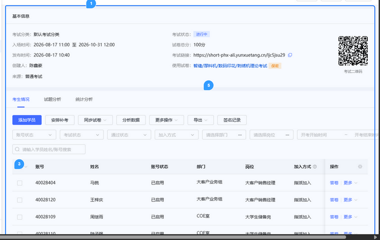
- 验收点：
  - [ ] Given 考试未发布 When 打开详情 Then 显示继续发布入口。
  - [ ] Given 点击考试链接图标 When 弹层打开 Then 可复制链接。
  - [ ] Given 点击二维码 When 预览打开 Then 可下载 200/400/800 三种尺寸。

### F7 考生情况与添加学员

- 描述：考生 tab 展示已安排人员、状态、成绩与操作。
- 工具栏：添加学员、安排补考、同步试卷、分析数据、更多操作、导出、签名记录。
- 筛选项：
  - 账号状态：已启用 / 已禁用 / 已删除。
  - 考试状态：未开始 / 考试中 / 批阅中 / 已完成 / 重新考试。
  - 通过状态：通过 / 不通过。
  - 加入方式：指派加入 / 链接加入等，具体枚举按实现常量化。
  - 部门：打开部门树抽屉，支持搜索和分页。
  - 岗位：打开岗位抽屉，支持岗位分类、岗位名称、搜索和分页。
  - 开考开始时间、结束时间：`datetime`，精确到分钟。
  - 姓名/账号搜索。
- 添加学员抽屉：单选人模式；部门筛选 + 姓名/账号/工号搜索 + 分页人员表 + 右侧已选；不显示多 tab 模式。
- 界面参照：
  - 
  - 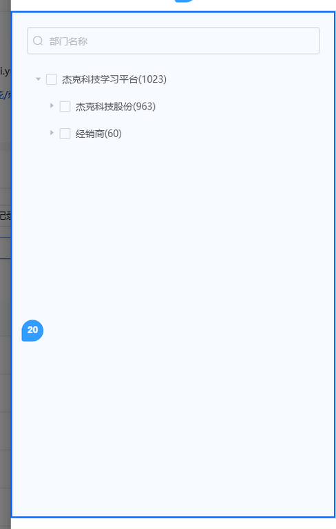
  - 
- 验收点：
  - [ ] Given 打开添加学员 When 查看顶部 Then 不出现「按用户组选人/高级选人/导入用户/关联动态用户组」tab。
  - [ ] Given 搜索姓名 When 结果返回 Then 表格与已选列表不丢失。
  - [ ] Given 重复添加已有学员 When 提交 Then 后端去重，前端提示「已存在，未重复安排」。

### F8 安排补考

- 描述：对未通过或需要重考的考生安排一次补考。
- 触发：选择考生 → 安排补考。
- 弹窗文案：`确定安排补考吗？` / `补考只支持安排一次，确认后，无法再次安排，请谨慎操作`。
- 规则：单个考生只允许安排一次；已安排过时按钮置灰并提示。
- 界面参照：
- 验收点：
  - [ ] Given 考生已安排补考 When 再次点击 Then 不允许提交。

### F9 同步试卷

- 描述：将最新试卷内容同步给考生。
- 触发：同步试卷。
- 菜单：同步未作答学员 / 同步全部学员。
- 规则：
  - 同步未作答学员：仅未开始或未产生作答记录的学员。
  - 同步全部学员：已作答学员也会使用最新试卷快照重新生成后续补考/重考试卷，不改历史答卷。
- 界面参照：
- 验收点：
  - [ ] Given 选择同步全部 When 确认 Then 需要二次确认并显示影响人数。

### F10 分析数据、催促与批量移除

- 分析数据：
  - 文案：`确认要分析数据吗？` / `分析数据后，学员将查看到自己的排名和每个题目的正确率。`
  - 执行后重算排名、分数统计、题目正确率，并开放学员端查看。
- 更多操作菜单：催促考试、催促批阅、批量移除。
  - 催促考试：向未完成学员发送通知。
  - 催促批阅：向批阅人发送通知。
  - 批量移除：移除安排关系，不删除账号；有作答记录时需确认。
- 界面参照：
  - 
  - 
- 验收点：
  - [ ] Given 点分析数据 When 确认 Then 分析状态更新且统计页数据刷新。
  - [ ] Given 勾选无作答考生 When 批量移除 Then 直接从考生列表删除。

### F11 考生导出

- 描述：按当前筛选导出考生数据。
- 导出菜单：仅导出最高成绩 / 导出所有成绩 / 导出学员答卷。
- 规则：
  - 仅导出最高成绩：每个考生一行，取最高成绩。
  - 导出所有成绩：每个考试尝试一行。
  - 导出学员答卷：打包 PDF 或 zip，含答卷详情。
- 界面参照：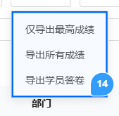
- 验收点：
  - [ ] Given 选择仅导出最高成绩 When 导出 Then 同一考生只有一行且成绩为最高分。
  - [ ] Given 筛选开考时间 When 导出 Then 文件只含该区间数据。

### F12 签名记录

- 描述：查看考前签名确认记录。
- 入口：考生情况工具栏「签名记录」。
- 抽屉字段：账号、姓名、签名图片、签名时间；分页；支持导出数据。
- 界面参照：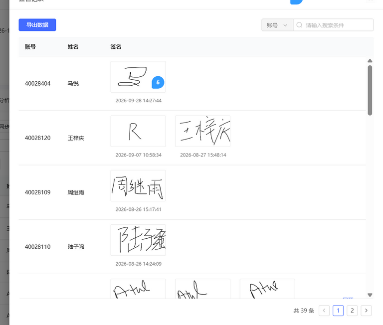
- 验收点：
  - [ ] Given 同一考生多次签名 When 查看 Then 每条签名按时间倒序展示。
  - [ ] Given 签名图片加载失败 When 展示 Then 显示占位而不是破图。

### F13 试题分析

- 描述：按试题统计答题次数和正确率。
- 工具栏：导出数据、题型筛选、难度筛选、试题名称搜索。
- 表格列：试题名称、题型、难度、答题次数、答对次数、正确率、答题详情。
- 点击试题名称 → 试题查看抽屉：题干、关键词、答案、考点、难度、解析、更新人、更新日期。
- 点击答题详情 → 答题详情抽屉：题干、选项、人数/比例、答案、难度、正确率、解析。
- 界面参照：
  - 
  - 
  - 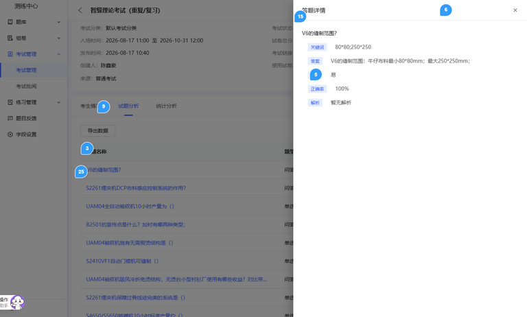
- 验收点：
  - [ ] Given 同一试题多次作答 When 分析完成 Then 正确率 = 答对次数 / 答题次数，保留两位小数。
  - [ ] Given 无作答记录 When 查看试题 Then 答题次数为 0，正确率显示 `--`。

### F14 统计分析

- 描述：考试整体统计与正确率分析。
- 指标卡：
  - 参与人数：参与人数 / 缺考人数 / 安排人数 / 参与率。
  - 参与人次：参与人次 / 安排人数 / 参与人次率。
  - 通过率：通过人数 / 通过率 / 首次通过率。
  - 优秀率：优秀人数 / 优秀率。
- 分值统计：试卷总分、通过分数、优秀分数（当前实现=及格线）、最高分、最低分、平均分、平均耗时（分钟）。
- 正确率统计：柱状图维度为题型 / 难度 / 考核点。
- 界面参照：
  - 
  - 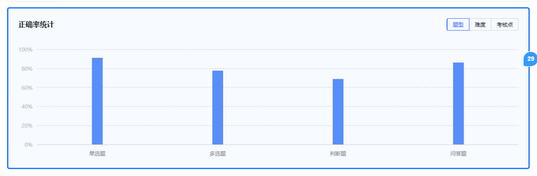
- 验收点：
  - [ ] Given 切换题型/难度/考核点 When 图表刷新 Then 横轴和值按所选维度变化。
  - [ ] Given 没有交卷记录 When 打开统计 Then 所有比率为 0/`--`，页面不报错。

### F15 创建考试类型选择

- 描述：点击「创建考试」先选择考试类型。
- 本期只实现「线上考试」卡；线下考试卡可直接隐藏，不显示不可用选项。
- 跳转：线上考试 → 创建考试向导第一步。
- 界面参照：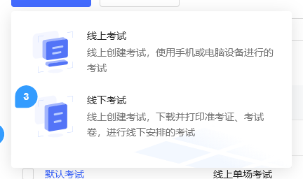
- 验收点：
  - [ ] Given 点击创建考试 When 选择线上考试 Then URL 带 `examType=onlineExam`。

### F16 创建试卷阶段

- 描述：考试创建向导第一步，决定考试使用的试卷来源。
- 三种方式：
  1. 创建新试卷：试卷名称、试卷分类、出卷方式、试卷保密；提交后创建试卷并进入下一步。
  2. 选择试卷：打开抽屉，分类树 + 试卷列表；选择后带入考试。
  3. 导入试卷：打开快速出卷抽屉，四步骤下载模板、选择题库、选分类/保密、上传 Excel；成功后创建试卷并进入下一步。
- 界面参照：
  - 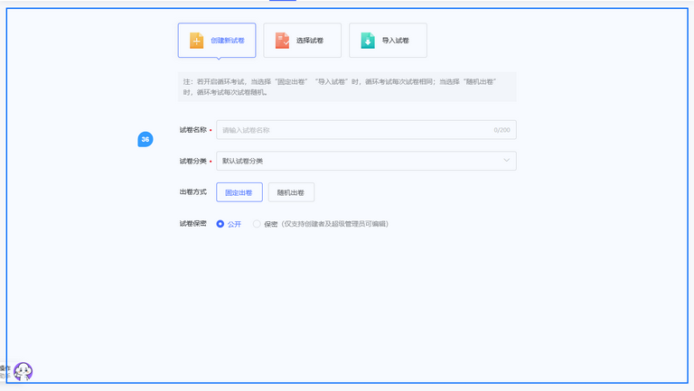
  - 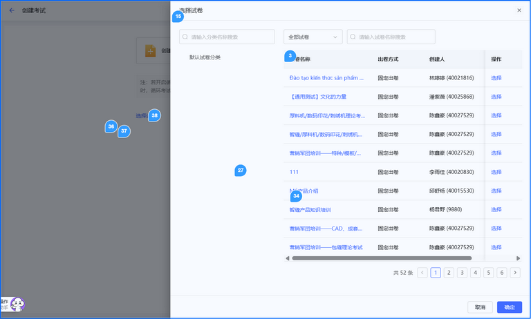
  - 
- 异常：未选试卷不能进入下一步；导入返回错误行明细。
- 验收点：
  - [ ] Given 选择已有试卷 When 下一步 Then 考试保存 `paperId`，不复制试卷。
  - [ ] Given 随机出卷 When 下一步 Then 进入试卷管理同款随机策略编辑页。

### F17 编辑试题阶段

- 描述：根据试卷出卷方式进入对应编辑页。
- 固定出卷：题型左栏 + 大题画布 + 题目卡片，复用试卷管理固定出卷页面。
- 随机出卷：策略矩阵 + 抽题来源 + 设定分值，复用试卷管理随机出卷页面。
- 本模块只负责流程壳、保存与进入下一步，不在考试模块复制试卷编辑器实现。
- 界面参照：
  - 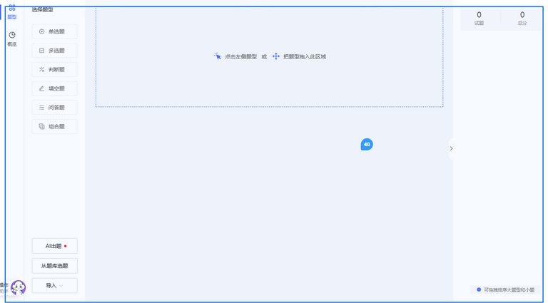
  - 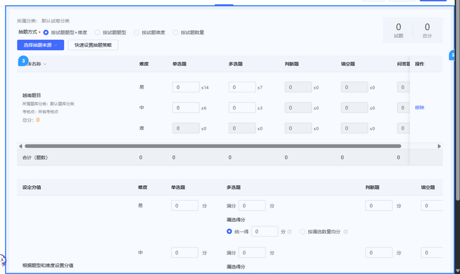
- 验收点：
  - [ ] Given 固定出卷点下一步 When 试卷无题 Then 阻止并提示「请先设置策略或添加试题」。
  - [ ] Given 随机出卷点下一步 When 分值全 0 Then 阻止并提示「请先设置分值」。

### F18 发布考试配置

- 描述：考试创建/编辑的最后一步，保存考试发布配置。
- 基本信息：考试名称、重要考试、是否保密、考试分类、编号、循环考试、入场时间、是否必修、通过分数（固定/比例）、学员奖励、答题次数限制、迟到限制、切屏限制。
- 通知设置：发送考试安排通知、安排取消通知、试卷批阅通知、成绩下发通知、定时消息设置。
- 通知设置只做开关；不出现默认模板/个性模板 radio。
- 更多设置：
  - 允许学员提交题目反馈、定时发布考试、定时结束考试、错题自动进错题本。
  - 考前签名确认及「签名展示在作答详情页中」。
  - 固定 IP 考试。
  - 批阅设置：批阅时隐藏考生信息、填空题自动批阅、问答题自动批阅、未作答自动批阅、允许问答题智能批阅。
  - 信息安全：复制下载图片、复制文字，允许/禁止。
  - 学习任务限制：生成学习任务，考试通过移除任务卡 / 考试提交移除任务卡。
  - 答卷设置：允许查看成绩、查看分数、查看是否通过、查看考核点得分；允许查看答卷详情页、仅错题、答案、解析、查看答题时间范围、禁止下载 PDF 答题结果。
  - 团队管理：允许团队管理者添加/移除学员。
- 界面参照：
  - 
  - 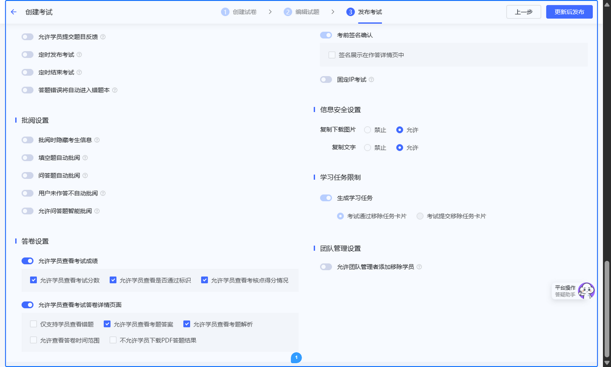
  - 
- 校验：
  - 考试名必填，最长 1000 字。
  - 考试分类必填。
  - 入场时间必填且结束时间晚于开始时间。
  - 通过分数必填且在合法范围。
  - 定时发布/结束时间开启时必填且晚于当前时间。
  - 固定 IP 开启时 IP 列表必填。
- 验收点：
  - [ ] Given 通知设置开关打开 When 保存 Then 只保存开关与定时消息，不保存模板细分。
  - [ ] Given 已发布考试修改配置 When 点更新后发布 Then 配置更新且生成变更通知草稿。

#### F18.1 已发布考试的可编辑范围

- 未发布考试：步骤「创建试卷」「编辑试题」「发布考试」均可继续修改。
- 已发布考试：可通过「上一步 / 下一步」回看前两步，但前两步只读；只有「发布考试」阶段可修改部分配置，保存入口显示「更新后发布」。
- 发布后可改的基本信息：
  - 考试名称
  - 重要考试
  - 是否保密
  - 考试分类
  - 入场开始/结束时间
  - 优秀分数及总分比例（**本期仅保存配置，统计口径按及格线**，见 09 D-26）
  - ~~使用试卷~~（**不可修改**：已发布后锁定，换卷请新建考试；2026-10-21 决策 D-31）
  - 考试说明
  - 负责人（最多 50 人）
  - 批阅人
- 发布后可改的通知设置：
  - 发送考试安排通知
  - 发送考试安排取消通知
  - 发送试卷批阅通知
  - 成绩下发通知
  - 定时消息设置及催促通知
- 第二批标注证据：
  - 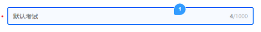
  - 
  - 
- 发布后不可改：
  - 创建试卷阶段：试卷名称、分类、出卷方式、保密等全部不可改
  - 编辑试题阶段：试卷题目、分值、抽题策略全部不可改
  - 「获得证书」配置：本期直接删除，不实现
  - 「更多设置」中的「防作弊限制」配置：已发布后不可改
  - 「更多设置」中的「学习任务限制」：已发布后不可改
- 发布后可改的其他「更多设置」：批阅设置、信息安全、答卷设置、题目反馈、定时发布/结束等，除上述不可改组之外均按可编辑处理。
- 「防作弊限制」的具体字段边界需要在实现前再对测试页补一次 DOM 标记；从当前截图可确定该组整体不可改。
- 验收点：
  - [ ] Given 已发布考试 When 进入步骤 1/2 Then 所有控件只读，不能提交修改。
  - [ ] Given 已发布考试 When 修改考试名称/时间/负责人/批阅人 Then 点「更新后发布」可保存。
  - [ ] Given 已发布考试 When 查看「防作弊限制」或「学习任务限制」 Then 控件置灰不可改。
  - [ ] Given 未发布考试 When 编辑任一阶段 Then 可以保存并继续流程。

### F19 考试链接与二维码

- 描述：为考试生成加入链接和二维码。
- 入口：考试列表更多菜单「链接」；考试管理页考试链接。
- 抽屉内容：考试名称、入场时间、链接、复制链接、二维码、下载 200/400/800。
- 规则：链接不含明文用户身份；学员打开后校验考试状态和权限。
- 界面参照：
- 验收点：
  - [ ] Given 点击复制链接 When 剪贴板成功 Then 提示「复制成功」。
  - [ ] Given 下载二维码 When 选择尺寸 Then 下载图片宽高对应尺寸。

### F20 变更通知与学员端联动

- 描述：考试配置修改后，管理员可发送变更通知给已安排学员。
- 入口：考试列表更多菜单「变更通知」。
- 管理端流程：展示变更摘要（时间、地点/链接、试卷、通过标准等）→ 编辑通知标题与正文 → 预览 → 确认发送。
- 学员端联动：发送后生成学员通知记录；学员端「我的考试 / 通知」接口可读取并标记已读。
- 图标参照：[考试列表更多菜单](页面素材/28-考试操作更多菜单.png)
- 入口参照：[变更通知入口](页面素材/29-变更通知入口.png)
- 验收点：
  - [ ] Given 考试入场时间变更 When 发送通知 Then 已安排学员都能在通知接口看到记录。
  - [ ] Given 学员标记已读 When 再次查询 Then `readStatus=1`，其他学员不受影响。

### F21 答卷详情

- 描述：管理员查看单个考生答卷。
- 入口：考生情况操作列「答卷」。
- 头部：试卷名称、试卷总分、提交时间、批阅人、考生账号、工号、部门、岗位；右上角导出 PDF。
- 正文：按大题分组；每题展示题干、选项、考生选择、正确答案、考点、解析、得分。
- 界面参照：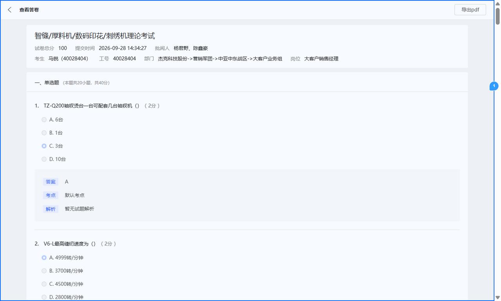
- 验收点：
  - [ ] Given 点击答卷 When 页面加载 Then URL 参数使用 `ueId` 唯一定位 attempt。
  - [ ] Given 点击导出 PDF When 生成完成 Then 下载内容与页面一致。

### F22 列字段设置

- 描述：考生表操作列表头的齿轮打开字段设置，支持显隐与拖拽排序。
- 字段：账号、姓名、账号状态、部门、岗位、加入方式、考试状态、开考时间、交卷时间、加入考试时间、IP 地址、答题时长、成绩、最高分第几次考、切屏次数、提交方式。
- 规则：至少有账号、姓名、操作列不可隐藏；设置保存到用户维度。
- 验收点：
  - [ ] Given 拖拽「成绩」到第一名 When 保存 Then 刷新后顺序保持。
  - [ ] Given 取消所有可隐藏字段 When 保存 Then 至少保留账号、姓名、操作列。

### F23 权限与状态

- 描述：跨页面的权限与状态规则。
- 权限：
  - 超管：全部操作。
  - 考试创建者/负责人：编辑、发布、复制、结束、变更通知、链接、考生管理、导出。
  - 分类管理员：管理分类与分类下考试。
  - 普通查看者：只读列表、详情、统计、答卷；写操作置灰。
- 状态：
  - 未发布：可编辑、删除、发布；不可安排学员。
  - 进行中：可安排/移除学员、补考、催促、同步、分析、导出；不可删除。
  - 已结束：只读配置与统计；可导出、查看答卷；不可继续安排学员。
- 验收点：
  - [ ] Given 进行中考试 When 查看更多菜单 Then 删除禁用，结束时需确认。
  - [ ] Given 普通查看者 When 打开详情 Then 写按钮全部置灰。

## 5. 界面与内容规格

### 5.1 布局

```text
考试管理列表页
┌──────────────────────┬─────────────────────────────────────────────────┐
│ 分类搜索 [+][...]     │ [创建考试] [批量操作]                           │
│ 默认考试分类          │ 筛选行1：全部考试/创建人/类型/状态/安排方式      │
│                      │ 筛选行2：名称编号搜索 [导出数据]                 │
│                      │ 表格：名称/类型/状态/入场时间/.../操作           │
│ ○包含子分类 ○仅当前   │ 分页                                            │
└──────────────────────┴─────────────────────────────────────────────────┘

考试管理页
┌──────────────────────────────────────────────────────────────────────────┐
│ 返回  考试名                         [编辑] [链接] [发布/更新后发布]      │
│ 基本信息卡片：分类/状态/入场时间/总分/链接/试卷/二维码                   │
│ [考生情况] [试题分析] [统计分析]                                         │
│ 工具栏 + 筛选行 + 表格/图表                                              │
└──────────────────────────────────────────────────────────────────────────┘

创建/编辑考试
┌──────────────────────────────────────────────────────────────────────────┐
│ 创建考试   ①创建试卷 > ②编辑试题 > ③发布考试    [上一步] [发布]          │
│ 左：基本信息/配置                                    右：通知/设置       │
└──────────────────────────────────────────────────────────────────────────┘
```

### 5.2 文案表

| 位置 | 文案原文 | 备注 |
|---|---|---|
| 列表按钮 | 创建考试 / 批量操作 / 导出数据 | 原文 |
| 列表操作 | 管理 / 更多 / 发布 | 原文 |
| 创建类型 | 线上考试 / 线下考试 | 本期仅线上 |
| 步骤条 | 创建试卷 / 编辑试题 / 发布考试 | 原文 |
| 创建试卷 | 创建新试卷 / 选择试卷 / 导入试卷 | 原文 |
| 补考弹窗 | 确定安排补考吗？ / 补考只支持安排一次，确认后，无法再次安排，请谨慎操作 | 原文 |
| 分析弹窗 | 确认要分析数据吗？ / 分析数据后，学员将查看到自己的排名和每个题目的正确率。 | 原文 |
| 同步菜单 | 同步未作答学员 / 同步全部学员 | 原文 |
| 更多操作 | 催促考试 / 催促批阅 / 批量移除 | 原文 |
| 导出菜单 | 仅导出最高成绩 / 导出所有成绩 / 导出学员答卷 | 原文 |
| 考试更多 | 编辑 / 变更通知 / 链接 / 复制 / 删除 / 结束 | 原文 |

### 5.3 视觉基调

- 沿用现有后台视觉：主色 `#1890ff`，成功 `#52c41a`，警告 `#faad14`，错误 `#f5222d`。
- 背景 `#f5f5f5`，卡片白色，边框 `#e8e8e8`，正文 `#333333`，次级 `#666666`，占位 `#999999`。
- 圆角 4px / 8px，表格行高约 48px，按钮高度 32/40px。
- 图表使用 ECharts，不自定义夸张渐变；统计数字 28px，卡片标题 16px。

## 6. 状态规格

| 状态 | 触发条件 | 界面表现 | 参照图 |
|---|---|---|---|
| 列表加载 | 切分类/筛选/翻页 | 表格 loading，保留现有行高 | 无 |
| 列表空态 | 无数据 | `el-empty`，文案「暂无考试」 | 无 |
| 请求失败 | 网络/业务失败 | 页面保留筛选，显示错误提示与重试 | 无 |
| 未发布 | `publishStatus=0` | 灰色状态点，操作列有发布 | `01-考试管理-列表页.png` |
| 进行中 | 发布且在考试时间窗内 | 蓝色状态点，操作列管理/更多 | 同上 |
| 已结束 | 结束或时间窗结束 | 灰色状态点，写操作置灰 | 同上 |
| 考生未开始 | `examStatus=0` | 灰点文字「未开始」 | `04-考试详情-基本信息与tab.png` |
| 考生考试中 | `examStatus=1` | 蓝点文字「考试中」 | 同上 |
| 考生批阅中 | `examStatus=2` | 橙点文字「批阅中」 | 同上 |
| 考生已完成 | `examStatus=3` | 绿点文字「已完成」 | 同上 |
| 考生重新考试 | `examStatus=4` | 蓝点文字「重新考试」 | 同上 |
| 无作答统计 | 答题次数 0 | 正确率 `--` | 无 |

## 7. 非功能需求

- 列表接口首屏在正常数据量下 < 1s；导出使用后端流式文件，不阻塞页面。
- 筛选输入 300ms 防抖；分页切换取消旧请求或忽略旧响应，避免竞态覆盖。
- 所有 ID 为 string；时间统一 `yyyy-MM-dd HH:mm:ss`；前端显示可裁剪秒但筛选精确到分钟。
- 批量操作和导出按钮在无选择或处理中必须禁用，防止重复提交。
- 统计页接口按考试聚合，不直接在前端拉全量答卷计算。
- 所有写操作后端再次校验权限，不依赖前端置灰。
- 用户数据、答卷、签名属于敏感数据，导出和查看需权限校验并记录操作日志。

## 8. 验收清单

- [ ] F1 路由/菜单/权限守卫正确。
- [ ] F2 分类树与题库/试卷交互一致，包含子分类过滤正确。
- [ ] F3 列表除来源外字段齐全，筛选、排序、分页正确。
- [ ] F4 列表操作与状态规则正确。
- [ ] F5 批量与导出正确。
- [ ] F6 详情基本信息正确，链接/二维码可用。
- [ ] F7 考生筛选、添加学员简化版正确。
- [ ] F8 补考只允许一次。
- [ ] F9 同步两种模式正确。
- [ ] F10 分析、催促、移除正确。
- [ ] F11 三种导出结果正确。
- [ ] F12 签名记录可分页/导出。
- [ ] F13 试题分析、查看、答题详情抽屉正确。
- [ ] F14 统计指标、分值、正确率维度切换正确。
- [ ] F15 创建考试仅线上。
- [ ] F16 三种创建试卷方式正确并复用试卷模块。
- [ ] F17 固定/随机出卷复用试卷模块。
- [ ] F18 发布配置与更多设置正确；通知模板不细分。
- [ ] F19 链接复制、二维码下载正确。
- [ ] F20 变更通知生成并写入学员端通知。
- [ ] F21 答卷详情与 PDF 导出正确。
- [ ] F22 列设置显隐与拖拽排序正确。
- [ ] F23 权限与状态置灰、后端双校验正确。

## 附录 A. 决策记录

| # | 决策点 | 结论 | 来源 |
|---|---|---|---|
| 1 | 只做线上考试 | 不实现线下考试入口 | 用户 |
| 2 | 通知模板不细分 | 只做通知开关和定时消息 | 用户 |
| 3 | 列表来源列不做 | UI 不展示；本期不新增来源业务字段 | 用户 |
| 4 | 添加学员不做多 tab | 单一简化选人抽屉 | 用户 |
| 5 | 试卷编辑复用试卷模块 | 考试模块只做流程壳和关联 | 用户/工程约束 |
| 6 | 变更通知联动学员端 | 管理端通知记录 + 学员端读取接口 | 用户 |
| 7 | 统计/正确率按轻量聚合表 | 不实时扫描全量答卷 | 对齐题库/试卷模块 |
| 8 | 考试与试卷之间使用快照 | 历史答卷不受试卷后续编辑影响 | 本文档建议 🤔 |

## 附录 B. 待确认项

- [x] 已完成核心读接口抓包；考试状态实测为 `0 未发布 / 2 进行中 / 3 已结束`，考生状态实测包含 3/4。
- [ ] 学员端通知 UI 是否与考试管理同批次实施。
- [ ] 试卷发布后是否禁止结构编辑；若禁止，后端实现可不用快照表，但接口保持 `snapshotId` 兼容。
- [ ] 导出学员答卷采用 PDF 合并还是 zip 打包。

