# 测练中心·考试管理复刻 需求文档

> 版本：v1.0 ｜ 日期：2026-10-14  
> 目标：复刻 `train.chinajack.com/ote` 管理端「考试管理」模块，功能归属现有 `ExamService` 与 `front-end` 的 `/exam` 路由段。  
> 证据：`观察素材/观察记录.md`、46 条用户浏览器标注、31 张页面参照图、`观察素材/抓包/实测接口与字段.md`。读接口已完成实测；写接口字段仍为设计/推断值 🤔。  
> 前置模块：`测练中心题库管理`、`测练中心试卷管理`。考试创建与编辑试卷阶段复用试卷模块，不重做另一套试卷编辑器。

## 1. 概述

考试管理面向管理员与考试负责人，解决以下问题：

- 在分类树上组织考试。
- 创建线上考试并完成试卷选择、编辑与发布配置。
- 在考试管理页安排学员、跟踪考试状态、处理补考、同步试卷、分析成绩。
- 查看试题维度正确率、考试整体统计、单个学员答卷与签名记录。
- 生成考试链接与二维码，并向已安排学员发送变更通知。

模块入口：管理端「测练中心 > 考试管理 > 考试管理」。

## 2. 范围

### 2.1 本期做

- 考试分类树：搜索、创建、编辑、删除、禁用、移动，复用题库/试卷分类组件。
- 考试列表：除「来源」外全部字段、筛选、排序、分页、批量操作、导出。
- 创建考试：仅线上考试；三步流程 `创建试卷 → 编辑试题 → 发布考试`。
- 创建试卷三种方式：创建新试卷、选择已有试卷、导入试卷。
- 试卷编辑：固定出卷、随机出卷，复用试卷管理模块页面与能力。
- 发布考试配置：基本信息、通知开关、更多设置。
- 考试管理页：基本信息、考生情况、试题分析、统计分析。
- 考生管理：添加学员、筛选、状态跟踪、补考、同步试卷、分析数据、催促、移除、导出、签名记录。
- 考试链接：链接复制、二维码预览与下载。
- 变更通知：提交后生成通知记录，并写入学员端可读取的通知数据。
- 答卷详情：按题目展示考生答案、正确答案、考点与解析，支持导出 PDF。
- 列表字段设置：显隐与拖拽排序（**注意：这是考生表格表头的齿轮，属 F22，保留**）。
- **顶层菜单裁剪（2026-11-13 用户拍板）**：「题目反馈」「字段设置」两个一级菜单**不实现，入口一并移除**。
  它们不在本轮复刻范围内，留着只会让人点进占位页。
  与 F22「列字段设置」不是同一件事——后者是考生表格的列显隐齿轮，保留。

### 2.2 本期不做

| 项 | 原因 |
|---|---|
| 线下考试创建 | 用户明确只做线上考试 |
| 考试列表「来源」列与筛选 | 用户明确排除 |
| 通知设置中的默认模板/个性模板细分 | 用户明确不细分 |
| 添加学员的多筛选模式 tab（按用户组、高级选人、导入用户、关联动态用户组） | 用户明确不做，采用单一简化选人抽屉 |
| 原站复杂角色/租户差异 | 本平台权限以现有三层权限体系和 StaffManagement 为准 |
| 学员端答题页完整复刻 | 本模块提供答卷查看与统计消费接口；答题页由学员端模块负责 |
| 试卷编辑器内部功能 | 直接复用 `测练中心试卷管理` 的固定/随机出卷页面 |

## 3. 用户流程

### 3.1 创建并发布考试

```text
考试管理列表
  → 创建考试
  → 选择「线上考试」
  → 步骤1 创建试卷
      ├─ 创建新试卷：填名称/分类/固定或随机/保密
      ├─ 选择试卷：从试卷分类与列表中选择已有试卷
      └─ 导入试卷：下载模板、选择题库、上传 Excel
  → 步骤2 编辑试题
      ├─ 固定出卷：进入试卷管理同款大题画布
      └─ 随机出卷：进入试卷管理同款策略矩阵
  → 步骤3 发布考试
      ├─ 基本信息
      ├─ 通知设置（仅开关，不做模板细分）
      └─ 更多设置
  → 发布 / 更新后发布
  → 返回考试管理列表
```

### 3.2 管理已发布考试

```text
考试列表点击考试名或「管理」
  → 考试管理页
      ├─ 考生情况：添加学员、筛选、补考、同步、分析、催促、导出、签名
      ├─ 试题分析：按题目查看答题次数/正确率
      └─ 统计分析：参与率、通过率、分值统计、正确率柱状图
  → 页头「编辑」
      → 发布配置页，保存后更新考试
```

### 3.3 查看答卷

```text
考生情况 → 某学员 → 答卷
  → 答卷详情页
  → 查看每题答案、正确选项、考点、解析
  → 导出 PDF
```

## 4. 功能需求

### F1 路由与菜单骨架

- 描述：在 `front-end` 新增考试管理路由与页面目录；侧边菜单「考试管理」激活。
- 入口：管理端「测练中心 > 考试管理」。
- 主流程：进入列表页；点击菜单不出现 PlaceholderPage。
- 异常：无考试管理权限时显示 403 页面。
- 验收点：
  - [ ] Given 有权限管理员登录 When 点击考试管理 Then 进入考试列表页。
  - [ ] Given 无权限用户 When 直接访问路由 Then 显示 403，不请求考试数据。

### F2 考试分类树

- 描述：左侧考试分类树，与题库/试卷分类树交互一致；根节点为「默认考试分类」。
- 入口：考试管理列表页左侧。
- 主流程：搜索分类名 → 选择分类 → 右侧列表按 `catalogId + routingPath` 过滤；底部选择「包含子分类 / 仅当前分类」。
- 分类操作：创建、编辑、删除、禁用、移动；有子分类或已挂考试时删除阻止。
- 界面参照：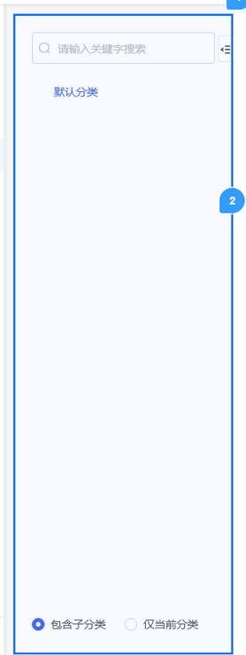
- 验收点：
  - [ ] Given 选择父分类且勾选包含子分类 When 列表刷新 Then 同时返回子分类下考试。
  - [ ] Given 分类存在子分类 When 删除 Then 弹阻止提示，分类不删除。
  - [ ] Given 移动分类 When 确认 Then 子分类路径和考试归属同步更新。

### F3 考试列表

- 描述：考试管理主列表，字段除来源外全做。
- 入口：考试管理菜单。
- 列：考试名称、考试类型、考试状态、入场时间、创建人、创建时间、负责人、安排人数、已交卷、已通过、通过率、操作。
- 筛选：全部考试/我创建的/我负责的；创建人；考试类型；考试状态；安排方式；考试名称/编号/创建人搜索；导出数据。
- 排序：创建时间、入场时间、安排人数、已交卷、已通过、通过率。
- 分页：10/20/50/100。
- 界面参照：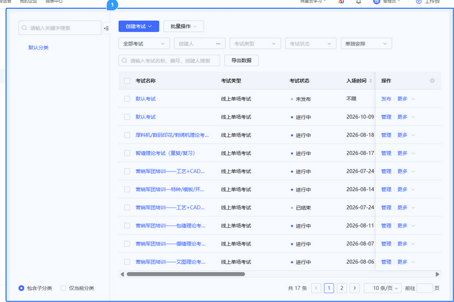
- 字段全览：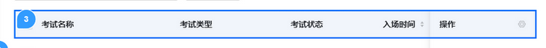
- 验收点：
  - [ ] Given 列表有数据 When 渲染 Then 不显示「来源」列或来源筛选项。
  - [ ] Given 点击考试名称 When 跳转 Then 与点击「管理」进入同一详情页。
  - [ ] Given 翻页/筛选 When 请求返回 Then 页码和总条数同步更新。

### F4 列表行操作

- 描述：操作列「管理 / 更多」；未发布考试显示「发布」。
- 更多菜单：编辑、变更通知、链接、复制、删除、结束。
- 规则：
  - 已结束考试「结束」置灰。
  - 删除仅创建者或超管可操作。
  - 已发布且有考生时删除必须先弹影响提示。
  - 复制复制考试配置、试卷引用和发布设置，不复制考生与作答记录。
- 界面参照：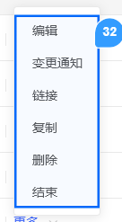
- 验收点：
  - [ ] Given 未发布考试 When 点击操作列发布 Then 状态变为进行中且列表刷新。
  - [ ] Given 非创建者 When 打开更多菜单 Then 删除项置灰。

### F5 批量操作与导出

- 描述：勾选考试后批量操作；无选择时禁用。
- 批量项：批量结束、批量删除。
- 导出：按当前分类和筛选导出考试列表 Excel。
- 验收点：
  - [ ] Given 勾选 0 条 When 查看批量操作 Then 下拉禁用。
  - [ ] Given 点击导出数据 When 后端生成文件 Then 文件名包含「考试列表」和日期。

### F6 考试管理页基本信息

- 描述：点击考试名称/管理后的详情页。
- 展示：考试分类、考试状态、入场时间、试卷总分、发布时间、考试链接、创建人、使用试卷、考试二维码、负责人、编号。
- 操作：返回、编辑、考试链接、继续发布（未发布时）。
- 界面参照：
- 验收点：
  - [ ] Given 考试未发布 When 打开详情 Then 显示继续发布入口。
  - [ ] Given 点击考试链接图标 When 弹层打开 Then 可复制链接。
  - [ ] Given 点击二维码 When 预览打开 Then 可下载 200/400/800 三种尺寸。

### F7 考生情况与添加学员

- 描述：考生 tab 展示已安排人员、状态、成绩与操作。
- 工具栏：添加学员、安排补考、同步试卷、分析数据、更多操作、导出、签名记录。
- 筛选项：
  - 账号状态：已启用 / 已禁用 / 已删除。
  - 考试状态：未开始 / 考试中 / 批阅中 / 已完成 / 重新考试。
  - 通过状态：通过 / 不通过。
  - 加入方式：指派加入 / 链接加入等，具体枚举按实现常量化。
  - 部门：打开部门树抽屉，支持搜索和分页。
  - 岗位：打开岗位抽屉，支持岗位分类、岗位名称、搜索和分页。
  - 开考开始时间、结束时间：`datetime`，精确到分钟。
  - 姓名/账号搜索。
- 添加学员抽屉：单选人模式；部门筛选 + 姓名/账号/工号搜索 + 分页人员表 + 右侧已选；不显示多 tab 模式。
- 界面参照：
  - 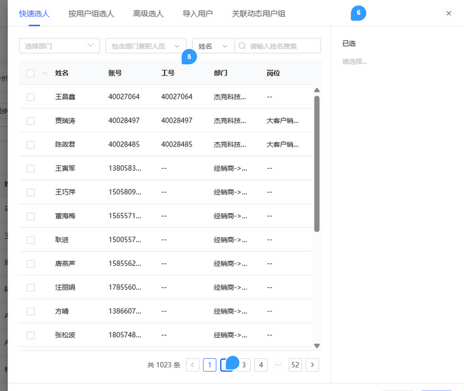
  - 
  - 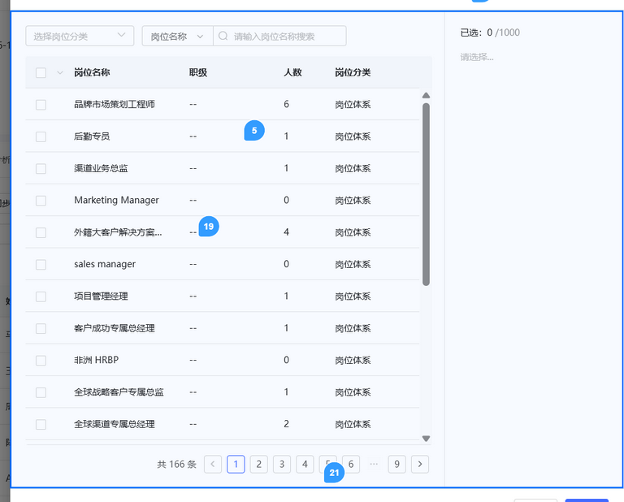
- 验收点：
  - [ ] Given 打开添加学员 When 查看顶部 Then 不出现「按用户组选人/高级选人/导入用户/关联动态用户组」tab。
  - [ ] Given 搜索姓名 When 结果返回 Then 表格与已选列表不丢失。
  - [ ] Given 重复添加已有学员 When 提交 Then 后端去重，前端提示「已存在，未重复安排」。

### F8 安排补考

- 描述：对未通过或需要重考的考生安排一次补考。
- 触发：选择考生 → 安排补考。
- 弹窗文案：`确定安排补考吗？` / `补考只支持安排一次，确认后，无法再次安排，请谨慎操作`。
- 规则：单个考生只允许安排一次；已安排过时按钮置灰并提示。
- 界面参照：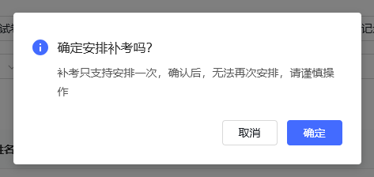
- 验收点：
  - [ ] Given 考生已安排补考 When 再次点击 Then 不允许提交。

### F9 同步试卷

- 描述：将最新试卷内容同步给考生。
- 触发：同步试卷。
- 菜单：同步未作答学员 / 同步全部学员。
- 规则：
  - 同步未作答学员：仅未开始或未产生作答记录的学员。
  - 同步全部学员：已作答学员也会使用最新试卷快照重新生成后续补考/重考试卷，不改历史答卷。
- 界面参照：
- 验收点：
  - [ ] Given 选择同步全部 When 确认 Then 需要二次确认并显示影响人数。

### F10 分析数据、催促与批量移除

- 分析数据：
  - 文案：`确认要分析数据吗？` / `分析数据后，学员将查看到自己的排名和每个题目的正确率。`
  - 执行后重算排名、分数统计、题目正确率，并开放学员端查看。
- 更多操作菜单：催促考试、催促批阅、批量移除。
  - 催促考试：向未完成学员发送通知。
  - 催促批阅：向批阅人发送通知。
  - 批量移除：移除安排关系，不删除账号；有作答记录时需确认。
- 界面参照：
  - 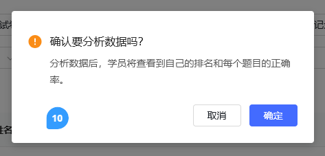
  - 
- 验收点：
  - [ ] Given 点分析数据 When 确认 Then 分析状态更新且统计页数据刷新。
  - [ ] Given 勾选无作答考生 When 批量移除 Then 直接从考生列表删除。

### F11 考生导出

- 描述：按当前筛选导出考生数据。
- 导出菜单：仅导出最高成绩 / 导出所有成绩 / 导出学员答卷。
- 规则：
  - 仅导出最高成绩：每个考生一行，取最高成绩。
  - 导出所有成绩：每个考试尝试一行。
  - 导出学员答卷：打包 PDF 或 zip，含答卷详情。
- 界面参照：
- 验收点：
  - [ ] Given 选择仅导出最高成绩 When 导出 Then 同一考生只有一行且成绩为最高分。
  - [ ] Given 筛选开考时间 When 导出 Then 文件只含该区间数据。

### F12 签名记录

- 描述：查看考前签名确认记录。
- 入口：考生情况工具栏「签名记录」。
- 抽屉字段：账号、姓名、签名图片、签名时间；分页；支持导出数据。
- 界面参照：
- 验收点：
  - [ ] Given 同一考生多次签名 When 查看 Then 每条签名按时间倒序展示。
  - [ ] Given 签名图片加载失败 When 展示 Then 显示占位而不是破图。

### F13 试题分析

- 描述：按试题统计答题次数和正确率。
- 工具栏：导出数据、题型筛选、难度筛选、试题名称搜索。
- 表格列：试题名称、题型、难度、答题次数、答对次数、正确率、答题详情。
- 点击试题名称 → 试题查看抽屉：题干、关键词、答案、考点、难度、解析、更新人、更新日期。
- 点击答题详情 → 答题详情抽屉：题干、选项、人数/比例、答案、难度、正确率、解析。
- 界面参照：
  - 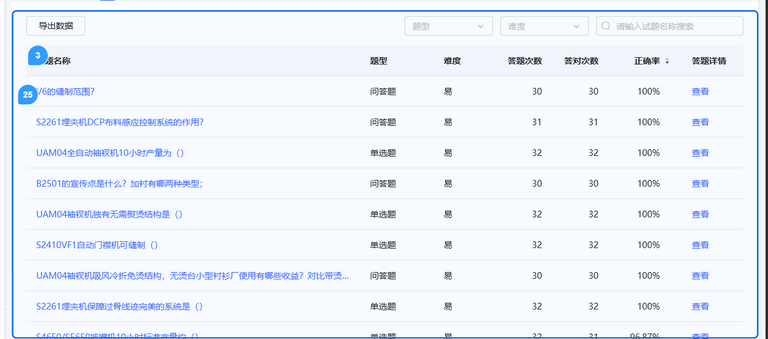
  - 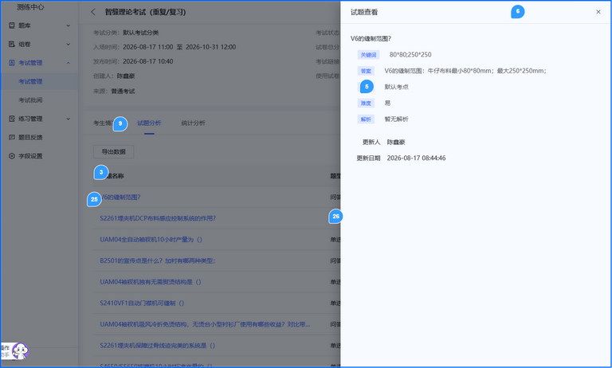
  - 
- 验收点：
  - [ ] Given 同一试题多次作答 When 分析完成 Then 正确率 = 答对次数 / 答题次数，保留两位小数。
  - [ ] Given 无作答记录 When 查看试题 Then 答题次数为 0，正确率显示 `--`。

### F14 统计分析

- 描述：考试整体统计与正确率分析。
- 指标卡：
  - 参与人数：参与人数 / 缺考人数 / 安排人数 / 参与率。
  - 参与人次：参与人次 / 安排人数 / 参与人次率。
  - 通过率：通过人数 / 通过率 / 首次通过率。
  - 优秀率：优秀人数 / 优秀率。
- 分值统计：试卷总分、通过分数、优秀分数（当前实现=及格线）、最高分、最低分、平均分、平均耗时（分钟）。
- 正确率统计：柱状图维度为题型 / 难度 / 考核点。
- 界面参照：
  - 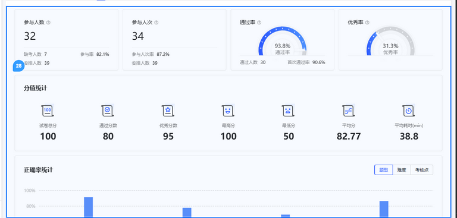
  - 
- 验收点：
  - [ ] Given 切换题型/难度/考核点 When 图表刷新 Then 横轴和值按所选维度变化。
  - [ ] Given 没有交卷记录 When 打开统计 Then 所有比率为 0/`--`，页面不报错。

### F15 创建考试类型选择

- 描述：点击「创建考试」先选择考试类型。
- 本期只实现「线上考试」卡；线下考试卡可直接隐藏，不显示不可用选项。
- 跳转：线上考试 → 创建考试向导第一步。
- 界面参照：
- 验收点：
  - [ ] Given 点击创建考试 When 选择线上考试 Then URL 带 `examType=onlineExam`。

### F16 创建试卷阶段

- 描述：考试创建向导第一步，决定考试使用的试卷来源。
- 三种方式：
  1. 创建新试卷：试卷名称、试卷分类、出卷方式、试卷保密；提交后创建试卷并进入下一步。
  2. 选择试卷：打开抽屉，分类树 + 试卷列表；选择后带入考试。
  3. 导入试卷：打开快速出卷抽屉，四步骤下载模板、选择题库、选分类/保密、上传 Excel；成功后创建试卷并进入下一步。
- 界面参照：
  - 
  - 
  - 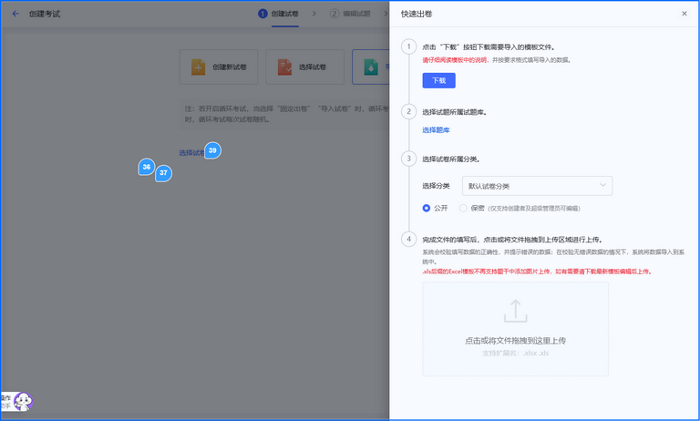
- 异常：未选试卷不能进入下一步；导入返回错误行明细。
- 验收点：
  - [ ] Given 选择已有试卷 When 下一步 Then 考试保存 `paperId`，不复制试卷。
  - [ ] Given 随机出卷 When 下一步 Then 进入试卷管理同款随机策略编辑页。

### F17 编辑试题阶段

- 描述：根据试卷出卷方式进入对应编辑页。
- 固定出卷：题型左栏 + 大题画布 + 题目卡片，复用试卷管理固定出卷页面。
- 随机出卷：策略矩阵 + 抽题来源 + 设定分值，复用试卷管理随机出卷页面。
- 本模块只负责流程壳、保存与进入下一步，不在考试模块复制试卷编辑器实现。
- 界面参照：
  - 
  - 
- 验收点：
  - [ ] Given 固定出卷点下一步 When 试卷无题 Then 阻止并提示「请先设置策略或添加试题」。
  - [ ] Given 随机出卷点下一步 When 分值全 0 Then 阻止并提示「请先设置分值」。

### F18 发布考试配置

- 描述：考试创建/编辑的最后一步，保存考试发布配置。
- 基本信息：考试名称、重要考试、是否保密、考试分类、编号、循环考试、入场时间、是否必修、通过分数（固定/比例）、学员奖励、答题次数限制、迟到限制、切屏限制。
- 通知设置：发送考试安排通知、安排取消通知、试卷批阅通知、成绩下发通知、定时消息设置。
- 通知设置只做开关；不出现默认模板/个性模板 radio。
- 更多设置：
  - 定时发布考试、定时结束考试、错题自动进错题本。
  - **「允许学员提交题目反馈」开关已移除（2026-11-13）**：功能不实现，
    该开关前后端均无消费方，拨了不产生任何效果，留着属于假开关。
  - 考前签名确认及「签名展示在作答详情页中」。
  - 固定 IP 考试。
  - 批阅设置：批阅时隐藏考生信息、填空题自动批阅、问答题自动批阅、未作答自动批阅、允许问答题智能批阅。
  - 信息安全：复制下载图片、复制文字，允许/禁止。
  - 学习任务限制：生成学习任务，考试通过移除任务卡 / 考试提交移除任务卡。
  - 答卷设置：允许查看成绩、查看分数、查看是否通过、查看考核点得分；允许查看答卷详情页、仅错题、答案、解析、查看答题时间范围、禁止下载 PDF 答题结果。
  - 团队管理：允许团队管理者添加/移除学员。
- 界面参照：
  - 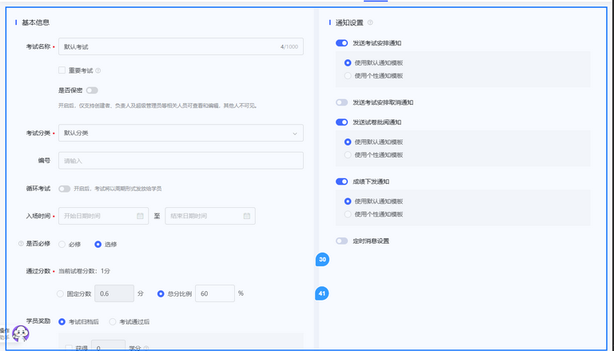
  - 
  - 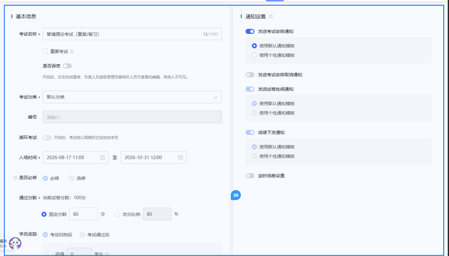
- 校验：
  - 考试名必填，最长 1000 字。
  - 考试分类必填。
  - 入场时间必填且结束时间晚于开始时间。
  - 通过分数必填且在合法范围。
  - 定时发布/结束时间开启时必填且晚于当前时间。
  - 固定 IP 开启时 IP 列表必填。
- 验收点：
  - [ ] Given 通知设置开关打开 When 保存 Then 只保存开关与定时消息，不保存模板细分。
  - [ ] Given 已发布考试修改配置 When 点更新后发布 Then 配置更新且生成变更通知草稿。

#### F18.1 已发布考试的可编辑范围

- 未发布考试：步骤「创建试卷」「编辑试题」「发布考试」均可继续修改。
- 已发布考试：可通过「上一步 / 下一步」回看前两步，但前两步只读；只有「发布考试」阶段可修改部分配置，保存入口显示「更新后发布」。
- 发布后可改的基本信息：
  - 考试名称
  - 重要考试
  - 是否保密
  - 考试分类
  - 入场开始/结束时间
  - 优秀分数及总分比例（**本期仅保存配置，统计口径按及格线**，见 09 D-26）
  - ~~使用试卷~~（**不可修改**：已发布后锁定，换卷请新建考试；2026-10-21 决策 D-31）
  - 考试说明
  - 负责人（最多 50 人）
  - 批阅人
- 发布后可改的通知设置：
  - 发送考试安排通知
  - 发送考试安排取消通知
  - 发送试卷批阅通知
  - 成绩下发通知
  - 定时消息设置及催促通知
- 第二批标注证据：
  - 
  - 
  - 
- 发布后不可改：
  - 创建试卷阶段：试卷名称、分类、出卷方式、保密等全部不可改
  - 编辑试题阶段：试卷题目、分值、抽题策略全部不可改
  - 「获得证书」配置：本期直接删除，不实现
  - 「更多设置」中的「防作弊限制」配置：已发布后不可改
  - 「更多设置」中的「学习任务限制」：已发布后不可改
- 发布后可改的其他「更多设置」：批阅设置、信息安全、答卷设置、定时发布/结束等，除上述不可改组之外均按可编辑处理。
  （「题目反馈」及其通知项已随功能移除，2026-11-13。）
- 「防作弊限制」的具体字段边界需要在实现前再对测试页补一次 DOM 标记；从当前截图可确定该组整体不可改。
- 验收点：
  - [ ] Given 已发布考试 When 进入步骤 1/2 Then 所有控件只读，不能提交修改。
  - [ ] Given 已发布考试 When 修改考试名称/时间/负责人/批阅人 Then 点「更新后发布」可保存。
  - [ ] Given 已发布考试 When 查看「防作弊限制」或「学习任务限制」 Then 控件置灰不可改。
  - [ ] Given 未发布考试 When 编辑任一阶段 Then 可以保存并继续流程。

### F19 考试链接与二维码

- 描述：为考试生成加入链接和二维码。
- 入口：考试列表更多菜单「链接」；考试管理页考试链接。
- 抽屉内容：考试名称、入场时间、链接、复制链接、二维码、下载 200/400/800。
- 规则：链接不含明文用户身份；学员打开后校验考试状态和权限。
- 界面参照：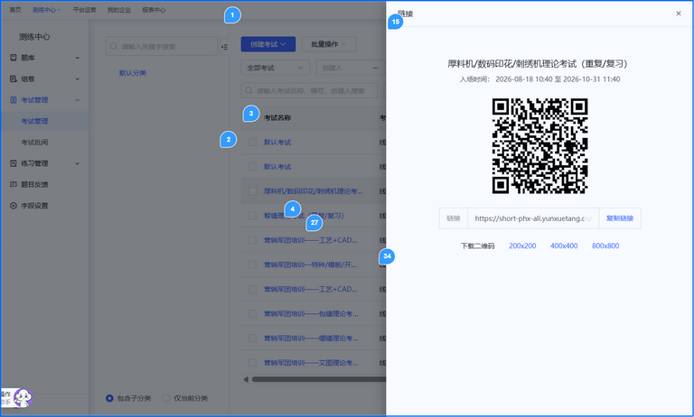
- 验收点：
  - [ ] Given 点击复制链接 When 剪贴板成功 Then 提示「复制成功」。
  - [ ] Given 下载二维码 When 选择尺寸 Then 下载图片宽高对应尺寸。

### F20 变更通知与学员端联动

- 描述：考试配置修改后，管理员可发送变更通知给已安排学员。
- 入口：考试列表更多菜单「变更通知」。
- 管理端流程：展示变更摘要（时间、地点/链接、试卷、通过标准等）→ 编辑通知标题与正文 → 预览 → 确认发送。
- 学员端联动：发送后生成学员通知记录；学员端「我的考试 / 通知」接口可读取并标记已读。
- 图标参照：[考试列表更多菜单](页面素材/28-考试操作更多菜单.png)
- 入口参照：[变更通知入口](页面素材/29-变更通知入口.png)
- 验收点：
  - [ ] Given 考试入场时间变更 When 发送通知 Then 已安排学员都能在通知接口看到记录。
  - [ ] Given 学员标记已读 When 再次查询 Then `readStatus=1`，其他学员不受影响。

### F21 答卷详情

- 描述：管理员查看单个考生答卷。
- 入口：考生情况操作列「答卷」。
- 头部：试卷名称、试卷总分、提交时间、批阅人、考生账号、工号、部门、岗位；右上角导出 PDF。
- 正文：按大题分组；每题展示题干、选项、考生选择、正确答案、考点、解析、得分。
- 界面参照：
- 验收点：
  - [ ] Given 点击答卷 When 页面加载 Then URL 参数使用 `ueId` 唯一定位 attempt。
  - [ ] Given 点击导出 PDF When 生成完成 Then 下载内容与页面一致。

### F22 列字段设置

- 描述：考生表操作列表头的齿轮打开字段设置，支持显隐与拖拽排序。
- 字段：账号、姓名、账号状态、部门、岗位、加入方式、考试状态、开考时间、交卷时间、加入考试时间、IP 地址、答题时长、成绩、最高分第几次考、切屏次数、提交方式。
- 规则：至少有账号、姓名、操作列不可隐藏；设置保存到用户维度。
- 验收点：
  - [ ] Given 拖拽「成绩」到第一名 When 保存 Then 刷新后顺序保持。
  - [ ] Given 取消所有可隐藏字段 When 保存 Then 至少保留账号、姓名、操作列。

### F23 权限与状态

- 描述：跨页面的权限与状态规则。
- 权限：
  - 超管：全部操作。
  - 考试创建者/负责人：编辑、发布、复制、结束、变更通知、链接、考生管理、导出。
  - 分类管理员：管理分类与分类下考试。
  - 普通查看者：只读列表、详情、统计、答卷；写操作置灰。
- 状态：
  - 未发布：可编辑、删除、发布；不可安排学员。
  - 进行中：可安排/移除学员、补考、催促、同步、分析、导出；不可删除。
  - 已结束：只读配置与统计；可导出、查看答卷；不可继续安排学员。
- 验收点：
  - [ ] Given 进行中考试 When 查看更多菜单 Then 删除禁用，结束时需确认。
  - [ ] Given 普通查看者 When 打开详情 Then 写按钮全部置灰。

## 4B. 学员端考试（新增 2026-11-10）

> 背景：本模块原先只做管理端，学员答题页按旧口径「由学员端模块负责」，实际从未实现。
> 本轮按原平台 7 轮实机勘探补齐。勘探记录见 `观察素材/学员端考试-勘探记录.md`，
> 决策依据见 `学员端考试-需求讨论稿.md` 与 `学员端考试-补充待讨论点.md`。

### S1 考试入口与列表

- **顶部导航**「考试」置于「AI实战训练场」右侧，指向学员考试列表页。
- 列表页参照对练列表页：左侧统计栏 + 右侧卡片列表。
- **左侧统计只放三项**：待考 / 进行中 / 已完成。学员关心的是「还有几场要考」。
- **卡片分组三档**：`未开始` / `未通过（可重考）` / `已通过`。
  - 考过但未通过**必须显示**：若消失，学员会以为考试被取消。
  - 次数已用完的未通过记录保留在「未通过」组，可看成绩但不可再考。
- **排序**：待考在前，组内按入场结束时间升序；已完成按提交时间倒序。
- 卡片展示：考试名、重要标记、有效期、状态、最高分。
- 验收：
  - [ ] Given 从未参加过的考试 When 打开列表 Then 出现在「未开始」组。
  - [ ] Given 考过未通过 When 打开列表 Then 出现在「未通过（可重考）」组且可再次进入。
  - [ ] Given 次数用尽的未通过 When 打开列表 Then 显示在未通过组，入场页不可开始并说明原因。

### S2 考试入场页

- 入口：**从「考试结果页」的「再次考试」进入**（2026-11-13 按原平台修正）。

#### 页面流转链路（2026-11-13 原平台复核，用户实测确认）

```
考试练习列表
  └─ 点考试卡片 ────────→ 考试结果页
                              │
        结果页「再次考试」────→ 考试入场页（本页）
                              │
        入场页「考试结果/查看详情」──→ 回到考试结果页
                              │
        结果页「查看答题详情」────────→ 答卷详情
```

**关键规则：点考试卡片先进「结果页」，不是「入场页」。**
判定依据是「有没有已交卷的答卷」：
- **有** → 结果页（学员点卡片通常是想看上次考了多少，不是想再考一次）
- **没有**（从未交卷 / 只开考未交卷）→ 入场页去考

> 我方旧实现是「点卡片一律进入场页」，与原平台方向相反，已按上表改正。
- 展示：考试名、入场时间、试卷总分、试题总数、考试限时、交卷时间、通过分数、优秀分数、考试次数（`已用/上限`，不限显示「不限」）、考生姓名。
- 「答卷须知」：说明可标记不确定题、限时考试倒计时结束自动交卷、点「开始考试」即开始计时。
- 已考过时额外显示：最近一次「考试结果：批阅中 / 已出分（未通过/通过）」+「查看详情」。
- 主按钮：未考过为「开始考试」，已考过为「再次考试」。
- 不可开始的原因如实展示：未到入场时间 / 已结束 / 次数用完。
- 验收：
  - [ ] Given 考试次数不限 When 展示 Then 次数显示「不限」。
  - [ ] Given 未到入场时间 When 进入场页 Then 开始按钮不可用并说明「考试尚未开始」。

### S3 考前流程（声明 / 签名 / 人脸核验）

按配置组合执行，顺序：**声明 → 签名 → 人脸核验 → 进入答题**。

- **考前声明**（`preExamDeclare`）：弹窗确认，未确认不得进入。
- **考前签名**（`signatureConfirm`）：canvas 手写 → 导出 PNG → 上传 → 绑定答卷。
  - 控件：清除重签 / 取消 / 确认。
  - 未签名不得进入。
- **人脸核验**（`faceVerify`）：**核验只采集证据，绝不阻断考试**。2026-11-12 起为**动作式活体**（DER-32）。
  - **流程**：开摄像头 → 加载人脸模型（约 1~2s，本地 `/models/`）→ 随机出题「请眨一下眼睛」或
    「请向你的左侧/右侧转头，再转回来」→ 学员完成动作 → 抓拍 → `pass`。
  - **技术**：`@vladmandic/human`（MIT，零依赖），只加载 `blazeface`（检测）+ `facemesh`（468 关键点），
    合计约 2.1MB，模型本地托管在 `public/models/`（**不依赖外网 CDN**）。
  - **判定口径**（重要，极性易错）：`openLeft/openRight` 是**睁眼度**（越小越闭）。
    闭眼 `<= 0.22`、睁眼 `>= 0.28`、中间为滞回带。
    **不要写成"闭合度"**——方向反了会让睁眼被判成闭眼，诚实学员 100% 超时。
  - **阈值已按真机标定（2026-11-12，两轮修正）**：实测 76 帧有效样本、19 次眨眼，真机 webcam 数据为
    **睁眼均值 0.301（单帧最低 0.273）、闭眼最低 0.176**。
    - 初版 `0.35`（依据 human 内置样例 0.41）→ **真机永远达不到，眨眼必然超时**
    - 第二版 `0.24 / 0.2` → 仍过不了：多数真人眨眼**闭不全**，只到 0.22 左右，卡在 0.2 线上
    - **最终 `0.28 / 0.22`**：容得下"闭不全"的常见眨眼（回放验证：闭到 0.22 能通过、只到 0.25 仍不过）
  - **采样策略同样关键**：`detectOnce` 单次实测约 172ms，而一次眨眼闭眼只持续 100~400ms。
    若采样周期过长会**整帧跳过眨眼**。当前取 `DETECT_INTERVAL_MS = 30`（检测完立刻排下一拍，
    实测周期约 200ms），且 `BLINK_OPEN_FRAMES = 1`（采样稀疏时不要求连续多帧睁眼）。
    抗抖动改由**滞回带 + 开局睁眼基线 + 闭眼必须真掉到阈值以下**三件套承担。
  - **换机器或换光线后必须重测**：用 `public/face-diagnose.html` 诊断页读新的睁眼/闭眼分布。
  - ⚠ **改完前端阈值必须验证运行时真的加载了**：`type-check` 和单测读的都是磁盘文件，
    不经过 Vite dev server 的模块图。排查时在页面上下文 `await import(...)` 读常量值，
    **不要用 `curl` 查 dev server 源码**（有 transform 缓存，会给出假阳性）。
    本次曾因 dev server 未热更新导致两轮修改全部无效、两次用户复测失败。
  - **失败分支（共 8 条）全部可继续考试**：
    | 分支 | `identity_status` |
    |---|---|
    | 动作完成 | 1 |
    | 超时 / 未检测到人脸 / 多张人脸 | 2（待人工核对） |
    | 模型加载失败 / 摄像头不可用 / 全程无有效帧 / 未预期异常 | 3（无法核验） |
  - **每阶段都要有出口**：模型加载中、动作挑战中都必须有「跳过核验」按钮，
    否则 2MB 模型在慢网下不来时学员会死锁。
  - **有效帧统计**：15 秒内一帧有效画面都没有 → 判 `unavailable`(3) 而非 `fail`(2)，
    因为那是设备/网络问题，**不该记在学员头上**。
  - **防护级别（如实写明）**：
    | 能防 | 防不住 |
    |---|---|
    | 举照片 / 播视频（活体动作做不出） | **首次替考**（DEF-01） |
    | 两人同时入镜（`faceCount > 1`） | 高质量屏幕翻拍 |
    | 长时间不对准摄像头 | 实时视频通话代考 |
  - **首次建档方案防不住首次替考**（DEF-01），如实写入偏差记录。
  - **人脸基准照录入（2026-11-12 补，DER-33，选填）**：
    - 入口：**考试列表页**顶部提示条（非弹窗），仅在「确认未录入」时出现，可关闭。
    - 文案必须说清用途与边界：「用于考试时比对是不是同一个人，不会用于其他用途，可随时重录或跳过」。
    - **不做成强制**：跳过入口始终可见；跳过只影响本次页面不再提示。
    - **不做活体动作**：录入就是拍一张清晰正面照（活体判定发生在考试前那一刻）。
    - 一个学员一张，重录即覆盖；存 `/api/exam/files/**`。
    - **能力边界**：基准照由学员自己拍，首次就可能是别人 ⇒ 只能检测「这次与上次不是同一人」，
      **不是身份认证**，UI 不得暗示「已确认本人」。
  - **1:1 比对（2026-11-13 补，DER-34）**：
    - 触发：学员**已录基准照** + 活体动作通过后，当前帧算 embedding 与基准比。
      未录基准照则跳过比对（不加载额外的 6.7MB 模型）。
    - 上报：`identity_method`（1 仅活体 / 2 活体+比对）、`identity_score`（相似度 0..1）。
    - **比对不通过不阻断**：与活体同一口径，只让批阅人看到相似度。
    - **阈值 `0.6`（欧氏距离）是初始值**，需用真实样本标定；偏差方向安全（偏大只会少报，不误伤）。
    - **能力边界**：比对在前端完成，防不住能改前端的人。真实价值是「记录 + 给批阅人参考」。
    - 验收：
      - [ ] Given 未录基准照 Then 不做比对，`identity_method=1`，不加载特征模型。
      - [ ] Given 已录基准照且活体通过 Then 上报 `identity_method=2` 与相似度。
      - [ ] Given 基准图 404 / 模型加载失败 Then 记 `identity_method=1`，**不阻断**。
    - 接口：`GET /student/face-baseline`（返回 `hasBaseline` + `imageUrl`）、
      `POST /student/face-baseline`（`{imageUrl}`，仅接受 `/api/exam/files/` 前缀）。
    - 验收：
      - [ ] Given 未录入 When 进考试列表 Then 出现可关闭的提示条，不弹窗打断。
      - [ ] Given 提示条 When 点「以后再说」Then 本次不再提示，仍可正常考试。
      - [ ] Given 已录入 Then 不再出现提示条。
      - [ ] Given 查询接口失败 Then 不提示也不报错（静默当已录入）。
  - 单测覆盖：动作完成→pass、超时→fail 且可继续、模型加载失败→unavailable 且可继续、
    卸载后不再 `detectOnce`、error 帧不误判 `no-face`、多人脸→fail。
- 验收：
  - [ ] Given 摄像头不可用 When 点开始 Then 提示后仍可继续，答卷 `identity_status=3`。
  - [ ] Given 核验不通过 Then 不阻断，`identity_status=2` 且抓拍图落库。
  - [ ] Given 未完成签名 When 点开始 Then 不得进入答题页。

### S4 答题页

- 顶部固定：退出、考试名、考生（姓名+账号）、工号、部门、总分、通过分数。
- 左侧题目区，右侧固定答题卡。
- **答题卡**：进度 `N/总题数`；按大题分组列题号；图例「未做 / 已做 / 当前 / 标记」；底部「提交考试」。
- **两种作答样式**（`answerLayout`）：
  - `single` 一页平铺：全部题目纵向平铺，滚动查看。
  - `paged` 单题分页：只渲染当前题，底部「上一题/下一题」，答题卡仍可跳题。
  分页粒度为**逐题**，不是逐大题。
- **逐题即时保存**：每答一题立即提交，不等交卷。
- **题目标记**：每题可标记，标记后答题卡可快速定位（`marked` 字段）。
- **倒计时**：限时考试显示剩余时间；不限时显示「不限时」。
  - 以服务端 `startAt` 与学生作答基准时间推算，**不做纯前端计时**，避免刷新漂移。
- **断线恢复**：刷新/重进即续答，已答内容从服务端回显。
- 验收：
  - [ ] Given 答一题 When 刷新页面 Then 该题答案仍在且状态为「已做」。
  - [ ] Given `answerLayout=paged` When 答题 Then 一屏一题且有上一题/下一题。
  - [ ] Given 不限时考试 When 查看顶部 Then 显示「不限时」而非空白。

### S5 交卷

- 交卷前校验：**「还有 N 道题未做，是否确认交卷？」**（N=0 也提示一次）。
- 开启了「全部答完才能交卷」时，有未答题则不允许交卷并说明。
- 交卷后：页面停留并显示「已成功交卷」+ 已提交水印，**不自动跳转**。
- **查看结果入口**（2026-11-12 补，DER-31）：交卷后在提示条内提供「查看结果」按钮，点击才跳 `/exam/student/attempts/{attemptId}/result`。
  - **不自动跳转**的理由：主观题未批完时结果页是「批阅中 / 成绩 -- / 排名 --」的中间态，被动看到半成品会让学员误以为没答上；超时自动交卷、切屏超限强制交卷时学员可能不在屏幕前，回来发现页面自己跳走更困惑。
  - **可见性（勘误）**：结果页 `/result` **本身没有整体拦截**，总是可访问（内部指标由 `viewScore` 等分项开关控制），因此按钮**不做可见性隐藏**。
    - 初稿曾写「复用 `AnswerViewPolicy.blockReason()` 判定」，经核实是错的：`blockReason()` 判的是**答卷详情** `/paper-detail` 的 40055，与结果页入口无关，两处语义不同不可混用。
    - `viewAnswerTimeRange=0` 时结果页仍可看四格指标，只是「查看答卷详情」按钮禁用；把结果入口也藏掉会让学员连客观题分都看不到，反而更差。
  - **文案随状态变化**：按 `submit` 响应的 `status` 判断——`status=2` 批阅中显示「查看批阅进度」，`status=3` 已出分显示「查看成绩」；避免学员点进去看到「批阅中」觉得被骗。
    - `status` 取交卷响应里的值（后端 `submitResultOf` 读的是判分收口后的真实 status；DER-18 全客观题卷交卷即 `status=3`），前端不再自己推断。
  - **与考后签名的关系**：`postExamSign` 前端本期尚未实现（DER 待补），故当前无时序冲突。将来接入考后签名时，按钮须等签名流程走完再出现，不与签名弹窗抢焦点——此条先写入契约作为后续约束，不在本期施工。
- 开启考后电子签名时，提示完成签名确认本人作答。
- 交卷即终态，不可再改答案。
- 验收：
  - [ ] Given 有 3 题未做 When 点提交 Then 提示「还有 3 道题未做」。
  - [ ] Given 已交卷 When 重新进入考试 Then 不可继续答题。
  - [ ] Given 交卷成功 When 看提示条 Then 有「查看结果」按钮且页面不自动跳转。
  - [ ] Given `viewAnswerTimeRange=0` When 交卷 Then 按钮仍显示（结果页无整体拦截），点进去四格指标可见、「查看答卷详情」禁用。
  - [ ] Given 交卷响应 `status=2`（主观题待批阅）Then 按钮文案为「查看批阅进度」；`status=3` 时为「查看成绩」。
  - [ ] Given 交卷成功 When 点「查看结果」Then 跳 `/exam/student/attempts/{attemptId}/result`。

### S6 结果页

- 展示：考试名、通过/未通过印章、考生信息、试卷总分、最高分、考试次数、入场时间。
- 四格指标：**是否通过 / 考试成绩 / 考试用时 / 本次考试排名**。
- 「答题时间：起 ~ 止」。
- 按钮：「再次考试」（次数未用尽时）、「查看答卷详情」（受可见性配置约束）。
- **成绩呈现（有意改进原平台）**：
  - 批阅未完成时先出**客观题分**，形如「客观题 4/9 分」，主观题标注「待批阅」；
  - **最终总分、是否通过、排名**在批阅完成后才定。
- 左侧「考试历史(N)」：逐条列出每次作答的成绩、状态、时间；最高分取历史最好。
  - **每条历史都可点击**（2026-11-13 用户要求），点了跳到该次答卷的结果页。
  - 当前正在查看的那一条不可点（跳到自己没有意义），但保留浅灰底高亮。
  - 可点项要有手型光标与 hover 底色，让「能点」看得出来；当前项不给手型（给了却点不动是骗人）。
  - 键盘可达：`role="button"` + `tabindex="0"` + Enter/Space 触发（对齐 AGENTS.md 自定义可点元素口径）。
- 「考核点得分情况」表格：考核点 / 总分 / 得分 / 正确率。
- 「本次考试情况分析」：总体正确率、用时、用时排名；按题型分块列出正确率、答对 X/Y、排名 X/Y。
  - 组合题作**一个大题**汇总（答对 2/5），不按子题平铺。
- 验收：
  - [ ] Given 主观题未批阅 When 看结果页 Then 显示客观题分且总分/通过/排名为待批阅。
  - [ ] Given 多次作答 When 看考试历史 Then 每次一条且最高分正确。
  - [ ] Given 点历史里某一条 When 点击 Then 跳到该次答卷的结果页，页面数据随之切换（不是停留在原来那次）。
  - [ ] Given 点当前正在看的那一条 When 点击 Then 无反应（不重载、不跳转）。
  - [ ] Given `viewResultDetail` 关闭 When 看结果页 Then 答卷详情按钮不可用并给出原因。

### S7 答卷详情页

- 展示：试卷名、通过/未通过印章、试卷总分、提交时间、考生信息（姓名/工号/部门/岗位）。
- 右侧固定：考试成绩、通过分数；三个筛选
  **只看错题 / 显示正确答案 / 展开所有解析**（默认全开）。
- 每题：题号 + 题干 +（分值）+ 作答回显 + 蓝字「答案 / 考点 / 解析」三行。
  - 解析缺失显示「暂无试题解析」。
  - 填空/问答额外显示作答文本；问答显示「批阅评语」与「关键词」。
- **只看错题是真过滤**：不渲染答对的大题（连大题标题都不出现），不是高亮。
- **只看错题与显示正确答案互相独立**：可同时生效（只列错题、但每题不显示答案行）。
- 组合题：父题显示父题干与考点，子题逐个展开。
- 验收：
  - [ ] Given 只看错题开启 When 打开详情 Then 答对的大题完全不出现。
  - [ ] Given 只看错题+不显示正确答案同时开启 Then 只列错题且无答案行。
  - [ ] Given 填空作答对 2/3 空 Then 显示得分与「答对 2/3 空」。

## 4C. 考试批阅（新增 2026-11-10）

> 批阅人是**人工兜底**的落点，也是自动批阅/AI 判分的最终闭环。缺了它，自动批阅开关就是空转。

### M1 批阅列表（考试维度，管理端）

- 入口：管理端「考试批阅」菜单。
- 表格：考试名称 / 来源 / 发布日期 / 安排人数 / 交卷人数 / **待批阅**。
- 操作：查看详情 / 快速批阅。
- 筛选：考试名称、来源、日期区间、分页、排序。
- 验收：
  - [ ] Given 某考试有 3 份待批阅答卷 When 看列表 Then 待批阅列显示 3。
  - [ ] Given 全部批阅完成 Then 待批阅为 0。

### M2 答卷列表（学员维度）

- 入口：M1「查看详情」。
- 表格：账号 / 姓名 / 部门 / 岗位 / 提交时间 / 考试用时 / **批阅人** / **批阅时间** / 得分 / **身份标记**。
- 操作：`查看`+`批阅`（待批阅）或 `查看`+`重新批阅`（已批阅）。
- **同一学员多次作答逐条列出**，不合并。
- 支持按「批阅状态」筛选；支持导出数据。
- 身份标记：核验异常（`fail`/`error`）的答卷显示「⚠ 身份待核对」。
- 验收：
  - [ ] Given 学员考了 3 次 When 看列表 Then 3 条记录分别展示。
  - [ ] Given 答卷身份核验异常 Then 该行显示身份待核对标记。

### M3 批阅答卷页

- 与学员「答卷详情页」**同一个页面**，增加批阅能力：
  - 顶部「导出 PDF」、批阅人信息；
  - 每题底部**打分区**：对错图标 + 分值输入；
  - 显示**全部题目**（不默认只看错题）；
  - 底部取消 / 提交。
- 提交后：回写逐题对错与得分、重算答卷总分、更新通过状态与排名、刷新 M1/M2 列表。
- **身份异常处理**：批阅人可看到核验抓拍图与异常原因；
  判断身份有问题时，走**已有 `exam_attempt.status=4 已作废`**，不新造流程。
- 已批阅的答卷可「重新批阅」修改（申诉/纠错）。
- 验收：
  - [ ] Given 批阅人给主观题打 6 分 When 提交 Then 答卷总分与通过状态更新，M1 待批阅减 1。
  - [ ] Given 已批阅答卷 When 重新批阅并改分 Then 成绩更新且记批阅人/批阅时间。
  - [ ] Given 身份待核对答卷 When 打开批阅页 Then 可见抓拍图与异常原因。

### M4 学员端批阅入口

- 入口：「我的陪练」→ 教学任务 → 考试批阅。
- 面向「批阅人 = 当前用户」的精简视图：待批阅 / 已批阅两个 tab。
- 每条：学员名、部门、提交时间 + 「批阅」按钮。
- 验收：
  - [ ] Given 当前用户被指定为批阅人 Then 能看到自己负责的待批阅答卷。
  - [ ] Given 当前用户不是批阅人 Then 看不到该考试的待批阅列表。

## 4D. 学员端考试配置项

| 配置项 | 键 | 默认 | 学员端生效表现 |
|---|---|---|---|
| 允许重复考试次数 | `attemptLimit` | 0=不限 | 入场页次数、再次考试可用性 |
| 统一考试时长 | `publishSettings.limitMinutes` | 0=不限 | 答题页倒计时；「不限时」文案 |
| 最短答题时长 | `publishSettings.minAnswerSeconds` | 0 | 未到时长禁止交卷 |
| 全部答完才能交卷 | `advancedSettings.allowSubmitAllFinish` | 0 | 交卷拦截 |
| PC端作答样式 | `advancedSettings.answerLayout` | `single` | 一页平铺 / 单题分页 |
| 问答题允许上传附件 | `advancedSettings.qaAttachment` | 0 | 问答区附件上传（`attach`） |
| 填空题自动批阅 | `grading.autoGradeFill` | 0 | 关=转人工；开=规则判分 |
| 问答题自动批阅 | `grading.autoGradeQa` | 0 | 同上 |
| 用户未作答不自动批阅 | `grading.autoGradeUnanswered` | 0 | 空答不进批阅队列 |
| 允许问答题智能批阅 | `grading.aiGradeQa` | 0 | **在自动批阅开启前提下**决定手段：关=关键词规则，开=AI 语义 |
| 允许查看考试成绩 | `answerView.viewScore` | 1 | 结果页总开关 |
| 查看考试分数 | `answerView.viewScoreValue` | 1 | 显示得分 |
| 查看是否通过 | `answerView.viewPassFlag` | 1 | 通过印章 |
| 查看考核点得分 | `answerView.viewPointScore` | 1 | 考核点表格 |
| 查看答卷详情 | `answerView.viewAnswerDetail` | 1 | 详情入口 |
| 仅支持查看错题 | `answerView.wrongOnly` | 0 | 真过滤 |
| 查看考题答案 | `answerView.viewAnswer` | 1 | 答案行 |
| 查看考题解析 | `answerView.viewAnalysis` | 1 | 解析行 |
| 答卷查看时间范围 | `answerView.viewAnswerTimeRange` | 0 | **三值语义见下** |
| 禁止下载 PDF | `answerView.forbidPdfDownload` | 1 | 无导出 |
| 考前声明确认 | `advancedSettings.preExamDeclare` | 0 | 声明弹窗 |
| 考前签名确认 | `advancedSettings.signatureConfirm` | 0 | canvas 签名 |
| 考后电子签名 | `advancedSettings.postExamSign` | 0 | 交卷后签名 |
| 签名展示在详情页 | `advancedSettings.signatureInAnswerDetail` | 0 | 详情页显示签名 |
| 答题前人脸核验 | `advancedSettings.faceVerify` | 0 | 核验采集（不阻断） |
| 考试切屏限制 | `screenSwitchLimit` | 0 | 切屏计数与强制交卷 |
| 复制图片/文字 | `security.copyDownloadImage` / `copyText` | 1 | 禁止时拦截复制 |
| 生成学习任务 | `learningTask.enabled` | 1 | 首页任务卡 |
| 本次考试不进学员列表 | `advancedSettings.hideFromStudentList` | 0 | 列表与任务卡隐藏 |
| 批阅人 | `publishSettings.reviewerType` + `reviewerUserIds` | creator | 本期仅 creator / assigned |

**`viewAnswerTimeRange` 三值语义（本轮勘误，重要）**：

| 值 | 含义 |
|---|---|
| 0 | 不允许查看答卷详情 |
| 1 | **考试通过后**查看（分数达到通过分才能看；未通过一直不可看） |
| 2 | **考试整体结束后**查看（不是交卷后） |
| 3 | **交卷后在指定时间窗内**查看（`answerViewStartAt` ~ `answerViewEndAt`） |

> 禁用时按钮 tooltip 必须给出与配置一致的原因（如「考试结束后允许查看」）。

## 4E. 学员端状态口径

| 学员状态 | 判定 |
|---|---|
| `not_started` 未开始 | 无答卷记录 |
| `in_progress` 进行中 | 有未交卷答卷 |
| `grading` 批阅中 | 已交卷但存在待批阅题（`correct_flag=3` 或答卷 `status=2`） |
| `finished` 已完成 | 已交卷且全部判完 |
| `invalid` 已作废 | 答卷 `status=4` |

> 状态一律由 `exam_attempt` 实时推算，**不新增冗余状态列**，避免与答卷不同步。
> 列表/任务卡/入场页共用同一口径。

## 5. 界面与内容规格

### 5.1 布局

```text
考试管理列表页
┌──────────────────────┬─────────────────────────────────────────────────┐
│ 分类搜索 [+][...]     │ [创建考试] [批量操作]                           │
│ 默认考试分类          │ 筛选行1：全部考试/创建人/类型/状态/安排方式      │
│                      │ 筛选行2：名称编号搜索 [导出数据]                 │
│                      │ 表格：名称/类型/状态/入场时间/.../操作           │
│ ○包含子分类 ○仅当前   │ 分页                                            │
└──────────────────────┴─────────────────────────────────────────────────┘

考试管理页
┌──────────────────────────────────────────────────────────────────────────┐
│ 返回  考试名                         [编辑] [链接] [发布/更新后发布]      │
│ 基本信息卡片：分类/状态/入场时间/总分/链接/试卷/二维码                   │
│ [考生情况] [试题分析] [统计分析]                                         │
│ 工具栏 + 筛选行 + 表格/图表                                              │
└──────────────────────────────────────────────────────────────────────────┘

创建/编辑考试
┌──────────────────────────────────────────────────────────────────────────┐
│ 创建考试   ①创建试卷 > ②编辑试题 > ③发布考试    [上一步] [发布]          │
│ 左：基本信息/配置                                    右：通知/设置       │
└──────────────────────────────────────────────────────────────────────────┘
```

### 5.2 文案表

| 位置 | 文案原文 | 备注 |
|---|---|---|
| 列表按钮 | 创建考试 / 批量操作 / 导出数据 | 原文 |
| 列表操作 | 管理 / 更多 / 发布 | 原文 |
| 创建类型 | 线上考试 / 线下考试 | 本期仅线上 |
| 步骤条 | 创建试卷 / 编辑试题 / 发布考试 | 原文 |
| 创建试卷 | 创建新试卷 / 选择试卷 / 导入试卷 | 原文 |
| 补考弹窗 | 确定安排补考吗？ / 补考只支持安排一次，确认后，无法再次安排，请谨慎操作 | 原文 |
| 分析弹窗 | 确认要分析数据吗？ / 分析数据后，学员将查看到自己的排名和每个题目的正确率。 | 原文 |
| 同步菜单 | 同步未作答学员 / 同步全部学员 | 原文 |
| 更多操作 | 催促考试 / 催促批阅 / 批量移除 | 原文 |
| 导出菜单 | 仅导出最高成绩 / 导出所有成绩 / 导出学员答卷 | 原文 |
| 考试更多 | 编辑 / 变更通知 / 链接 / 复制 / 删除 / 结束 | 原文 |

### 5.3 视觉基调

- 沿用现有后台视觉：主色 `#1890ff`，成功 `#52c41a`，警告 `#faad14`，错误 `#f5222d`。
- 背景 `#f5f5f5`，卡片白色，边框 `#e8e8e8`，正文 `#333333`，次级 `#666666`，占位 `#999999`。
- 圆角 4px / 8px，表格行高约 48px，按钮高度 32/40px。
- 图表使用 ECharts，不自定义夸张渐变；统计数字 28px，卡片标题 16px。

## 6. 状态规格

| 状态 | 触发条件 | 界面表现 | 参照图 |
|---|---|---|---|
| 列表加载 | 切分类/筛选/翻页 | 表格 loading，保留现有行高 | 无 |
| 列表空态 | 无数据 | `el-empty`，文案「暂无考试」 | 无 |
| 请求失败 | 网络/业务失败 | 页面保留筛选，显示错误提示与重试 | 无 |
| 未发布 | `publishStatus=0` | 灰色状态点，操作列有发布 | `01-考试管理-列表页.png` |
| 进行中 | 发布且在考试时间窗内 | 蓝色状态点，操作列管理/更多 | 同上 |
| 已结束 | 结束或时间窗结束 | 灰色状态点，写操作置灰 | 同上 |
| 考生未开始 | `examStatus=0` | 灰点文字「未开始」 | `04-考试详情-基本信息与tab.png` |
| 考生考试中 | `examStatus=1` | 蓝点文字「考试中」 | 同上 |
| 考生批阅中 | `examStatus=2` | 橙点文字「批阅中」 | 同上 |
| 考生已完成 | `examStatus=3` | 绿点文字「已完成」 | 同上 |
| 考生重新考试 | `examStatus=4` | 蓝点文字「重新考试」 | 同上 |
| 无作答统计 | 答题次数 0 | 正确率 `--` | 无 |

## 7. 非功能需求

- 列表接口首屏在正常数据量下 < 1s；导出使用后端流式文件，不阻塞页面。
- 筛选输入 300ms 防抖；分页切换取消旧请求或忽略旧响应，避免竞态覆盖。
- 所有 ID 为 string；时间统一 `yyyy-MM-dd HH:mm:ss`；前端显示可裁剪秒但筛选精确到分钟。
- 批量操作和导出按钮在无选择或处理中必须禁用，防止重复提交。
- 统计页接口按考试聚合，不直接在前端拉全量答卷计算。
- 所有写操作后端再次校验权限，不依赖前端置灰。
- 用户数据、答卷、签名属于敏感数据，导出和查看需权限校验并记录操作日志。

## 8. 验收清单

- [ ] F1 路由/菜单/权限守卫正确。
- [ ] F2 分类树与题库/试卷交互一致，包含子分类过滤正确。
- [ ] F3 列表除来源外字段齐全，筛选、排序、分页正确。
- [ ] F4 列表操作与状态规则正确。
- [ ] F5 批量与导出正确。
- [ ] F6 详情基本信息正确，链接/二维码可用。
- [ ] F7 考生筛选、添加学员简化版正确。
- [ ] F8 补考只允许一次。
- [ ] F9 同步两种模式正确。
- [ ] F10 分析、催促、移除正确。
- [ ] F11 三种导出结果正确。
- [ ] F12 签名记录可分页/导出。
- [ ] F13 试题分析、查看、答题详情抽屉正确。
- [ ] F14 统计指标、分值、正确率维度切换正确。
- [ ] F15 创建考试仅线上。
- [ ] F16 三种创建试卷方式正确并复用试卷模块。
- [ ] F17 固定/随机出卷复用试卷模块。
- [ ] F18 发布配置与更多设置正确；通知模板不细分。
- [ ] F19 链接复制、二维码下载正确。
- [ ] F20 变更通知生成并写入学员端通知。
- [ ] F21 答卷详情与 PDF 导出正确。
- [ ] F22 列设置显隐与拖拽排序正确。
- [ ] F23 权限与状态置灰、后端双校验正确。

## 附录 A. 决策记录

| # | 决策点 | 结论 | 来源 |
|---|---|---|---|
| 1 | 只做线上考试 | 不实现线下考试入口 | 用户 |
| 2 | 通知模板不细分 | 只做通知开关和定时消息 | 用户 |
| 3 | 列表来源列不做 | UI 不展示；本期不新增来源业务字段 | 用户 |
| 4 | 添加学员不做多 tab | 单一简化选人抽屉 | 用户 |
| 5 | 试卷编辑复用试卷模块 | 考试模块只做流程壳和关联 | 用户/工程约束 |
| 6 | 变更通知联动学员端 | 管理端通知记录 + 学员端读取接口 | 用户 |
| 7 | 统计/正确率按轻量聚合表 | 不实时扫描全量答卷 | 对齐题库/试卷模块 |
| 8 | 考试与试卷之间使用快照 | 历史答卷不受试卷后续编辑影响 | 本文档建议 🤔 |

## 附录 B. 待确认项

- [x] 已完成核心读接口抓包；考试状态实测为 `0 未发布 / 2 进行中 / 3 已结束`，考生状态实测包含 3/4。
- [ ] 学员端通知 UI 是否与考试管理同批次实施。
- [ ] 试卷发布后是否禁止结构编辑；若禁止，后端实现可不用快照表，但接口保持 `snapshotId` 兼容。
- [ ] 导出学员答卷采用 PDF 合并还是 zip 打包。

