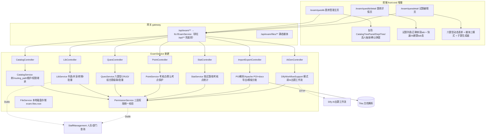

# 测练中心·题库管理复刻 技术实现方案

> 版本：v1.0 ｜ 日期：2026-10-12 ｜ 配套：01-需求文档.md、03-接口文档.md、04-建表SQL.md
> 工程基线：front-end（Vue3+TS+SCSS+Element Plus）+ 新建 ExamService（Spring Boot 4.x 微服务族模式）+ gateway + Nacos + MySQL final_dream

---

## 1. 整体架构



要点：
- **用户自建空壳应用**（老模式）：目录结构对齐既有微服务（controller/dto/entity/mapper/service/config）。
- 文件存储**本地磁盘**：`exam.files.root`（application.properties 配置），Spring 静态资源映射 `/api/exam/files/**`；上传走统一 FileController（原文件名+UUID 存储，返回相对 URL 入库）。
- 权限校验收敛在 PermissionService（AOP 或 Service 显式调用），写操作统一拦截。

## 2. 技术选型

| 层 | 选型 | 理由 |
|----|------|------|
| 应用 | Spring Boot 4.x + MyBatis-Plus + Nacos | 对齐 after-end 族 |
| 前端 | Vue3 + TS + Element Plus（现有工程） | 零新增依赖 |
| Excel 解析/生成 | Apache POI（xlsx 用户模式+大文件SXSSF） | 借鉴 lsgwr MIT 实现的逐行 try-catch + ImportResult 模式 |
| Word 解析/生成 | Apache POI XWFPojoRepository / poi-ooxml | 模板与导出同为 docx 段落式 |
| 富文本编辑器 | WangEditor（工程既有或 npm 新增，二选一实施时定） | 三媒体模式中的"文本（富文本）" |
| 文档解析（AI建题素材） | Apache Tika | 复用媒体处理模块同款选型 |
| AI 出题 | Dify workflow（新建 DSL） | SpeechTraining DifyWorkflowSupport 同模式（blocking） |
| 试题内容存储 | 结构化列 + content(HTML) + play(JSON) | 借鉴 xzs TextContent 思想但按字段拆列，列表查询免解析 |

**开源侦察结论**（详见决策记录）：xzs（AGPL+Vue2）/spring-boot-online-exam（MIT 但 3 题型）/SpringBoot-Vue-OnlineExam（无 LICENSE）均整体不可用，**从零自研**。

## 3. 数据模型（DDL 见 04-建表SQL.md）

### 3.1 表清单与关键设计

| 表 | 关键字段 | 设计说明 |
|----|----------|----------|
| exam_catalog | id/parent_id/name/order_index/routing_path/inherit_parent_auth/child_inherit_current_auth/disabled + 审计字段 | routing_path 三位一段（001.001.002），移动/重排时整棵子树重算（递归 UPDATE，事务内） |
| exam_catalog_admin | catalog_id/user_id | 管理员关系；权限继承在读取时合并（勾继承=读父级管理员列表） |
| exam_lib | id/name/catalog_id/secrecy/default_lib/disabled/duplicate_condition/point_qty/total_ques_qty + 审计字段 | duplicate_condition 用 tinyint 位标记（bit0=单选…bit4=问答）；point_qty/total_ques_qty 冗余计数，试题写操作时同事务维护 |
| exam_lib_share | lib_id/target_type(1部门/2人)/target_id | 共享范围，读取时 union 部门展开（经 StaffManagement 查部门成员） |
| exam_question | id/lib_id/parent_id/order_index/type/level_type/status/content/summary/file_id/play/explain_text/explain_play/answer_content/answer_play/judge_answer/judge_correct_option_content/judge_wrong_option_content/no_order_mark/answer_keywords(JSON)/duplicate/disabled + 审计字段 | **组合题**：父题 type=5，子题 parent_id 指向父题，子题复用全部题型字段；父题删除/换库级联子题。**answer_keywords**：问答关键词 `[{keyword,scoreRatio}]` JSON 列 |
| exam_question_item | ques_id/item_content/answer/order_index/item_play | 选项；answer=1 为正确项；order_index 决定 A/B/C 序号 |
| exam_question_point | ques_id/point_id/order_index | 多对多；主考核点=order_index 最小（UI 第一个选的） |
| exam_point | id/lib_id/name/default_point | default_point=1 唯一（每库），库创建时自动建"默认考点" |
| exam_answer_stat | ques_id/point_id/used_qty/total_answer_qty/correct_answer_qty | 轻量聚合；考试模块上线后回填；按考核点统计可由 question×point 聚合视图计算 |

### 3.2 枚举值（对齐原平台抓包）

| 枚举 | 值 |
|------|-----|
| type 题型 | 0单选 1多选 2判断 3填空 4问答 5组合 |
| level_type 难度 | 0易 1中 2难 |
| status 试题状态 | 0已保存 1已提交 2已审核 3不通过（列表不展示，字段保留） |
| secrecy | 0公开 1保密 |
| disabled | 0启用 1禁用 |
| share target_type | 1部门 2人 |

## 4. 关键实现设计

### 4.1 试题保存（六题型统一入口）

```
POST /api/exam/ques {…题型字段}
QuesService.save():
  1. 校验：题干非空（summary=HTML去标签）、选项≥2且答案匹配题型规则（单选1项/多选≥1/判断二选一/填空答案≥1/问答答案非空/组合子题≥1）
  2. 组合题：先存子题（仅一层，子题 lib_id 同父），收集子题 id 后存父题；子题不再嵌套组合题
  3. 选项行存 exam_question_item（order_index 重排连续）
  4. 考核点关联全删全插 exam_question_point（order_index 按提交顺序）
  5. 冗余计数维护：lib.total_ques_qty±1；新增考核点时 point_qty 重算
  6. 组合题父题 summary = 首子题摘要（列表展示）
```

### 4.2 分类树 routing_path 维护

- 新建：`父.routing_path + '.' + 三位序号`（同级 max+1）；根下为 `001`。
- 移动：目标分类下重编号 + **整棵子树前缀替换**（`UPDATE ... SET routing_path = REPLACE(...)` 事务内逐层执行；层级>10 拒绝）。
- 查询：题库列表按分类过滤 = `catalog_id = ? OR routing_path LIKE '前缀%'`（含子分类，对齐原平台 catalogId+routingPath 双参数语义）。

### 4.3 快速建题前端解析器

```
parse(text) → QuestionDraft[]:
  1. 按空行/题型标记行切题（[单选题][易] 开头为新题）
  2. 逐行识别：题干行 / A.选项行（A~L 或 A、） / 答案： / 解析：
  3. 填空题解析 __(n)__ 或 (n) 占位 → 答案按序映射
  4. 校验：题型标记必填、答案必填、选项题选项≥2；失败题标错误原因
```

纯前端实现（TS util），错误行内联标红；确定录入时**逐题调用** `POST /api/exam/ques`，由前端汇总成功/失败明细（后端没有批量建题接口）。

### 4.4 导入导出

- **导入**：multipart 上传 → 按扩展名分发 ExcelParser（POI 逐 Sheet 逐行）/WordParser（XWFRanges 按段落切题，格式同导出样例）→ 每行 try-catch 产出 ImportResult{successCount, failCount, errors:[{line, reason}]}；新考核点 upsert（按 lib_id+name 查重）；图片单元格（Excel 嵌图）本期**忽略并提示**（原模板支持但复刻优先文字，标注后续增强）。
- **导出**：Excel=POI 5 Sheet 模板填充（模板文件 classpath 内置复制后写数据）；Word=poi-ooxml 按段落样式生成（【正确答案】等用加粗 run）。
- **模板下载**：`GET /api/exam/ques/import/template?format=excel|word` 返回 classpath 静态文件流。

### 4.5 查重

- 入库时计算归一化题干：`summary` 去空白/全半角归一 → 存 `summary_norm` 列（加索引）。
- 查重执行：`SELECT … FROM exam_question WHERE lib_id=? AND type=? AND summary_norm IN (SELECT summary_norm FROM … GROUP BY HAVING COUNT(*)>1)` → 打 duplicate=1 标记 + duplicate_condition 位标记持久化。
- 后续增强：SimHash 64bit 列 + 海明距离≤3（预留列不实施）。

### 4.6 AI出题

> 说明：start 变量名为 `material_text`。权威 DSL 是 `final_dream_difys/测练中心-AI出题.yml`。

- 流程：start（material_text、单/多/判/填/问数量）→ LLM（structured_output schema=题目数组）→ end 只输出 `questions`。
- 默认：ExamService `NativeExamGenClient` 调 AIGentService `POST /internal/agent/task/exam-gen`，超时 120s。
- 回退：`agent.exam-gen.provider=dify` 并重启后走 `DifyWorkflowSupport`。同一轮失败不改打另一边。
- 解析仍在 ExamService：`outputs.questions` → QuestionDraft。失败返回 50010。

### 4.7 权限校验（当前实现，PermissionService 为目标态）

> 本期没有独立 `PermissionService` / `StatController`；能力集由 `LibServiceImpl.permissionsOf` 在题库列表/详情中回填，写操作由各 Service 重复校验。下方伪码保留为目标态拆分参考，待后续重构落地。

```
check(operator, action, target):
  删除题库   → operator==lib.createUserId || isSuperAdmin
  编辑保密库 → 同上（secrecy=1 时）
  管理分类   → isSuperAdmin || catalogAdmin(catalog含继承链) 
  管理试题   → isSuperAdmin || libOwner || sharedUser(operator)（共享范围内）
```
- 前端按 `/api/exam/permission/check` 返回的能力集控制置灰；后端写操作再校验（双保险）。

## 5. 工程结构

```
ExamService/
├── controller/ CatalogController / LibController / QuesController / PointController /
│               StatController / ImportExportController / AiGenController /
│               FileController(上传+静态映射) / PermissionController
├── dto/ req/resp（对齐03接口文档）
├── entity/ 九表实体
├── mapper/ MyBatis-Plus
├── service/ CatalogService / LibService / QuesService / PointService /
│            StatService / ImportService / ExportService / AiGenService /
│            FileService / PermissionService
├── parser/ QuickParseUtil(共享给前端的规则文档) / ExcelQuestionParser / WordQuestionParser
└── config/ (Dubbo consumer StaffManagement / DifyProperties / 静态资源映射)

front-end/src/views/admin/exam/
├── QuesLibPage.vue            # 主页（树+列表）
├── LibDetailPage.vue          # 详情页（双tab+建题tab态）
├── QuesEditPage.vue           # 试题编辑/新建
├── components/
│   ├── CatalogTree.vue        # 树+齿轮菜单（复用改造课件CatalogTreePanel）
│   ├── CatalogFormDrawer.vue  # 新建/编辑分类（批量文本框+权限）
│   ├── MoveCatalogDrawer.vue  # 移动（懒展开树）
│   ├── LibFormDrawer.vue      # 新建/编辑题库
│   ├── ShareDrawer.vue / TransferDrawer.vue / ChangeCatalogDrawer.vue
│   ├── UserPickerDrawer.vue   # 快速选人（DeptTree+搜索+分页）
│   ├── QuesListTable.vue      # 试题列表
│   ├── QuesForm/              # 六题型表单（QuestionFormBase+各题型子组件+ComposeSubForm）
│   ├── PointSelect.vue / PointEditDrawer.vue
│   ├── QuickCreatePanel.vue   # 快速建题（解析器+卡片流）
│   ├── AiCreatePanel.vue      # AI建题
│   ├── QuesViewDrawer.vue     # 查看
│   ├── StatByQuesTable.vue / StatByPointTable.vue / AnswerDetailDrawer.vue
│   ├── ImportDrawer.vue / ChangeLibDrawer.vue / BatchPointDrawer.vue
│   └── ConfirmDialog.vue      # 删除确认（截图36样式）
```

## 6. 现有应用改动

| 应用 | 改动 |
|------|------|
| gateway | application.properties 增加 route：`/api/exam/**` → lb://ExamService（order=-1，在 /api/** 前） |
| front-end | router 增加 /exam 段；Home.vue 测练中心入口卡片；views/admin/exam/ 新页面族 |
| StaffManagement | 无代码改动（复用既有人员/部门 Dubbo 接口） |
| 其他应用 | 零改动 |

## 7. 实施顺序建议（给 code agent 的施工序）

1. 建表 SQL 执行 + ExamService 空壳（用户建）+ 网关路由
2. 分类树全套（FP-03）+ 题库列表全套（FP-04）——页面可操作闭环
3. 试题列表 + 编辑页六题型（FP-07/08）+ 考核点（FP-09）
4. 权限三层（FP-05）——穿插在 2/3 的写操作上
5. 快速建题（FP-10）→ 导入导出（FP-12/13）→ 查重（FP-14）→ 批量（FP-15）
6. 正确率（FP-16）+ AI建题（FP-11，Dify 工作流配置后联调）

## 8. 风险清单

| 风险 | 影响 | 应对 |
|------|------|------|
| routing_path 子树重算并发 | 移动分类时树结构错乱 | catalog 写操作加库级互斥（SELECT FOR UPDATE 父节点） |
| 组合题级联删除遗漏 | 孤儿子题 | 删除/换库统一走 QuesService 递归入口，禁直接 deleteById |
| 冗余计数漂移 | 列表试题数与实际不符 | 写操作同事务维护 + 上线后跑一次全量重算脚本（附 04） |
| Excel 嵌图导入 | 模板支持但本期忽略 | 导入提示"图片题型暂不支持导入"，文档标注后续增强 |
| Dify AI出题输出不稳定 | JSON 解析失败 | structured_output schema 约束 + 失败重试1次 + 前端错误提示 |
| WangEditor 工程未装 | 媒体富文本模式 | 实施时 npm 安装（轻依赖），或降级 textarea+HTML 源码（保底） |
| 本地磁盘路径部署差异 | 文件找不到 | exam.files.root 走 Nacos 配置，部署时按服务器实际路径配置 |

## 修订记录

| 版本 | 日期 | 变更 |
|------|------|------|
| v1.0 | 2026-10-12 | 初版 |
| v1.1 | 2026-10-27 | AI 出题默认改 AIGentService exam-gen |
