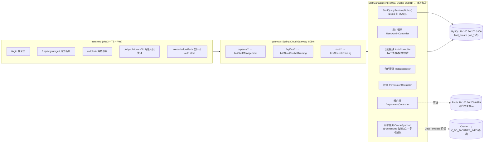
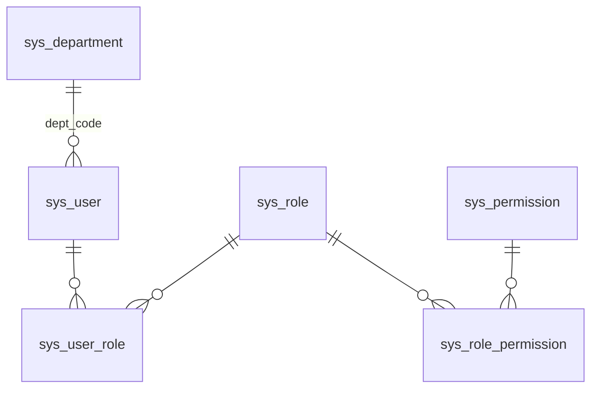

# 杰克数字人陪练平台 · 组织架构与角色权限模块 技术实现方案

> 版本：v1.0（2026-09-23）
> 配套文档：《01-需求文档》《03-接口文档》。功能点编号（FP-xx）三份文档统一。

---

## 1. 整体架构



分层说明：
- **认证与用户/角色/权限管理全部收敛在 StaffManagement**（已确认不新建应用），定位"用户与权限中心"
- Oracle 仅作为同步源（只读）；所有业务查询走 MySQL
- 网关新增路由 `/api/sm/**` → StaffManagement，置于 `/api/**` 兜底路由之前（顺序参考现有 routes[0]=/api/act/** 的做法）
- 其他服务（SpeechTraining 等）本期后端接口不加鉴权（见 §8 风险清单 R-3），前端全站拦截先覆盖入口

## 2. 技术栈

| 层 | 选型 | 版本 | 选型理由（对应决策） |
|----|------|------|---------------------|
| 后端框架 | Spring Boot（沿用） | 4.1.1 / Java 21 | 现有工程，不升级不动版本 |
| RPC | Dubbo（沿用） | 3.3.6 + Nacos 169.254.180.49:8848 | FP-18 保留 Dubbo 接口；register-mode=interface 必须保留（避免网关误路由，工程既有注释） |
| ORM（新增） | MyBatis-Plus | 3.5.17（与 SpeechTraining 一致） | sys_* 表 CRUD；注意 MP insert 的 (T)/(Collection) 重载与 any(实体.class) 的单测写法（既有踩坑记录） |
| 主数据源 | MySQL final_dream 库 | mysql-connector-j | 已确认复用 final_dream（10.100.26.200:3306） |
| 同步数据源 | Oracle JdbcTemplate（沿用） | ojdbc17 | 只读查询 V_BD_JACKMES_INFO，保留现有方言 SQL |
| 密码加密 | spring-security-crypto（仅 BCrypt 单包） | 与 Boot 4.1.1 对齐 | 只引 crypto，不引 security 全家桶，避免过滤器链侵入 |
| Token | jjwt（io.jsonwebtoken jjwt-api/impl/jackson） | 0.12.x | JWT HS256（已确认）；无状态，前端 localStorage |
| 定时任务 | Spring @Scheduled（新增 @EnableScheduling） | 内置 | 每晚 2 点增量同步，不引入 XXL-Job |
| 缓存 | Redis（沿用） | 内置 | 部门目录缓存可保留；用户/角色查询直查 MySQL（数据量小） |
| 前端 | Vue 3.5 + TS + Vite 8 + Pinia + vue-router 4（沿用） | 既有 | 工程约定：不引 Element Plus，全部手写 SCSS 组件 |
| 构建 | Maven（StaffManagement）/ npm（front-end） | 既有 | 注意：新增依赖不要 import dubbo-bom（会拉低 spring-core 致启动失败，工程既有注释） |

## 3. 模块划分

### 3.1 后端 StaffManagement（StaffManagement-provider）

| 模块 | 职责 | 对应 FP |
|------|------|---------|
| `auth` | 登录（BCrypt 校验+JWT 签发）、修改密码、当前用户信息（含权限码） | FP-21, FP-21.1 |
| `department` | 部门树查询（含人数、关键字过滤） | FP-01, FP-15(部门筛选) |
| `user` | 用户分页查询（多条件）、启/禁用、重置密码、删除、设置超管 | FP-04/06/07/08/10/11 |
| `position` | 岗位 distinct 分页（名称搜索+人数）、职级 distinct | FP-03, FP-06 |
| `role` | 角色 CRUD（人数保护）、权限树、角色权限即时增删 | FP-12/13/14 |
| `rolemember` | 角色成员列表（筛选分页）、添加成员、取消授权（单个+批量） | FP-15/16 |
| `sync` | 定时增量同步 + 手动触发 + 水位管理 + 部门同步 | FP-17 |
| `staffquery`（既有） | Dubbo StaffQueryService，实现改查 MySQL | FP-18 |
| `bootstrap` | 启动 seeding：admin 内置超管、sys_permission 静态权限点、默认角色（可选） | FP-20 |

模块依赖：auth ← user/role（登录要查用户与权限）；sync → user/department（写表）；rolemember → user/role。

### 3.2 前端 front-end（新增部分）

| 模块 | 职责 | 对应 FP |
|------|------|---------|
| `views/Login` | 登录页 | FP-21 |
| `views/udp/OrgUserMgmt` | 员工名册页（部门树+筛选+列表） | FP-01~11 |
| `views/udp/RoleMgmt` | 角色权限页（列表+详情+权限树） | FP-12~14 |
| `views/udp/RoleUsers` | 角色人员管理页 | FP-15/16 |
| `stores/auth.ts` | token/用户/权限码状态 | FP-21 |
| `api/sm.ts` | StaffManagement 接口封装 | 全部 |
| `components/sm/*` | 手写公共组件：SmDropdown、SmDialog/SmDrawer、SmTable、SmTree、SmPagination、SmTooltip | 全部 |
| `components/layout/EnterpriseLayout.vue` | "我的企业"二级侧栏布局（左栏菜单：组织架构/角色权限） | 导航 |
| `router` 守卫 + 顶栏入口 | 全站拦截、"我的企业"入口指向 /udp/orgoumgmt | FP-21 |

## 4. 数据模型设计

所有表建于 **MySQL final_dream 库**，字符集 utf8mb4，InnoDB。ID 为 BIGINT 自增，**对前端一律序列化为 string**（工程约定防 JS 精度丢失）。时间用 DATETIME。

### 4.1 sys_user（用户表，FP-08/17）

| 字段 | 类型 | 约束 | 说明 |
|------|------|------|------|
| id | BIGINT | PK AUTO | 用户 ID |
| account | VARCHAR(64) | UNIQUE NOT NULL | 账号：有工号=工号，无工号=手机号 |
| employee_no | VARCHAR(64) | INDEX | 工号，无则 NULL |
| name | VARCHAR(128) | NOT NULL, INDEX | 姓名 |
| mobile | VARCHAR(32) | | 手机号 |
| email | VARCHAR(128) | | 邮箱（C-1 已确认：Oracle 视图无邮箱列 → 同步不写此列，恒 NULL 时列表显示 "-"，仅供本地补录） |
| dept_code | VARCHAR(64) | INDEX | 部门编码（Oracle deptCode） |
| dept_name | VARCHAR(255) | | 直属部门名 |
| dept_path | VARCHAR(1024) | | 部门完整层级原始路径（Oracle deptPath；C-4 已确认原生即以 `_` 分隔，无需转换） |
| position_name | VARCHAR(128) | INDEX | 岗位名 |
| job_grade | VARCHAR(64) | | 职级 |
| entry_date | DATE | | 入职时间 |
| status | TINYINT | NOT NULL DEFAULT 1 | 1=启用 0=禁用 |
| is_super_admin | TINYINT | NOT NULL DEFAULT 0 | 1=超级管理员 |
| password | VARCHAR(128) | NOT NULL | BCrypt 哈希 |
| source | VARCHAR(16) | NOT NULL DEFAULT 'ORACLE' | ORACLE=同步 / MANUAL=手工（admin） |
| last_sync_time | DATETIME | | 最近一次被同步更新的时间 |
| created_at | DATETIME | NOT NULL | |
| updated_at | DATETIME | NOT NULL | |

索引：uk_account(account)、idx_employee_no、idx_name、idx_dept_code、idx_position_name、idx_status。

### 4.2 sys_department（部门表，FP-01/17）

| 字段 | 类型 | 约束 | 说明 |
|------|------|------|------|
| id | BIGINT | PK AUTO | |
| dept_code | VARCHAR(64) | UNIQUE NOT NULL | 部门编码 |
| dept_name | VARCHAR(255) | NOT NULL | 部门名 |
| parent_code | VARCHAR(64) | | 父部门编码，根为 NULL |
| dept_path | VARCHAR(1024) | | 完整层级路径 |
| dept_level | INT | | 层级（1=根） |
| sort | INT | DEFAULT 0 | 同级排序 |
| user_count | INT | DEFAULT 0 | 该部门（含子部门）启用用户数，同步任务冗余维护 |
| updated_at | DATETIME | | |

### 4.3 sys_role（角色表，FP-12~14）

| 字段 | 类型 | 约束 | 说明 |
|------|------|------|------|
| id | BIGINT | PK AUTO | |
| name | VARCHAR(64) | UNIQUE NOT NULL | 角色名称（≤20 字，前端+后端双校验） |
| description | VARCHAR(500) | | 角色说明（详情页"角色描述"展示） |
| remark | VARCHAR(500) | | 备注 |
| built_in | TINYINT | NOT NULL DEFAULT 0 | 预留（内置角色标记），本期无内置角色 |
| created_by | VARCHAR(64) | NOT NULL | 创建人 account |
| created_at / updated_at | DATETIME | NOT NULL | |

### 4.4 sys_user_role（用户-角色关联，FP-15/16）

| 字段 | 类型 | 约束 | 说明 |
|------|------|------|------|
| id | BIGINT | PK AUTO | |
| user_id | BIGINT | NOT NULL | |
| role_id | BIGINT | NOT NULL | |
| added_by | VARCHAR(64) | NOT NULL | 添加人 account |
| added_at | DATETIME | NOT NULL | 添加时间 |

索引：uk_user_role(user_id, role_id)（幂等添加靠它 + INSERT IGNORE / ON DUPLICATE），idx_role_id。

### 4.5 sys_permission（权限点/静态菜单树，FP-14）

| 字段 | 类型 | 约束 | 说明 |
|------|------|------|------|
| id | BIGINT | PK AUTO | |
| code | VARCHAR(64) | UNIQUE NOT NULL | 权限码，如 org:employee |
| name | VARCHAR(64) | NOT NULL | 菜单名 |
| parent_id | BIGINT | DEFAULT 0 | 父节点（0=根），用于树形渲染 |
| route_path | VARCHAR(128) | | 前端路由，如 /udp/orgoumgmt |
| sort | INT | DEFAULT 0 | |

启动 seeding 固定数据（FP-14 已确认的菜单级权限树）：

| code | name | parent | route_path |
|------|------|--------|-----------|
| org | 组织架构 | 0 | — |
| org:employee | 员工名册 | org | /udp/orgoumgmt |
| role | 角色权限 | 0 | — |
| role:mgmt | 角色管理 | role | /udp/role |
| act | AI实战训练场 | 0 | — |
| act:speech | 话术训练中心 | act | /sparring/newmanage |
| act:template | 话术模板 | act | /sparring/newtemplate |
| act:training | 实战训练场 | act | /sparring/freesimulate |

> "首页(/homepage)"不作为权限点：能进管理端（有任一权限或超管）即默认可见。

### 4.6 sys_role_permission（角色-权限关联，FP-14）

| 字段 | 类型 | 约束 | 说明 |
|------|------|------|------|
| id | BIGINT | PK AUTO | |
| role_id | BIGINT | NOT NULL | |
| permission_id | BIGINT | NOT NULL | |
| updated_at | DATETIME | NOT NULL | |

索引：uk_role_perm(role_id, permission_id)。

### 4.7 sys_sync_log（同步水位与日志，FP-17）

| 字段 | 类型 | 约束 | 说明 |
|------|------|------|------|
| id | BIGINT | PK AUTO | |
| sync_type | VARCHAR(16) | NOT NULL | FULL / INCREMENT |
| watermark | DATETIME | NOT NULL | 本轮同步后的 LASTCHANGE 水位 |
| total | INT | | 处理记录数 |
| inserted / updated / disabled | INT | | 新增/更新/禁用数 |
| status | VARCHAR(16) | NOT NULL | SUCCESS / FAILED |
| error_msg | VARCHAR(2000) | | 失败原因 |
| started_at / finished_at | DATETIME | | |

每次同步一条记录；增量水位取最近一条 SUCCESS 的 watermark。**失败不推进水位**。

### 4.8 ER 关系



### 4.9 建表 SQL 交付物

完整幂等 DDL（CREATE TABLE IF NOT EXISTS + 索引）随代码交付，文件建议：`StaffManagement/sql/v2.0-用户与权限-建表.sql`（遵循工程既有 sql 目录习惯）。执行方式沿用工程惯例（本机无 mysql CLI，用临时 Java JDBC 类执行，幂等判列存在）。

## 5. 前端工程

### 5.1 目录结构（新增）

```
src/
├── api/
│   └── sm.ts                      # StaffManagement 全部接口封装（基于 request.ts）
├── stores/
│   └── auth.ts                    # token/用户信息/权限码/超管标识/登出
├── router/index.ts                # 新增 /login、/udp/* 路由 + beforeEach 守卫
├── components/
│   ├── layout/EnterpriseLayout.vue  # 我的企业布局（二级侧栏：组织架构/角色权限）
│   └── sm/                        # 手写组件（SCSS，不引 Element Plus）
│       ├── SmDropdown.vue         # 下拉选择
│       ├── SmDialog.vue           # 居中弹窗
│       ├── SmDrawer.vue           # 右侧滑出（岗位选择/添加成员/创建角色）
│       ├── SmTable.vue            # 表格：等宽列+横向滚动+ellipsis+悬浮 tooltip
│       ├── SmTree.vue             # 部门树（展开/收拢/搜索/选中）
│       ├── SmPagination.vue       # 分页
│       └── SmCheckbox.vue         # 复选框
└── views/
    ├── Login/index.vue
    └── udp/
        ├── OrgUserMgmt/index.vue      # 员工名册
        │   ├── DeptTreePanel.vue      # 左侧部门树面板
        │   ├── UserFilterBar.vue      # 筛选行（岗位/启用禁用/字段搜索/超管）
        │   ├── PositionPickerDrawer.vue # 岗位选择弹窗
        │   └── UserTable.vue
        ├── RoleMgmt/index.vue         # 角色权限（左右两栏）
        │   ├── RoleListPanel.vue
        │   ├── RoleDetailPanel.vue
        │   ├── RoleFormDrawer.vue     # 创建/编辑表单
        │   └── PermissionTree.vue
        └── RoleUsers/index.vue        # 角色人员管理 /udp/role/users/:id
            ├── MemberFilterBar.vue
            ├── MemberTable.vue
            └── AddMemberDrawer.vue    # 添加成员
```

### 5.2 路由与守卫（FP-21）

新增路由：

| path | 组件 | 说明 |
|------|------|------|
| /login | Login/index.vue | 登录页，无需鉴权 |
| /udp | EnterpriseLayout | 重定向 /udp/orgoumgmt，需登录 |
| /udp/orgoumgmt | OrgUserMgmt | 权限码 org:employee |
| /udp/role | RoleMgmt | 权限码 role:mgmt |
| /udp/role/users/:id | RoleUsers | 权限码 role:mgmt（角色人员管理属角色管理） |

守卫伪码：
```ts
router.beforeEach((to) => {
  const auth = useAuthStore()
  if (to.path === '/login') return auth.token ? { path: '/homepage' } : true
  if (!auth.token) return { path: '/login', query: { redirect: to.fullPath } }
  // 管理端权限码路由：route.meta.permission
  if (to.meta.permission && !auth.isSuperAdmin && !auth.permissions.includes(to.meta.permission)) {
    return { path: '/study/home' }   // 无权限进不了管理端
  }
  return true
})
```

登录跳转（FP-21）：`isSuperAdmin || permissions.length > 0` → `/homepage`；否则 → `/study/home`（有 redirect 参数优先回跳）。

顶栏改造：AdminTopNav "我的企业"（现已有该入口）指向 `/udp/orgoumgmt`；顶栏右侧用户下拉新增"修改密码"入口（FP-21.1）；`AdminTopNav` 中用户名从 auth store 读取（替代 mock"管"）。

### 5.3 表格规格（FP-08/09，与原平台实测一致）

- 列宽：普通列 `width: 160px`，操作列 `width: 210px`，`table-layout: fixed`，单元格 `white-space: nowrap; overflow: hidden; text-overflow: ellipsis`
- 容器 `overflow-x: auto`，总宽 ≈ 160×11 + 210 = 1970px（我们 12 列；原平台 21 列总宽 3410px，规格同为 160/210）
- 悬浮完整值：自研 tooltip（跟 `title` 属性或自定义组件均可，推荐自定义 SmTooltip 定位更稳）
- 空值显示 "-"；空数据保留表头 + "暂无数据"行（遵循用户 UI 偏好：空行保留标识信息）
- 字号：表头/正文 14px，行高约 44px，操作链接 15px 蓝色文字按钮

### 5.4 请求层改造（src/api/request.ts）

- 请求拦截器新增：`config.headers.Authorization = 'Bearer ' + authStore.token`
- 响应拦截器新增：`code === 40101`（未登录/token 失效）→ 清除 auth store + `router.push('/login')`；其余沿用现有 alert 逻辑
- **不设默认 Content-Type**（工程既有坑：FormData 会被标成 application/json）

### 5.5 与接口文档的对应

`src/api/sm.ts` 按模块导出函数，命名与 03 接口文档一一对应（login、getDepartmentTree、searchUsers、updateUserStatus、resetPassword、deleteUser、setSuperAdmin、getPositions、getJobGrades、searchRoles、createRole、updateRole、deleteRole、getRoleDetail、getPermissionTree、addRolePermission、removeRolePermission、getRoleMembers、addRoleMembers、batchRemoveRoleMembers、removeRoleMember、triggerSync、changePassword）。

## 6. 后端工程

### 6.1 目录结构（StaffManagement-provider）

> 实际包名沿用本模块既有的 `jack.digityhuman.staffmanagement`（工程已有 StaffManagementApplication、
> Dubbo 扫描路径 `...staffmanagement.service` 都绑在这个包上），不按早期草案的 `com.jack.staff` 新建。

```
jack.digityhuman.staffmanagement
├── config/
│   ├── DataSourceConfig.java       # MySQL 主数据源（MP，@Primary）+ Oracle 只读次数据源 + 事务管理器
│   ├── MybatisPlusConfig.java      # 分页插件
│   ├── SchedulingConfig.java       # @EnableScheduling + 注册 AuthProperties/SyncProperties
│   ├── SecurityConfig.java         # BCryptPasswordEncoder Bean（只引 spring-security-crypto，不引 starter-security）
│   ├── AuthProperties.java         # sm.auth.*
│   └── SyncProperties.java         # sm.sync.*（enabled 默认 false，见 §6.4）
├── common/
│   ├── AuthContext.java            # ThreadLocal 当前登录人（JwtFilter 写入）
│   ├── ErrorCode.java              # 错误码枚举，与《03》§1.4 一一对应
│   ├── BizException.java           # 业务异常（带 code），GlobalExceptionHandler 转 HTTP 200 + body
│   ├── ApiResponse.java / PageVo / ListVo / ApiTime / LikeUtil
├── web/
│   ├── ApiResponse.java            # 既有，沿用 { code, message, data }
│   ├── GlobalExceptionHandler.java # 既有，补齐 BizException / 绑定失败 / 请求体不可读 → 40001~40904
│   └── StaffController.java        # 既有 /api/staff/**（本期仍查 Oracle，FP-18 后置）
├── auth/                           # AuthController + AuthService + JwtService + JwtFilter(+JwtFilterConfig)
│   └── dto/ vo/
├── entity/                         # 7 张 sys_* 表对应实体（MP @TableName）
├── mapper/                         # BaseMapper + 少量 @Select/@Insert 手写 SQL；跨表结果行放 mapper/row
├── department/                     # DepartmentController + DepartmentService + vo
├── user/                           # UserAdminController + UserAdminService + UserQuery + UserSearchField
├── position/                       # PositionController + PositionService（岗位 distinct / 职级 distinct）
├── role/                           # 角色 CRUD、权限树、角色成员同包分层：
│   ├── RoleController / RoleService
│   ├── PermissionController / PermissionService
│   ├── RoleMemberController / RoleMemberService / RoleMemberQuery
│   └── dto/ vo/
├── sync/                           # OracleReader + OracleEmployee/OracleDepartment + OracleSyncService
│   └── OracleSyncJob + SyncController + vo/SyncLogVo
├── bootstrap/
│   └── DataInitializer.java        # ApplicationRunner：seeding admin + 8 个权限点
├── dal/ service/                   # 既有 Oracle 视图访问与 Dubbo 实现，本期不动
```

与草案的差异：角色成员不单开 `rolemember/` 包（它和角色共享 `SysUserRoleMapper`、VO 与权限码语义，
拆开只会让一次改动跨两个包）；`*Mapper` 集中在 `mapper/` 而不是散在业务包内（MP 的 `@MapperScan`
口径唯一，也便于和 entity 逐列比对）。

### 6.2 双数据源与事务约定

- MySQL：主数据源 + MyBatis-Plus（@Primary）；Oracle：只读次数据源（同步侧新建 `OracleReader` 自带
  `JdbcTemplate`，既有的 `StaffViewRepository` 保持不动），**不参与事务**
- 配置前缀是 `sm.mysql.*` / `sm.oracle.*`，**不是 `spring.datasource.*`**：两个 `DataSource` Bean
  一旦手动声明，Boot 的 `DataSourceAutoConfiguration`（`@ConditionalOnMissingBean(DataSource)`）整体退让，
  `spring.datasource.*` 就不再生效了；沿用 `spring.datasource` 会让 MySQL 侧看起来"配了却没读"
- `sm.mysql.jdbc-url` 上挂了 `forceConnectionTimeZoneToSession=true`：这台 MySQL 实例
  `@@system_time_zone=UTC`，DDL 里 `created_at DEFAULT CURRENT_TIMESTAMP` 写的是 UTC 墙上时间，
  而 Java 侧 `LocalDateTime.now()` 是东八区，同一张表会出现差 8 小时的两套时钟；连上会话即
  `SET time_zone='+08:00'`，让库侧默认值与 Java 写入值同口径（实测改配前后 `sys_role.created_at` 差 8 小时）
- 事务：`@Transactional` 只用于 MySQL 写操作（角色删除、批量加成员、部门重建）；同步任务按批提交用的是
  `TransactionTemplate`（由 Boot 依据唯一的 `PlatformTransactionManager` 自动装配），因为"一批一提交"
  不能靠方法级注解
- 多参数私有方法传参遵循工程教训：用 builder 或显式 setter，防止同类型参数错位

### 6.3 鉴权方案

- 白名单（免 JWT）：`POST /api/sm/auth/login`、静态资源
- 其余 `/api/sm/**`：JwtFilter 校验 Bearer token → 解析失败/过期返回 40101；解析成功写入 AuthContext（account、userId、isSuperAdmin、permissions）
- 管理端授权分两层（本期口径）：JwtFilter 只保证"登录有效"；**超管专属**动作（设超管、启停/删除内置 admin、
  手动触发同步、同步状态查询）在 service 里 `requireSuperAdmin()` 拒 40301；**菜单级权限码**本期只做
  下发（登录响应 `permissions`）+ 前端守卫拦路由，后端不按权限码逐个拦读接口——与 R-3 同源，
  二期由网关统一验签后再收口
- 超管专属接口（设置超管、手动触发同步、同步状态查询）：`UserAdminService.requireSuperAdmin()` → 否则 40301
- 内置保护（FP-20）：对 admin 账号（source=MANUAL 且 account=admin）的禁用/删除/取消超管请求一律拒绝 40903
- **传输层约定（实测敲定）**：业务失败一律 `HTTP 200` + `{"code":非0,"message","data":null}`。
  前端 `request.ts` 只在 2xx 分支读 `data.code`，回 4xx 会落到 axios 的通用错误分支，用户只看到"网络异常"
- token 无状态、不做黑名单：改密/重置密码都不会吊销已签发的 token，最长活到 `jwt-expire-hours` 自然过期
- JWT 配置（application.properties，纯 ASCII，遵循工程 properties 规范）：
  ```properties
  sm.auth.jwt-secret=<32+随机字符>
  sm.auth.jwt-expire-hours=12
  sm.auth.default-password=Jack@123456
  sm.auth.admin-account=admin
  sm.auth.admin-initial-password=Jack@123456
  ```

### 6.4 同步任务设计（FP-17）

```
每晚 2:00 增量（或手动触发 full=true/false）；开关 sm.sync.enabled，默认 false：

1. 读最近一条 SUCCESS 的 watermark（手动 full 时 watermark=null；库里没有成功记录也按全量跑）
2. OracleReader 分批查 JACKSHR.V_BD_JACKMES_INFO（DISTINCT 投影 + select distinct，
   ORDER BY "LASTCHANGE","GH"，rownum <= batchSize，只取 sys_user 用得上的列）
3. 逐批一个事务：
   - account = 工号 ?: 手机号；手机号为字面量 '0' 视为无手机号（实测约 374 行）
   - INSERT（密码=BCrypt(默认密码)，status=离职则 0，source=ORACLE）
   - UPDATE 只碰 Oracle 拥有的基础字段（姓名/部门三件套/岗位/职级/手机号/入职时间/last_sync_time）
     绝不 UPDATE：password / status / is_super_admin / source / email / 角色关联
   - 离职置禁单独一条 UPDATE ... WHERE status=1 AND account IN (...)，
     返回值才是"本轮真正新禁用的人数"，同步日志里的数字有意义
4. 部门同步：整表重建 sys_department（delete + 批量 insert，parent_code/dept_path/dept_level 由全路径拆解）
   user_count = SELECT dept_path, COUNT(*) FROM sys_user WHERE status=1 GROUP BY dept_path
                → 内存里沿 "_" 逐段上卷给每一级祖先 → 一条 CASE dept_code 批量 UPDATE 回写
5. 写 sys_sync_log（SUCCESS：推进水位；FAILED：记录 error_msg，水位不动）
```

三条硬纪律：① 水位只在 SUCCESS 时推进，FAILED 那轮下一晚从上一个成功点重跑；② 只写 Oracle 拥有的列，
管理员改过的密码/启停/超管/角色关联永不被同步覆盖；③ 按批提交，全量 3.4 万行不压在一个事务里。

实现细节与草案的差异（均已实测）：

| 点 | 落地做法 | 原因 |
|----|----------|------|
| 增量翻页 | 复合 keyset `(LASTCHANGE, GH)`：`"LASTCHANGE" > ? OR ("LASTCHANGE" = ? AND "GH" > ?)` | 视图 34080 行只有 32541 个不同的 LASTCHANGE 值（含小数秒仍并列），单列水位翻页会漏掉并列行；一轮的首页故意用 `>=` 重读边界，靠 upsert 幂等吃掉 |
| LASTCHANGE 为 NULL | 实测 42 行，不参与水位续接 | 排不出顺序，只能靠首轮全量收进来 |
| 水位写入 | FAILED 记录也写"已推进到的位置"，但查询只认 SUCCESS | 看得出断在哪；无成功记录时用 1970-01-01 占位（列 NOT NULL），接口回 null |
| 默认密码哈希 | 一轮只 `BCrypt.encode` 一次、全部新用户复用同一串 | 3.4 万次编码会把首轮全量拖成小时级；同明文不同哈希都能 `matches`，复用不影响正确性 |
| 新增/更新计数 | 启动一轮先 `SELECT account FROM sys_user` 全量入内存（3.4 万串），按 `Set.add` 结果计数 | 比逐行 SELECT 少 3.4 万次往返 |
| 部门 user_count | 分组统计 + 内存上卷 + 一条 CASE 批量回写 | 草案的"一条前缀 LIKE 聚合 SQL"不成立：路径分隔符 `_` 同时是 LIKE 通配符，且 1400×前缀匹配走不到索引 |
| 部门表重建 | delete + insert 同事务，而不是 upsert | upsert 会把 Oracle 已删除的部门留成"点不进、人数恒 0"的幽灵节点 |
| 邮箱 | 同步完全不写 `email` | 视图无该列（C-1 实测确认），写 NULL 会把本地补录的邮箱冲掉 |
| Oracle 读超时 | `OracleReader` 自建 `JdbcTemplate`（queryTimeout=300s） | 不能改共享的那个 60s 模板，`StaffViewRepository` 还在用 |
| 并发 | 进程内 `AtomicBoolean` 开关，撞车回 50301"已有同步任务正在执行" | 单实例部署本期够用；多实例需在它之上加分布式锁（见 §7-8） |
| 定时开关 | `sm.sync.enabled` 默认 false，`@Scheduled` 方法内判开关而不是 `@ConditionalOnProperty` | 首轮 3.4 万行必须有人盯着手动跑；Bean 仍需存在，手动触发接口要用它 |

幂等性：可重复执行（upsert）；失败安全：Oracle 不可达时第 2 步抛异常直接落 FAILED 日志，本地数据零影响。
手动删除的用户若 Oracle 在职将被重新 INSERT（已确认接受）。

> **本轮未执行同步**：代码、`SyncController` 与定时任务已就位，3.4 万行全量按用户决定不在本次跑；
> 上线时由超管手动 `POST /api/sm/admin/sync/trigger?full=true`，确认 `sys_sync_log` 成功后再打开
> `sm.sync.enabled`。同步用到的 5 条 SQL（upsert / 禁用 / 账号全集 / 部门分组统计 / 部门重建）
> 已在 MySQL 9.2 上用事务回滚的方式逐条验证过语法与列名，库里不留数据。

### 6.5 统一响应与错误处理

沿用既有 `ApiResponse { code, message, data }`（code=0 成功，前端 request.ts 已按此判断）；GlobalExceptionHandler 补充业务异常（BizException + ErrorCode）映射。错误码总表见 03 文档 §1.4。

**传输层口径（实施时确定，草案未写）**：业务失败一律 **HTTP 200 + body 里的非零 code**，只有真正的
服务端异常才回 5xx。理由有两条：① 前端 `request.ts` 的响应拦截器只在 2xx 分支读 `data.code`，
非 2xx 会被 axios 提前 reject，"看到 40101 就清凭证跳登录页"这条约定直接失效；② `JwtFilter` 是
servlet 过滤器，不经过 `@RestControllerAdvice`，它写 401 状态码和写 body 是两套代码路径，
统一成"200 + 手写 body"最省心（该 body 不含用户输入，无需转义）。

因此 `GlobalExceptionHandler` 除了 `BizException`，还必须接住 Spring 自己抛的参数异常，
否则它们会掉进兜底的 `Exception` 处理器被抹平成 50001：

| 异常 | 触发场景 | 映射 |
|------|----------|------|
| `MissingServletRequestParameterException` | 必填 query 参数缺失 | 40001 |
| `MethodArgumentTypeMismatchException` | `size=abc`、`includeSensitive=1` 之类类型不符 | 40001 |
| `MethodArgumentNotValidException` / `BindException` | `@ModelAttribute` 绑定 + Bean Validation 失败（如 `status=XXX` 不在枚举内） | 40001 |
| `HttpMessageNotReadableException` | 请求体不是合法 JSON（含 GBK 等非 UTF-8 字节） | 40001 |

`IllegalArgumentException` 仍回 HTTP 400（历史行为，`/api/staff/**` 已这么用），不与上面的 200 口径混。

### 6.6 配置与网关

- StaffManagement 端口 8083、Dubbo 20881、QoS 22223、register-mode=interface 均不变
- 网关新增（放在 /api/** 之前，**本期未做，属网关仓改动，待与前端联调时一并提**）：
  ```yaml
  - id: staff-management
    uri: lb://StaffManagement
    predicates:
      - Path=/api/sm/**
  ```
- 既有 `/api/staff/**` HTTP 接口保留原样（仍直连 Oracle 视图，FP-18 的"改查 MySQL"按用户决定推到同步跑通之后）
- 隔离自测起法（不动用户 IDEA 起的实例、不往 Nacos 注册）：
  ```bash
  ./mvnw -o -pl StaffManagement-provider spring-boot:run \
    -Dspring-boot.run.arguments="--server.port=8093 --spring.cloud.nacos.discovery.enabled=false \
      --dubbo.registry.address=N/A --dubbo.protocol.port=20893 --dubbo.application.qos-enable=false"
  ```

## 7. 关键实现难点与对策

| # | 难点 | 对策 |
|---|------|------|
| 1 | 双数据源（MySQL+Oracle）共存 | 独立 DataSourceConfig：MySQL 走 MP（@Primary），Oracle 手动装配 JdbcTemplate 指定数据源；Oracle 只读不进事务 |
| 2 | 3.4 万人全量同步性能与安全 | 分批 500 + 每批事务；密码只对新用户 BCrypt 一次（全量约 3.4 万次 BCrypt ≈ 可接受，若慢可预生成一个默认密码哈希复用——BCrypt 同明文每次哈希不同但均可用 matches 校验，**直接复用同一哈希字符串即可**，性能最优） |
| 3 | 部门树 1400 节点前端渲染 | 接口一次返回全量平铺列表（含 parent_code/user_count），前端递归建树 + 虚拟化不做（1400 节点可接受）；搜索在内存过滤 |
| 4 | 表格横向滚动 + ellipsis + tooltip 自绘 | table-layout:fixed + 固定列宽；tooltip 用绝对定位单例组件，避免 12 列 × 20 行个 tooltip 实例 |
| 5 | JWT 全站接入对既有页面的回归影响 | 守卫只做"是否登录 + 管理端权限码"两级；学员端路由仅查 token；SpeechTraining 等后端本期不加鉴权（风险 R-3） |
| 6 | 添加成员跨页勾选 | 抽屉内维护 selectedIds Set（string），翻页/筛选不清空；已在该角色的用户列表中标记"已添加"且可勾选（幂等跳过） |
| 7 | 权限即时保存的并发/失败回滚 | 前端乐观更新 + 失败 revert；后端 uk_role_perm + INSERT IGNORE / DELETE 幂等 |
| 8 | MyBatis-Plus 3.5.17 单测 | verify insert 用 any(实体.class)（既有坑）；实体字段必须与 DDL 逐列比对（既有坑：多列直接 Unknown column） |

## 8. 风险清单

| # | 风险 | 影响 | 应对 |
|---|------|------|------|
| R-1 | ~~Oracle 视图无 EMAIL 列~~ **已确认（C-1 实测：46 列无邮箱字段）** | 邮箱列恒 "-" | 已落地：同步不写 `email`，列仅由本地补录使用（见 §6.4 差异表） |
| R-2 | ~~离职判定字段取值不明~~ **已确认（C-2 实测：`ISWORK` 取值为"在职"/"离职"中文串）** | 同步禁用规则不准 | 已落地：`"离职".equals(ISWORK)` 判离职；`stateCode` 不参与 |
| R-3 | 仅前端拦截，后端老接口（SpeechTraining/ACT）无鉴权 | 知道 URL 可绕过登录直接调 API | 本期已知并接受（范围外）；风险写明，二期由网关统一验签 JWT |
| R-4 | 手动删除用户被同步"复活" | 管理员困惑 | 已确认接受；在删除确认弹窗文案中明确提示"若该员工仍在 Oracle 在职名单，将于下次同步自动恢复" |
| R-5 | 默认密码全员一致 | 安全风险 | 已确认接受（内部系统）；登录页不做提示；建议上线后通知全员改密（运营动作） |
| R-6 | 全量同步期间服务内存/Oracle 压力 | 服务抖动 | 凌晨执行 + 分批 + 单实例执行（如未来多实例需加分布式锁，本期单机部署不做） |
| R-7 | Spring Boot 4.1.1 引入 jjwt/MP 版本兼容 | 启动失败 | 依赖逐步引入、每步 mvn 编译验证；不 import dubbo-bom（既有坑） |
| R-8 | admin 初始密码写在配置文件 | 泄漏风险 | properties 不入库不入 git 明文密码（环境变量注入），首次登录后建议改密 |

## 9. 实施顺序建议（供 code agent 参考）

1. DDL：7 张 sys_* 表（§4）→ 执行到 final_dream
2. 后端基础设施：双数据源 + MP + BCrypt/JWT + 错误码 + seeding（admin + 权限点）
3. 认证：login / change-password + JwtFilter（可先用 curl 联调）
4. 同步任务：全量 + 增量 + 手动触发（先小批量验证 upsert/禁用规则）
5. 员工名册接口：部门树 / 用户查询 / 岗位职级 / 行操作
6. 角色接口：角色 CRUD / 权限树 / 角色成员
7. Dubbo 改造 + 网关路由
8. 前端：登录页 + 守卫 + request 改造 → EnterpriseLayout + 员工名册 → 角色权限 → 角色人员管理
9. 联调验收：按 01 文档各 FP 验收标准逐条过（含浏览器实测表格规格与权限跳转）

## 10. 变更记录

### 10.1 2026-09-23 后端实施（本次）

实施过程中与本文档草案不一致的地方，均已回写到对应小节，此处只做索引：

| # | 草案 | 实际落地 | 为什么改 | 详见 |
|---|------|----------|----------|------|
| 1 | 包名 `com.jack.staff` | `jack.digityhuman.staffmanagement` | 工程已有启动类与 Dubbo 扫描路径绑在这个包上，新建包等于重建模块 | §6.1 |
| 2 | 独立 `rolemember/` 包 | 角色成员并入 `role/` 包 | 与角色共享 `SysUserRoleMapper`、VO 与权限码语义，拆包只会让一次改动跨两处 | §6.1 |
| 3 | 未约定 | 业务失败一律 **HTTP 200 + 非零 code**；参数绑定失败与请求体不可读并入 40001 | 前端 request.ts 只在 2xx 读 `data.code`；JwtFilter 不过 `@RestControllerAdvice` | §6.5 |
| 4 | `spring.datasource.*` | `sm.mysql.*` / `sm.oracle.*` | 手动声明两个 `DataSource` Bean 后 Boot 自动装配整体退让，`spring.datasource` 配了也不读 | §6.2 |
| 5 | 未约定 | jdbc-url 追加 `forceConnectionTimeZoneToSession=true` | 该 MySQL 实例 `system_time_zone=UTC`，DDL 默认值与 Java `LocalDateTime.now()` 差 8 小时 | §6.2 |
| 6 | admin 密码"待运营配置" | `sm.auth.admin-account=admin`、初始密码与同步默认密码同为 `Jack@123456`（用户确认） | 内部系统先跑通；生产按 R-8 用环境变量注入 | §6.3 |
| 7 | 权限树来源未定 | 8 个权限点写死在 `DataInitializer`（`ApplicationRunner`），启动按 code 补齐 | 角色关联的是 `permission_id`，DDL 里插不下、也不能"先删再插"（会清空已配好的角色权限） | §6.1 |
| 8 | 用户列表响应字段 | 新增 `builtin`（= 手工创建 + 账号等于配置的 admin） | 前端要据此隐藏"禁用/删除/取消超管"，用 `is_super_admin` 判不出来（别人也能被设为超管） | §6.1 |
| 9 | 增量水位单列 `LASTCHANGE` | 复合 keyset `(LASTCHANGE, GH)` | 34080 行只有 32541 个不同取值，单列翻页会漏并列行 | §6.4 |
| 10 | 部门人数"一条前缀 LIKE 聚合" | 分组统计 + 内存沿 `_` 上卷 + 一条 CASE 批量回写 | 分隔符 `_` 本身是 LIKE 通配符，且前缀匹配走不到索引 | §6.4 |
| 11 | 同步删邮箱列风险未提 | 同步完全不写 `email`；`FNCELL='0'` 视为无手机号 | C-1 实测视图无邮箱列，写 NULL 会冲掉本地补录 | §6.4 |
| 12 | 开关位置未定 | `sm.sync.enabled` 默认 **false**，`@Scheduled` 方法体内判开关 | 首轮 3.4 万行必须有人盯着手动跑；Bean 仍需存在，手动触发接口要用 | §6.4 |
| 13 | 50301 = "Oracle 同步失败" | 同码复用为"已有同步任务正在执行"（进程内 `AtomicBoolean`） | 单实例部署够用；多实例要换分布式锁，本期不做 | §6.4 |
| 14 | 成员搜索"对齐员工名册" | 角色成员列表 `searchField` 只支持 name/account，其余报 40001 | 该页没有岗位/职级列，静默按姓名兜底会让管理员以为筛选生效了 | §6.1 |
| 15 | 未约定 | ID 一律 string、日期由 `ApiTime` 格式化、列表统一 `ListVo`（`data.list`） | Long 精度在前端会丢；后端不做全局日期配置，避免影响 Dubbo 序列化 | §6.1 |

### 10.2 本轮验证与未做事项

- **已做**：DDL 落库（7 张 `sys_*` 表）→ 编译 → 8093 隔离实例逐个接口过了一遍 HTTP 实测，
  覆盖 40101/40102/40103/40301/40401/40001/40901/40902/40903/40904/50301 各分支；
  同步用到的 5 条 SQL 在 MySQL 9.2 上以事务回滚方式验证过语法与列名。
- **未做（按用户决定）**：① 3.4 万行全量同步未执行，库里只有 admin + 8 个权限点；
  ② 前端（登录页/守卫/`EnterpriseLayout`/三个页面）未开工，§5 全是待实施；
  ③ 网关 `/api/sm/**` 路由未加；④ FP-18（Dubbo 与 `/api/staff/**` 改查 MySQL）推到同步跑通之后。
- **交付顺序因此调整**：§9 的第 3~6 步已完成，第 7 步（Dubbo 改造 + 网关）与第 8~9 步（前端 + 联调）待后续。
